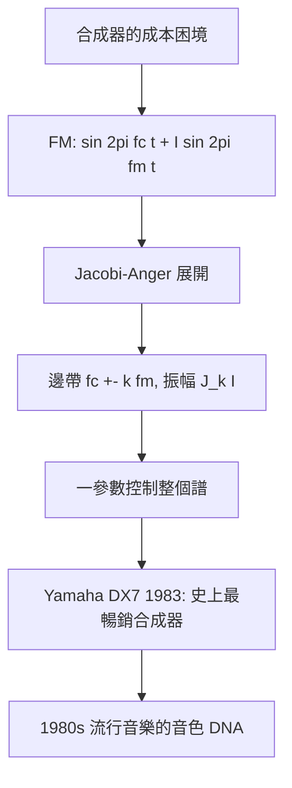

# 2.3 1973年：調頻合成與電子音樂——樂器變成方程式

## 1. 問題：如何用數學「造」出樂器的音色？

到 1970 年代，合成器（Moog, 1964）用**減法合成**：鋸齒波 + 濾波器 + 包絡。問題：

1. 要逼真模仿管弦樂，需要大量濾波器與控制參數，硬體昂貴；
2. 諧音豐富的音色（銅管、鐘、鑼）需要上百個諧波的精確控制——減法合成的參數空間低效；
3. 核心矛盾：**加法合成**（直接指定每個諧波振幅，2.2 節的逆操作）最「理論正確」但每個諧波一個振盪器，成本爆炸。

史丹佛的 John Chowning 1967 年發現（1973 年正式發表）一個反直覺的答案：**用一個振盪器調變另一個振盪器的頻率**，就能產生豐富的諧波結構。

## 2. 數學：調頻的邊帶級數

載波 $c$ 調變器 $m$ 的 FM 信號：

$$
y(t) = \sin\!\big(2\pi f_c t + I\sin(2\pi f_m t)\big)
$$

利用 Jacobi–Anger 展開（貝塞爾函數！），它嚴格等於無窮多個正弦的疊加：

$$
y(t) = \sum_{k=-\infty}^{\infty} J_k(I)\,\sin\big(2\pi (f_c + k f_m)t\big)
$$

三個工程黃金性質：

1. **邊帶在 $f_c \pm k f_m$**：諧波間隔 = 調變頻率；
2. **振幅由貝塞爾函數 $J_k(I)$ 給定**：只有**一個**參數 $I$（調變指數）控制整個譜的形狀——$I$ 從 0 增大，能量從載波流向邊帶，音色由「純音」變「明亮」；
3. **$f_m$ 為 $f_c$ 的整數倍時邊帶和諧**（樂音），非整數時出現金屬鈴聲/鐘聲（不諧和）——**和諧性成為一個比值條件**。

兩個振盪器（carrier + modulator）、兩個參數（$f_m/f_c$ 比值、$I$），即得整個音色空間——**參數空間被數學壓縮了幾百倍**。

## 3. 後果

- **DX7 與流行音樂**：Yamaha 1983 年推出 FM 合成器 DX7（數位、便宜、音色新穎），1980 年代流行樂、電視配樂的標誌性音色（bass、E.PIANO）皆出自 $f_m/f_c$ 比值表——**一條貝塞爾函數級數定義了一個世代的音樂音色**。
- **數位音效的普及**：FM 演算法簡單到可放進音效晶片——AdLib 與 Sound Blaster（OPL 晶片）讓整個 PC 遊戲時代有了音樂（任天堂、世嘉機台同源技術）。
- **合成理論的系統化**：Chowning 的「演算法（algorithm）」概念——多個振盪器以固定拓撲連接——成為合成器設計的通用語言；加法、減法、FM、粒式、物理建模（Karplus–Strong 撥弦演算法, 1983）形成譜系。

## 4. 回饋

FM 合成的成功反過來暴露並催生數學問題：

1. **反問題**：給定目標音色的譜，求 $(f_m/f_c, I)$——逆 FM 問題沒有封閉解（貝塞爾函數反演），工程上靠匹配追蹤與人工試誤，成為**稀疏逼近**（matching pursuit, 1993）的早期動機之一。
2. **參數空間的感知度量**：哪些 $(f_m/f_c, I)$ 聽起來相近？音色空間需要感知尺規（MDS 多維尺度分析）——心理聲學與統計學的交會，預告了 5.3 節「學習音色嵌入」的路線。
3. **聲音的程式化**：樂器 = 方程式 ⇒ 聲音可以被**程式碼與資料**表示——MIDI（1983，同年代！的事件語言）+ 合成演算法 = 今日所有軟體音源、遊戲即時音效、鈴聲的架構。音樂製作從硬體工藝轉為數學與資訊工程。

## 5. 延伸思考

1. FM 用「非線性調變」產生諧波——與通訊中的 FM 廣播同源數學，為何一個是「污染要避免」、另一個是「資源要開採」？（目標函數決定數學的用途）
2. 貝塞爾函數出現在 FM、圓膜振動、天線輻射（2.3 節電磁版）、熱傳——「圓對稱問題 → 貝塞爾」的數學結構，說明了什麼？（圓柱諧波的普適性）
