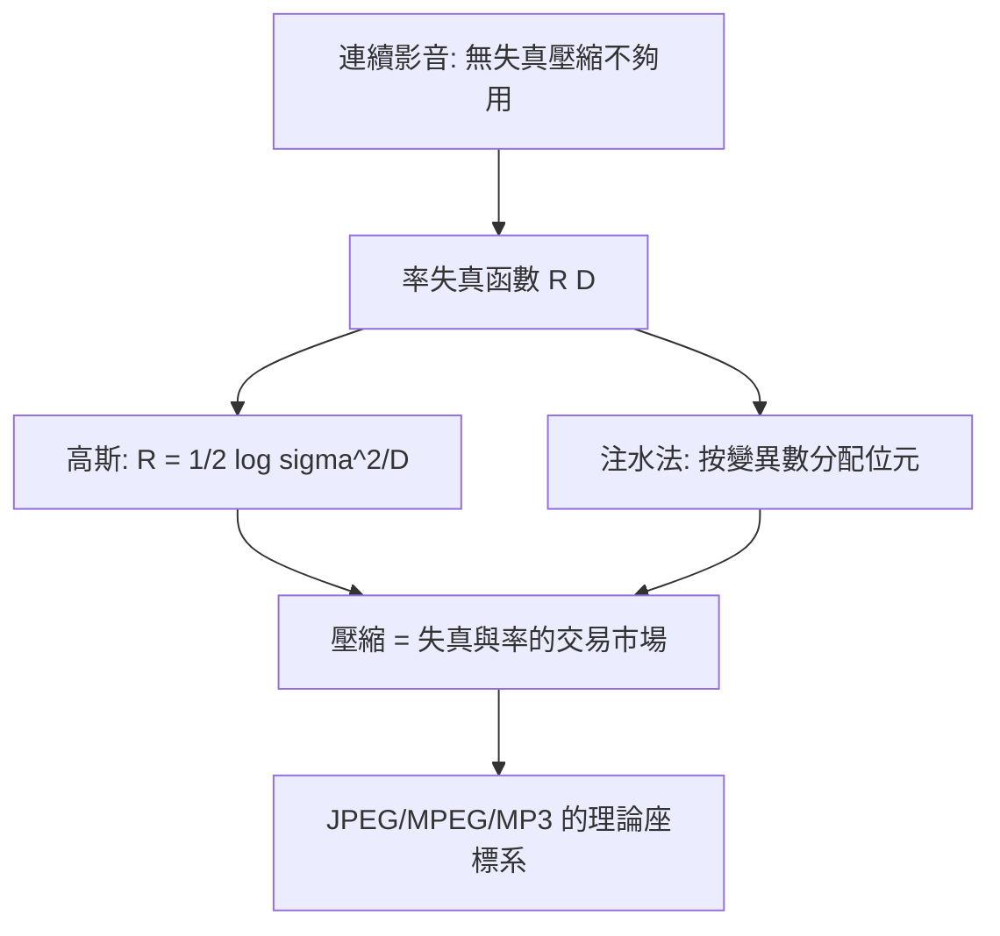

# 3.1 1948年：率失代理論——「失真」可以被交易

## 1. 問題：壓縮的極限在哪裡？

夏農 1948 年的無失真編碼定理（信源編碼）給了壓縮的第一個極限：熵 $H(X)$。但影音立刻撞上現實：

> 一張連續色調的照片、一段音樂，抽樣量化後的**熵高得驚人**（連續信號精確描述需要無限位元），無失真壓縮根本不夠用。

工程界的隱含直覺是「丟掉一點東西就能省很多位元」——但**丟多少、省多少、丟什麼最划算**，完全沒有理論。這是影音壓縮的奠基問題。

## 2. 數學：率失真函數

夏農同年在〈Coding for a Noisy Channel〉等工作中建立**率失代理論**（rate–distortion theory, 1948–59）。定義失真度量 $d(x, \hat x)$（如均方誤差 MSE），則達到失真 $D$ 所需的**最低位元率**：

$$
R(D) = \min_{p(\hat x \mid x):\; E[d(X,\hat X)] \le D} I(X; \hat X)
$$

其中 $I(X;\hat X)$ 是互資訊。三個基石定理：

1. **率失真函數是極限**：任何編碼器位元率 $\ge R(D)$，且存在編碼可任意逼近；
2. **高斯信號 + MSE** 時有封閉解：

$$
R(D) = \frac{1}{2}\log_2\frac{\sigma^2}{D} \quad (0 < D \le \sigma^2)
$$

位元率與失真的**對數—線性交換**：每省 1 bit/pixel，MSE 上升一倍；
3. **反水印/位元分配**：對多個統計獨立的成分（如變換後的係數），最優位元分配是**注水法**（water-filling）：

$$
R_i = \max\left(0,\ \frac{1}{2}\log_2\frac{\sigma_i^2}{\theta}\right)
$$

——變異數大的成分多給位元、小的少給或不給，$\theta$ 由總預算決定。**「把位元花在刀口上」從格言變成定理。**

## 3. 後果

- **影音壓縮的設計座標**：所有有損編解碼器（JPEG、MPEG、MP3、H.26x、AV1）都在 $R$–$D$ 平面上工作——「同一失真誰的位元更少」成為編碼器競賽的標準題（BD-rate 評測）。
- **變換編碼的正當化**：注水法直接預言了「先變換（去相關、集中能量）、再按係數變異數分配位元」的架構——3.2 節 DCT 的理論動機在此。
- **量化器的理論**：Lloyd–Max 量化器（1957/60）、高解析量化近似（$R \approx \frac{1}{2}\log_2 \frac{\sigma^2}{D}$ 加上形狀因子）——每個量化表都是率失真曲線上的一個取樣點。

## 4. 回饋

理論的抽象性立即遇到實作鴻溝，反向催生數學：

1. **失真該量什麼？** MSE 與人眼/耳的感知不符（1.2、2.2 節）——**加權 MSE**（感知加權濾波）、SSIM（2004）、PEAQ/PESQ 等感知指標成為新「失真函數」；理論框架不變，內涵被感知科學替換——3.3 節 MP3 的心理聲學模型本質上是「把 R(D) 的 D 換成聽覺 JND」。
2. **信號不是高斯的**：真實影像係數呈 Laplace/重尾分佈——非高斯率失真、熵約束量化（熵編碼 + 量化聯合設計）成為編碼理論主戰場。
3. **分佈未知**：實務上信號統計未知——通用信源編碼（Lempel–Ziv, 1977）證明**免於模型的壓縮**可能，而 LZ 的「字典」思想與 4.2 節影片的「參考幀」思想同構。

## 5. 延伸思考

1. $R(D)$ 說「失真必然存在」（$D>0$ 才有有限 $R$）——那「無損」JPEG 的意義是什麼？（無損是對**離散樣本**而言；從場景到樣本已失真多次）
2. 率失真是漸近理論（無限長信號）——對一張 8×8 區塊、一幀畫面，理論距離實務多遠？（有限字長、端點效應，正是 4.3 節 RDO 要補的洞）
