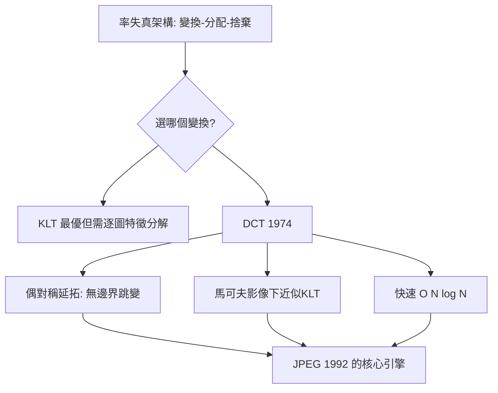

# 3.2 1974年：離散餘弦轉換DCT——影像的能量集中

## 1. 問題：影像的統計結構如何被利用？

到 1970 年代，影像傳輸（影像電話、衛星、遙測）需要壓縮，率失代理論（3.1 節）已給出架構：「變換 → 集中能量 → 捨棄小係數」。但**用哪個變換**？候選者眾多（KLT、傅立葉、Hadamard…），標準是：

1. **去相關**：變換後係數互相獨立（位元分配有效）；
2. **能量集中**：自然影像的能量擠進少數係數（丟棄的尾巴損失小）；
3. **可計算**：有快速演算法。

N. Ahmed、T. Natarajan、K. R. Rao 1974 年發表的 DCT，在這三項上達到近乎最優的實用平衡。

## 2. 數學：DCT-II 與能量集中

### 定義

$N$ 點 DCT-II：

$$
X[k] = \sum_{n=0}^{N-1} x[n]\cos\!\left[\frac{\pi}{N}\left(n + \frac{1}{2}\right) k\right]
$$

（8×8 二維版本 = 先列後行兩次一維變換，JPEG 用 $N=8$ 。）

### 為何 DCT 比傅立葉更適合影像？

關鍵在**邊界處理**。DCT 等價於把信號做**偶對稱延拓**後再做 DFT——邊界連續，因此：

1. **沒有傅立葉的週期跳躍假影**（DFT 對非週期信號會在邊界產生能量洩漏 = Gibbs/振鈴）；
2. **漸近最優性**（Jain 的分析）：對一階馬可夫過程（相鄰像素相關係數 $\rho \to 1$ ），DCT 的能量集中逼近理論最優的 KLT（Karhunen–Loève）——而 KLT 需要為每張圖算特徵向量，不可行。**DCT = 免模型的「近似 KLT」**。
3. **快速演算法**： $O(N\log N)$ ，可用 FFT 的結構（同《電的數學》3.3 節的分治思想）。

自然影像的統計事實：相鄰像素高度相關（ $\rho \approx 0.95$ ），變換後大部分區塊只剩少數低頻係數有顯著能量——**空間冗餘被變換搬到「少數大係數」裡，剩下的可以大方地丟**。

## 3. 後果

- **JPEG（1992）的引擎**：8×8 DCT + 量化 + 熵編碼——見 3.3 節；DCT 使「壓縮到 1/10 幾乎無感」成為日常。
- **影音標準的通用零件**：MPEG-1/2/4、H.261 到 H.264 的 I 幀、AVS、VP8（變體）全部使用 DCT 家族（H.264 用整數近似的 DCT）——**DCT 是三十年編解碼標準的不動核心**。
- **MP3/AAC 的時域版本**：MDCT（改良 DCT，重疊視窗）是音訊壓縮的變換核心——同一數學貫穿圖像與聲音。

## 4. 回饋

DCT 的統治地位也逼出後繼者與反思：

1. **8×8 區塊的假影**：區塊邊界不連續造成 blocking artifact（低碼率 JPEG 的方格紋）——**重疊變換**（Lapped Orthogonal Transform、MDCT 的重疊結構）與去區塊濾波（H.264 in-loop deblocking）被催生；
2. **小波的挑戰**：JPEG 2000（2000）改用離散小波（多解析度、無區塊、可漸進傳輸）——變換的選擇從「能量集中」升級為「尺度—空間局部化的權衡」（2.2 節回饋的時頻測不準）；
3. **方向性**：自然影像的邊緣有方向，DCT 的水平/垂直基不匹配——方向變換（directionlet、curvelet）與最終的**學習變換**（神經網路自學字典），把「哪個變換最好」從固定數學變成可訓練問題（5.3 節）。

## 5. 延伸思考

1. KLT 最優但不可行、DCT 可行且漸近同優——「模型的完美 vs. 結構的簡單」的取捨在哪些工程領域重演？
2. DCT 係數的統計（低頻大、高頻小、Laplace 邊際）是自然影像統計的縮影——這與視覺皮層 V1 的方向性濾波（sparse coding 理論）有何深層關聯？（自然場景統計 = 感知系統的訓練資料）
