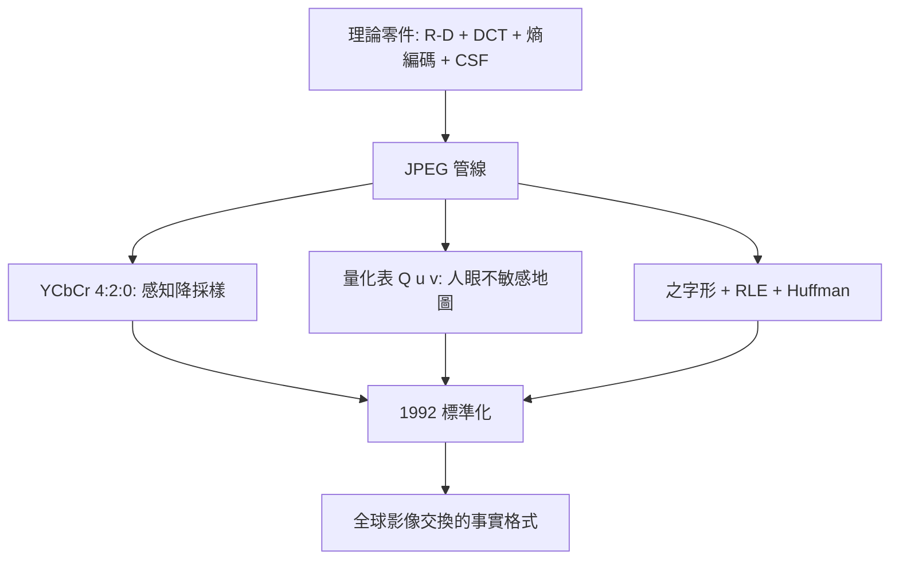

# 3.3 1992年：JPEG標準——心理視覺的量化藝術

## 1. 問題：從理論到「每個人都在用」的格式

到 1980 年代末期，理論零件齊備：率失真架構（3.1）、DCT（3.2）、熵編碼（Huffman/算術）、以及一個關鍵的科學積累——**人眼對什麼不敏感**（對比敏感度函數 CSF、掩蔽效應）。但各機構的壓縮方法互不相容，影像交換困難。

CCITT/ISO 的 JPEG 委員會（1986–1992）要把理論焊成一個**可互操作**的標準——所有決策都必須是「確定的數字表」：量化表、掃描序、碼表。

## 2. 數學：管線中的每一步都在做率失真取捨

JPEG 有損模式的管線（每張圖拆成 8×8 區塊）：

$$
\text{RGB} \to \text{YCbCr} \to \xrightarrow{\text{DCT}} F(u,v) \to \xrightarrow{\text{量化}} \hat F = \left[\frac{F}{Q}\right] \to \text{熵編碼}
$$

### (1) 顏色空間的感知降採樣

RGB → YCbCr 分離明度與色度（1.2 節 CIE 思想的工程版）；人眼對色度空間解析度不敏感 ⇒ **4:2:0 色度降採樣**（色度像素數砍 3/4），這一步幾乎無感卻省下 50% 資料。

### (2) 量化：心理視覺的位元分配

量化表 $Q(u,v)$ 實現 3.1 節的注水法，只是「變異數」被換成**對比敏感度**（CSF，人眼空間頻率響應，峰值在每度 3–5 週期，高頻急降）：

$$
\hat F(u,v) = \mathrm{round}\!\left(\frac{F(u,v)}{q\cdot Q(u,v)}\right)
$$

高頻位置的 $Q$ 大 ⇒ 捨棄多。**量化表就是一張「人眼不敏感地圖」**——JPEG 把感知心理學焊死在 64 個整數裡。品質參數 $q$ 是率失真曲線的旋鈕。

### (3) 之字形掃描 + RLE + 熵編碼

量化後大多數係數為零；DC 係數做差分（區塊間相關），AC 係數按之字形序（低頻先）做遊程編碼，最後 Huffman/算術編碼收尾——**結構冗餘 → 符號冗餘 → 無失真壓縮**的三級瀑布。

## 3. 後果

- **數位影像的普及化**：JPEG 1/10 的壓縮比 + 免費專利授權 ⇒ 數位相機（1990s）、網頁影像、掃描文件全面爆發——**網路時代的視覺語言是 JPEG**。
- **「有損但無感」的範式確立**：MP3（1993–95，同源管線：MDCT + 心理聲學模型 + Huffman）把同樣哲學帶到音訊，催生 MP3 播放器與音樂產業數位化；MPEG 帶到影片（第 4 章）。**「感知冗餘是最大的壓縮資源」成為影音工業的信條。**
- **標準化的方法論**：委員會以「測試圖 + 主觀評分 + 客觀 PSNR」選拔技術——影音工程從此以**感知實驗**為驗收標準（MOS 分數文化）。

## 4. 回饋

JPEG 的成功也暴露了「心理視覺」這一環的粗糙，反催研究：

1. **PSNR 失靈**：MSE/PSNR 與主觀品質常背離（結構失真比能量失真更礙眼）——SSIM（2004）、LPIPS（2018，學習式指標）相繼問世，**「失真函數」本身成為研究對象**（3.1 節回饋的延續）；
2. **算術編碼的專利風波**：更優的算術編碼因專利未被 JPEG 主檔採用——推動了免專利的 Huffman 變體與開源文化，也影響了 AV1 等新標準的專利策略；
3. **壓縮即特徵**：JPEG 的 DCT 係數意外成為影像分析的好特徵（隱寫分析、品質評估）；而**壓縮表示能否直接服務理解**，通往 5.3 節「表示學習」的路線——壓縮與智能的深層同構（Hutter 獎、率失真直覺的機器學習版）。

## 5. 延伸思考

1. JPEG 把「人眼模型」凍結在標準裡——若顯示器變成 HDR 高動態、超高解析，量化表的感知假設還成立嗎？（JPEG XL 的重造動機）
2. 量化丟掉的資訊不可逆——但 5.3 節的生成模型可以「編」回細節。壓縮的哲學從「還原」轉向「逼真重造」，率失代理論需要怎樣的擴充？（感知失真 vs. 分佈距離：perceptual compression 的 R(D) 新解）
