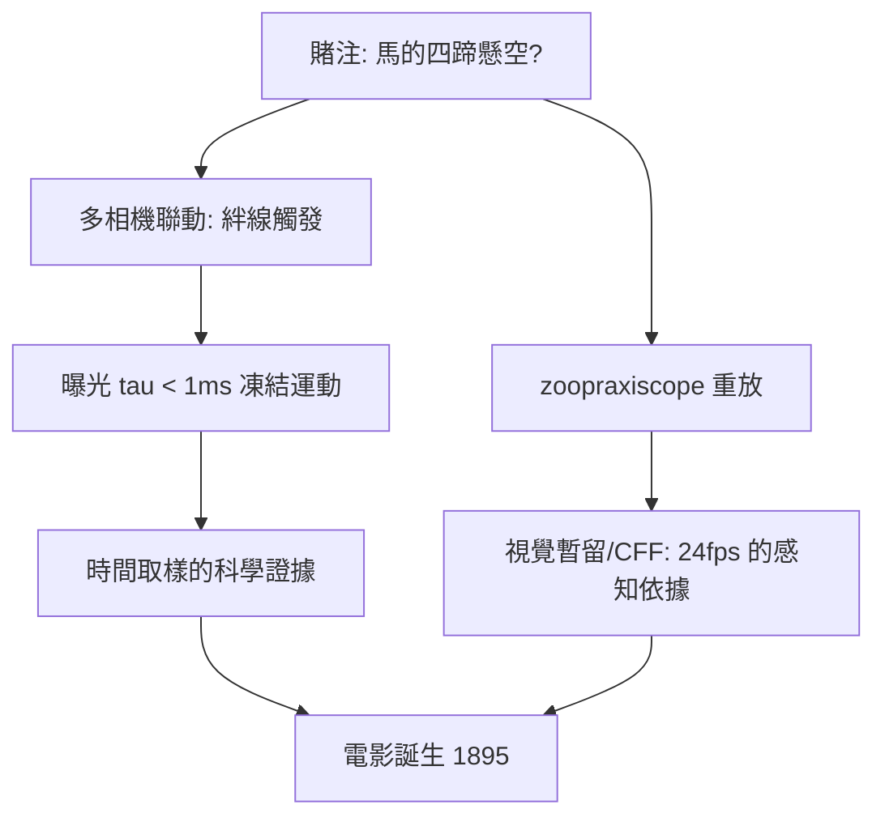

# 4.1 1878年：奔馬攝影與電影的誕生——時間被離散化

## 1. 問題：馬奔跑時四蹄同時離地嗎？

1872 年，加州州長 Leland Stanford 賭馬的問題（馬奔馳時是否存在四蹄懸空的瞬間）交給攝影師 Eadweard Muybridge。當時攝影底片感光太慢（秒級曝光），快速運動只拍出一團模糊——**時間維度的解析度不足**。

這是「時間被離散化」的第一個科學工程問題：

> 運動是連續的，多快的取樣（幀率）才能「凍結」並「重放」運動？

## 2. 數學：高幀率取樣、頻閃與視覺暫留

### (1) 時間抽樣：凍結運動

曝光時間 $\tau$ 決定動態模糊：速度 $v$ 的物體模糊量 $\approx v\tau$ 。要凍結馬腿（ $v \approx 15$ m/s）需 $\tau < 1$ ms——Muybridge 1878 年在 Palo Alto 以**多機聯動**（12–24 台相機，賽馬絆線觸發，快門 $\tau \approx 1/1000$ s）拍到著名的〈The Horse in Motion〉：**四蹄同時離地的瞬間確實存在**。

這正是 1.3 節抽樣定理的時間版：取樣間隔（幀距）與曝光（積分核）共同決定時間維度的資訊量。

### (2) 重放：頻閃融合

靜止圖像序列要被大腦「看成運動」，條件是幀率高於**臨界融合頻率**（CFF ≈ 60 Hz，暗部更低）且相鄰幀位移小於可容忍混淆——電影 24 fps 是「足夠融合 + 底片經濟 + 機械快門可行」的妥協（配三葉遮光板把閃爍率提到 72 Hz）。

Muybridge 1879 年的 zoopraxiscope（活動投影機）完成了「取樣 → 重放」閉環；1888 年 Le Prince 單機連續攝影、1895 年 Lumière 兄弟的 Cinématographe 使電影成為工業。

## 3. 後果

- **電影工業**：敘事影片（Méliès 1896 起）、蒙太奇語言——時間的離散化讓人類第一次可以**剪輯時間**。
- **科學的運動分析**：生理學（人體步態）、動物力學、彈道——高速攝影成為科學儀器；今日的運動捕捉（motion capture）是 Muybridge 的演算法版。
- **電視與視訊**：掃描標準（Nipkow 圓盤 1884 → 1930–40 年代電子電視）把「幀 + 行」的二維離散化制度化，直通 4.2 節的視訊編碼。

## 4. 回饋

電影的時間取樣立即暴露兩個數學缺口：

1. **24 fps 的運動混淆**：車輪倒轉（wagon-wheel effect）= 時間混疊（1.3 節的頻域解釋）；攝影機快門的 $\theta=180°$ 慣例（ $\tau = T/2$ ）則是用**運動模糊**當抗混淆濾波——缺陷被制度化為美學；
2. **頻閃偽影對抗高幀率**：LED 燈/螢幕與攝影機幀率的拍頻（beating）問題——頻閃數學成為照明工程的一部分；
3. **插幀與運動估計**：把 24 fps 提升到 60/120 fps 需要「在幀之間補出中間畫面」——必須估計像素的**運動場**（optical flow），這正是 4.2 節運動補償的數學前身：**電影美學的需求（高幀率）預先發明了視訊壓縮的核心工具（光流）。**

## 5. 延伸思考

1. 24 fps + 運動模糊 = 「電影感」；高幀率（HFR，如 48/120 fps）反而「太真」令部分觀眾不適——時間取樣密度與美學文化如何互鎖？
2. Muybridge 的賭注問題靠「取樣」回答——凡是「瞬間是否存在」的科學爭議（子彈穿蘋果、核爆起始毫秒），都變成取樣問題嗎？極限在哪？
