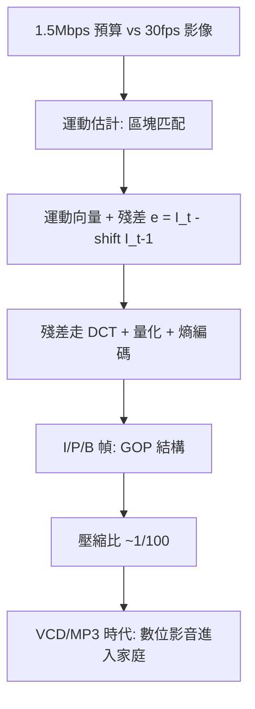

# 4.2 1993年：MPEG-1與運動補償預測——影片的時間冗餘

## 1. 問題：一秒影片 = 30 張 JPEG，但儲存與網路都不夠

JPEG（3.3 節）把單張影像壓到 ~1/10，但影片是 25–30 幀/秒：若逐幀 JPEG（Motion-JPEG），一部 90 分鐘電影仍需數十 GB——1990 年代初的 CD-ROM（650 MB）與 1.5 Mbps 網路完全裝不下。目標：把「VHS 品質影片」塞進 1.5 Mbps（MPEG-1 的設計點）。

關鍵資源是**時間冗餘**：相鄰幾乎相同——一幀之間，只有物體移動了。問題的數學形式：

> 如何把「逐像素傳送下一幀」升級為「傳送物體的移動量」？

## 2. 數學：運動補償預測與 I/P/B 幀

### (1) 運動估計：區塊匹配

把幀切成 16×16 巨區塊，在參考幀的搜尋窗內找最像的位置，得到**運動向量** $(u, v)$ ：

$$
(u^*, v^*) = \arg\min_{(u,v)} \sum_{(x,y)} \big|I_t(x,y) - I_{t-1}(x+u, y+v)\big|
$$

（SAD/SSD 失真；搜尋用三步法、菱形法等啟發式控制計算量。）這是**光流**（optical flow，Horn–Schunck 1981 的變分問題 $\int (I_x u + I_y v + I_t)^2 + \lambda|\nabla u|^2$ 的離散工程版）的區塊化簡化——**精確光流太貴，粗糙光流夠用**。

### (2) 預測誤差 + DCT

真正編碼的是**殘差**： $e = I_t - \text{shift}(I_{t-1}, (u,v))$ ，殘差遠比原圖稀疏，再走 JPEG 式 DCT + 量化（3.2–3.3 節全套）。傳送的內容從「一張圖」變成「一組向量 + 一點誤差」。

### (3) 幀類型與 GOP

- **I 幀**（intra）：獨立編碼（JPEG 式），是隨機存取/換台/糾錯的錨；
- **P 幀**（predicted）：參考前幀，運動補償 + 殘差；
- **B 幀**（bidirectional）：前後雙向內插預測，壓縮率最高但增加延遲與複雜度——**碼率、延遲、隨機存取的三方權衡**顯式進入碼流語法。

GOP（如 IBBPBBP…）把時間冗餘的開採結構化。

## 3. 後果

- **MPEG-1（1993）→ MP3 的溫床**：MPEG-1 的音訊層 III 即 MP3——**影片壓縮的專案孕育了音樂革命的格式**。
- **MPEG-2（1994–95）與數位電視/DVD**：交錯掃描支援、更高解析——廣播與儲存的數位化一夕完成；HDTV 的基礎。
- **運動補償成為影片壓縮的永久核心**：H.263/264/265/AV1 的架構骨架三十年未變——變的是搜尋精度（整像素→1/4 像素→仿射）、幀內預測的方向數、與環內濾波。

## 4. 回饋

運動補償的成功暴露新數學問題，塑造了後續二十年：

1. **預測誤差的統計**：殘差分佈（Laplace、重尾）使固定量化次優——自適應量化與 4.3 節 RDO 登場；
2. **誤差傳播**：一個 P 幀的錯誤沿 GOP 擴散直到下個 I 幀——**預測編碼的脆弱性**催生了 slice、錯誤恢復、FEC 與流媒體的自適應碼率（ABR, HLS/DASH）設計；
3. **亞像素精度**：整像素匹配後仍殘餘大誤差 ⇒ 半像素/四分之一像素內插（插值核的設計 = 1.3 節 sinc 的實務版）——取樣理論在壓縮器內部重演；
4. **「編碼 ≠ 還原」的哲學終點**：運動向量是**解釋**（哪裡動了）而非**描述**（像素值）——影片壓縮悄悄從訊號處理走向「生成」：告訴解碼器「前一幀 + 這樣移動 + 這些差異」，正是 5.3 節生成模型（video prediction、光流引導生成）的思想前身。

## 5. 延伸思考

1. 區塊匹配的 SAD 最小 ≠ 人眼覺得對（遮擋、透明、旋轉都會失敗）——為何「錯的模型」統治三十年？（計算成本與碼流相容性的鎖定效應）
2. GOP 結構 = 位元預算在時間軸上的分配——這與 3.1 節注水法同構嗎？把 I 幀當「基建投資」、P/B 幀當「流量支出」，碼率控制就是投資組合問題？
