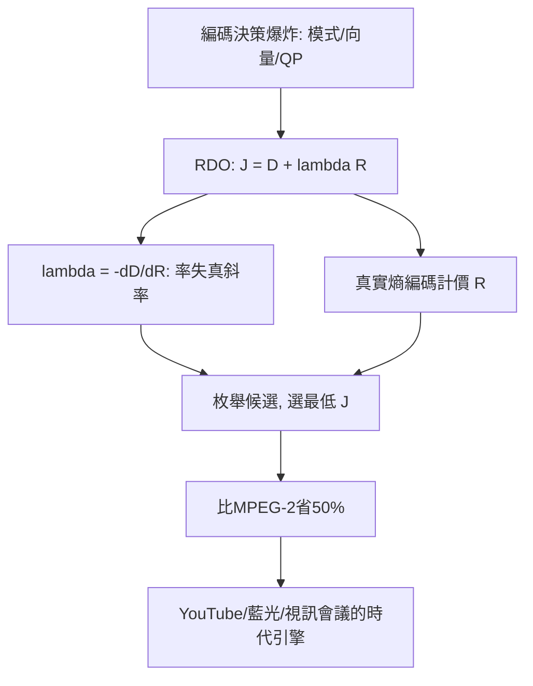

# 4.3 2003年：H.264與率失真最佳化——每個位元都要有理由

## 1. 問題：編碼決策太多了，誰來做決定？

到 2000 年代，視訊編碼器內的**決策爆炸**：每個區塊要選——幀內 or 幀間？用哪個參考幀？哪個運動向量？哪種分割（16×16/16×8/8×16/8×8/…）？幀內預測用哪個方向？量化參數是多少？——決策樹的組合數達天文數字。

MPEG-2 時代這些大多靠啟發式（固定門檻、經驗規則）。但 H.264/AVC（ITU-T/ISO, 2003）的目標是比 MPEG-2 省 50% 位元——**靠更聰明的工具 + 更系統的決策**。系統決策的數學就是率失真最佳化（RDO）。

## 2. 數學：拉格朗日率失真最佳化

### (1) 拉格朗日鬆弛

把「在位元預算下最小化失真」的約束最佳化轉為無約束：

$$
\min_{\text{模式}}\; J = D + \lambda\, R
$$

$\lambda$ 是碼率—失真的匯率：每多花一個位元，必須換來超過 $\lambda$ 的失真改善才算划算。理論上 $\lambda = -\frac{dD}{dR}$（率失真曲線斜率，3.1 節的直接回歸）。

### (2) 率的精確計算：真實熵

與 MPEG-2 不同，H.264 的 RDO 用**實際熵編碼後的位元數**（不是近似模型）：

$$
R = R_{\text{熵編碼}}(\text{語法元素}), \qquad D = \mathrm{SAD} \text{ 或 } \mathrm{SSD} \text{（或 SATD）}
$$

對每個候選模式真的編碼一次、量一次——**枚舉 + 誠實計價**。這使 H.264 編碼器計算量暴增（比解碼貴 10–100 倍），但換來 50% 的增益：**壓縮的進步開始由「編碼端的算力」支付**。

### (3) 全域結構：碼率控制與 GOP 級 RDO

各區塊的 $\lambda$ 隨幀類型、複雜度、緩衝區狀態調整（HRD 一致性約束下的動態規劃思想）——**位元預算在時空上的最優分配**。

## 3. 後果

- **H.264 成為影音史上最成功的標準**：YouTube（2005 起）、藍光、視訊會議、行動串流——直到今日仍是兼容性之王。
- **編解碼器 = 搜尋演算法**：編碼器的優劣（x264 的競品差距）主要來自搜尋與 RDO 的工程效率，而非碼流語法——**「標準規定解碼、不規定編碼」**的結構確立，催生了編碼器開源競賽（x264/x265/libvpx/libaom）。
- **HEVC（2013）/VVC（2020）的續作**：更大區塊（CTU 64）、更多方向、四叉樹分割——RDO 框架不變、搜尋空間指數膨脹、以並行硬體扛計算量；AV1 用感知失真（PSNR 之外加 SSIM/PSY 項）直接修改 $D$ 的定義——**3.1 節「失真函數」的工程化完成閉環**。

## 4. 回饋

RDO 的成功反哺並改寫了上游理論與下游應用：

1. **複雜度成為一維**：$J = D + \lambda R$ 隱含「計算免費」，但硬體不是——**複雜度約束的 RDO**（complexity-constrained coding）把運算量納入目標，直通行動裝置時代的即時編碼設計；
2. **感知 RDO**：SSIM/學習指標進入 $D$ 項（AV1 的 psycho visual optimizations）——率失代理論的「失真」徹底感知化（3.1/3.3 節回饋的匯流）；
3. **機器學習入侵**：RDO 的模式決策本質是分類/搜尋問題——神經網路做快速模式決策、CNN 去區塊/超解析進入碼流後端、甚至端到端學習式編解碼器（neural codecs, 2018–，學出「變換 + 量化 + 熵模型」）直接把 3.1 節的整個架構變成可訓練目標（率失真損失 $L = D + \lambda R$ 的梯度下降版）——**RDO 從編碼器的決策規則升格為神經網路的損失函數**，通往 5.3 節。

## 5. 延伸思考

1. RDO 枚舉的每個候選都要「試編碼」——這與強化學習的 rollout、模型預測控制的滾動求解同構嗎？編碼器是否是一個「感知—決策系統」？
2. x264 社群以測試集 BD-rate 為單一目標迭代十年，增益超越理論預期——當優化目標與人眼脫節（如暗場噪聲），「最佳編碼器」會最佳化出什麼怪異行為？（Goodhart 定律的編碼版）
