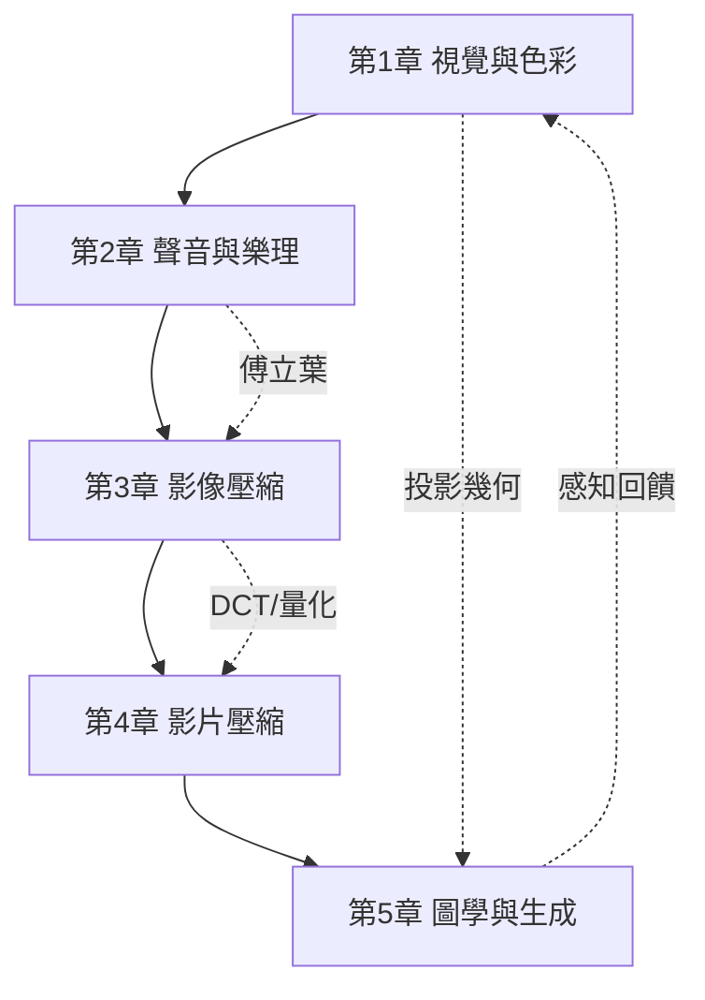

# 影音與數學

從透視法到擴散模型——一本以「影音 ⇄ 數學」互相驅動為主軸的教科書。影像、影片、音樂的本質是訊號與幾何；JPEG、MPG、MP3 是把人類感知的「冗餘」用數學剝掉的工程。全書追問同一個問題：**人如何感知，機器就如何計算。**

## 目錄

* 第1章-視覺與色彩的數學基礎
    * [1.1-1435年：透視法與投影幾何——圖像的空間語言](01.1-1435年透視法與投影幾何——圖像的空間語言.md)
    * [1.2-1931年：CIE色度學——顏色的三維向量空間](01.2-1931年CIE色度學——顏色的三維向量空間.md)
    * [1.3-1949年：抽樣定理與人眼解析度——連續世界如何變成像素](01.3-1949年抽樣定理與人眼解析度——連續世界如何變成像素.md)
* 第2章-聲音與樂理的數學
    * [2.1-1722年：十二平均律——把音階變成對數](02.1-1722年十二平均律——把音階變成對數.md)
    * [2.2-1822年：傅立葉級數與音色——樂音的和弦分解](02.2-1822年傅立葉級數與音色——樂音的和弦分解.md)
    * [2.3-1973年：調頻合成與電子音樂——樂器變成方程式](02.3-1973年調頻合成與電子音樂——樂器變成方程式.md)
* 第3章-影像壓縮：JPEG的數學
    * [3.1-1948年：率失代理論——「失真」可以被交易](03.1-1948年率失代理論——失真可以被交易.md)
    * [3.2-1974年：離散餘弦轉換DCT——影像的能量集中](03.2-1974年離散餘弦轉換DCT——影像的能量集中.md)
    * [3.3-1992年：JPEG標準——心理視覺的量化藝術](03.3-1992年JPEG標準——心理視覺的量化藝術.md)
* 第4章-影片壓縮：MPEG的時間維度
    * [4.1-1878年：奔馬攝影與電影的誕生——時間被離散化](04.1-1878年奔馬攝影與電影的誕生——時間被離散化.md)
    * [4.2-1993年：MPEG-1與運動補償預測——影片的時間冗餘](04.2-1993年MPEG-1與運動補償預測——影片的時間冗餘.md)
    * [4.3-2003年：H.264與率失真最佳化——每個位元都要有理由](04.3-2003年H.264與率失真最佳化——每個位元都要有理由.md)
* 第5章-計算機圖學與生成式影音
    * [5.1-1963年：Sketchpad與電腦圖學的誕生——矩陣變換的工業化](05.1-1963年Sketchpad與電腦圖學的誕生——矩陣變換的工業化.md)
    * [5.2-1986年：渲染方程——光線傳輸的積分方程](05.2-1986年渲染方程——光線傳輸的積分方程.md)
    * [5.3-2014年：GAN與擴散模型——影音的生成轉向](05.3-2014年GAN與擴散模型——影音的生成轉向.md)

## 閱讀路線

## 本書的方法論

每節遵循同一敘事結構：

1. **問題**：當時的感知/藝術/工程困境是什麼？
2. **數學**：什麼數學被發明或引入？
3. **後果**：如何改變了影音技術？
4. **回饋**：技術的反省如何催生新數學？
