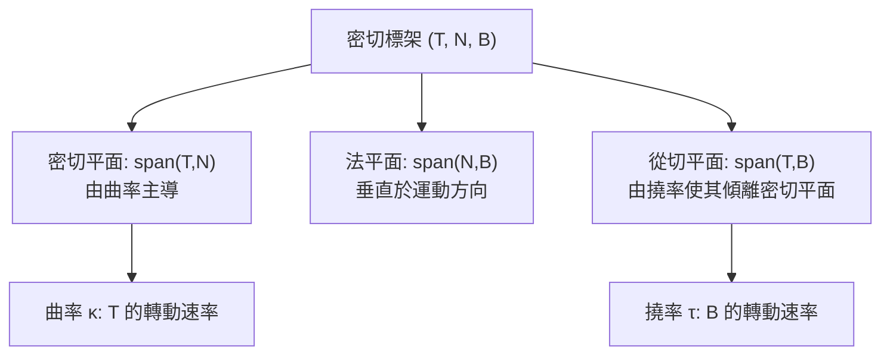

# 1.2 弧長、曲率與撓率

## 導言：如何量化「彎」？

參數化給了我們描述曲線的語言，但「這條曲線彎得多厲害？朝哪個方向彎？」需要量化的答案。本節建立曲線論的三大幾何量：**弧長**（長度）、**曲率**（偏離直線的程度）、**撓率**（偏離平面的程度）。這三個量在參數變換下不變，是曲線的真正幾何不變量。

---

## 弧長

### 定義

設 $\gamma : [a,b] \to \mathbb{R}^n$ 是 $C^1$ 曲線。把區間分割 $a = t_0 < t_1 < \cdots < t_N = b$ ，取折線長度

$$
L(P) = \sum_{i=1}^{N} |\gamma(t_i) - \gamma(t_{i-1})|
$$

弧長定義為所有折線長度的上確界：

$$
L = \sup_P L(P)
$$

當 $\gamma$ 是 $C^1$ 時，此上確界存在且等於積分：

$$
L = \int_a^b |\gamma'(t)|\, dt
$$

### 證明概要

由均值不等式（多變量微積分的 MVT），存在 $\xi_i \in (t_{i-1}, t_i)$ 使

$$
|\gamma(t_i) - \gamma(t_{i-1})| \leq \int_{t_{i-1}}^{t_i} |\gamma'(\tau)|\, d\tau
$$

求和得上界；再利用 $\gamma'$ 的一致連續性證明下界收斂到同一積分。細節見任一分析教科書，此處強調方法論：**「折線逼近」是幾何量用積分定義的原型**——面積用小矩形逼近、曲面面積用小切平面逼近（2.2 節）、都循此模式。

### 弧長的性質

- **可加性**： $L([a,c]) + L([c,b]) = L([a,b])$ 。
- **參數不變性**：在 $\tilde\gamma = \gamma \circ \phi$ 之下，由變數變換公式 $L$ 不變。這是必須用 $|\gamma'|dt$ （而非 $dt$ ）作為「長度元素」的原因。
- **非負性與單調性**：子弧長不超過全弧長。

---

## 曲率

### 動機

比較兩條曲線在同一点的彎曲程度，直觀的辦法是：走同樣的弧長，看切方向轉了多少角度。令 $\Delta\theta$ 為切向量在弧長 $\Delta s$ 內轉過的角度，定義

$$
\kappa = \lim_{\Delta s \to 0} \frac{\Delta\theta}{\Delta s}
$$

即「單位弧長的方向變化率」。

### 分析定義

設 $\gamma$ 以弧長參數 $s$ 表示，單位切向量 $\dot\gamma = d\gamma/ds$ ，因 $|\dot\gamma| = 1$ 恆成立， $\ddot\gamma$ 與 $\dot\gamma$ 垂直（對 $|\dot\gamma|^2 = 1$ 微分即得 $2\dot\gamma \cdot \ddot\gamma = 0$ ）。定義

$$
\boxed{\ \kappa(s) = \left|\ddot\gamma(s)\right|\ }
$$

對一般參數 $t$ ，公式為

$$
\kappa(t) = \frac{|\gamma'(t) \times \gamma''(t)|}{|\gamma'(t)|^3} \quad (\text{平面與空間適用})
$$

平面情形的分量形式：

$$
\kappa = \frac{|x'y'' - y'x''|}{\left(x'^2 + y'^2\right)^{3/2}}
$$

### 有號曲率

平面曲線可以區分「左彎」與「右彎」，定義

$$
k(s) = \langle \dot T, \dot n \rangle
$$

其中 $n$ 是把 $T$ 逆時針旋轉 $90°$ 所得的法向量。直觀上： $\kappa$ 是彎的「量」， $k$ 是彎的「量與方向」。空間曲線沒有天然的左右之分，故只用非負曲率。

### 曲率的直觀例證

| 曲線 | 曲率 | 半徑關係 |
|---|---|---|
| 直線 | $0$ | $\infty$ |
| 半徑 $R$ 的圓 | $1/R$ | $\rho = R$ |
| 螺旋線 $(a\cos t, a\sin t, bt)$ | $a/(a^2+b^2)$ | 密接圓半徑 |
| 抛物線 $y = x^2$ 在原點 | $2$ | $\rho = 1/2$ |

**曲率半徑** $\rho = 1/\kappa$ ：過曲線上一點、與曲線二階接觸的圓（密接圓）的半徑。曲率越大，密接圓越小。

---

## 撓率

### 動機

平面曲線只需要曲率；空間曲線還可以「扭出平面」。考慮兩條曲率完全相同的空間曲線：一條是平面圓，一條是螺旋線。區別在於後者的密切平面隨弧長轉動。

### 定義

以弧長參數表示，若 $\kappa > 0$ ，定義單位主法向量

$$
N = \frac{\ddot\gamma}{|\ddot\gamma|}, \qquad B = T \times N
$$

$T, N, B$ 構成右手正交標架（密切標架）。 $B$ 稱為**副法向量**，其方向標記密切平面。定義撓率

$$
\boxed{\ \tau(s) = -\left\langle \frac{dB}{ds},\ N \right\rangle\ }
$$

（有些書不取負號，符號約定需留意。）撓率量度密切平面的旋轉速率。

### 基本性質

- $\tau \equiv 0$ ⟺ 曲線落在某平面上（平面曲線的特徵）。
- $\tau$ 可以為正、負或零；螺旋線 $\tau = b/(a^2+b^2)$ ，右旋螺絲為正。
- $\kappa = 0$ 的點上撓率無定義（因 $N$ 未定義）。

### 幾何直觀：三個平面的分工

- **密切平面**（osculating plane）：由 $T$ 與 $N$ 張成，是曲線在該點「最貼近」的平面。
- **法平面**（normal plane）：垂直於 $T$ ，質點的向心加速度落在其中。
- **從切平面**（rectifying plane）：由 $T$ 與 $B$ 張成。

---

## 曲率與撓率的計算技巧

### 對任意參數的撓率公式

$$
\tau = \frac{\det\big(\gamma', \gamma'', \gamma'''\big)}{|\gamma' \times \gamma''|^2}
$$

此公式只需對 $t$ 微分三次，避免先化為弧長參數，實用性高。

### 分子分母的記憶法

曲率公式的分子 $|\gamma' \times \gamma''|$ 量度「二階彎曲」，分母 $|\gamma'|^3$ 修正參數速度；撓率公式的分子是三重積（三階資訊），分母 $|\gamma' \times \gamma''|^2$ 恰為曲率資訊的平方。兩個公式合起來告訴我們：**曲率是二階量、撓率是三階量**。

---

## 例題

### 例題 1：計算螺旋線的曲率與撓率

設 $\gamma(t) = (a\cos t,\ a\sin t,\ bt)$ 。

**曲率**：

$$
\gamma'(t) = (-a\sin t,\ a\cos t,\ b), \qquad \gamma''(t) = (-a\cos t,\ -a\sin t,\ 0)
$$

$$
\gamma' \times \gamma'' = (ab\sin t,\ -ab\cos t,\ a^2)
$$

$$
|\gamma' \times \gamma''| = \sqrt{a^2b^2 + a^4} = a\sqrt{a^2+b^2}, \qquad |\gamma'|^3 = (a^2+b^2)^{3/2}
$$

$$
\kappa = \frac{a\sqrt{a^2+b^2}}{(a^2+b^2)^{3/2}} = \frac{a}{a^2+b^2}
$$

**撓率**：三重積

$$
\det(\gamma', \gamma'', \gamma''') = \begin{vmatrix} -a\sin t & a\cos t & b \\ -a\cos t & -a\sin t & 0 \\ a\sin t & -a\cos t & 0 \end{vmatrix} = b\,(a^2\sin^2 t + a^2\cos^2 t) = a^2 b
$$

（沿第三列展開。）因此

$$
\tau = \frac{a^2 b}{a^2(a^2+b^2)} = \frac{b}{a^2+b^2}
$$

**驗證極限**： $b \to 0$ 時螺旋線退化為平面圓， $\kappa \to 1/a$ 、 $\tau \to 0$ 。✓ $a \to 0$ 時退化為直線， $\kappa \to 0$ 。✓

### 例題 2：拋物線 $y = x^2$ 的曲率

參數化 $\gamma(x) = (x, x^2)$ ：

$$
\kappa = \frac{|1\cdot 2 - 1\cdot 0|}{(1 + 4x^2)^{3/2}} = \frac{2}{(1+4x^2)^{3/2}}
$$

在頂點 $x=0$ 曲率最大（ $\kappa = 2$ ，密接圓半徑 $1/2$ ），向兩側遞減趨於 0——拋物線在無窮遠處趨於直線。此式在光學設計（抛物面鏡焦點性質）與道路設計（緩和曲線）中直接可用。

---

## 存在唯一性：曲線由曲率與撓率決定

### 陳述

設 $\kappa(s) > 0$ 與 $\tau(s)$ 是區間 $I$ 上的連續函數。則存在弧長參數曲線 $\gamma(s)$ ，其曲率為 $\kappa$ 、撓率為 $\tau$ ，且在剛體運動（平移＋旋轉）的意義下唯一。

### 證明思路

這是一階線性常微分方程組的解的唯一性應用：Frenet 方程（1.3 節）

$$
\frac{d}{ds}\begin{pmatrix} T \\ N \\ B \end{pmatrix} = \begin{pmatrix} 0 & \kappa & 0 \\ -\kappa & 0 & \tau \\ 0 & -\tau & 0 \end{pmatrix} \begin{pmatrix} T \\ N \\ B \end{pmatrix}
$$

是 $3\times 3$ 正交矩陣值函數的 ODE，由 Picard–Lindelöf 定理，給定初始標架後解存在唯一；再積分 $\dot\gamma = T$ 得曲線。剛體運動不改變 $\kappa, \tau$ ，反之亦然。

### 意義

這條定理（常稱 fundamental theorem of the theory of space curves）說：** $\kappa(s)$ 與 $\tau(s)$ 是曲線的完備不變量系統**——曲線的一切內蘊形狀資訊都裝在這兩個函數裡。同樣的哲學在曲面論中演變為 Gauss–Bonnet 定理（第 3 章）與 Riemann 幾何中「度量決定曲率」的主題（第 5、6 章）。

---

## 歷史背景

### 曲率的誕生

- **1665–1666**，牛頓在瘟疫年期間發展出曲率的初步概念；他在《原理》(1687) 中以密切圓處理行星軌道的向心力，曲率半徑是萬有引力平方反比律證明的關鍵道具。
- **1691 年**，萊布尼茨與惠更斯獨立提出密切圓思想；惠更斯更早在 1659 年已完成曲率半徑的計算（《鐘擺論》，1673 出版）。
- **1736 年**，尤拉引入以弧長為參數的曲率公式 $k = d\theta/ds$ ，確立平面曲率理論。
- **1820 年代**，法國工程師學派（Frenet 1847、Serret 1851，還有更早的 Lancret 1806 對撓率的直觀描述）完成空間曲線的標架理論。Frenet 是軍醫出身，在醫院值班之餘完成論文——數學史上著名的業餘成就。

### 解決了什麼

曲率把「彎」從主觀印象變成可計算的數；撓率解決了空間曲線分類問題： $\kappa$ 與 $\tau$ 兩個函數完全分類空間曲線（在剛體運動下）。

### 引發的新問題

- 曲線可以由兩個數量函數分類；曲面呢？曲面有無窮多個自由度，需要全新的語言——第一、第二基本形式（2.2、3.3 節）。
- 「標架沿曲線的變化方程」直接啟發了活動標架法（Cartan, 1900 年代），成為現代微分幾何與規範場論（9.3 節）的核心工具。

---

## 與其他領域的關聯

### 向量微積分

曲率公式本質上是叉積與二階導數的應用；密切平面是向量值函數泰勒展開的前兩項：

$$
\gamma(s_0 + \Delta s) = \gamma(s_0) + \dot\gamma\, \Delta s + \tfrac{1}{2}\ddot\gamma\, \Delta s^2 + o(\Delta s^2)
$$

一階項沿切線、二階項沿主法線——「曲線局部上是一段拋物線」。

### 物理學

- 牛頓第二運動定律：等速圓周運動的向心加速度 $a = v^2\kappa$ 。曲率直接出現在力學方程中。
- 梁的彎曲理論（Euler–Bernoulli beam）：應變能正比於曲率平方 $\int \kappa^2 ds$ ，這是土木工程撓度分析的基礎。
- 廣義相對論中，質點的世界線是測地線（8.1 節），其四維曲率對應感受到的重力加速度。

### 算子理論

Frenet 矩陣

$$
\begin{pmatrix} 0 & \kappa & 0 \\ -\kappa & 0 & \tau \\ 0 & -\tau & 0 \end{pmatrix}
$$

是反對稱矩陣，屬於李代數 $\mathfrak{so}(3)$ ；標架演化是矩陣指數流。這是李群–李代數關係（10.2 節）最單純的例子；量子力學中自旋在磁場中的進動方程（Bloch 方程）與 Frenet 方程數學結構完全相同。

### 量子力學

電子在晶格中的行進可以視為波包沿「曲率空間」的運動（Berry 相位，1984），Berry 相位在數學上是 holonomy（6.1 節）的一維版本——曲率與相位的聯繫從本節就埋下伏筆。

---

## 小結

1. 弧長以折線逼近定義， $L = \int |\gamma'| dt$ ，參數不變。
2. 曲率 $\kappa = |\ddot\gamma|$ （弧長參數），量度偏離直線的程度；曲率半徑 $\rho = 1/\kappa$ 。
3. 撓率 $\tau = -\langle \dot B, N\rangle$ ，量度偏離平面； $\tau \equiv 0$ ⟺ 平面曲線。
4. $\kappa(s), \tau(s)$ 完備分類空間曲線（剛體運動意義下）。
5. 活動標架的思想——攜帶一個沿曲線演化的座標系——是 Cartan 方法與規範理論的種子。

下一節把 $d/ds$ 作用在標架上，寫出整潔的 Frenet–Serret 方程組。

---

## 深入研習：曲率理論的進階主題

1. **平面曲線的符號曲率與旋轉指數**：平面曲線的切向量沿閉路繞行一周的總轉角是 $2\pi$ 的整數倍——**旋轉指數（rotation index）**。Whitney–Graustein 定理：正規閉曲線的旋轉指數 $= 1 + \frac{1}{2\pi}\int k\,ds$ 對同倫類不變。**有號曲率的積分是拓樸量**——Gauss–Bonnet（3.2 節）的一維預演。

2. **四頂點定理**：閉凸平面曲線至少有四個頂點（曲率極值點；Mukhopadhyaya 1909）。這條「優雅而意外」的定理是**離散–連續對應**（discrete–smooth analogies）研究的起點，也是仿射幾何、凸幾何的樞紐；其推廣（六頂點定理、空間版）至今活躍。

3. **曲率的總量約束**：Fenchel 定理（1929）：閉空間曲線的總曲率 $\int\kappa\,ds \geq 2\pi$ ，等號當且僅當凸平面曲線。Fáry–Milnor 定理（1950）：扭結的總曲率 $\geq 4\pi$ ——**「打結需要更多的彎」**！這是拓樸（扭結類型）通過分析量（曲率積分）表現的第一批嚴格定理，是 3.2 節 Gauss–Bonnet 精神的一維版本。

4. **扭結的能量泛函**：Freedman–He–Wang（1994）定義 $\int\kappa^2 ds$ 型能量，其極小化流可用於扭結分類；O'Hara 能量在數值扭結理論中成為「最圓扭結」的標準——**曲率平方積分 = 幾何的「緊繃度量」**，與彈性桿理論（Elastica，Euler 1744）同源。

5. **撓率的符號與手性**：右旋螺旋線 $\tau > 0$ 、左旋 $\tau < 0$ ——撓率是**手性（chirality）的數學指標**。生物學中 DNA 超螺旋（linking number = twist + writhe，White–Calugareanu 定理 1968–71）用這套語言量化：**拓樸量（linking）= 幾何量（twist、writhe）的組合**——分子生物學直接借用曲線微分幾何。

6. **Napier–Lancret 與廣義螺旋線的力學**：廣義螺旋線（ $\kappa/\tau$ 常數）的特徵是「存在常方向的切向量」。物理對應：粒子在均勻磁場中的運動（Lorentz 力 $F = qv \times B$ ）軌跡正是廣義螺旋線（漂移速度 + 螺旋）——**托克馬克中帶電粒子的約束軌道理論**建立在此。

7. **數值曲率估計**：離散點列的曲率估計（外接圓法： $\kappa \approx 4\,\mathrm{Area}(\triangle)/(|ab||bc||ca|)$ ）是曲線擬合、邊緣偵測的基礎。**收斂階**：等距採樣下外接圓法二階收斂——離散微分幾何（10.3 節 DDG）的一維案例。

8. **曲率驅動的運動**：曲線以法向速度 $v = \kappa$ 收縮（曲率流）：凸曲線收縮為圓再消失（Gage–Hamilton 1986）；內嵌曲線可能奇點化（Angenent 的 8 字形自縮）。**曲率流 = 幾何的「熱方程」**——Ricci 流（5.2 節）是其高維推廣，Perelman 解決 Poincaré 猜想的引擎。

9. **撓率的積分幾何**：Fulci–Pontryagin 型結果、以及「空間閉曲線的撓率積分依賴於標架選擇」的細膩性——與 6.1 節 holonomy 的關係：**沿閉曲線平移標架的總旋轉**（Fuller 定理 1978： writhe = 標架 holonomy 的函數）把 1.3 節 Frenet 標架與 6.1 節 holonomy 直接縫合。

10. **曲率半徑與光學**：透鏡面加工的容差由「波前誤差 $\sim \delta\kappa\,r^2$ 」決定——曲率半徑的測量（球徑儀、干涉法）是光學製造的日常。**曲率的可測性 = 製造精度**，是「毛蟲測曲率」（2.3 節）的工業版本。

## 習題與詳解

**習題 1**：計算對數螺線 $\gamma(t) = (e^{at}\cos t,\ e^{at}\sin t)$ 的曲率，並證明其與切線夾角恆定。

解： $\gamma' = e^{at}(a\cos t - \sin t,\ a\sin t + \cos t)$ ， $|\gamma'| = e^{at}\sqrt{a^2+1}$ 。 $\gamma'' = e^{at}((a^2-1)\cos t - 2a\sin t,\ (a^2-1)\sin t + 2a\cos t)$ 。叉積 $z$ 分量： $\gamma'_x\gamma''_y - \gamma'_y\gamma''_x = e^{2at}[(a\cos t - \sin t)((a^2-1)\sin t + 2a\cos t) - (a\sin t + \cos t)((a^2-1)\cos t - 2a\sin t)] = e^{2at}(2a\cos^2 t + 2a\sin^2 t) = 2a\,e^{2at}$ 。故 $\kappa = \frac{2a\,e^{2at}}{e^{3at}(a^2+1)^{3/2}} = \frac{2a}{\sqrt{a^2+1}}\cdot\frac{e^{-at}}{a^2+1}$ ——曲率按 $e^{-at}$ 衰減（**螺線越張越直**）。切線角： $\tan\psi = \frac{a\sin t + \cos t}{a\cos t - \sin t}$ 的 $t$ 相依性消去後 $\psi$ 恆定（等角螺線的定義）——**Bernoulli 的 spira mirabilis：放大後與自身重合**。

**習題 2**：證明：平面曲線 $\kappa(s)$ 給定後，曲線在剛體運動下唯一（構造式證明）。

解：定義 $\theta(s) = \int_0^s k(u)\,du$ （ $k$ 為有號曲率），令 $T(s) = (\cos\theta(s), \sin\theta(s))$ ，則 $\frac{dT}{ds} = \theta'(s)(-\sin\theta, \cos\theta) = k\,n$ （ $n$ 為 $T$ 逆時針轉 $90°$ ）✓。再定義 $\gamma(s) = \gamma_0 + \int_0^s T(u)\,du$ 。驗證： $\dot\gamma = T$ ✓、 $\kappa = |dT/ds| = |k|$ ✓。唯一性：任何解滿足同一 ODE（ $\theta' = k$ ）與初值，由 ODE 唯一性定理相同。**這是 1.2 節基本定理的平面構造版**——「曲率是完備不變量」的具體含義。

**習題 3**：Hulse–Taylor 型的例子：證明圓柱螺旋線的總曲率在長度 $L$ 上為 $L\kappa = \frac{La}{a^2+b^2}$ ，並討論 $a \to 0$ 與 $b \to 0$ 的極限。

解： $\kappa = \frac{a}{a^2+b^2}$ （正文），總曲率 $= \frac{La}{a^2+b^2}$ 。 $b \to 0$ （平面圓）： $\to L/a = 2\pi n$ （ $n$ 圈）——**Fenchel 下界 $2\pi$ 的達成當 $n = 1$ ** ✓。 $a \to 0$ （直線）： $\to 0$ ，但此時曲線閉合性破壞（退為直線）——**閉合約束強制總曲率 $\geq 2\pi$ **（Fenchel），直線不是閉曲線。✓
