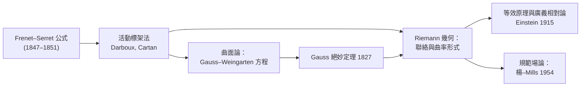

# 1.3 Frenet–Serret 公式

## 導言：讓標架隨曲線一起運動

前兩節我們定義了 $T, N, B$ 三個向量與 $\kappa, \tau$ 兩個數量。現在把它們整合成一個動力學系統：標架 $(T, N, B)$ 沿曲線如何演化？答案就是 **Frenet–Serret 公式**——五個方程式構成的優雅體系，被達布稱為「曲面理論的樞紐」。它同時是活動標架法、剛體力學、與規範場論的共同源頭。

### 歷史定位

- **1806 年**，蘭克雷（Lancret）已用文字描述撓率與標架轉動的關係。
- **1847 年**，法國軍醫弗雷內（F. Frenet, 1816–1868）在其博士論文中導出此方程組，但當時未受重視。
- **1851 年**，塞雷（J. A. Serret）獨立發表同樣的公式，即以兩人命名。
- **1880 年代**，達布（G. Darboux）與嘉當（É. Cartan）將「活動標架」發展為一般方法，適用於任意維流形——今日廣義相對論中的四足標架（tetrad）形式（第 8 章）即其直系後裔。

---

## 公式本身

### 推導

設曲線以弧長 $s$ 參數化， $\kappa > 0$ 。從定義與恆等式出發：

1. $T = \dot\gamma$ ，故 $\dot T = \kappa N$ （曲率定義的重寫）。
2. 對 $N \cdot N = 1$ 微分： $\dot N \perp N$ 。又 $\dot N \perp B$ 由下述唯一性：因 $(T,N,B)$ 是正交基， $\dot N$ 可展開為 $\dot N = aT + bB$ 。對 $N \cdot T = 0$ 微分得 $\dot N \cdot T = -N \cdot \dot T = -\kappa$ ，故 $a = -\kappa$ 。定義 $b = \tau$ ，得 $\dot N = -\kappa T + \tau B$ 。
3. 對 $B = T \times N$ 微分： $\dot B = \dot T \times N + T \times \dot N = \kappa N \times N + T \times (-\kappa T + \tau B) = \tau\, (T \times B) = -\tau N$ 。

### 完整公式組

$$
\boxed{
\begin{aligned}
\dot T &= \kappa N \\
\dot N &= -\kappa T + \tau B \\
\dot B &= -\tau N
\end{aligned}}
$$

寫成矩陣形式：

$$
\frac{d}{ds}\begin{pmatrix} T \\ N \\ B\end{pmatrix} = \underbrace{\begin{pmatrix} 0 & \kappa & 0 \\ -\kappa & 0 & \tau \\ 0 & -\tau & 0\end{pmatrix}}_{A(s)} \begin{pmatrix} T \\ N \\ B\end{pmatrix}
$$

### 結構解讀

- 係數矩陣 $A$ 是**反對稱**的： $A^T = -A$ 。這保證標架保持正交歸一（對 $X^TX = I$ 微分， $\dot X = AX$ 且 $A$ 反對稱 ⟹ 解恆為正交矩陣）。
- 反對稱矩陣 = 角速度：剛體以角速度向量 $\omega = \tau T + \kappa B$ 旋轉（**Darboux 向量**），標架正是這個剛體。曲率是繞 $B$ 軸的轉速，撓率是繞 $T$ 軸的轉速。
- $A$ 屬於李代數 $\mathfrak{so}(3)$ ；Frenet 公式是李群 $\mathrm{SO}(3)$ 上的流。這是李群與李代數（10.2 節）最親切的入門例。

---

## 不變量與結論

### 立即推論

1. **曲率的特徵化**： $\kappa = |\dot T|$ ，且 $\kappa \equiv 0 \iff$ 曲線為直線。
2. **撓率的特徵化**： $\tau \equiv 0 \iff$ 曲線為平面曲線（ $\dot B = 0$ ⟹ $B$ 為常向量 ⟹ 曲線落在 $\langle x, B\rangle = c$ 的平面上）。
3. **廣義螺旋線**： $\kappa/\tau$ 為常數 $\iff$ 曲線為廣義螺旋線（切向量與固定方向夾定角）。證明： $\frac{d}{ds}\left(\tau T + \kappa B\right) = 0$ 當且僅當 $\kappa/\tau$ 常數，此時 Darboux 向量是常向量，而 $T \cdot (\tau T + \kappa B) = \tau$ 為常數。
4. **存在唯一性**：給定 $\kappa(s) > 0$ 、 $\tau(s)$ 與初始標架，Frenet ODE 有唯一解，積分得曲線—— $\kappa, \tau$ 是完備不變量（1.2 節已述）。

### 能量估計（選讀）

由 $\dot T = \kappa N$ 得 $\kappa \leq |\dot T|_{\max}$ 類的估計在工程上用於曲率上界控制：若 $|\gamma'| \leq v_{\max}$ 且 $|\gamma''| \leq a_{\max}$ ，則

$$
\kappa \leq \frac{a_{\max}}{v_{\max}^2}
$$

這正是鐵路緩和曲線設計中「限制離心加速度」的數學根據。

---

## 一般參數下的 Frenet 公式

以任意正則參數 $t$ 表示，定義 $v = |\gamma'|$ ：

$$
\frac{dT}{dt} = v\kappa N, \qquad \frac{dB}{dt} = -v\tau N
$$

推導： $\frac{dT}{dt} = \frac{dT}{ds}\frac{ds}{dt} = \kappa N \cdot v$ 。記住「對 $s$ 的導數 = 對 $t$ 的導數除以 $v$ 」即可自由換算。

---

## 例題

### 例題 1：驗證螺旋線的 Frenet 標架

取 $\gamma(t) = (a\cos t, a\sin t, bt)$ ， $c = \sqrt{a^2+b^2}$ ，弧長參數 $s = ct$ 。

**單位切向量**：

$$
T = \frac{\gamma'}{|\gamma'|} = \frac{1}{c}(-a\sin t,\ a\cos t,\ b)
$$

**對弧長微分**：

$$
\frac{dT}{ds} = \frac{1}{c}\frac{dT}{dt} = \frac{1}{c^2}(-a\cos t,\ -a\sin t,\ 0)
$$

模長 $= a/c^2$ ，故 $\kappa = a/c^2 = \dfrac{a}{a^2+b^2}$ 。✓

**主法向量**：

$$
N = \frac{dT/ds}{\kappa} = (-\cos t,\ -\sin t,\ 0)
$$

指著圓柱軸心——向心方向，符合直觀。

**副法向量**：

$$
B = T \times N = \frac{1}{c}\left(b\sin t,\ -b\cos t,\ a\right)
$$

**撓率**：

$$
\frac{dB}{ds} = \frac{1}{c^2}(b\cos t,\ b\sin t,\ 0) = \frac{b}{c^2}(\cos t, \sin t, 0) = -\frac{b}{c^2} N
$$

故 $\tau = b/c^2 = \dfrac{b}{a^2+b^2}$ 。✓ 與 1.2 節的一般公式一致。

**Darboux 向量**：

$$
\omega = \tau T + \kappa B = \frac{b}{c^2}T + \frac{a}{c^2}B = \frac{1}{c^3}\left(b(-a\sin t, a\cos t, b) + a(b\sin t, -b\cos t, a)\right) = \frac{1}{c^3}(0, 0, b^2 + a^2) = \frac{1}{c}\hat z
$$

常向量、指向圓柱軸！這證實螺旋線是廣義螺旋線：切向量 $T$ 與軸向 $\hat z$ 的夾角恆定（ $\cos\theta = b/c$ ）。

### 例題 2：由曲率與撓率反構曲線

設 $\kappa = \dfrac{1}{\sqrt{2}}$ 、 $\tau = \dfrac{1}{\sqrt{2}}$ 為常數，初始 $T(0) = (1,0,0)$ 、 $N(0) = (0,1,0)$ 、 $B(0) = (0,0,1)$ 。

係數矩陣為常值：

$$
A = \frac{1}{\sqrt 2}\begin{pmatrix} 0 & 1 & 0 \\ -1 & 0 & 1 \\ 0 & -1 & 0\end{pmatrix}
$$

$A^3 = -\frac{1}{2}A$ （直接計算），故指數化簡為有限項：

$$
e^{As} = I + \sin\frac{s}{\sqrt2}\,\frac{A}{\lambda} + \left(1-\cos\frac{s}{\sqrt2}\right)\frac{A^2}{\lambda^2}, \qquad \lambda = \frac{1}{\sqrt 2}
$$

特別地

$$
T(s) = \frac{1}{\sqrt 2}\left(\sin\frac{s}{\sqrt 2},\ \cos\frac{s}{\sqrt 2},\ 1\right)
$$

積分（並平移使 $\gamma(0)=0$ ）：

$$
\gamma(s) = \left(1-\cos\frac{s}{\sqrt 2},\ \sin\frac{s}{\sqrt 2},\ \frac{s}{\sqrt 2}\right)
$$

正是 $a = b = 1$ 的螺旋線。這就是「存在唯一性定理」的具體操作：解 Frenet ODE 得標架，再積分得曲線。

---

## 活動標架法：通往一般理論

### 從曲線到一般流形

Frenet 公式說：沿曲線的幾何完全編碼在「標架的變化方程」中。嘉當把這個思想極端化：

- 不用固定座標系，而在每一點攜帶一個標架；
- 幾何資訊 = 標架之間的「聯絡形式」（contact forms）；
- 不變量 = 這些形式在標架變換下的不變組合。

在曲面論中，這產生 Gauss–Weingarten 方程（第 2、3 章）；在 Riemann 幾何中，產生 Levi-Civita 聯絡與曲率形式（第 5、6 章）；在物理中，產生規範場論（9.3 節）。

### 表格：各層次的「標架方程」

| 層次 | 標架 | 變化方程 | 不變量 |
|---|---|---|---|
| 平面曲線 | $(T, n)$ | $\dot T = k n$ | 曲率 $k$ |
| 空間曲線 | $(T, N, B)$ | Frenet–Serret | $\kappa, \tau$ |
| 曲面 | $(r_u, r_v, n)$ | Gauss–Weingarten | $E, F, G; L, M, N; K, H$ |
| Riemann 流形 | 切標架 $e_i$ | $\nabla_{e_i} e_j = \Gamma_{ij}^k e_k$ | Riemann 張量 |
| 規範理論 | 內部對稱標架 | $D_\mu = \partial_\mu + A_\mu$ | 楊–Mills 場強 $F_{\mu\nu}$ |

每一行都是「標架 + 聯絡 + 曲率」的同一套結構，只是維度與對稱群不同。本書正是沿這張表逐層爬升。

---

## 與其他領域的關聯

### 剛體力學

Euler 剛體方程（1765）與 Frenet 方程同為 $\mathfrak{so}(3)$ 值的演化方程；Darboux 向量扮演角速度。陀螺進動的數學與螺旋線的數學是同一個。

### 算子理論

把 $D = \frac{d}{ds}$ 限制在沿曲線的向量場上，Frenet 矩陣是 $D$ 相對於標架的矩陣表示。曲率 $\kappa$ 是這個微分算子在法向的「特徵速率」。譜理論的觀點（把幾何量看成算子的譜資料）在量子力學的哈密頓算符、以及在流形上的 Laplace 算子譜幾何（「能否聽出鼓的形狀？」Kac 1966）中全面開花。

### 量子力學

- **自旋進動**：自旋態 $|\psi\rangle$ 在磁場中滿足 $i\hbar\dot\psi = H\psi$ ，等價於 Bloch 向量在球面上的 Frenet 型演化；Berry 相位 $\oint \langle\psi, d\psi\rangle$ 是標架沿閉曲線的幾何相位。
- **規範不變性**：量子波函數的相位選擇就像曲線的參數選擇——物理量必須在「規範（參數）變換」下不變。Frenet 理論的參數不變性是其最簡模型。

### 計算機科學

樣條曲線（Bézier、B-spline）設計中，曲率連續性（G² 連續）是車體、字型設計的品質標準；Frenet 標架用於 CAD 的倒角與掃掠操作。

---

## 小結

1. Frenet–Serret 公式： $\dot T = \kappa N$ 、 $\dot N = -\kappa T + \tau B$ 、 $\dot B = -\tau N$ 。
2. 係數矩陣反對稱 ⟹ 標架恆為剛性旋轉；Darboux 向量 $\omega = \tau T + \kappa B$ 。
3. $\kappa, \tau$ 完備決定曲線；常數 $\kappa/\tau$ 刻畫廣義螺旋線。
4. 活動標架法把「攜帶座標系、記錄其變化」推廣為一般方法，是本書其後所有章節的方法論基礎。
5. 「標架 + 聯絡 + 曲率」的結構在曲面、Riemann 流形、規範理論中一再重現。

第 2 章將把同樣的程式應用到曲面：參數化曲面、定義切平面與兩個基本形式，並在 1827 年的 Gauss 絕妙定理處抵達內蘊幾何的誕生。

---

## 深入研習：活動標架的深化與推廣

1. **Darboux 標架與曲面論的銜接**：沿曲面上的曲線，用「曲面的法向量 $n$ + 曲線切向 $T$ + 副法向 $u = n \times T$ 」組成 **Darboux 標架**（相對於 Frenet 標架），其方程含**測地曲率** $k_g$ 、**法曲率** $\kappa_n$ 、**測地撓率** $\tau_g$ 三個量： $\dot T = \kappa_g u + \kappa_n n$ 、 $\dot u = -\kappa_g T - \tau_g n$ 、 $\dot n = -\kappa_n T + \tau_g u$ 。**測地曲率是內蘊的**（Gauss–Bonnet 的邊界項）、法曲率是外在的（3.3 節）——標架選擇決定哪些量「可見」。

2. **Frenet 方程的解空間結構**：給定 $\kappa(s), \tau(s)$ ，標架解是 $SO(3)$ 上的路徑；由矩陣指數理論（10.2 節），常數 $\kappa, \tau$ 給出單參數子群——螺旋線是**李群的單參數子群在 $\mathbb{R}^3$ 的像**。一般 $\kappa(s), \tau(s)$ 的解 = $SO(3)$ 上的任意路徑：**曲線論 = 李群軌道理論**——這是 Cartan 方法論的種子。

3. **交換矩陣的意義**：Frenet 係數矩陣 $A(s)$ 反對稱。兩個不同 $s$ 的 $A$ 一般不可交換 ⟹ 標架演化路徑依賴 ⟹ **曲線「記得」自己的歷史**。若 $[A(s_1), A(s_2)] = 0$ （可交換），則解可寫成純指數——這正是常曲率螺旋線的情況。**不可交換性 = 曲率/撓率變化的幾何代價**（與 6.1 節 holonomy 的「路徑依賴」同一主題）。

4. **Bishop 標架：沒有撓率的標架**：1953 年 Bishop 提出另一種標架（法標架），其方程 $\dot T = k_1 N_1 + k_2 N_2$ 、 $\dot N_1 = -k_1 T$ 、 $\dot N_2 = -k_2 T$ ——**無撓率項**， $k_1, k_2$ （法曲率座標）在 $\kappa = 0$ 點也不退化。計算機圖學的曲線座標系（避免 Frenet 標架在拐點的翻轉）用 Bishop 標架——**工程實務推翻「標架唯一」的直觀**：標架是工具，不是實在（本書哲學！）。

5. **蘭克雷–Frenet 的歷史正名**：Lancret（1806）已明確區分「曲率的法向變化」與「撓率」；Frenet（1847）給出完整公式組但論文被埋沒（發表於非主流期刊）；Serret（1851）獨立且及時發表。**數學史上的命名不公**（還有 Jacobi、Gauss 對標架理論的私人貢獻）提醒我們：科學的榮譽分配遵循社會學而非純邏輯。

6. **量子力學的 Bloch 方程對照**：自旋 1/2 在磁場 $\mathbf{B}(t)$ 中的 Bloch 向量方程 $\dot{\mathbf{s}} = \boldsymbol{\Omega}\times\mathbf{s}$ （ $\Omega \parallel B$ ）——反對稱係數矩陣的形式與 Frenet 完全相同。**自旋進動 = 標架演化**；Berry 相位（6.1 節）是這個演化的「幾何餘額」：沿閉路後自旋態的相位偏移 = holonomy。**1.3 節是量子力學幾何相位的初等模型**。

7. **活動標架法的代數化**：Cartan 把標架方程抽象為「李群 $G$ 值函數 + 李代數值 1-形式」： $\theta = g^{-1}dg$ （Maurer–Cartan 形式），結構方程 $d\theta + \theta\wedge\theta = 0$ 。Frenet 矩陣 $A$ 正是 $SO(3)$ 的 Maurer–Cartan 形式在曲線拉回下的係數。**主叢上的聯絡（9.3 節規範理論）就是這套語言的最高形式**——本節是它的初等樣本。

8. **曲線論的剛體運動群作用**：歐氏群 $E(3) = \mathbb{R}^3 \rtimes SO(3)$ 作用在曲線空間上；曲線的分類 = 商空間（曲線/剛體運動）。 $\kappa(s), \tau(s)$ 是商空間的座標。**「幾何 = 對稱群的商」**（Klein 綱領的觀點，10.2 節）在曲線層次已可完整演練——這是理解 4.2 節「光滑結構等價類」與 9.3 節「規範等價類」的心智模型。

9. **數值積分的幾何保真**：直接用 Runge–Kutta 積分 Frenet 方程會漂移正交性（ $\|T\| \neq 1$ 漸增）；**幾何數值積分**（Lie 群方法：每步把解投影回 $SO(3)$ ，即 Crouch–Grossman / Magnus 展開法）保持剛性——**李群結構是數值穩定性的資源**（10.3 節幾何積分器的思想源頭）。

10. **從曲線到曲面：Weingarten 矩陣的預告**：1.3 節的 $A$ （ $3\times3$ 反對稱）在曲面論換成 $S = -dn$ （ $2\times2$ 對稱，3.3 節形狀算子）。反對稱 vs 對稱：**曲線的標架演化是旋轉（保守），曲面的法向變化是拉伸（譜分解）**——這個對比決定了兩章的數學風味：曲線論用 $\mathfrak{so}(3)$ 、曲面論用對稱算子譜理論（特徵值 = 主曲率）。

## 習題與詳解

**習題 1**：證明 Darboux 向量 $\omega = \tau T + \kappa B$ 滿足 $\dot T = \omega \times T$ 、 $\dot N = \omega\times N$ 、 $\dot B = \omega\times B$ 。

解： $\omega\times T = \tau\,T\times T + \kappa\,B\times T = \kappa\,N$ （因 $B\times T = N$ ）✓。 $\omega\times N = \tau\,T\times N + \kappa\,B\times N = \tau B - \kappa T$ （ $T\times N = B$ 、 $B\times N = -T$ ）✓。 $\omega\times B = \tau\,T\times B = -\tau N$ （ $T\times B = -N$ ）✓。**標架演化 = 繞 $\omega$ 的角速度旋轉**——Frenet 方程的剛體力學翻譯。

**習題 2**：求曲率 $\kappa = \cosh s$ 、撓率 $\tau = \sinh s$ 的曲線在 $s = 0$ 附近的 Frenet 矩陣並說明其結構。

解： $A(s) = \begin{pmatrix}0 & \cosh s & 0\\ -\cosh s & 0 & \sinh s\\ 0 & -\sinh s & 0\end{pmatrix}$ 。驗證反對稱 ✓。注意 $\kappa^2 - \tau^2 = 1$ 恆成立——這使 $A(s)$ 落在 $SO(2,1)$ 型子代數： $\kappa^2 - \tau^2$ 是標架演化在 $(N,B)$ 平面上的「Minkowski 不變量」。**係數的代數關係 ⟹ 演化群退化**——廣義螺旋線（ $\kappa/\tau$ 常數）與此例（ $\kappa^2 - \tau^2$ 常數）是「單參數子代數流」的兩種典型。

**習題 3**：證明：若曲線的所有法平面過定點，則曲線是球面曲線或平面曲線。

解：法平面過定點 $p$ ⟺ $\gamma'(s)\cdot(\gamma(s) - p) = 0$ （法平面方程）⟺ $\frac{d}{ds}\frac{1}{2}|\gamma - p|^2 = 0$ ⟺ $|\gamma(s) - p|$ 恆定 ⟺ **曲線落在以 $p$ 為心的球面上**。若 $|p| \to \infty$ 極限即平面。**球面曲線的特徵**（可選進階）： $\tau/\kappa + \frac{d}{ds}\left(\frac{\dot\kappa}{\kappa^2\tau}\right) = 0$ 。**「法平面的包絡」與「密切球面」理論**（球面像理論，Darboux 向量的像）是十九世紀曲線論的精緻篇章，是 3.3 節 Dupin 標線的直接前奏。
