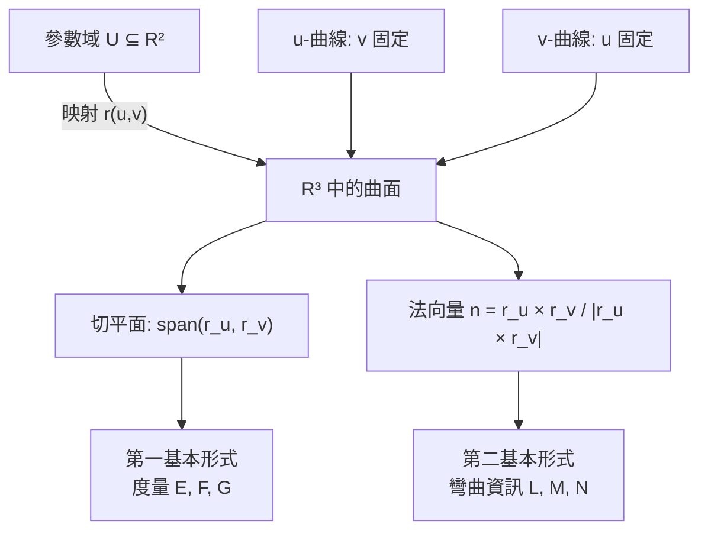

# 2.1 曲面的參數化與切平面

## 導言：從一維到二維的跳躍

曲線只需一個參數；曲面需要兩個。這個看似平凡的推廣，實則引入了全新的現象：兩個方向的混合（ $r_{uv}$ ）、不同方向的相互作用、以及「外在描述」與「內蘊描述」的張力——後者將在 Gauss 絕妙定理（3.2 節）達到高潮。本節建立曲面的參數化語言與切平面。

### 歷史前奏

- **Euler（1760）**：《關於曲面的研究》，首次系統地用兩參數描述曲面並計算法向量。
- **Monge（1807）**：《分析在幾何中的應用》，把微分方程與曲面理論結合，Gauss 的老師輩；蒙日學派奠定了法國微分幾何傳統。
- **Gauss（1827）**：《關於曲面的一般研究》，本書第二章的核心文獻，我們將沿他的路徑前進。

---

## 正則參數化曲面

### 定義

設 $U \subseteq \mathbb{R}^2$ 是開集。一個 ** $C^k$ 參數化曲面**是映射

$$
r : U \to \mathbb{R}^3, \qquad r(u, v) = \big(x(u,v),\ y(u,v),\ z(u,v)\big)
$$

若偏導數 $r_u = \partial r/\partial u$ 與 $r_v = \partial r/\partial v$ 在每點線性無關（即 $r_u \times r_v \neq 0$ ），稱 $r$ 為**正則**參數化。正則性保證法向量存在、切平面有定義。

### 與曲線論的對照

| | 曲線 | 曲面 |
|---|---|---|
| 參數 | 一個 $t$ | 兩個 $u, v$ |
| 正則條件 | $\gamma' \neq 0$ | $r_u \times r_v \neq 0$ |
| 切對象 | 一維切線 | 二維切平面 |
| 法對象 | 不唯一（法平面） | 唯一法線（局部） |
| 等價變換 | 單變數微分同胚 | 雙變數微分同胚（座標變換） |

座標變換 $(u,v) \mapsto (\tilde u, \tilde v)$ 的 Jacobi 矩陣是 $2\times 2$ 可逆矩陣；正是「雙向可變換的局部座標」概念，將在流形論（4.2 節）中公理化。

---

## 典型曲面範例

### 球面

$$
r(\theta, \phi) = (R\sin\theta\cos\phi,\ R\sin\theta\sin\phi,\ R\cos\theta)
$$

$0 < \theta < \pi$ 、 $0 < \phi < 2\pi$ 。注意需要**兩張座標卡**才能覆蓋整個球面（極點處參數化退化： $r_\phi = 0$ ）——這是流形需要圖冊（atlas）的直接理由。

### 圓柱面

$$
r(u, v) = (a\cos u,\ a\sin u,\ v), \qquad r_u \times r_v = (a\cos v\ldots)
$$

直接計算： $r_u = (-a\sin u, a\cos u, 0)$ 、 $r_v = (0,0,1)$ ，法向量 $r_u \times r_v = (a\cos u, a\sin u, 0)$ ，指離軸心。可展曲面（ $K = 0$ ，見 3.3 節）。

### 環面

$$
r(u, v) = \big((a + b\cos v)\cos u,\ (a + b\cos v)\sin u,\ b\sin v\big), \qquad a > b > 0
$$

環面是「圓繞軸旋轉」的旋轉面；它的內蘊幾何允許 $K \equiv 0$ 的平坦度量（與球面不同！見 3.2 節拓樸約束的討論）。

### 旋轉面的一般形式

曲線 $(f(v), 0, g(v))$ 繞 $z$ 軸旋轉：

$$
r(u, v) = \big(f(v)\cos u,\ f(v)\sin u,\ g(v)\big)
$$

球面、圓柱、環面、懸鏈面、偽球面都是特例。這一族曲面將反覆出現：Gauss 曲率的計算、測地線的顯式解、負曲率模型（偽球面與雙曲幾何）。

### 圖形（mermaid）

---

## 切平面

### 定義與直觀

曲面在一點 $p = r(u_0, v_0)$ 的**切平面**是過 $p$ 、由 $r_u$ 與 $r_v$ 張成的平面：

$$
T_pS = \{\, a\, r_u + b\, r_v \mid a, b \in \mathbb{R} \,\}
$$

直觀：把一張平紙貼在曲面上（局部相切）。嚴格的內蘊定義（切向量 = 曲線的導數，4.3 節）稍後給出；此刻的 $r_u, r_v$ 定義已足夠計算。

正則條件下 $\dim T_pS = 2$ ，且 $T_pS$ 不依賴參數化的選擇（可驗證：座標變換下 $r_u, r_v$ 線性組合為新座標的偏導，張成同一平面）。

### 法向量

$$
n = \frac{r_u \times r_v}{|r_u \times r_v|}
$$

單位法向量；在正則曲面上局部連續選取（可定向時全域選取）。法向量的取向選擇（ $n$ 或 $-n$ ）影響第二基本形式的符號，但不影響 Gauss 曲率（3.3 節）。

### 曲面上的曲線

曲面上的曲線 $\gamma(t) = r(u(t), v(t))$ 速度為

$$
\gamma' = u' r_u + v' r_v \in T_{\gamma(t)}S
$$

這個簡單的鏈式法則，是「切平面 = 曲面上所有曲線的速度集合」的證明，也是把曲面問題化約為曲線問題的橋樑：測地線（3.1 節）就是曲面上的「直線」。

---

## 例題

### 例題 1：球面的切平面與法向量

取 $r(\theta, \phi) = (R\sin\theta\cos\phi,\ R\sin\theta\sin\phi,\ R\cos\theta)$ 。

**計算偏導**：

$$
r_\theta = (R\cos\theta\cos\phi,\ R\cos\theta\sin\phi,\ -R\sin\theta)
$$

$$
r_\phi = (-R\sin\theta\sin\phi,\ R\sin\theta\cos\phi,\ 0)
$$

**法向量**：

$$
r_\theta \times r_\phi = \left(R^2\sin^2\theta\cos\phi,\ R^2\sin^2\theta\sin\phi,\ R^2\sin\theta\cos\theta\right) = R^2\sin\theta \cdot \hat r_{\text{radial}}
$$

其中 $\hat r_{\text{radial}} = \frac{1}{R}r(\theta,\phi)$ 是徑向單位向量。故

$$
n = \frac{r(\theta,\phi)}{R}
$$

球面的法向量就是半徑方向——符合直觀，且是全體座標卡一致的（球面可定向）。

**正則性檢驗**： $|r_\theta \times r_\phi| = R^2\sin\theta$ 在 $\theta = 0, \pi$ 為零——極點是參數化奇點，需另一張卡（如以 $x$ 軸為極軸的參數化）覆蓋。

**切平面方程**：過點 $p_0 = r(\theta_0, \phi_0)$ 、法向 $p_0$ 的平面：

$$
r(\theta,\phi) \cdot p_0 = R^2
$$

即 $x x_0 + y y_0 + z z_0 = R^2$ 。這正是球面切平面的經典方程，與微積分中隱函數曲面的切平面公式一致。

### 例題 2：過一點的所有曲面曲線的速度

設 $S$ 為球面，考察兩條曲面曲線在 $\theta = \pi/2, \phi = 0$ 處（北半球赤道點 $(R, 0, 0)$ ）：

- 緯線： $u(t) = \pi/2$ （常數）、 $v(t) = t$ ⟹ $\gamma' = r_\phi = (0, R, 0)$ 。
- 經線： $u(t) = \pi/2 + t$ 、 $v(t) = 0$ ⟹ $\gamma' = r_\theta = (0, 0, -R)$ 。

兩速度線性無關，張成切平面 $x = R$ 。任何曲面上過該點的曲線速度都在此平面內；反之平面上任一向量都可由某曲線實現。✓

---

## 隱函數曲面與圖形曲面

### 圖形曲面

$z = f(x, y)$ 的參數化 $r(x, y) = (x, y, f(x,y))$ ：

$$
r_x = (1, 0, f_x), \quad r_y = (0, 1, f_y), \quad n = \frac{(-f_x, -f_y, 1)}{\sqrt{1 + f_x^2 + f_y^2}}
$$

切平面在 $(x_0, y_0)$ ： $z = f(x_0,y_0) + f_x\,\Delta x + f_y\,\Delta y$ ——這正是多元微積分的全微分線性近似。**微積分中的「切平面」就是本節概念的特例**。

### 隱曲面

$F(x, y, z) = 0$ ， $\nabla F \neq 0$ 處由隱函數定理局部解出參數化；法向量為 $\nabla F / |\nabla F|$ 。隱函數定理因此是曲面論的存在性支柱——「只要梯度不退化，曲面就是局部圖形」。

---

## 座標變換下的變換律

設 $\tilde r(\tilde u, \tilde v) = r(u(\tilde u, \tilde v), v(\tilde u, \tilde v))$ ，則鏈式法則：

$$
\tilde r_{\tilde u} = r_u \frac{\partial u}{\partial \tilde u} + r_v \frac{\partial v}{\partial \tilde u}, \qquad \tilde r_{\tilde v} = r_u \frac{\partial u}{\partial \tilde v} + r_v \frac{\partial v}{\partial \tilde v}
$$

寫成矩陣： $\tilde r_{\tilde u}, \tilde r_{\tilde v} = (r_u, r_v)\, J$ ，其中 $J$ 是座標變換的 Jacobi 矩陣。由此：

- 切平面不變（ $J$ 可逆）；
- 法向量滿足 $\tilde n = \pm n$ （符號由 $\det J$ 決定——定向的變換律）；
- 度量分量滿足張量變換律 $\tilde g = J^T g\, J$ （2.2 節詳述）。

「按 Jacobi 律變換」就是**張量**的定義精神，這裡第一次出現，將在 4.3、7.3 節正式化。

---

## 歷史與新問題

### 解決了什麼

Euler–Monge 的參數化方法解決了「如何對曲面做微積分」：把曲面化為兩變數函數，一切分析工具可用。切平面與法向量提供了局部線性化，使曲率的定義（下一節起）成為可能。

### 引發的新問題

1. 切平面依賴外在空間 $\mathbb{R}^3$ ；曲面自身的幾何（不解開外在座標）如何描述？→ 第一基本形式（2.2）。
2. 參數化變換下，哪些量是曲面自身的？→ Gauss 絕妙定理（3.2）。
3. 球面需要多張座標卡；一般「局部平坦」的空間如何公理化？→ 流形（第 4 章）。
4. 三維空間中的曲面之外，更高維甚至不需要外在空間的對象？→ Riemann 流形（第 5 章）。

### 與其他領域的關聯

- **微積分**：圖形曲面的切平面即全微分；隱函數定理是存在性基礎。
- **向量微積分**：法向量場用於通量計算 $\iint F \cdot n\, dA$ ；Gauss 定理與 Stokes 定理的敘述依賴定向曲面（本節的 $n$ 選取）。
- **計算機圖學**：三維模型以三角網格逼近曲面，法向量決定著色（Phong shading）；參數曲面（NURBS）是工業設計標準。
- **物理學**：廣義相對論中「時空流形」由類似參數卡覆蓋（第 8 章）；量子力學的布洛赫球是兩維球面，其參數化的極點奇異性對應態的規範選取問題。

---

## 小結

1. 曲面 = 兩參數映射 $r(u,v)$ ；正則性 $r_u \times r_v \neq 0$ 。
2. 切平面 $T_pS = \mathrm{span}(r_u, r_v)$ 是參數不變的；法向量 $n$ 局部唯一。
3. 座標變換以 $2\times 2$ Jacobi 矩陣聯繫兩組偏導——張量變換律的原型。
4. 圖形曲面與隱曲面是特例，與微積分直接銜接。
5. 參數化只給出「外在」描述；內蘊幾何需要度量——下一節的主題。

---

## 深入研習：參數化的全域問題與奇點

1. **單卡不可覆蓋緊緻曲面**：緊緻空間的連續像緊緻，而 $\mathbb{R}^n$ 的開子集非緊——**球面、環面都必須至少兩張卡**。這個簡單論證是 4.1 節「圖冊必要性」的嚴格核心；也是為什麼地圖冊永遠是多頁的。

2. **法向量場與可定向性**： $n = \frac{r_u\times r_v}{|r_u\times r_v|}$ 的全域存在 ⟺ 曲面可定向。Möbius 帶是**不可定向**的經典例子：單側曲面、法向量繞一周翻號——毛髮定理（4.3 節）與磁單極（9.3 節 Dirac 弦）的幾何根源都在此。**「能不能連續選法向」= 可定向性**，是第一個非平凡的全域拓樸問題。

3. **奇點理論的預告**：曲面參數化的奇點（ $r_u \times r_v = 0$ ）的分類由 Whitney（1935–55）完成：一般位置下只有**摺痕**（fold）與**尖點**（cusp）兩類（像地圖摺痕、牙齒輪廓）。這是**奇點理論/突變論**（Thom 1972、Arnold 學派）的起點：**投影奇點的有限分類**解釋了影子的形狀為何「總是那幾種」。

4. **Steinmetz 與隱式曲面的計算**：兩圓柱相交（Steinmetz 體）的曲面由隱式給出；CAD 系統的核心任務（求交、裁剪、拼接）本質是**隱函數定理的數值化**：牛頓迭代 + 奇點檢測（ $\nabla F \approx 0$ 警報）。3D 列印的 STL 網格、CT 掃描的等值面（marching cubes, 1987）——**隱曲面 = 醫學影像的幾何介面**。

5. **球極投影的共形性與應用**：球極投影保角（可由 2.2 節等溫座標驗證），因此**複平面 = 去極點的球面**：複分析（解析函數、Möbius 變換）幾何化為球面幾何。物理應用：天球座標（天文望遠鏡指向）、晶體學的極射赤面投影（X 光繞射分析，晶體學家的百年工具）。

6. **環面座標與環面宇宙學**：環面 $\mathbb{T}^2$ 的平坦度量（4.1 節）使「環面宇宙」成為宇宙形狀候選（多重連通宇宙：天空中的「鏡像星系」假說；Planck 衛星對環面宇宙的檢驗至今無信號——**拓樸由觀測約束**的範例）。固態物理的布里淵區正是 $\mathbb{T}^3$ ：**動量空間天然是環面**（晶格週期性），量子霍爾的 Chern 數（6.1 節）定義在其上。

7. **參數曲面與網格的張力**：實務中曲面以三角網格表示（非參數式），網格的「參數化」= 每個三角片到平面的仿射映射。**網格參數化**（把曲面包到平面域，保持面積或角度）是計算機圖學核心難題：全域等距不可能（3.2 節），只能局部最優（LSCM、ABF 演算法）——**絕妙定理的否命題是整個 UV 展開工業的約束條件**。

8. **浸入與嵌入的維數門檻**：Whitney 嵌入定理（1936）： $n$ 維流形嵌入 $\mathbb{R}^{2n}$ 、浸入 $\mathbb{R}^{2n-1}$ ；最優版本（20 世紀末改進）：球面 $\mathbb{S}^n$ 嵌入 $\mathbb{R}^{n+1}$ 顯然，但**一般流形的最優嵌入維數**仍是活躍問題（例如 $\mathbb{RP}^2$ 不能嵌入 $\mathbb{R}^3$ 但能浸入 $\mathbb{R}^3$ 、嵌入 $\mathbb{R}^4$ ——Boy's surface 1901 與 Roman surface 的歷史）。**「維數預算」是幾何的全域約束**。

9. **切平面的物理直觀與工程**：接觸力學（Hertz 接觸 1882）：兩彈性體接觸點附近以切平面近似，接觸面積 $\propto F^{2/3}$ ——**局部線性化（切平面）是接觸力學的第一近似**；機器人抓取（摩擦錐在切平面定義）、輪胎力學同理。**切平面 = 力學分析的舞台**。

10. **從兩參數到 $n$ 參數的心理跳躍**：本節所有公式的 $n$ 維推廣（5.2 節度量）在記號上幾乎不變（ $E, F, G$ 變成 $g_{ij}$ 矩陣）；**真正的跳躍在於「直觀」**：無法再「看見」高維曲面，只能依賴代數與定理。Riemann 1854 的偉大不在技術而在**心智模型的解放**——本節的例子（球、環、旋轉面）是讀者能「看見」的最後一站，4.1 節起轉入代數直觀。

## 習題與詳解

**習題 1**：求曲面 $z = xy$ 在點 $(1, 1, 1)$ 的切平面與法向量。

解： $r(x,y) = (x, y, xy)$ ， $r_x = (1, 0, y)$ 、 $r_y = (0, 1, x)$ 。在 $(1,1)$ ： $r_x = (1,0,1)$ 、 $r_y = (0,1,1)$ 。法向量 $= r_x\times r_y = (-1, -1, 1)$ 。切平面： $-1(x-1) -1(y-1) + 1(z-1) = 0$ ，即 $z = x + y - 1$ 。驗證：過 $(1,1,1)$ ✓（ $1 = 1+1-1$ ）。**馬鞍點（ $K < 0$ ，3.3 節）的切平面把曲面「切」在鞍點**——局部上四個象限分居切平面兩側。

**習題 2**：驗證 Möbius 帶不可定向：取 $r(u, v) = ((2 - v\cos\frac{u}{2})\cos u,\ (2 - v\cos\frac{u}{2})\sin u,\ v\sin\frac{u}{2})$ ， $u \in [0, 2\pi]$ 、 $v \in [-1, 1]$ ，考察法向量繞 $u$ 一周的行為。

解：參數化在 $u = 2\pi$ 與 $u = 0$ 給出同一點集，但計算 $r_u\times r_v$ 顯示**反向**（半扭轉的幾何直觀： $v$ 方向繞一圈翻轉 $\pi$ 角）。因此 $n(u = 2\pi) = -n(u = 0)$ ：**法向量場不能連續閉合** ⟹ 不可定向。**後果**：其上不能全域定義「面積分流的正負」、無全域 Stokes 定理的直接應用（需雙覆蓋）、作為緊緻不可定向曲面的代表（Euler 示性數 $\chi = 0$ ，帶邊界版）。

**習題 3**：證明：正則曲面的第一基本形式正定（ $E > 0$ 、 $EG - F^2 > 0$ ）。

解： $E = |r_u|^2 > 0$ （正則性 ⟹ $r_u \neq 0$ ）。 $EG - F^2 = |r_u|^2|r_v|^2 - (r_u\cdot r_v)^2 = |r_u \times r_v|^2 > 0$ （Lagrange 恆等式 + 正則性）。**幾何意義**：線元素 $ds^2 = Edu^2 + 2Fdudv + Gdv^2 > 0$ 對任何 $(du,dv) \neq 0$ ——沿任何參數方向移動都有正長度，度量確實是「度量」。✓ 這也是 5.2 節 Riemann 度量正定性定義的曲面版來源。
