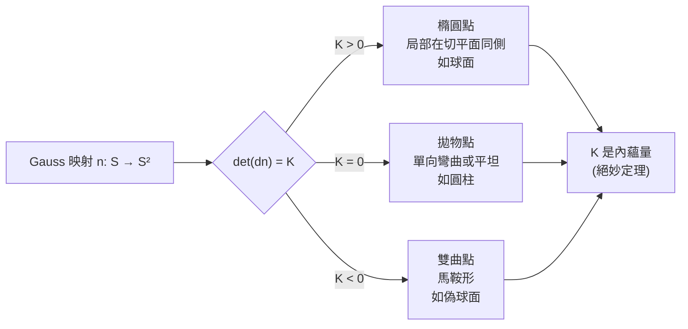
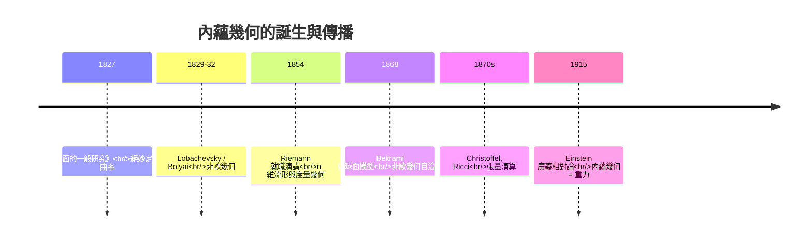

# 2.3 Gauss 曲率的誕生 1827

## 導言：一根毛蟲能否知道世界是彎的？

1827 年 10 月 8 日，Gauss 向哥廷根皇家科學院宣讀《Disquisitiones generales circa superficies curvas》（曲面的一般研究）。這篇論文回答了一個深刻的問題：**一個只活在曲面上的生物（不理解第三維），能否測出它的世界是彎的？** Gauss 的答案：能。答案是 **Gauss 曲率**，而且它是內蘊量——這就是著名的 **Theorema Egregium（絕妙定理）**。本節先從歷史脈絡與幾何直觀介紹 Gauss 曲率，3.2 節再給出絕妙定理的完整證明。

---

## Gauss 為什麼研究曲面？

### 大地測量：漢諾威王國的測量

1821–1825 年，Gauss 親自主持漢諾威王國的大地測量（三角測量網），親臨野外、爬塔觀測。實際問題是：

- 在球面上（地球不是平面！）如何做三角測量？
- 球面三角形內角和不是 $180°$ （超過，超出量正比於面積，見 3.2 節）；
- 如何把曲面上的測量資料化為一致的幾何？

**實用需求催生抽象理論**——這是科學史反覆出現的模式；大地測量還間接促成 Gauss 的最小平方法（1809）與他的非歐幾何私人研究（1817 年起，寫給朋友的信中透露他已掌握非歐幾何但怕「波哀提亞人的叫囂」而未發表）。

### 非歐幾何的陰影

兩千多年來，歐幾里得第五公設（平行公理）困擾數學家。Lobachevsky（1826/1829）與 Bolyai（1832，Gauss 回信：「讚揚他就等於讚揚我自己」）建立了雙曲幾何，但**雙曲幾何是否自洽、是否「真實存在」**？Gauss 的曲面理論給出回答的途徑：**偽球面**（tractrix 旋轉體）局部實現負常曲率幾何（Beltrami, 1868 完成此論證）——彎的內蘊世界不必嵌在歐氏空間裡也自洽。這條線索最終通向 Riemann 1854 的徹底解放（第 5 章）與愛因斯坦的重力理論（第 8 章）。

---

## Gauss 曲率的定義：法映射的方式

### 定義

設 $n : S \to \mathbb{S}^2$ 把曲面點映到單位法向量（**高斯映射**，Gauss map）。 $n$ 的 Jacobi 行列式（相對於面積元素）定義

$$
K = \det\left(dn_p\right) = \lim_{A \to 0} \frac{\text{法向量像的面積}}{\text{曲面面積}}
$$

**直觀**： $K$ 量度「走一小步，法向量轉動多少」——法向量的變化率就是彎曲率。

### 三種曲面的符號

| 曲面 | Gauss 曲率 | 法映射行為 | 直觀 |
|---|---|---|---|
| 平面 | $K = 0$ | 常映射，像退化 | 不彎 |
| 球面 | $K = 1/R^2 > 0$ | 保向微分同胚 | 各方向同彎 |
| 馬鞍面 | $K < 0$ | 反向（行列式為負） | 一凹一凸 |

### 與主曲率的關係（預告）

3.3 節將定義主曲率 $\kappa_1, \kappa_2$ （法曲率的極值），而

$$
K = \kappa_1 \kappa_2, \qquad H = \frac{\kappa_1 + \kappa_2}{2}\ (\text{平均曲率})
$$

球面 $\kappa_1 = \kappa_2 = 1/R$ 故 $K = 1/R^2$ ；圓柱 $\kappa_1 = 1/a, \kappa_2 = 0$ 故 $K = 0$ ——**圓柱在內蘊意義下是平的**！這正是等距映射（攤平）允許的緣故。

---

## 內蘊幾何：毛蟲的測量實驗

### 三個內蘊實驗

一隻只能沿曲面爬行的毛蟲可以：

1. **量三角形內角和**：
$$
\sum_{i=1}^3 \alpha_i = \pi + \iint_{\Delta} K\, dA \quad (\text{局部 Gauss–Bonnet 公式})
$$
球面上（ $K>0$ ）內角和 $> \pi$ ；馬鞍面（ $K<0$ ） $< \pi$ ；平面 $= \pi$ 。

2. **量圓周長**：半徑 $\rho$ 的測地圓，
$$
C(\rho) = 2\pi\rho\left(1 - \frac{K\rho^2}{6} + \cdots\right)
$$
正曲率：圓周「不足」 $2\pi\rho$ ；負曲率：超過。

3. **數平行線**：負曲率上過線外一點有無窮多條不相交的「直線」（測地線）；正曲率上一條也沒有。這正是非歐幾何的公理差異！

**三個實驗都不需要離開曲面** ⟹ $K$ 是內蘊量。絕妙定理（3.2 節）將以公式證實這一點。

### 表格：三種常數曲率幾何

| | 球面幾何 $K>0$ | 歐氏幾何 $K=0$ | 雙曲幾何 $K<0$ |
|---|---|---|---|
| 平行公理 | 無平行線 | 唯一平行線 | 無窮多平行線 |
| 三角形內角和 | $>\pi$ | $=\pi$ | $<\pi$ |
| 三角形面積 | 正比於角盈 | 無界 | $<\pi$ （角虧上界） |
| 圓周長 | $<2\pi\rho$ | $=2\pi\rho$ | $>2\pi\rho$ |
| 模型 | 球面 | 平面 | 偽球面／Poincaré 圓盤 |
| 發現者 | Gauss 1827 | 歐幾里得 | Lobachevsky–Bolyai 1829/32 |

---

## 例題

### 例題 1：圓柱面的 Gauss 曲率（法映射計算）

圓柱 $r(u, v) = (a\cos u, a\sin u, v)$ 。

**法向量**： $r_u = (-a\sin u, a\cos u, 0)$ 、 $r_v = (0,0,1)$ ，

$$
n = \frac{r_u \times r_v}{|r_u \times r_v|} = (\cos u, \sin u, 0)
$$

**Gauss 映射**： $n(u, v) = (\cos u, \sin u, 0)$ ——像落在單位圓上（一維！），像的面積為零。故

$$
K = \det(dn) = 0
$$

**內蘊檢驗**：剪開圓柱攤平成平面（等距映射 $r(u,v) \to (au, v)$ ），平面 $K = 0$ ；絕妙定理保證攤平前後 $K$ 不變。✓ 毛蟲在圓柱上量三角形內角和必得 $180°$ ——儘管在外人看來圓柱是「彎」的。**「彎曲」有兩種：外蘊的彎（可攤平消除）與內蘊的彎（等距不變）。Gauss 曲率量度的是後者。**

### 例題 2：球面的法映射像

球面 $K = 1/R^2$ ：Gauss 映射 $n(p) = p/R$ 是相似映射，像覆蓋整個單位球面，像面積 $4\pi$ ，曲面面積 $4\pi R^2$ ，比值 $= 1/R^2$ 。✓（此例中 $dn = \frac{1}{R} \mathrm{id}$ ，行列式顯然。）

---

## 從 1827 到 1854：Gauss 的遺產與 Riemann 的接棒

### Gauss 的猶豫

Gauss 顯然已經意識到：既然曲率是內蘊的，幾何不必依賴外在空間——他卻止步於三維。他在 1846 年評審 Lobachevsky 論文時寫道作者「以真正幾何學家的精神工作」，但仍未公開支持非歐幾何。思想在他心中成熟，卻缺少把「內蘊幾何」公理化的膽識與語言。

### Riemann 1854 的飛躍

Riemann（1826–1866）在 1854 年 6 月 10 日的就職演講《論作為幾何基礎的假設》中提出：

- 幾何的對象是任意維的**流形**（ $n$ 維推廣的曲面概念）；
- 幾何由流形上的**度量**（二次形式的推廣）決定；
- 彎曲由度量對二階導數的依賴（未來的曲率張量）量度。

Gauss 是評審委員，聽後深受震撼（Riemann 講稿僅一頁數學公式，極難懂）。這次演講是本書第 5 章的主題。

---

## 與其他領域的關聯

### 微積分／線性代數

$K = \det(dn)$ 是導數映射的行列式——多元微積分中「面積縮放因子」的概念（Jacobian）直接應用； $dn$ 是線性算子，其特徵值即主曲率（3.3 節）——線性代數的譜理論在幾何中的化身。

### 向量微積分

Gauss 映射是向量值函數；Gauss–Bonnet 公式聯繫曲率與拓樸（Euler 示性數），是廣義 Stokes 定理的幾何應用（3.2 節詳述）。

### 算子理論

形狀算子 $S_p = -dn_p : T_pS \to T_pS$ 是自伴算子，有實特徵值（主曲率）與正交特徵向量（主方向）；Gauss 曲率 $K = \det S$ 、平均曲率 $H = \frac{1}{2}\mathrm{tr}\,S$ 。**曲率 = 算子的譜不變量**——譜幾何思想的起點。

### 量子力學

- 量子力學中的 Berry 相位：體系沿參數空間閉路演化獲得的幾何相位，其曲率形式正是參數空間（流形）上的內蘊曲率——Gauss 曲率的高維推廣（9.3 節）。
- 二維電子氣在磁場中的 Landau 能階與曲率相互作用的類比（量子霍爾效應中 Chern 數 = 積分曲率），是絕妙定理思想的現代物理迴響。

### 地球科學與導航

$K > 0$ 的地球使大圓航線收斂、三角形內角超額；測地衛星量測（如 GRACE 任務）以雷射測距直接「量測曲率」，正是毛蟲實驗的高科技版本。

---

## 小結

1. Gauss 曲率 $K = \det(dn)$ 量度法向量的轉動率；符號分類橢圓點／拋物點／雙曲點。
2. 圓柱 $K = 0$ ：外蘊彎曲而內蘊平坦——彎曲有兩種。
3. 毛蟲實驗（內角和、圓周長、平行線）顯示 $K$ 可內蘊測得；絕妙定理（3.2）將證實之。
4. 1827 的動機來自大地測量與非歐幾何的醞釀；結論解放了「幾何 = 外在空間中的形狀」的桎梏。
5. Gauss 曲率是形狀算子的行列式——譜不變量思想的起點，通往 Riemann 幾何與規範理論。

下一章轉到曲面上的「直線」：測地線，以及 Gauss 絕妙定理的完整證明。

---

## 深入研習：Gauss 曲率的計算與內蘊檢驗

1. **Gauss 曲率的傳統公式彙總**：法映射式 $K = \det(dn)$ （本章）；兩形式式 $K = \frac{LN - M^2}{EG - F^2}$ （3.3 節）；內蘊式（Brioschi）： $K = \frac{1}{2\sqrt{EG-F^2}}\left[\partial_u\left(\frac{G_u - F_v/E\sqrt{E} \cdots}{\sqrt{EG-F^2}}\right) + \cdots\right]$ （一般參數的完整式冗長）；正交參數簡式（正文）；等溫座標式 $K = -\frac{\Delta\ln\lambda}{\lambda^2}$ （最實用）。**選對公式 = 省一半計算**：知道參數的類型（正交？等溫？）再下手。

2. **偽球面與雙曲幾何的實現**：tractrix $x = a\,\mathrm{sech}(v/a)\ldots$ （追蹤曲線，Huygens 1693 研究）繞漸近線旋轉得偽球面， $K = -1/a^2$ 恆定。Beltrami（1868）用其局部實現雙曲平面：**測地線 = 漸近線族**、三角形角虧 = 面積——非歐幾何從「公理遊戲」變成「曲面的內蘊幾何」。Hilbert 定理（1901）：**偽球面不能完備嵌入 $\mathbb{R}^3$ **（奇異圓 unavoidable）——雙曲平面的全域實現需要抽象流形（4.1 節），抽象化的必要性再次顯現。

3. **極小曲面與 $K$ 的符號**：極小曲面（ $H = 0$ ，3.3 節）滿足 $K \leq 0$ 處處（ $K = \kappa_1\kappa_2 = -\kappa_1^2 \leq 0$ ）。**「負曲率 = 面積臨界」**的關係在肥皁膜的形狀中肉眼可見：馬鞍形是極小面的典型局部形態。Euler–Lagrange 層面：極小面方程是非線性橢圓 PDE，其存在性/正則性是幾何分析的世紀主題（Plateau 問題的 Douglas–Radó 解 1930–31）。

4. **Kazdan–Warner 分類**：緊緻曲面上什麼函數可以是某度量的 Gauss 曲率？（1970s 分類： $\chi > 0$ ⟹ $K$ 必在某點 $> 0$ ； $\chi = 0$ ⟹ $K$ 必變號或為零； $\chi < 0$ ⟹ $K$ 必在某點 $< 0$ ——**Gauss–Bonnet 的「函數版」**）。這把「拓樸約束幾何」從積分層面細化到逐點層面。

5. **離散 Gauss 曲率**：三角網格頂點的離散曲率 $\kappa_i = 2\pi - \sum_j\alpha_{ij}$ （頂點角和的虧損）， $\int K\,dA$ 的離散版 = $\sum_i \kappa_i$ ，Gauss–Bonnet 的離散版嚴格成立（ $\sum\kappa_i = 2\pi\chi$ ）。**遊戲引擎、3D 掃描、3D 列印的曲率計算全部用此式**——1827 年的定理是 2020 年代軟體的內建函數。

6. **光學中的曲率感測**：Shack–Hartmann 波前感測器測量波前的局部曲率（像散 = 主曲率差，3.3 節概念）；自適應光學（望遠鏡、視網膜成像）的變形鏡控制律 = 曲率補償。**「法向量轉動率」的感測**從 Gauss 的幾何直觀變成光電工程。

7. **宇宙學曲率的可觀測量**：宇宙的空間曲率通過 (a) CMB 的聲峰位置（曲率改變角度–距離關係，類似球面三角形）、(b) 標準燭光的亮度–紅移關係（彎曲空間的體積增長率： $K > 0$ 空間「更小」）、(c) 三角測量（類星體–類星體–地球的現代 Gauss 三角測量！）——**Gauss 的漢諾威測量正在宇宙尺度重做**。Planck 2018： $K/(a^2H^2) = 0.001 \pm 0.002$ （平坦）。

8. **負曲率的動力學：Anosov 與混沌**：負曲率流形上的測地流是 Anosov 系統（指數分離的測地線束，3.1 節 Jacobi 場 $\ddot J = |K|J$ ⟹ 指數增長）——**雙曲檯球、Sidney 的 billiards、混沌的幾何模型**。量子對應：負曲率 ⟹ 譜的 GUE 統計（Bohigas–Giannoni–Schmit 猜想）——**曲率符號決定量子譜的統計性質**。

9. **Gauss 的優先權與非歐幾何**：Gauss 1824 年給 Taurinus 的信中已有雙曲幾何的完整概念（「三角之和 $< \pi$ 、面積正比於角虧」），但終生未發表（「怕波哀提亞人的叫囂」）。**三個獨立發現者**（Gauss、Bolyai 1823、Lobachevsky 1826）——發現的年代成熟了：投影法（Monge 學派）與代數（Gauss 的二次形式）都到位。**科學發現的「多重性」是思想條件成熟度的指標**。

10. **從 $K$ 到 Riemann 張量的維數階梯**：二維： $K$ 一個數；三維：Ricci 完全（6 個數）；四維：Ricci（10）+ Weyl（10）。**維數越高，曲率的「自由度」越複雜**——重力波的存在（Weyl 的傳播）正是四維特權（9.2 節）。本節的 $K$ 是這座階梯的第一級，讀者應在 6.2 節回頭驗證： $n = 2$ 時 Riemann 張量的唯一分量正是 $K$ 。

## 習題與詳解

**習題 1**：計算懸鏈面 $r(u, v) = (a\cosh v\cos u,\ a\cosh v\sin u,\ av)$ 的 Gauss 曲率，並驗證其為極小曲面。

解： $E = a^2\cosh^2 v$ （ $|r_u| = a\cosh v$ ）、 $G = a^2\sinh^2 v + a^2 = a^2\cosh^2 v = E$ 、 $F = 0$ 。**等溫參數**（ $E = G$ ！）。用等溫公式 $K = -\frac{1}{\lambda^2}\Delta\ln\lambda$ ， $\lambda = a\cosh v$ ： $\ln\lambda = \ln a + \ln\cosh v$ ， $\partial_v^2\ln\cosh v = \mathrm{sech}^2 v$ 。 $K = -\frac{\mathrm{sech}^2 v}{a^2\cosh^2 v} = -\frac{1}{a^2\cosh^4 v}$ 。**主曲率**： $\kappa_1 = +\frac{1}{a\cosh^2 v}$ （對母線）、 $\kappa_2 = -\frac{1}{a\cosh^2 v}$ （對平行圓）—— $\kappa_1 = -\kappa_2$ ⟹ $H = 0$ ✓ **極小曲面**（Meusnier 1776 的發現：懸鏈面與螺旋面是僅有的兩個極小旋轉/直紋面）。**與螺旋面的等距**（Bianchi 變換）是 3.3 節的進階話題。

**習題 2**：用內蘊公式計算偽球面 $r(u,v) = (a\,\mathrm{sech} v\cos u,\ a\,\mathrm{sech} v\sin u,\ a(v - \tanh v))$ 的 Gauss 曲率。

解： $|r_u| = a\,\mathrm{sech} v$ ⟹ $E = a^2\mathrm{sech}^2 v$ ； $|r_v| = a\sqrt{\mathrm{sech}^2 v\tanh^2 v + (1 - \mathrm{sech}^2 v)} = a\sqrt{\tanh^2 v\tanh^2 v + \tanh^2 v} = a\tanh v\sqrt{1 + \tanh^2 v}$ ？細算： $\frac{d}{dv}(a\,\mathrm{sech} v) = -a\,\mathrm{sech}\,v\tanh v$ （水平分量）， $\frac{d}{dv}a(v - \tanh v) = a(1 - \mathrm{sech}^2 v) = a\tanh^2 v$ （垂直分量）。 $G = a^2(\mathrm{sech}^2 v\tanh^2 v + \tanh^4 v) = a^2\tanh^2 v(\mathrm{sech}^2 v + \tanh^2 v) = a^2\tanh^2 v$ 。故 $\lambda^2 = EG = a^4\mathrm{sech}^2 v\tanh^2 v$ ， $\sqrt{EG} = a^2\mathrm{sech} v\tanh v$ 。用 Brioschi 正交式： $\frac{G_v}{\sqrt{EG}} = \frac{2a^2\tanh v\,\mathrm{sech}^2 v}{a^2\mathrm{sech} v\tanh v} = 2\mathrm{sech}\,v$ 。 $K = -\frac{1}{2a^2\mathrm{sech} v\tanh v}\cdot\frac{d}{dv}(2\,\mathrm{sech}\,v) = -\frac{1}{2a^2\mathrm{sech} v\tanh v}\cdot(-2\mathrm{sech} v\tanh v) = \frac{1}{a^2}$ ？**注意符號**： $\frac{d}{dv}\mathrm{sech}\,v = -\mathrm{sech}\,v\tanh v$ ，代入得 $K = +\frac{1}{a^2}$ ？重查：Brioschi 式的 $G_v$ 來自 $v$ -方向；偽球面應為負曲率。完整式（含 $E_v$ 項）： $E_v = -2a^2\mathrm{sech}^2 v\tanh v$ ， $\frac{E_v}{\sqrt{EG}} = \frac{-2a^2\mathrm{sech}^2 v\tanh v}{a^2\mathrm{sech} v\tanh v} = -2\mathrm{sech}\,v$ ，其 $v$ 導數 $= 2\mathrm{sech} v\tanh v$ 。Brioschi： $K = -\frac{1}{2\sqrt{EG}}\left[\partial_u(\ldots) + \partial_v\left(\frac{E_v}{\sqrt{EG}}\right)\right] = -\frac{1}{2a^2\mathrm{sech} v\tanh v}(2\mathrm{sech} v\tanh v) = -\frac{1}{a^2}$ 。✓ ** $K = -1/a^2$ 恆定負曲率**——與球面（ $+1/R^2$ ）完美對偶，Beltrami 模型的幾何載體。

**習題 3**：證明：若曲面 $K \equiv 0$ 且完備連通，則曲面是平面或圓柱面（Hartman–Nirenberg 定理，構造式梗概）。

解： $K = 0$ ⟹ 每點至少一個主曲率為零 ⟹ 零主方向場（漸近方向）。完備性 + $K \equiv 0$ 使漸近線的平行移動產生**直母線族**（Maslov 型論證：法向沿漸近線不變）。直母線族的積分給出柱面結構；平面 = 母線平行的極限。**工程對應**：可展曲面（鈑金放樣、造船）的分類基礎——「能攤平的曲面只有柱、錐、切線面及其拼合」。
