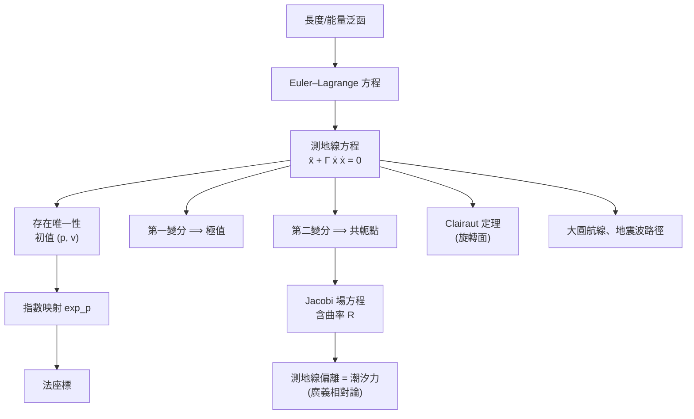

# 3.1 測地線

## 導言：曲面上的「直線」

平面上，兩點之間走直線最短。曲面上，「直線」是什麼？答案是**測地線**：局部最短、且「不自轉彎」的曲線。測地線是 Riemann 幾何與廣義相對論的核心概念：行星繞日的軌道、光線經過太陽旁的偏折（9.1 節）、重力波傳播（9.2 節），都是四維時空中的測地線。本節從變分原理出發建立測地線方程，並計算具體例子。

### 歷史

- **約翰·伯努利（1697）**：最速降線問題開啟變分法；「最短路線」問題是其自然延伸。
- **Euler（1744）**：《尋求具有某種極大或極小性質的曲線的技巧》，發展等周問題的一般方法——Euler–Lagrange 方程的前身。
- **Lagrange（1788）**：《分析力學》把變分法系統化；測地線方程即約束系統的 Lagrange 方程。
- **Gauss（1827）**：在曲面論中以幾何方式定義測地線；Christoffel（1869）、Levi-Civita（1917）給出協變形式的 $\nabla_{\dot\gamma}\dot\gamma = 0$（5.3、6.1 節）。

---

## 變分原理：最短 ⟹ 測地線

### 長度泛函與能量泛函

在曲面上連接 $p, q$ 的曲線 $\gamma(t) = r(u(t), v(t))$，長度

$$
L[\gamma] = \int_a^b \sqrt{E u'^2 + 2F u'v' + G v'^2}\; dt
$$

$L$ 對參數變換不變，變分計算較繁瑣；改用**能量泛函**（等價的極值條件，需弧長參數化）：

$$
\mathcal{E}[\gamma] = \frac{1}{2}\int_a^b \left( E u'^2 + 2F u'v' + G v'^2 \right) dt
$$

### Euler–Lagrange 方程

對 Lagrangian $\mathcal{L} = \frac{1}{2}g_{ij}\dot x^i \dot x^j$ 施用 E–L 方程

$$
\frac{d}{dt}\frac{\partial \mathcal{L}}{\partial \dot x^k} - \frac{\partial \mathcal{L}}{\partial x^k} = 0
$$

計算（$g_{ij}$ 依賴位置）：

$$
\frac{d}{dt}\left(g_{kj}\dot x^j\right) - \frac{1}{2}\frac{\partial g_{ij}}{\partial x^k}\dot x^i\dot x^j = g_{kj}\ddot x^j + \frac{\partial g_{kj}}{\partial x^i}\dot x^i\dot x^j - \frac{1}{2}\frac{\partial g_{ij}}{\partial x^k}\dot x^i\dot x^j = 0
$$

兩邊乘 $g^{mk}$（逆度量）整理，得

$$
\boxed{\ \ddot x^m + \Gamma^m_{ij}\dot x^i\dot x^j = 0\ }
$$

其中

$$
\Gamma^m_{ij} = \frac{1}{2}g^{ml}\left( \frac{\partial g_{lj}}{\partial x^i} + \frac{\partial g_{li}}{\partial x^j} - \frac{\partial g_{ij}}{\partial x^l} \right)
$$

正是 **Christoffel 符號**（5.3 節）。這組二階 ODE 就是**測地線方程**；它是從度量 $g$ 純內蘊地導出的——不需要外在空間。

### 幾何解讀：不自轉彎

測地線的加速度完全法向（無切向分量）：$\ddot\gamma \perp T_pS$ 的切向部分為零。換言之，質點在曲面上自由滑動（無切向力）時走測地線——約束力（曲面的支持力）只提供法向加速度。這是測地線的力學定義，也是廣義相對論「自由落體走測地線」的原型（8.1 節）。

---

## 測地線的性質

### 存在唯一性

測地線方程是二階 ODE：給定初始點 $p$ 與初始速度 $v \in T_pS$，存在唯一測地線 $\gamma_v(t)$（局部）。這是 ODE 理論（Picard–Lindelöf）的直接應用；完備流形上解可延伸到所有時間（Hopf–Rinow, 1931）。

### 等速性

沿測地線能量守恆：$\frac{d}{dt}|\dot\gamma|^2 = 2\langle\nabla_{\dot\gamma}\dot\gamma, \dot\gamma\rangle = 0$，故測地線可以（且通常）弧長參數化。

### 指數映射

$$
\exp_p(v) = \gamma_v(1)
$$

把切空間的向量「射」到流形上；在原點附近是微分同胚——**法座標**的來源：在法座標下 $\Gamma^i_{jk}(p) = 0$，測地線過 $p$ 附近是直線，且 $g_{ij}(p) = \delta_{ij}$。這說明：**彎曲不存在於一階（切空間總是平的），而存在於二階（度量的導數）**——與曲線論中「曲率是二階量」一脈相承。

### 最短線的局部性

測地線局部最短（長度泛函的極小），但全域未必：球面上大圓超過半圈後不再是兩點間最短線。**共軛點**（沿測地線指數映射失去單射性的點）標記最短性的喪失（Morse–Jacobi 理論）。

---

## 例題

### 例題 1：球面上的測地線——大圓

球面 $ds^2 = R^2 d\theta^2 + R^2\sin^2\theta\, d\phi^2$，$E = R^2$、$G = R^2\sin^2\theta$、$F = 0$，$g^{\theta\theta} = 1/R^2$、$g^{\phi\phi} = 1/(R^2\sin^2\theta)$。

**Christoffel 符號**：非零者只有（由 $\Gamma^\theta_{\phi\phi} = -\frac{1}{2R^2}\partial_\theta G = -\sin\theta\cos\theta$ 等）

$$
\Gamma^\theta_{\phi\phi} = -\sin\theta\cos\theta, \qquad \Gamma^\phi_{\theta\phi} = \Gamma^\phi_{\phi\theta} = \cot\theta
$$

**測地線方程**：

$$
\ddot\theta - \sin\theta\cos\theta\,\dot\phi^2 = 0, \qquad \ddot\phi + 2\cot\theta\,\dot\theta\dot\phi = 0
$$

**解讀**：取赤道 $\theta = \pi/2$、$\theta(t) = \pi/2$ 常數 ⟹ $\ddot\theta = 0$，第一式 $0 - 0 = 0$ ✓；第二式 $\ddot\phi = 0$ ⟹ $\phi = at$。赤道是測地線。同理任一經線（$\phi$ 常數）是測地線。

**一般解**：旋轉對稱保證所有大圓都是測地線（任何大圓經剛體旋轉變成赤道）。非大圓的緯線 $\theta = \theta_0 \neq \pi/2$：代入第一式得 $0 - \sin\theta_0\cos\theta_0\,\dot\phi^2 \neq 0$ ✗——緯線不是測地線（除赤道），即使它是「圓」。**直觀：沿緯線走需要不斷向內（向極點方向）修正，有切向力。**

**應用**：飛機航線在大氣層高空近似大圓（great circle route）——紐約直飛東京的航線經過阿拉斯加上空，而非沿緯線。這是測地線最著名的日常應用。

### 例題 2：旋轉面上的測地線——Clairaut 定理

Alexis Clairaut（1733，年僅 20 歲！）：旋轉面 $r(u,v) = (f(v)\cos u, f(v)\sin u, g(v))$ 上，測地線滿足

$$
f(v)\sin\psi = c \quad (\text{常數})
$$

其中 $\psi$ 是測地線與經線的夾角。**推導**：$u$ 是循環座標（$\mathcal{L}$ 不顯含 $u$），由 Noether 型論證（動量守恆）：$\frac{\partial \mathcal{L}}{\partial \dot u} = f^2\dot u = c$，而 $\sin\psi = f\dot u / |\dot\gamma|$ 與等速性給出上式。

**物理驗證**：角動量守恆 $L = mv f \sin\psi$，自由質點在旋轉面上 $mv$ 常數 ⟹ Clairaut 關係。**斜面滾珠實驗**（曲面上的小珠不受摩擦）可直接演示。

**推論**：測地線不能穿過 $f < |c|$ 的區域（$\sin\psi \leq 1$）——測地線在緯線 $f = |c|$ 處反射往回，彷彿有力障壁。這在地球物理（地震波在球狀分層地球中的路徑）中直接應用：地震波走「時空測地線」，Clairaut 關係決定波在哪些深度轉向。

---

## 變分法觀點：測地線與 Jacobi 場

### 第二變分

測地線是否最短，由第二變分決定：

$$
\frac{d^2 L}{d\epsilon^2}\Big|_0 = \int_a^b \left( |\nabla_{\dot\gamma} V|^2 - \langle R(\dot\gamma, V)\dot\gamma, V\rangle \right) ds
$$

其中 $V$ 是變分場，$R$ 是曲率張量（6.2 節）。第二變分方程的解是 **Jacobi 場**：

$$
\nabla_{\dot\gamma}\nabla_{\dot\gamma} J + R(J, \dot\gamma)\dot\gamma = 0
$$

**直觀**：相鄰測地線的分離行為由曲率決定——正曲率使測地線聚焦（如透鏡）、負曲率使測地線發散（混沌的種子，Anosov 系統）。**這是「曲率 = 重力」的最純數學形式**：廣義相對論中測地線偏離方程（geodesic deviation）正是 Jacobi 方程，潮汐力即 Riemann 張量（8.2 節）。

---

## mermaid 圖：測地線的知識結構

---

## 與其他領域的關聯

### 變分法與微積分

測地線方程是 Euler–Lagrange 方程的最早非平凡應用之一；變分法後來發展出 Noether 定理（對稱 ⟺ 守恆律，1918），Clairaut 定理正是其初等實例（循環座標 = 對稱性 = 守恆量）。

### 力學

測地線 = 約束系統的自由運動；位形空間的度量（動能）決定軌跡。Lagrange、Hamilton 力學在幾何語言下：**力學 = 流形上的測地流**（geodesic flow），這是辛幾何的起點。

### 廣義相對論

自由落體走時空的類時測地線、光線走零測地線；牛頓重力「力」被幾何化為「時空彎曲使直線變測地線」。等效原理（8.1 節）是這個幾何化的物理根據。

### 算子理論

測地流的量子化（quantum ergodicity）聯繫特徵值問題：負曲率流形上的 Laplace 特徵函數在半經典極限下「等分布」（Shnirelman 定理, 1974）——**混沌測地流 ⟺ 量子本徵態的隨機性**。算子理論（擬譜、跡公式）在此全面登場。

### 量子力學

路徑積分中 $e^{iS/\hbar}$ 的位相 $S$ 是作用量（能量泛函的積分）；測地線是駐定相位路徑，半經典極限 $\hbar \to 0$ 時粒子「走測地線」——古典力學從量子力學的駐定相位近似中湧現。

---

## 小結

1. 測地線是能量（長度）泛函的極值曲線，方程 $\ddot x^m + \Gamma^m_{ij}\dot x^i\dot x^j = 0$。
2. Christoffel 符號由度量完全決定——測地線是內蘊概念。
3. 指數映射與法座標顯示：彎曲從二階開始。
4. Clairaut 定理：旋轉面上的角動量守恆；地震波路徑的數學。
5. 第二變分引入曲率 $R$：測地線的聚焦/發散 = 重力的數學本質。

下一節給出 Gauss 絕妙定理的證明與 Gauss–Bonnet 定理——曲率與拓樸的第一次握手。

---

## 深入研習：測地線的進階理論與應用

1. **測地線的存在域與共軛點**：法座標下 $\exp_p$ 是微分同胚的最大半徑由**共軛點**決定（沿測地線指數映射的 Jacobi 行列式首次為零處）。球面：對蹠點是赤道出發測地線的共軛點（距離 $\pi R$）——**超過共軛點，測地線不再是極小**。Morse 理論（1920s–30s）把路徑空間的拓樸與共軛點計數聯繫：**路徑空間的 Betti 數 ≤ 共軛點數**——「流形的形狀編碼在測地線的行為裡」。

2. **測地線的混沌：負曲率世界**：雙曲平面（$K = -1$）上相鄰測地線指數分離（$\ddot J = J$ ⟹ $J \sim e^s$）：初始誤差 $\delta$ 在長度 $s \sim \ln(1/\delta)$ 後放大為 $O(1)$——**可預測性視野（Lyapunov 時間）**。雙曲檯球（Hadamard 1898 首例）是**數學混沌的第一個嚴格模型**，先於 Lorenz（1963）半世紀。宇宙學意義：負曲率宇宙中初始密度擾動指數放大（重組合時期的微擾 → 今日星系），**曲率符號 = 結構形成的放大器設定**。

3. **測地線與守恆量：可積系統**：對稱性（Killing 向量場，10.2 節）給出守恆量：旋轉對稱 ⟹ 角動量（Clairaut 定理）、平移對稱 ⟹ 動量。**足夠多的守恆量 ⟹ 可積**（Liouville 定理：$n$ 自由度需 $n$ 個對合守恆量）。可積 ⟹ 軌道在環面上（Liouville–Arnold 定理 1963）——**經典力學的「完美世界」是測地流在環面上的直線**。不可積（如三體、一般負曲率）→ 混沌——**對稱性的數量決定動力學的命運**。

4. **地球物理：地震波射線**：地震波在分層地球中走「費馬最短時間路線」（射線 = 時間度量的測地線，折射率 $n(r)$ 定義 $ds^2_{\text{光學}} = n^2(dx^2+dy^2+dz^2)$）。**Herglotz–Wiechert 反演（1907–10）**：從走時曲線反推速度分層——地球內核（1936 Lehmann 發現）的發現是「測地線反演」的勝利。**CT 掃描、石油探勘的層析成像同屬此族**。

5. **測地線與最優控制**：火箭的最省燃料軌跡（花園灌溉型問題）、機器人的最短可達路徑（Dubins 車：曲率受限的最短線 = 由圓弧與直線拼接，1957）——**帶約束的測地問題**。Dubins 路徑的六種組合（LSL、RSR、LSR…）是 Pontryagin 極大值原理（1956）的教科書案例——**變分法 1950 年代的現代化 = 測地論的控制版**。

6. **彈道與彈性：Elastica**：Euler 的彈性桿（1744）：彎曲能 $\int\kappa^2 ds$ 極小的形狀——「彈性測地線」。變體：帶撓率的三維 Elastica（DNA 形狀模擬、海底電纜敷設）。**能量泛函的選擇（長度 vs 曲率平方）決定「直線」的定義**——測地線概念的三種推廣：最短、最平、最省能。

7. **閉測地線與週期軌道**：緊緻流形上每個同倫類有閉測地線（Birkhoff 極大極小法，1917；Lyusternik–Fet 1951 一般化）。**閉測地線計數**與譜的關係（trace formula）：負曲率面的閉測地線長度譜決定譜（Huber 1959）、譜決定長度譜（Huber 反向）——**「聽音辨形」的測地版本**：底鼓（dupin）問題的兩側。三葉結補空間的閉測地計數（模形式！）是現代發展（Basmajian 等）。

8. **測地線與 GPS 的軌道力學**：衛星軌道在 Schwarzschild 度量的類時測地線（8.3 節）——廣義相對論修正 GPS 衛星的近地點進動（每年毫米級但累積重要）、LAGEOS 衛星的 Lense–Thirring 進動測量（Frame dragging，2004–2011 確認）。**牛頓軌道 = 平直時空測地線 + 中心力；GR 軌道 = 彎曲時空測地線，零力**——同一現象的兩種描述，GR 的更內蘊。

9. **理論物理的測地假說**：等效原理的最強形式「測地假說」：小質點世界線是類時測地線（Einstein–Grommer 1927 證明：點粒子在場方程 + 守恆律下自動沿測地線——**運動方程從場方程導出**！）。這消除「獨立假設」的冗餘：**幾何不僅提供舞台，還編寫劇本**。

10. **測地線的數值方法**：測地方程的積分（RK 方法）、網格上的離散測地線（Dijkstra 近似、exact geodesic algorithm MMP 1987）、**熱核法**（Crane–Weischedel–Wardetzky 2013：用擴散過程的 Dirichlet-to-Neumann 映射求精確測地距離）——**「熱的擴散記得距離」**：譜理論（5.2 節 Laplace 算子）與測地距離的深層等價在遊戲與 CAD 中實用化。

## 習題與詳解

**習題 1**：在單位球面上求從 $(1, 0, 0)$ 出發、初始方向 $v = (0, 1, 0)/1 \in T_p$ 的測地線顯式解。

解：過 $p = (1,0,0)$、切向 $y$ 軸的大圓 = 赤道（$z = 0$ 平面與球面之交）。測地線 $\gamma(t) = (\cos t, \sin t, 0)$。驗證測地方程（3.1 節球面方程）：$\theta(t) = \pi/2$ 常數、$\phi(t) = t$：$\ddot\theta - \sin\theta\cos\theta\dot\phi^2 = 0 - 0 = 0$ ✓、$\ddot\phi + 2\cot(\pi/2)\dot\theta\dot\phi = 0$ ✓。**對稱性論證**：赤道經剛體旋轉可變為任何大圓 ⟹ **球面測地線 = 大圓**（5.2 節「旋轉對稱 + 唯一性」論證）。

**習題 2**：推導 Clairaut 關係並驗證於球面緯線圓。

解：旋轉面 $r(u, v) = (f(v)\cos u, f(v)\sin u, g(v))$，度量 $E = f^2$、$G = f'^2 + g'^2$（取 $v$ 為弧長參數則 $G = 1$）。Lagrangian $L = \frac{1}{2}(f^2\dot u^2 + \dot v^2)$ 不顯含 $u$ ⟹ $\frac{\partial L}{\partial \dot u} = f^2\dot u = c$。速率恆定 $f^2\dot u^2 + \dot v^2 = 1$。測地線與經線（$\dot u = 0$ 方向）夾角 $\psi$：$\sin\psi = \frac{f|\dot u|}{1}$ ⟹ $f\sin\psi = c$。**驗證**：赤道（$f = a$，$\psi = \pi/2$）：$c = a$ ✓；測地線到達最小緯線 $f_{\min} = |c|$ 處 $\psi = \pi/2$ 後反射——**「緯度障壁」**。地球物理應用（正文已述）：地震波在地球中的轉向半徑由角動量守恆決定，S/P 波的陰影區（1912 Gutenberg 的核–幔邊界發現，2900 km）正是 Clairaut 幾何的觀測。

**習題 3**：證明：$K \leq 0$ 的曲面上，任何測地線的兩點段若包含共軛點則矛盾（無共軛點定理），並說明其後果。

解：Jacobi 場方程（3.1 節）取法向分量：$\ddot j + K j = 0$（二維、弧長參數）。$K \leq 0$ ⟹ $\ddot j = -Kj \geq 0$（當 $j > 0$）：$j$ 凸增、永不回到零——**非平凡 Jacobi 場無第二零點 ⟹ 無共軛點**。後果（Cartan–Hadamard 定理 1896/1928）：完備單連通 $K \leq 0$ 流形上 $\exp_p$ 是全域微分同胚 ⟹ **任何兩點恰有一條測地線連接、距離 = 測地長度**——雙曲空間的「完美導航」性質；也是 Thurston 三維分類與 Mostow 剛性（1968：雙曲流形由基本群完全決定！）的起點。**負曲率把「局部直線」升級為「全域唯一直線」**。
