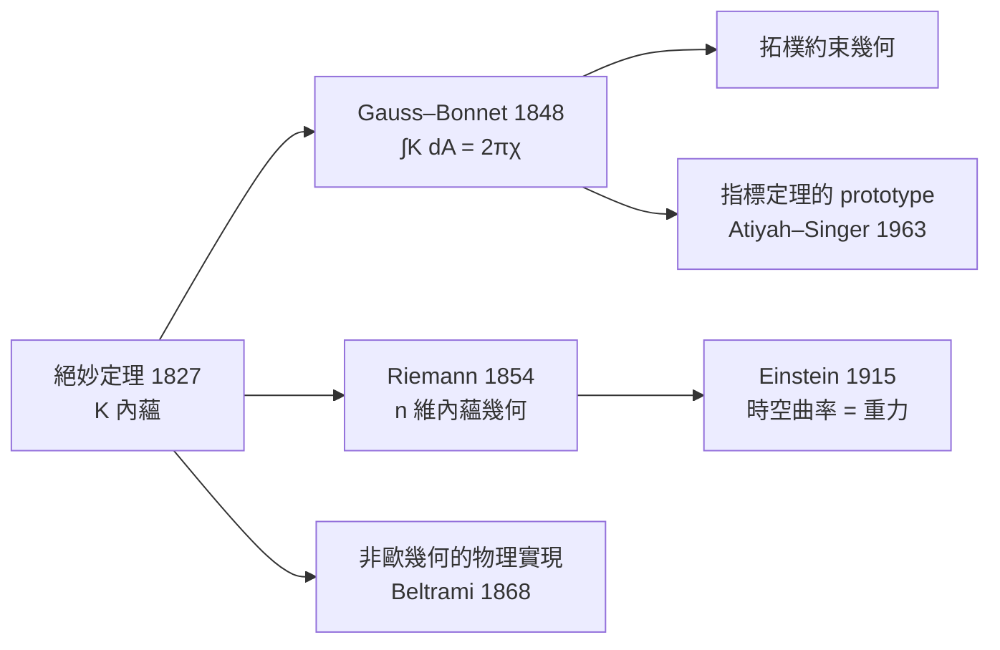

# 3.2 Gauss 絕妙定理

## 導言：Theorema Egregium

1827 年，Gauss 在《曲面的一般研究》中證明了一個他自己稱之為 **Theorema Egregium**（拉丁文「絕妙定理」）的結果：

> **Gauss 曲率 $K$ 可以只用第一基本形式（$E, F, G$ 及其導數）表出。**

這意味著：等距映射保持 Gauss 曲率。彎曲的內蘊性第一次被嚴格證明——毛蟲不必離開曲面就能測出 $K$。這條定理是 Riemann 幾何的種子：既然曲率內蘊於度量，則「度量 + 微分」即可構建完整的幾何，不需要外在空間——Riemann 1854、Einstein 1915 都站在這條定理上。

---

## 定理的陳述與公式

### Gauss 方程

設曲面 $r(u, v)$，第一基本形式 $I = E\,du^2 + 2F\,du\,dv + G\,dv^2$，第二基本形式 $II = L\,du^2 + 2M\,du\,dv + N\,dv^2$（3.3 節定義）。Gauss 的**特性方程**（Gauss equation）給出

$$
K = \frac{LN - M^2}{EG - F^2}
$$

乍看之下 $K$ 依賴第二基本形式（外在量）。但 Gauss 更進一步證明：

$$
\boxed{\ K = \frac{1}{EG - F^2}\left( \text{關於 } E, F, G \text{ 及其一、二階偏導的多項式} \right)\ }
$$

即 $LN - M^2$ 可完全由 $E, F, G$ 表出。這是絕妙定理的內容。

### 正交參數下的顯式公式

當 $F = 0$（正交參數）時（Brioschi 公式的特例）：

$$
K = -\frac{1}{2\sqrt{EG}}\left[ \frac{\partial}{\partial u}\left( \frac{G_u}{\sqrt{EG}} \right) + \frac{\partial}{\partial v}\left( \frac{E_v}{\sqrt{EG}} \right) \right]
$$

### 等溫座標下的公式

若 $ds^2 = \lambda^2(du^2 + dv^2)$：

$$
K = -\frac{1}{\lambda^2}\Delta(\ln \lambda), \qquad \Delta = \partial_u^2 + \partial_v^2
$$

這個公式把曲率與 Laplace 算子聯繫起來，是極小曲面理論、複分析（解析函數的實虛部為調和函數）與 Liouville 定理（「平面上有界調和函數為常數」⟹ 完備正曲率曲面緊緻，經典應用）的交會點。

### 內蘊距離下的不變性

**推論（等距不變性）**：設 $\phi : S_1 \to S_2$ 是等距映射（保持第一基本形式），則對應點的 Gauss 曲率相等：

$$
K_{S_1}(p) = K_{S_2}(\phi(p))
$$

**立即可得**：不存在把球面（$K = 1/R^2 > 0$ 處處）等距映到平面（$K = 0$）的映射——**地圖必然失真**。Mercator 保角但不保距；等距離投影保長度性質之一但非全域等距。這為製圖學的極限給出數學判決。

---

## 證明梗概

### 第一步：Gauss–Weingarten 方程

把 $\mathbb{R}^3$ 值向量場 $r_u, r_v, n$ 對 $u, v$ 求導並在標架 $\{r_u, r_v, n\}$ 中展開：

$$
r_{uu} = \Gamma^1_{11}r_u + \Gamma^2_{11}r_v + L\,n
$$
$$
r_{uv} = \Gamma^1_{12}r_u + \Gamma^2_{12}r_v + M\,n
$$
$$
r_{vv} = \Gamma^1_{22}r_u + \Gamma^2_{22}r_v + N\,n
$$

以及 Weingarten 方程 $n_u, n_v \in T_pS$（形狀算子）。

### 第二步：混和偏導相容性

向量值函數的混合偏導相等：$r_{uuv} = r_{uvu}$。把兩邊都用標架展開，比較法向分量（切向分量得出 Codazzi 方程，見 3.3 節），法向分量相減：

$$
L\, v - M\, u \text{ 型的項相消後得 } LN - M^2 = (\text{Christoffel 符號的組合})
$$

而 Christoffel 符號由 $g_{ij}$ 決定：

$$
\Gamma^k_{ij} = \frac{1}{2}g^{kl}\left( \partial_i g_{jl} + \partial_j g_{il} - \partial_l g_{ij} \right)
$$

故 $K = (LN - M^2)/(EG - F^2)$ 只含 $E, F, G$ 與其導數。**證明的哲學：「兩次求導的順序無關」這個平凡事實（$r_{uuv} = r_{uvu}$）蘊藏了曲率的內蘊性**。同一論證在高維產生 Riemann 曲率張量（6.2 節）——曲率 = 聯絡的可交換性缺陷。

---

## Gauss–Bonnet 定理：曲率與拓樸握手

### 局部形式

對曲面上由分段光滑測地弧圍成的區域 $\Delta$（角 $\alpha_i$）：

$$
\iint_\Delta K\, dA + \sum_i \int_{\partial\Delta} k_g\, ds + \sum_i(\pi - \alpha_i) = 2\pi
$$

其中 $k_g$ 是測地曲率（邊界曲率的切平面內分量）。測地三角形（三邊皆測地線、$k_g = 0$）：

$$
\alpha_1 + \alpha_2 + \alpha_3 = \pi + \iint_\Delta K\, dA
$$

**內角和由曲率的積分決定**——歐氏幾何 $\pi$、球面 $> \pi$、雙曲 $< \pi$（2.3 節的毛蟲實驗）。

### 全域形式（Bonnet, 1848）

設 $S$ 是緊緻可定向曲面，則

$$
\boxed{\ \iint_S K\, dA = 2\pi\,\chi(S)\ }
$$

$\chi(S) = 2 - 2g$ 是 Euler 示性數（$g$ = 虧格，洞的個數）。

| 曲面 | $\chi$ | $\iint K\, dA$ |
|---|---|---|
| 球面 | $2$ | $4\pi$ |
| 環面 | $0$ | $0$ |
| 雙環面 | $-2$ | $-4\pi$ |
| 平坦環面 | $0$ | $0$ |

**深刻的後果**：

1. 環面不可能有處處 $K > 0$ 的度量（否則積分 $> 0$，矛盾）——**拓樸約束幾何**。
2. 積分 $K$ 與度量無關（左邊依賴度量、右邊只依賴拓樸）！這是**指標定理**（Atiyah–Singer, 1963）的二維原型。
3. 常曲率度量的存在性：$\chi > 0$ ⟹ 球面幾何、$\chi = 0$ ⟹ 歐氏、$\chi < 0$ ⟹ 雙曲——**三幾何分類**，正是龐加萊宇宙學模型與宇宙形狀問題（現代宇宙學：微波背景測量判斷 $K$ 的符號）的數學基礎。

---

## 例題

### 例題 1：用內蘊公式計算球面曲率

球面 $ds^2 = R^2 d\theta^2 + R^2\sin^2\theta\, d\phi^2$（正交參數，$F = 0$）。用 Brioschi 公式：

$$
\sqrt{EG} = R^2\sin\theta, \qquad \frac{G_\theta}{\sqrt{EG}} = \frac{2R^2\sin\theta\cos\theta}{R^2\sin\theta} = 2\cos\theta
$$

$$
K = -\frac{1}{2R^2\sin\theta}\left[ \frac{\partial}{\partial\theta}(2\cos\theta) + \frac{\partial}{\partial\phi}(0) \right] = -\frac{1}{2R^2\sin\theta}(-2\sin\theta) = \frac{1}{R^2}
$$

✓ 與法映射方法（2.3 節）結果一致，但**整個計算只用 $E, G$**——Gauss 曲率確實內蘊。順帶驗證 Gauss–Bonnet：

$$
\iint_S K\, dA = \frac{1}{R^2}\cdot 4\pi R^2 = 4\pi = 2\pi\chi(\mathbb{S}^2)\ \checkmark
$$

### 例題 2：等距映射的存在性判別

問：半徑 $a$ 的球冠（緯度 $0 \leq \theta \leq \theta_0$）能否等距攤平到平面上的圓盤（半徑 $\rho_0$）？

**分析**：若能，則曲率不變：球冠 $K = 1/a^2 > 0$，平面 $K = 0$——矛盾，**不能精確攤平**。但注意：**圓錐面可以**（$K = 0$，除頂點外可攤平）；橋樑工程中薄殼的「可展曲面」（$K \equiv 0$：柱面、錐面、切線面）可以由平板彎成而不產生應變——**這是 $K$ 內蘊性的工程應用**：不可展曲面（如球殼）需要拉伸材料（塑形應變），可展曲面只需彎曲。汽車鈑金、造船鋼板放樣（與 Monge 的畫法幾何淵源深厚）都應用此判別。

---

## 歷史與迴響

### Gauss 的猶豫與影響

Gauss 對此發現深感自豪（「絕妙」）但表達隱晦；他在信中提到「這些研究與世俗事物緊密相連」（指大地測量），也私下向 Schumacher 承認他已掌握非歐幾何。曲面內蘊幾何成為：

- **Riemann（1854）**：推廣到 $n$ 維，度量幾何誕生；
- **Beltrami（1868）**：偽球面模型使非歐幾何獲得嚴格地位；
- **Klein（1872）**：Erlangen 綱領以變換群分類幾何（與內蘊觀點互補，10.2 節）；
- **Ricci–Levi-Civita（1900）**：張量演算，使內蘊計算可操作；
- **Einstein（1915）**：內蘊幾何成為重力的語言。

### 引發的新問題

1. 內蘊曲率高維推廣的完整結構？→ Riemann 張量（6.2）。
2. 拓樸如何約束幾何（Gauss–Bonnet 的高維版本）？→ 指標定理、Ricci 流（Perelman, 2003 證明龐加萊猜想）。
3. 非歐幾何的物理意義？→ 相對論（第 7、8 章）。

### 與其他領域的關聯

- **微積分**：混合偏導相等（Clairaut–Schwarz 定理）是證明的引擎；Laplace 算子出現在等溫公式。
- **向量微積分**：Gauss–Bonnet 是 Stokes 型定理（微分形式的 $\int_S d\omega = \int_{\partial S}\omega$）；曲率 $K\,dA$ 是一個「外微分二次型」（Chern 類的二維情形）。
- **算子理論**：$\Delta(\ln\lambda) = -\lambda^2 K$ 把曲率與譜理論聯繫；緊曲面 Laplace 特徵值的 Weyl 漸近含曲率修正項（譜幾何）。
- **量子力學**：量子霍爾效應中 Hall 電導 = $(e^2/h)\cdot\frac{1}{2\pi}\int F$，與 Gauss–Bonnet 同構（Chern 數）；陳省身 1944 的內蘊證明直接啟發現代拓樸量子場論。

---

## 小結

1. 絕妙定理：$K = (LN - M^2)/(EG - F^2)$ 可由 $E, F, G$ 完全表出；等距映射保持 $K$。
2. 證明核心：混合偏導相容性 $r_{uuv} = r_{uvu}$ ⟹ Gauss 方程。
3. Gauss–Bonnet：$\iint K\,dA = 2\pi\chi(S)$，曲率積分是拓樸不變量。
4. 拓樸約束：環面無正曲率度量；三幾何分類（正／零／負曲率）。
5. 內蘊哲學：幾何存在於度量之中，外在空間可有可無——通往 Riemann 與 Einstein。

下一節補完曲面的外在幾何：第二基本形式、主曲率與平均曲率，說明 $K$ 在其中的位置。
