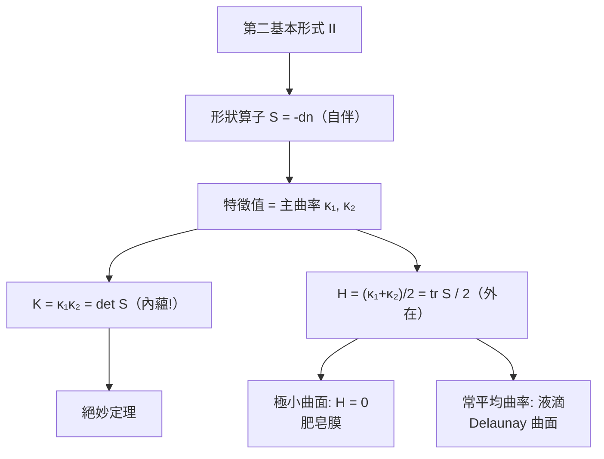

# 3.3 第二基本形式與主曲率

## 導言：曲面的「彎法」

第一基本形式回答「怎麼量」，第二基本形式回答「怎麼彎」。彎曲的方向性（凹凸、馬鞍）、極小曲面（肥皂膜）、常平均曲率曲面（液滴），都由它描述。本節建立第二基本形式、形狀算子、主曲率，並完成曲面幾何的全景圖。

### 歷史

- **Meusnier（1776）**：18 歲的學生向 Euler 指出極小曲面問題的解（螺旋面），並提出「法曲率與密切圓」的關係（Meusnier 定理）。
- **Rodrigues（1815）**：法向量變化與主曲率。
- **Gauss（1827）**：第二基本形式系統化， $K = (LN - M^2)/(EG-F^2)$ 。
- **Gaspard Monge 學派**：偏微分方程與曲面分類；Dupin 標線（1813）。
- **Delassus、Bianchi 等（19 世紀末）**：基本定理（度量 + 第二形式決定曲面，至剛體運動）。

---

## 法曲率與第二基本形式

### 曲面的曲線曲率拆解

設曲面上的曲線 $\gamma(s)$ （弧長參數）。其曲率向量 $\ddot\gamma$ 分解為切平面內分量與法向分量：

$$
\ddot\gamma = (\ddot\gamma)^{\top} + (\ddot\gamma)^{\perp}, \qquad (\ddot\gamma)^{\perp} = \kappa_n\, n
$$

**法曲率**定義為

$$
\kappa_n = \langle \ddot\gamma, n\rangle = II(\dot\gamma, \dot\gamma)
$$

其中**第二基本形式**

$$
II = L\,du^2 + 2M\,du\,dv + N\,dv^2, \qquad L = \langle r_{uu}, n\rangle,\ M = \langle r_{uv}, n\rangle,\ N = \langle r_{vv}, n\rangle
$$

### Meusnier 定理（1776）

同一點、同一切方向的曲面上所有曲線，法曲率相同；且

$$
\kappa = \cos\theta \cdot \frac{1}{\rho}
$$

其中 $\kappa$ 是曲線曲率、 $\rho$ 是該方向的法截線曲率（曲面與法平面交線的曲率）、 $\theta$ 是曲線密切面與法平面夾角。**換言之：法曲率只依賴切方向**——曲面在一個方向的「彎度」是內定值，個別曲線只按 $\cos\theta$ 分攤。

### 幾何直觀

把曲面沿某方向切開（用垂直於切平面的平面），看切口曲線的彎曲程度：那就是法曲率。球面各方向相同（ $\kappa_n = 1/R$ ）；圓柱沿軸向為 0、橫向為 $1/a$ ；馬鞍面有的方向正、有的負。

---

## 形狀算子與主曲率

### Weingarten 映射

定義**形狀算子**（shape operator，又稱 Weingarten 映射）

$$
S_p = -dn_p : T_pS \to T_pS
$$

由 Weingarten 方程 $n_u, n_v$ 的展開式， $S$ 在基 $\{r_u, r_v\}$ 的矩陣為

$$
S = \frac{1}{EG - F^2}\begin{pmatrix} L\,G - M\,F & M\,E - L\,F \\ M\,G - N\,F & N\,E - M\,F \end{pmatrix}
$$

**關鍵事實： $S$ 是自伴算子**（ $I(SX, Y) = I(X, SY)$ ，由 $n\cdot r_u = 0$ 微分兩次的對稱性）。由譜定理：

- $S$ 有兩個實特徵值：**主曲率** $\kappa_1, \kappa_2$ ；
- 特徵方向正交：**主方向**；
- $\kappa_n(\theta) = \kappa_1\cos^2\theta + \kappa_2\sin^2\theta$ （**Euler 公式**， $\theta$ 為與第一主方向的夾角）。

### 不變量

$$
K = \kappa_1\kappa_2 = \det S = \frac{LN - M^2}{EG - F^2}, \qquad H = \frac{\kappa_1 + \kappa_2}{2} = \frac{1}{2}\mathrm{tr}\,S = \frac{EN - 2FM + GL}{2(EG - F^2)}
$$

**Gauss 曲率 = 形狀算子的行列式，平均曲率 = 跡之半**。絕妙定理說：行列式內蘊（ $K$ 只由 $g$ 決定），但跡不然—— $H$ 是真正的外在量（等距映射可改變 $H$ ）。

### 點的分類

| 點型 | 條件 | $S$ 的特徵 | 幾何 | 例 |
|---|---|---|---|---|
| 橢圓點 | $K > 0$ | 同號特徵值 | 局部凸（同側） | 球面、蛋面 |
| 雙曲點 | $K < 0$ | 異號 | 馬鞍形 | 偽球面 |
| 拋物點 | $K = 0$ ，非零 | 一零一非零 | 單向彎 | 圓柱（處處） |
| 臍點 | $\kappa_1 = \kappa_2$ | $S = \kappa I$ | 各向同性 | 球面（處處）、球面點 |

**Dupin 標線**： $II = \pm 1$ 在切平面的截線，橢圓／雙曲線／平行線——曲面的局部「指紋」。

---

## 極小曲面與常平均曲率曲面

### 極小曲面

**定義**： $H \equiv 0$ 的曲面。名稱來源：面積泛函的臨界點——任意小變形都使面積增加（局部極小）。

- **Lagrange（1762）**提出方程；**Meusnier（1776）**給出兩個非平凡解：平面與**螺旋面**。
- **Plateau（1873）**實驗：肥皂膜自然張成極小曲面（表面張力使能量 = 面積極小）。
- **Plateau 問題**：給定閉曲線，求張在其上的極小曲面。Douglas 與 Radó（1930–31）解決（Douglas 獲 1936 首屆 Fields 獎）。
- 經典例子：**懸鏈面**（兩個圓之間的旋轉極小面）、**Enneper 曲面**、**Costa 曲面**（1982，虧格 1 三端極小面）。

### 極小曲面方程

圖形曲面 $z = f(x, y)$ 的極小性條件：

$$
(1 + f_y^2)f_{xx} - 2f_x f_y f_{xy} + (1 + f_x^2)f_{yy} = 0
$$

這是非線性橢圓 PDE；用等溫座標可線性化為調和條件 $\Delta f = 0$ 的共軛系統（Weierstrass 表示：極小曲面由解析函數對 $(\varphi_1, \varphi_2, \varphi_3)$ 構造）——**複分析成為極小曲面的引擎**，顯示第一/第二形式與 Laplace 算子的深刻聯繫。

### 常平均曲率（CMC）曲面

$H$ 為常數的曲面是面積泛函在體積約束下的臨界點（液滴、細胞膜）：

- 球面（Delaunay 1841 完整分類旋轉 CMC 面：球、圓柱、波狀面、懸鏈面夾層）；
- Alexandrov 定理（1958）： $\mathbb{R}^3$ 中緊緻嵌入 CMC 面只有球面——**物理對應：肥皂泡是球形**。

---

## 基本定理：兩形式決定曲面

### 陳述（Bonnet, 1867）

設區域上給定對稱正定 $g = \begin{pmatrix} E & F \\ F & G\end{pmatrix}$ 與對稱 $b = \begin{pmatrix} L & M \\ M & N\end{pmatrix}$ ，滿足

- **Gauss 方程**（曲率相容）： $K = \frac{LN-M^2}{EG-F^2}$ 且 $K$ 由 $g$ 計算一致；
- **Codazzi–Mainardi 方程**（第二形式相容）：
$$
L_v - M_u = L\Gamma^1_{12} + M(\Gamma^2_{12} - \Gamma^1_{11}) - N\Gamma^2_{11}\quad (\text{及另一條對稱式})
$$

則存在曲面（至剛體運動唯一）以之為兩基本形式。

### 意義

曲面的「形狀密碼」是兩組量： $g$ （內蘊）+ $b$ （外在），共 6 個函數，受 3 條相容方程（1 Gauss + 2 Codazzi）約束。**相容性方程 = 可積分條件**，其代數結構正是「曲率張量」的一般模式（6.2 節：Riemann 張量是聯絡的相容性缺陷）。同構對比：量子力學中 Schrödinger 方程的相容性（波函數可積分）由規範對稱性保證（9.3 節）。

---

## 例題

### 例題 1：球面的第二基本形式與主曲率

球面 $r(\theta, \phi) = R(\sin\theta\cos\phi, \sin\theta\sin\phi, \cos\theta)$ ， $n = r/R$ 。

**二階偏導**：

$$
r_{\theta\theta} = -r, \qquad r_{\theta\phi} = R\cos\theta(-\sin\phi, \cos\phi, 0), \qquad r_{\phi\phi} = -R\sin\theta(\sin\theta\cos\phi, \sin\theta\sin\phi, 0) + R\sin\theta\, n_{\text{radial 部分}}
$$

直接計算法向分量：

$$
L = \langle r_{\theta\theta}, n\rangle = \langle -r, r/R\rangle = -R
$$

（取向 $n = r/R$ 向外， $L = -R$ ；若取 $n = -r/R$ 則 $L = R$ ——符號取決於法向取向， $K$ 不受影響。）

$$
M = \langle r_{\theta\phi}, n\rangle = 0 \quad (\text{切向向量與 } n \text{ 正交}), \qquad N = \langle r_{\phi\phi}, n\rangle = -R\sin^2\theta
$$

**主曲率**：

$$
K = \frac{LN - M^2}{EG - F^2} = \frac{(-R)(-R\sin^2\theta)}{R^2\cdot R^2\sin^2\theta} = \frac{1}{R^2}\ \checkmark
$$

$$
H = \frac{EN - 2FM + GL}{2(EG - F^2)} = \frac{R^2(-R\sin^2\theta) + R^2\sin^2\theta(-R)}{2R^4\sin^2\theta} = -\frac{1}{R}
$$

故 $\kappa_1 = \kappa_2 = \pm 1/R$ ：球面處處是臍點。✓

### 例題 2：圓柱面的兩形式

圓柱 $r(u, v) = (a\cos u, a\sin u, v)$ ， $n = (\cos u, \sin u, 0)$ ， $E = a^2, F = 0, G = 1$ 。

$$
r_{uu} = (-a\cos u, -a\sin u, 0) = -a\,n \Rightarrow L = -a; \quad r_{uv} = 0 \Rightarrow M = 0; \quad r_{vv} = 0 \Rightarrow N = 0
$$

$$
K = \frac{(-a)(0) - 0}{a^2} = 0, \qquad H = \frac{a^2\cdot 0 + 1\cdot(-a)}{2a^2} = -\frac{1}{2a}
$$

主曲率 $\kappa_1 = \pm 1/a$ （橫向）、 $\kappa_2 = 0$ （縱向）。** $K = 0$ 但 $H \neq 0$ **：外在彎、內蘊平——與 2.3、3.2 節呼應。肥皂泡做成圓柱形（兩環之間）需要壓差（非極小），而肥皂**膜**（兩面）才是 $H = 0$ 。

---

## 與其他領域的關聯

### 線性代數／算子理論

形狀算子是自伴算子：譜定理給出主曲率與主方向； $K = \det S$ 、 $H = \frac{1}{2}\mathrm{tr} S$ 是譜不變量。特徵值問題（求 $S$ 的譜）= 幾何問題，這是「譜幾何」最簡模型；Rayleigh–Ritz 變分原理（算子理論核心）對應極小曲面的面積變分。

### 向量微積分

Weingarten 方程是方向導數 $D_v n = -S(v)$ 的版本； $\mathrm{div}\, n = \kappa_1 + \kappa_2 = 2H$ ——**平均曲率是法向量場的散度**！極小曲面 ⟺ $\mathrm{div}\,n = 0$ ，這在流體力學（Young–Laplace 方程：壓差 $\Delta p = 2\gamma H$ ， $\gamma$ 為表面張力）直接出現：肥皂泡內外壓差與 $H$ 成正比。毛細現象、肺泡生理學（肺表面張力）皆用此式。

### 量子力學

- 膜世界（braneworld）模型中物質附著於高維時空的類時極小超曲面；
- 弦論中極小曲面的廣義化（極小極大面）用於鏡像對稱的驗證；
- 二維量子引力以 $\int K\, dA$ 為作用量（Liouville 理論）——Gauss 曲率成為量子場。

### 工程與科學

- 建築：薄殼結構（Sydney 歌劇院）以曲率分佈設計受力； $K=0$ 可展面免應變。
- 醫學影像：腦皮質的主曲率用於溝回識別。
- 電腦圖學：網格平滑以離散平均曲率流（mean curvature flow）實現——PDE 在離散幾何上的模擬。

---

## 小結

1. 第二基本形式 $II$ 量度法向加速度；法曲率只依賴切方向（Meusnier）。
2. 形狀算子 $S = -dn$ 自伴；主曲率是其特徵值，Euler 公式給出方向依賴。
3. $K = \det S$ （內蘊）、 $H = \frac{1}{2}\mathrm{tr}\,S$ （外在）。
4. $H = 0$ 極小曲面（肥皂膜）、 $H$ 常數 CMC（肥皂泡）；Alexandrov 定理。
5. Gauss–Codazzi 方程是兩形式可積分的相容條件——曲率張量思想的曲面前身。

第 4 章將把「局部座標卡 + 相容條件」公理化為流形，脫離 $\mathbb{R}^3$ 的搖籃。
