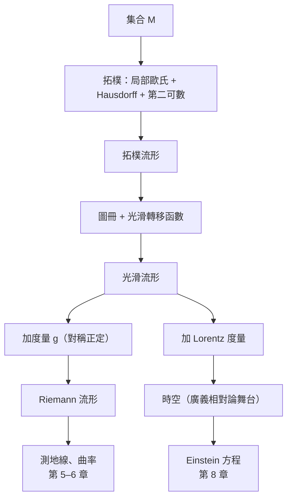

# 4.1 從曲面到流形

## 導言：幾何的抽象化

十九世紀的曲面理論依附於 $\mathbb{R}^3$：曲面「放在」空間裡。但 Riemann 1854 年問：幾何的本質是什麼？答案：**一個對象，局部像 $\mathbb{R}^n$，配上相容的座標卡**——這就是**流形**。本節敘述流形概念如何從曲面、非歐幾何與物理需求中誕生，並說明其定義的每一個部件為何必要。

### 為什麼需要流形？

四個驅動力：

1. **高維幾何**：Riemann 想研究 $n$ 維彎曲空間，但 $n$ 維曲面嵌在 $\mathbb{R}^{n+1}$ 之外的描述不明確——需要內蘊公理化。
2. **非歐幾何的自洽性**：雙曲幾何無法整體嵌入 $\mathbb{R}^3$（Hilbert 定理, 1901：$\mathbb{R}^3$ 中無完備負常曲率曲面的等距嵌入），需要不依賴嵌入的模型。
3. **力學的位形空間**：剛體的姿態構成三維流形（非歐的！旋轉群 $SO(3)$）；多體系統的位形空間是高維流形。力學需要內蘊幾何。
4. **相對論**：時空不是 $\mathbb{R}^4$ 加座標，而是流形 + Lorentz 度量（第 7、8 章）。座標只是「地圖」，不是實在。

---

## 流形的定義

### 拓樸流形

$n$ 維**拓樸流形**是 Hausdorff、第二可數的拓樸空間 $M$，使得每點有鄰域同胚於 $\mathbb{R}^n$ 的開集。

三個條件各自必要：

- **局部歐氏**：局部可用 $n$ 個座標描寫（地圖的概念）；
- **Hausdorff**：不同點可分離（排除病態空間如兩原點直線）；
- **第二可數**：有可數拓樸基（使單位分割等分析工具可用；排除不可數不交並）。

### 座標卡與圖冊

一對 $(U, \varphi)$（$U \subseteq M$ 開、$\varphi : U \to \varphi(U) \subseteq \mathbb{R}^n$ 同胚）稱為一張**座標卡**（chart）。一族座標卡覆蓋 $M$ 者，稱**圖冊**（atlas）。

**地圖比喻**：地球儀不能攤平成一張地圖（等距不可能，3.2 節），但可用**一冊**地圖覆蓋；相鄰地圖有重疊區，重疊區的座標轉換規則必須一致。這正是圖冊與轉移函數的直觀。

### 轉移函數

若 $U_\alpha \cap U_\beta \neq \emptyset$，兩張卡在重疊區給出轉換

$$
\varphi_\beta \circ \varphi_\alpha^{-1} : \varphi_\alpha(U_\alpha \cap U_\beta) \to \varphi_\beta(U_\alpha \cap U_\beta)
$$

這是 $\mathbb{R}^n$ 開集之間的映射；若所有轉移函數都是 $C^\infty$ 微分同胚，稱圖冊為**光滑圖冊**，$M$ 配上它（的極大化）即**光滑流形**。

---

## 球面的圖冊：多張地圖的必要性

### 球極投影

單張卡覆蓋不了球面（緊緻空間不能同胚於 $\mathbb{R}^n$ 開集——緊緻性在連續映射下保持，而 $\mathbb{R}^n$ 非緊）。用**兩張**球極投影：

- 從北極 $N$ 投影到赤道平面：$U_1 = S^2 \setminus \{N\}$；

$$
\varphi_1(x, y, z) = \left( \frac{x}{1 - z},\ \frac{y}{1 - z} \right)
$$

- 從南極 $S$ 投影：$U_2 = S^2 \setminus \{S\}$；

$$
\varphi_2(x, y, z) = \left( \frac{x}{1 + z},\ \frac{y}{1 + z} \right)
$$

**轉移函數**：在 $U_1 \cap U_2$（去掉兩極）上，

$$
\varphi_2 \circ \varphi_1^{-1}(u, v) = \frac{(u, v)}{u^2 + v^2}
$$

是反演映射——處處光滑（重疊區不含原點）。故 $\{U_1, U_2\}$ 是光滑圖冊：**$S^2$ 是光滑流形**。

### 這個例子蘊含的普遍教訓

- 參數化（第 2 章）= 局部卡；球面參數化的極點奇異（2.1 節）不是球面的缺陷，而是**單張地圖的缺陷**——換一張卡即可。
- 物理對應：經緯度在極點失效（北極點的「經度」無意義）；GPS 系統與量子力學中 Bloch 球的座標都有同樣問題，解法同樣是多張卡 + 轉移函數。

---

## 更多流形例子

### 例子清單

| 流形 | 維度 | 描述 | 出現之處 |
|---|---|---|---|
| $\mathbb{R}^n$ | $n$ | 一張卡 | 歐氏空間 |
| $\mathbb{S}^n$ | $n$ | 球極投影兩張卡 | 宇宙形狀、Bloch 球 |
| $\mathbb{T}^n = \mathbb{S}^1 \times \cdots$ | $n$ | 環面 | 固態物理 Brillouin 區、環面宇宙學 |
| $SO(3)$ | $3$ | 旋轉群（實射影空間 $\mathbb{RP}^3$） | 剛體力學 |
| $\mathbb{CP}^n$ | $2n$ | 複射影空間 | 量子力學態空間（$n=1$: Riemann 球） |
| Lie 群 | — | 群 + 流形 | 規範場論（9.3）、10.2 |
| GR 的時空 $M$ | $4$ | Lorentz 流形 | 第 7–9 章 |

### 旋轉群 $SO(3)$：力學的流形

剛體姿態由旋轉矩陣 $R \in SO(3) = \{R \in M_3 : R^TR = I, \det R = 1\}$ 描述：三個自由度，但**不是 $\mathbb{R}^3$**（歐拉角在萬向節死鎖處退化——又一個「單卡不足」的例子；飛控與機器人學用四元數，即 $\mathbb{S}^3$ 的雙覆蓋）。剛體運動是 $SO(3)$ 流形上的曲線，角速度是切向量——**力學天然是流形上的幾何**，這是 Lagrange 力學幾何化的實例。

---

## 流形上的函數與映射

### 光滑函數

$f : M \to \mathbb{R}$ 稱光滑，若對每張卡 $(U, \varphi)$，複合函數 $f \circ \varphi^{-1} : \varphi(U) \to \mathbb{R}$ 是 $C^\infty$（多變數微積分意義下）。**定義不依賴卡的選擇**：因轉移函數光滑，若在某卡中光滑，換卡仍光滑——這正是「轉移函數必須光滑」的理由。

### 光滑映射

$F : M \to N$ 光滑，若在所有卡的複合 $\psi \circ F \circ \varphi^{-1}$ 光滑。微分同胚 = 光滑雙射 + 光滑逆：**流形的等價概念**。維數是不變量（不變域定理的推論）。

### 子流形

$\mathbb{R}^3$ 中的曲面（第 2、3 章）正是 $\mathbb{R}^3$ 的二維子流形；一般地，子流形由浸入或正則值預像（隱函數定理）給出。**第 2–3 章的一切 = 子流形幾何的最簡情況**；抽象化後，那些理論（切空間、度量、曲率）全部可以搬上流形。

---

## 例題

### 例題 1：驗證環面是光滑流形

$\mathbb{T}^2 = \mathbb{S}^1 \times \mathbb{S}^1$。取 $\mathbb{S}^1$ 的標準圖冊：$U_\pm = \mathbb{S}^1 \setminus \{(\pm 1, 0)\}$，卡 $\varphi_\pm$ 映到角度區間（如 $\varphi_-(\cos\theta, \sin\theta) = \theta \in (-\pi, \pi)$）。

積結構給 $\mathbb{T}^2$ 四張卡 $U_{\pm} \times U_{\pm}$，轉移函數是角度差的修正（如 $\theta \mapsto \theta + 2\pi$ 在適當定義域上），皆為 $C^\infty$。故 $\mathbb{T}^2$ 光滑。

**線性代數驗證式參數化**（作為 $\mathbb{R}^3$ 子流形）：

$$
r(u, v) = ((a + b\cos v)\cos u,\ (a + b\cos v)\sin u,\ b\sin v)
$$

需要多張卡（$u, v$ 各有週期奇點），恰對應上述四卡圖冊。✓

**內蘊平坦性**：$\mathbb{T}^2$ 可賦予 $ds^2 = a^2 d\theta^2 + b^2 d\phi^2$ 型的**平坦度量**（$K \equiv 0$，Gauss–Bonnet：$\chi = 0$ ✓）。但這個平坦環面不能**等距**嵌入 $\mathbb{R}^3$（$\mathbb{R}^3$ 中的環面必有 $K > 0$ 區域；強版：平坦環面無 $C^2$ 等距嵌入——直到 Nash, 1954 的 $C^1$ 野性嵌入）。**流形可以內蘊平坦而外在必彎：內蘊幾何超越嵌入**——抽象化不是奢侈品，而是必需品。

### 例題 2：實射影直線 $\mathbb{RP}^1 \cong \mathbb{S}^1$

$\mathbb{RP}^n$：把 $\mathbb{R}^{n+1}$ 的直線（過原點）作為點。$n = 1$ 時每條直線對應一對對蹠點 $\{p, -p\}$，即 $\mathbb{RP}^1 = \mathbb{S}^1 / (\pm 1)$，同胚於圓。卡：直線斜率的仿射座標。**量子力學對應**：$\mathbb{CP}^1 \cong \mathbb{S}^2$（Riemann 球），二能階量子態 $|\psi\rangle = \alpha|0\rangle + \beta|1\rangle$（$\mathbb{C}^2$）除以相位與尺度得 Bloch 球——**態空間是流形、規範等價是座標卡的物理版本**（9.3 節詳述）。

---

## 歷史背景

### 誰、何時、為什麼

- **Riemann（1854）**：提出「流形」（Mannigfaltigkeit）概念，但以哲學語言表述，無現代嚴格定義。
- **Weyl（1913）**：《Riemann 面的概念》首次嚴格用「圖冊 + 轉移函數」定義流形（為複分析）。
- **Whitney（1936）**：嵌入定理——任何 $n$ 維流形可嵌入 $\mathbb{R}^{2n}$：抽象流形與子流形理論終會合。
- **Cairns、Whitehead（1930–40）**：光滑結構的存在性與分類問題。
- **Milnor（1956）**：發現 $\mathbb{S}^7$ 上有 28 個互異光滑結構（怪球）——**同一拓樸流形可有不同微分幾何**，震驚學界。

### 解決了什麼

- 擺脫 $\mathbb{R}^3$ 搖籃：高維、非嵌入的幾何對象有了嚴格語言。
- 非歐幾何、力學位形空間、量子態空間統一處理。
- 為廣義相對論提供數學基礎：時空 = Lorentz 流形，其定義的每個部件（Hausdorff、局部歐氏、卡與轉移）都有物理對應（事件可分離、局部慣性系、座標變換的光滑性）。

### 引發的新問題

1. 光滑結構的存在與唯一？→ Milnor 怪球、四維的異常（Freedman–Donaldson, 1982：$\mathbb{R}^4$ 有不可數多個互異光滑結構——**唯一有此現象的維數**）。
2. 流形上如何做微積分？→ 切叢、微分形式（4.3、10.1）。
3. 如何量度彎曲？→ Riemann 度量（第 5 章）。

---

## 與其他領域的關聯

### 微積分

流形是「多變數微積分的舞台」：方向導數、微分、Jacobian、隱函數定理都獲得內蘊表述（10.1 節）。反函數定理成為「局部座標的存在」的根據。

### 線性代數／算子理論

每點的切空間是向量空間；叢（4.3 節）是「以流形為指標的向量空間族」。希爾伯特空間上的算子理論在無窮維流形（如泛函空間）上推廣，成為量子場論的數學基礎（無窮維的微分幾何：Fréchet 流形、Banach 流形；Morse 理論的無窮維應用——Morse 理論本身由 Milnor 用於流形分類）。

### 量子力學

- 態空間是射影希爾伯特空間（無窮維復流形）；
- 可觀測量是自伴算子——「函數推廣為算子」；
- 路徑積分是無窮維流形上的積分；
- 幾何量子化把經典流形（相空間）轉為量子 Hilbert 空間：**量子力學 = 相空間流形的量子化**。

### 資料科學

高維資料假設落在低維流形上（流形學習，10.3 節）：t-SNE、UMAP 重建局部座標卡；正與本節「局部歐氏 + 圖冊」的思想同構。

---

## 小結

1. 流形 = 局部歐氏 + Hausdorff + 第二可數；光滑流形再加相容圖冊。
2. 座標卡是地圖、轉移函數是地圖拼接規則；「單卡不足」是球面、旋轉群的共同經驗。
3. 光滑函數與映射以卡的複合定義；微分同胚是流形等價。
4. 平坦環面：內蘊幾何超越嵌入——抽象化的必要性。
5. 物理對應：相對論時空、量子態空間、剛體姿態都是流形。

下一節深入「光滑結構」：等價圖冊、極大圖冊，以及維數與結構的奇異現象。
