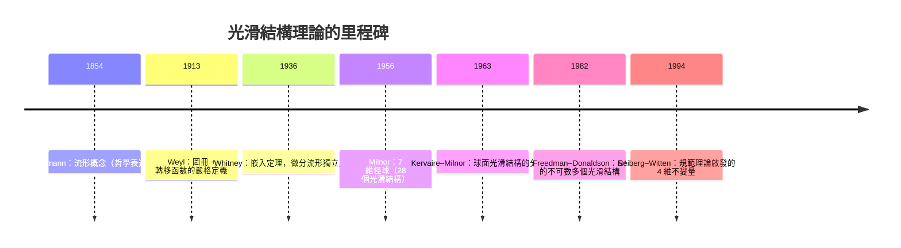

# 4.2 座標卡與光滑結構

## 導言：一座流形，多種「光滑」

上一節以圖冊定義了光滑流形。本節深入兩個問題：**(1) 不同圖冊何時定義「同一」光滑結構？(2) 同一拓樸流形可以有幾種不同的光滑結構？** 第二問的答案出人意料——維數 4 的宇宙獨有的怪異——並且與物理（時空的光滑性）直接相關。

---

## 圖冊的等價與極大化

### 相容的圖冊

兩個圖冊 $\mathcal{A} = \{(U_\alpha, \varphi_\alpha)\}$ 與 $\mathcal{B} = \{(V_\beta, \psi_\beta)\}$ 稱**相容**（$C^\infty$-compatible），若聯合圖冊 $\mathcal{A} \cup \mathcal{B}$ 仍是光滑圖冊（即新增的轉移函數 $\psi_\beta \circ \varphi_\alpha^{-1}$ 全部光滑）。

**等價關係**：$\mathcal{A} \sim \mathcal{B} \iff$ 相容。等價類稱為**光滑結構**。實作上取每個等價類中的**極大圖冊**（再添任何相容卡都改變不了它）作為代表——光滑流形的嚴格定義 = 拓樸流形 + 極大光滑圖冊。

### 為什麼要極大化？

因為我們希望「光滑函數」的概念完備：凡在已有卡下光滑的函數都該被承認。極大圖冊自動包含一切相容卡，消除圖冊選取的任意性——與曲線論中「參數化等價類」（1.1 節）、規範場論中「規範等價類」（9.3 節）同一思想：**數學對象 = 等價類，描述的選取不重要**。

### 具體例子：$\mathbb{R}$ 的兩種圖冊

- 標準卡：$\varphi(x) = x$；
- 「奇異卡」：$\psi(x) = x^3$。

$\psi \circ \varphi^{-1}(u) = u^3$ 光滑，但 $\varphi \circ \psi^{-1}(v) = v^{1/3}$ **不光滑**（在 $0$）！所以 $(\mathbb{R}, \varphi)$ 與 $(\mathbb{R}, \psi)$ 作為單卡圖冊不相容。但 $\{x^3\}$ 作為圖冊**自己**是光滑圖冊（單卡無轉移函數），定義一個光滑結構，與標準結構**微分同胚**（映射 $x \mapsto x^3$ 是兩者之間的微分同胚：把標準卡的點映到奇異卡的點，轉移變成恒等）。**結論：$\mathbb{R}$ 上這兩個光滑結構等價**——這是「同一座流形、不同座標描述、同一幾何」的最簡例子。

---

## 光滑結構的存在性與數目

### 主要定理

| 維數 $n$ | $\mathbb{R}^n$ / 球面的光滑結構數 | 註 |
|---|---|---|
| $1, 2, 3$ | 唯一（至微分同胚） | 低維幸運 |
| $4$ | $\mathbb{R}^4$：**不可數多**（Freedman–Donaldson, 1982–83） | 異常維數 |
| $5$ 以上 | 唯一（$\mathbb{R}^n$）；球面分類有限 | |
| $\mathbb{S}^7$ | $28$ 個（Milnor, 1956） | 怪球 |

### Milnor 的怪球（1956）

$\mathbb{S}^7$ 作為**拓樸**空間只有一個，但作為**光滑流形**有 28 個（對應 $\mathbb{S}^3$-叢的分類，與八元數的結構相關）。Milnor 構造的「怪球」**同胚**於 $\mathbb{S}^7$ 但**不微分同胚**：存在從怪球到標準球面的同胚，卻不存在光滑的雙向映射。這證明：

**光滑結構是拓樸之外的真實資料**——「局部像 $\mathbb{R}^n$ 且相容」這件事本身有不可化約的選擇。

### 四維的異常

- $\mathbb{R}^n$（$n \neq 4$）的光滑結構唯一；$\mathbb{R}^4$ 有**不可數多個**互不微分同胚的光滑結構（「怪 $\mathbb{R}^4$」），且每個怪 $\mathbb{R}^4$ 不能光滑嵌入 $\mathbb{R}^5$。
- **物理猜想**：我們的時空是四維的；某些物理學家（如 Carlip 等）猜測怪 $\mathbb{R}^4$ 可能與量子重力、時空微觀結構有關——尚未定論，但說明流形理論的「純數學」問題可能觸及物理。

### 判別工具：光滑不變量

判別兩個光滑結構是否等價，需要**微分同胚不變量**：

- 切叢的同構類、Stiefel–Whitney 類、Pontryagin 類；
- 指標（Atiyah–Singer）：$\dim\ker D^+ - \dim\ker D^-$ 型的解析量；
- Donaldson 不變量（瞬子模空間的相交形式）、Seiberg–Witten 不變量（1994，物理啟發！規範場論的單極方程成為四維拓樸利器）。

**模式：解析（微分方程）的量 = 拓樸不變量**——與 Gauss–Bonnet、指標定理一脈相承；也是本書反覆出現的主題：**微分的局部性質決定拓樸的全域性質**。

---

## 白話理解：地圖集的品味

### 比喻：同一座城市，兩套地圖集

- 拓樸結構：城市的「連通性」（哪些街區相鄰）。
- 光滑結構：地圖集的**座標網格系統**。兩套網格若在重疊區可以光滑互算，就是同一套「品味」；若不行，就是兩種不同的光滑城市。
- 怪球：同一座城市（拓樸），但一種網格系統下「勻稱」、另一種下有無法撫平的「晶格缺陷」——缺陷不在城市，在網格。

### 為何低維幸運？

維數 $1, 2, 3$ 中，拓樸手夠「軟」，任何光滑結構都可拉直（Munkres、Moise、Radó 定理）。四維起，自由的維數容許網格系統的「結」——四維是既足夠自由又不夠自由的第一個維數，因此最怪。**這與物理的四維時空是巧合還是深刻聯繫，是未解之謎。**

---

## 例題

### 例題 1：證明 $x \mapsto x^3$ 給出微分同胚的兩個結構

設 $\mathcal{A}$ = 標準圖冊（卡 $\varphi(x) = x$）、$\mathcal{B}$ = 圖冊（卡 $\psi(x) = x^3$），皆為 $\mathbb{R}$ 上的光滑圖冊。

**第一步**：各自是光滑圖冊（單卡，無轉移函數可驗）。

**第二步**：構造映射 $F : (\mathbb{R}, \mathcal{A}) \to (\mathbb{R}, \mathcal{B})$，$F(x) = x$（集合上的恆等）。檢驗光滑性：在卡下的表現

$$
\psi \circ F \circ \varphi^{-1}(u) = \psi(u) = u^3
$$

是 $C^\infty$。✓

**第三步**：逆映射 $F^{-1}$ 在卡下的表現

$$
\varphi \circ F^{-1} \circ \psi^{-1}(v) = \varphi(v^{1/3}) = v^{1/3}
$$

在 $v = 0$ **不光滑**！所以 $F$（作為這兩座流形間的映射）不是微分同胚。

**第四步**：改取 $G(x) = x^{1/3}$... 同樣失敗（對稱的困難）。**正確做法**：$G : (\mathbb{R}, \mathcal{A}) \to (\mathbb{R}, \mathcal{B})$，$G(x) = x^3$（即 $\psi(G(\varphi^{-1}(u))) = \psi(u^3) = u^9$ 光滑 ✓，逆表現 $\varphi(G^{-1}(\psi^{-1}(v))) = \varphi(v) = v$ 光滑 ✓）。

**結論**：$G(x) = x^3$ 是 $(\mathbb{R}, \mathcal{A}) \to (\mathbb{R}, \mathcal{B})$ 的微分同胚，故兩個光滑結構**等價**。**教訓：微分同胚不是點集恆等映射！要把兩座流形當作不同的對象，尋找適當的映射。**

### 例題 2： $\mathbb{S}^6$ 的幾乎複結構（選讀）

$\mathbb{S}^6$ 承襲八元數結構有幾乎複結構（每點切空間的線性複構造 $J_p$，$J_p^2 = -I$），但**是否存在積可積（即復）結構**是 60 餘年未解的公開問題（2020 年代仍有否定性進展）。這顯示「相容性」問題（類似 Codazzi 方程的可積分條件）在高層次的難度：**逐點的線性代數結構（$J_p$）能否拼成整體相容的結構，是流形理論的核心難題**，與 Newlander–Nirenberg 定理（幾乎複 ⟺ 復的可積分條件）、以及本書 3.3 節 Gauss–Codazzi 相容方程同一精神。

---

## 函數的光滑性檢驗：實作要點

### 檢驗流程

給 $f : M \to \mathbb{R}$，判定光滑：

1. 取覆蓋 $f$ 定義域的卡 $(U_\alpha, \varphi_\alpha)$；
2. 對每卡計算 $f_\alpha = f \circ \varphi_\alpha^{-1}$（$n$ 變數函數）；
3. 若所有 $f_\alpha$ 是 $C^\infty$，則 $f$ 光滑。

**為何卡不影響結論**：兩卡下 $f_\beta = f_\alpha \circ (\varphi_\alpha \circ \varphi_\beta^{-1})$，轉移函數與 $f_\alpha$ 皆光滑，複合光滑。✓

### 座標表達式

流形上的計算總是「進卡、算 $\mathbb{R}^n$ 微積分、出卡」。張量分析（第 5–7 章）的變換律保證「出卡」的結果與卡無關——**這正是本書反覆強調的「不變性」原則**：Christoffel 符號非張量（變換不齊）、Riemann 張量是張量（變換齊），幾何陳述必須後者（6.2 節）。

---

## 歷史與迴響

### 發展時間線

### 解決與未解

- **解決**：流形的嚴格化；低維分類；高維（$\geq 5$）球面結構分類（Kervaire–Milnor 群）。
- **未解**：$\mathbb{S}^6$ 的復結構、四維光子與物理的關聯、光滑 4 維龐加萊猜想的完全敘述（Freedman 解決拓樸版，光滑版的區分是 Donaldson 理論的核心）。

### 與其他領域的關聯

- **算子理論**：光滑結構的不變量（指標）由橢圓算子的指標給出——Fredholm 指標（核維數差）成為拓樸量。Atiyah–Singer 指標定理把解析指標 = 拓樸指標，是 Gauss–Bonnet 的無窮維推廣。
- **量子力學**：Seiberg–Witten 方程即規範場論中的場方程（類似 Dirac 方程 + 瞬子）；解的模空間計數給出流形不變量——**量子場論成為微分拓樸的計算工具**（Witten 的 Fields 獎, 1990）。
- **微積分**：「光滑」的多變數定義是基石；轉移函數的光滑性 = 複合函數求導（鏈式法則）的應用。
- **工程**：CAD 中曲面拼接的光滑性（G^k 連續）是流形光滑性的離散版本。

---

## 小結

1. 相容圖冊的等價類 = 光滑結構；用極大圖冊作代表。
2. 微分同胚是流形等價；它不必是點集恆等（例題 1 的教訓）。
3. 維數決定奇異性：$n \leq 3$ 唯一、$n = 4$ 怪異（不可數多）、高維可分類。
4. Milnor 怪球：光滑結構是拓樸外的真實資料。
5. 判別工具是解析量（算子指標、規範理論不變量）——局部微分決定全域拓樸的又一例證。

下一節構造流形上最重要的向量空間族：切叢與餘切叢，使「在流形上做微積分」成為可能。
