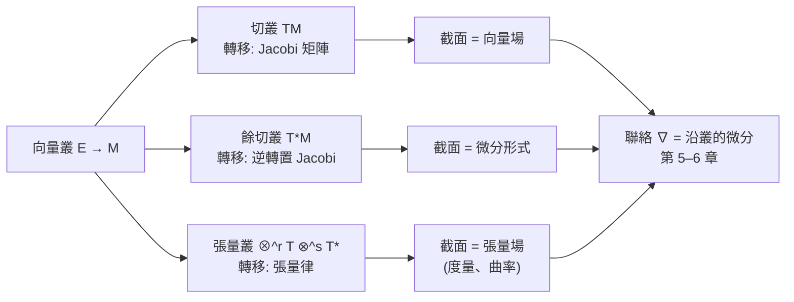

# 4.3 切叢與餘切叢

## 導言：把所有切空間縫成一個整體

每個流形點 $p$ 都有切空間 $T_pM$ （向量空間）。把所有 $T_pM$ 收集成一個新空間——**切叢** $TM$ ——流形上的向量場、微分、聯絡才有了嚴格的家。**餘切叢** $T^*M$ （線性泛函的叢）則是微分形式、動量、與辛幾何的舞台。本節建立這兩個叢，它們是 Riemann 幾何（第 5–6 章）與相對論（第 7–8 章）的語言基礎。

---

## 切向量：三種等價定義

### 定義一：曲線的速度

$p \in M$ 的**切向量**是等價類：通過 $p$ 的曲線 $\gamma$ （ $\gamma(0) = p$ ），按「在卡中導數相同」分類：

$$
\gamma_1 \sim \gamma_2 \iff (\varphi \circ \gamma_1)'(0) = (\varphi \circ \gamma_2)'(0)
$$

$T_pM$ = 全部等價類，向量空間運算由卡中的分量運算定義。**維數 $= \dim M$ **（變換律保證卡無關：鏈式法則）。

### 定義二：方向導數（切向量 = 微分算子）

切向量 $v$ 作用在光滑函數上：

$$
v(f) = \left.\frac{d}{dt}\right|_{0} f(\gamma_v(t))
$$

在卡中 $v = \sum_i v^i \partial/\partial x^i$ ，且

$$
v(fg) = v(f)g(p) + f(p)v(g) \quad (\text{Leibniz 律})
$$

**反過來也成立**： $T_pM$ 上滿足 Leibniz 律的線性泛函必是方向導數。**切向量 = 點上的「一階微分算子」**——這個觀點是向量場 = 「一階偏微分算子」的來源，也是李代數（10.2 節）中向量場的括積 $[X, Y] = XY - YX$ 成為算子交換子的原因。

### 定義三：物理的「位移微元」

卡中座標的無窮小改變 $(dx^1, \ldots, dx^n)$ ，按變換律

$$
\tilde v^i = \sum_j \frac{\partial \tilde x^i}{\partial x^j} v^j
$$

**這正是張量的變換律**（與 2.1 節 Jacobi 律、7.3 節四維向量同一公式）。古典張量分析以此為定義；現代幾何以曲線速度為定義、變換律為**定理**——定義升級，結論不變。

---

## 切叢與向量場

### 切叢

$$
TM = \bigsqcup_{p \in M} T_pM = \{\, (p, v) \mid p \in M,\ v \in T_pM \,\}
$$

配以自然拓樸與光滑結構（由卡的乘積結構縫合），成為 $2n$ 維流形。投影 $\pi : TM \to M$ ， $\pi(p, v) = p$ 。**纖維** $\pi^{-1}(p) = T_pM$ 是 $n$ 維向量空間—— $TM$ 是**向量叢**的原型。

### 向量場

**向量場** $X$ 是光滑截面： $X : M \to TM$ ， $\pi \circ X = \mathrm{id}$ （每點選一個切向量，且選得光滑）。卡中 $X = \sum X^i(p)\, \partial_i$ 。

**向量場的三重身分**：

1. 幾何：每點的箭頭；
2. 分析：一階線性微分算子 $X(f) = df(X)$ ；
3. 動力系統： $X$ 的積分曲線是 ODE $\dot\gamma = X(\gamma)$ 的解。

**例子**： $\mathbb{R}^2$ 上 $X = -y\,\partial_x + x\,\partial_y$ ，積分曲線 $x = r\cos(t + \theta_0)$ 、 $y = r\sin(t + \theta_0)$ ——同心圓族。 $X$ 生成旋轉流：**向量場 = 無窮小變換**，這是 Lie 理論的核心圖像（10.2 節）。

### 流（flow）

向量場 $X$ 的流 $\phi_t$ ： $\frac{d}{dt}\phi_t(p) = X(\phi_t(p))$ ，是單參數（局部）變換群。**緊緻流形上流完備**（ODE 解不會在有限時間逃逸）。力學中的時間演化、量子力學中的單參數酉群（Stone 定理： $U_t = e^{-itH/\hbar}$ ，**算子理論**的基石）都是「單參數群」的具體表現。

---

## 餘切叢與微分形式

### 餘切空間

$T_p^*M = (T_pM)^*$ ：切空間的對偶（線性泛函全體）。座標微元 $dx^i$ 定義為 $\partial_j$ 的對偶基： $dx^i(\partial_j) = \delta^i_j$ 。

**微分** $df$ ：對 $f \in C^\infty(M)$ ，

$$
df(v) = v(f)
$$

是餘切向量（卡中 $df = \sum \frac{\partial f}{\partial x^i} dx^i$ ——**全微分，座標無關**）。鏈式法則保證卡無關性：座標變換下 $dx'^i = \sum_j \frac{\partial x'^i}{\partial x^j} dx^j$ ，協變變換律。

### 餘切叢與一形式

$$
T^*M = \bigsqcup_p T_p^*M
$$

**一形式** $\omega$ 是 $T^*M$ 的截面： $\omega = \sum \omega_i(x)\, dx^i$ 。物理對應：

| 切叢 | 餘切叢 |
|---|---|
| 速度 | 動量 |
| 位移 | 功的微元 $F_i\, dx^i$ |
| Lagrange 力學的 $\dot q$ | Hamilton 力學的 $p$ |
| $TM$ | $T^*M$ （相空間） |

**Legendre 變換** $TM \to T^*M$ （經由 Lagrangian）把速度語言轉為動量語言——**古典力學的兩大框架分居切叢與餘切叢**；量子化在 $T^*M$ 上進行（幾何量子化）。

### 高階形式（預告）

反對稱多線性形式 $k$ -形式的叢 $\Lambda^k T^*M$ ；外微分 $d$ （10.1 節）。Stokes 定理 $\int_M d\omega = \int_{\partial M}\omega$ 統一 Newton–Leibniz、Green、Gauss、Kelvin–Stokes 四大公式——**向量微積分的終點、流形微積分的起點**。

---

## 叢的一般概念

### 向量叢

**向量叢** $(E, \pi, M)$ ：全空間 $E$ 、底空間 $M$ 、投影 $\pi$ ，每根纖維 $E_p = \pi^{-1}(p)$ 是向量空間，局部平凡化（「卡」）： $E|_{U_\alpha} \cong U_\alpha \times \mathbb{R}^k$ ，轉移函數是 $GL(k, \mathbb{R})$ 值。

**轉移函數決定叢**：同一底空間上的向量叢由 $GL(k)$ 值轉移函數的分類（上同調類）決定——**局部平凡 + 相容條件 = 全域對象**，這與流形本身（卡 + 轉移）、規範理論（位勢 + 規範變換）完全同構。**叢 = 幾何版的「局部座標 + 相容性」**。

### 截面 = 「叢上的函數」

向量場、微分形式、度量、曲率張量都是各叢的截面。**聯絡**（第 5–6 章）回答「截面如何微分」——因為不同點的纖維不同，無法直接相減，需要平行移動（6.1 節）作中介。

---

## 例題

### 例題 1：驗證切向量的變換律

設 $M$ 有卡 $(U, x^i)$ 與 $(V, \tilde x^i)$ ，曲線 $\gamma(t)$ ， $p = \gamma(0)$ 。

**卡 $x$ 中**： $\gamma(t) = (x^1(\gamma(t)), \ldots)$ ，速度分量 $v^i = \dot x^i(\gamma(0))$ 。

**卡 $\tilde x$ 中**： $\tilde v^i = \dot{\tilde x}^i(\gamma(0))$ 。由鏈式法則 $\tilde x^i = \tilde x^i(x^1, \ldots, x^n)$ ：

$$
\tilde v^i = \sum_j \frac{\partial \tilde x^i}{\partial x^j}\bigg|_p \dot x^j(\gamma(0)) = \sum_j \frac{\partial \tilde x^i}{\partial x^j} v^j
$$

**變換矩陣是 Jacobi 矩陣在 $p$ 的值**：切向量按（反變）向量律變換。✓ 結構無涉「哪張卡」——切向量是流形自身的對象。

### 例題 2：球面切叢不平凡——毛髮定理

**定理（Poincaré–Hopf 毛髮定理）**：緊緻流形上處處非零的向量場存在 ⟺ Euler 示性數 $\chi(M) = 0$ 。

**驗證**：

- $\chi(\mathbb{S}^2) = 2 \neq 0$ ⟹ 球面切叢不平凡、球面上有「髮旋」（無處不梳平的髮型不存在）——直觀上球面切叢不能同構於 $\mathbb{S}^2 \times \mathbb{R}^2$ 。
- $\chi(\mathbb{T}^2) = 0$ ⟹ 環面有非零向量場（如 $\partial/\partial\theta$ ），切叢平凡： $\mathbb{T}^2$ 可「梳平」。✓
- $\chi(SO(3)) = \chi(\mathbb{RP}^3) = 0$ ⟹ 三維旋轉群可梳（「梳椰子」：三維球面與旋轉群都有非零場；「梳毛球」不行——兩個古老謎題的統一解答）。

**物理意義**：球面上的連續向量場必有奇點——**這正是磁單極問題的幾何根源**（Dirac 1931：磁單極需要規範位勢的奇點/多張卡，9.3 節），也是 Bloch 球上態向量場的相約束（Berry 相位的拓樸來源）。

---

## 座標變換總表

| 對象 | 變換律 | 類型 |
|---|---|---|
| 切向量分量 $v^i$ | $\tilde v^i = \frac{\partial \tilde x^i}{\partial x^j} v^j$ | 反變向量 |
| 餘向量分量 $\omega_i$ | $\tilde\omega_i = \frac{\partial x^j}{\partial \tilde x^i}\omega_j$ | 協變向量 |
| 度量 $g_{ij}$ | $\tilde g_{ij} = \frac{\partial x^k}{\partial\tilde x^i}\frac{\partial x^l}{\partial\tilde x^j} g_{kl}$ | 二階協變張量 |
| 函數 $f$ | $\tilde f = f$ （不變） | 標量 |
| Christoffel $\Gamma^k_{ij}$ | 含二階導的額外項（非張量） | 聯絡係數 |
| Riemann 張量（6.2） | 張量律 | 四階（1,3）張量 |

此表是全書座標計算的速查表；7.3 節把它重寫為相對論的指標記號。

---

## 與其他領域的關聯

### 微積分

- $df$ 是全微分的內蘊化；方向導數 $v(f)$ 是多元導數；
- Jacobi 矩陣從「計算工具」升級為「轉移函數」；
- Stokes 定理統一四大積分公式（10.1 節）。

### 力學與辛幾何

- Lagrange 力學在 $TM$ 、Hamilton 力學在 $T^*M$ ；
- 辛形式 $\omega = \sum dp_i \wedge dq^i$ 使 $T^*M$ 成為辛流形；Hamilton 方程 = 辛流上的流；
- **Noether 定理（1918）**：對稱群作用 ⟹ 守恆量（動量映射）——對稱與守恆的幾何化。

### 算子理論與量子力學

- 向量場是一階微分算子，其交換子 $[X,Y]$ 對應李括積；量子化後對應算子交換子 $[\hat A, \hat B] = i\hbar\{\cdot,\cdot\}$ （Dirac 的洞見, 1930）——**Poisson 括積 = 李括積的經典版**。
- Stone–von Neumann 定理：正則對易關係的表示唯一性（自由度有限時）——相空間 $T^*\mathbb{R}^n$ 的量子化唯一；無窮維（場論）則有多種表示（粒子數表象分歧）。
- 幾何量子化：在 $T^*M$ （帶辛結構）上構造 Hilbert 空間，把「量化」變成幾何程序。

### 資料科學

切叢的離散版本：資料流形上每點的局部切空間估計（局部線性嵌入 LLE、切空間近似）；「沿流形的梯度」= Riemann 梯度（10.3 節最佳化）。

---

## 小結

1. 切向量三種定義：曲線速度、Leibniz 算子、變換律等價類——變換律從定義降為定理。
2. $TM$ 、 $T^*M$ 是向量叢的原型；截面 = 向量場 / 微分形式。
3. 向量場 = 無窮小變換（流、單參數群）；餘切叢 = 相空間（動量、辛結構）。
4. 毛髮定理： $\chi \neq 0$ ⟹ 切叢不平凡；磁單極與 Berry 相位的幾何根源。
5. 座標變換總表奠定張量分析的計算基礎。

第 5 章將在此語言上重建 Riemann 1854 的藍圖：度量、聯絡與曲率。
