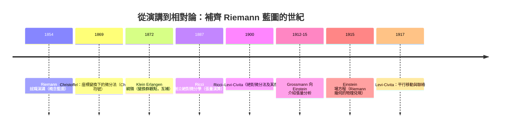

# 5.1 Riemann 的就職演講

## 導言：一小時演講改寫兩千年的幾何

1854 年 6 月 10 日，哥廷根大學。28 歲的無薪講師 Georg Friedrich Bernhard Riemann 為取得「Privatdozent」資格發表就職演講（Habilitationsvortrag）《論作為幾何基礎的假設》（*Über die Hypothesen, welche der Geometrie zu Grunde liegen*）。聽眾中有年近八旬的 Gauss——是他在系裡提供的三個題目中親自挑選了「幾何學基礎」。一小時之後，幾何學的定義被改寫：**幾何 = 流形 + 度量**，而 Euclid 的空間只是無窮多種可能之一。

### 演講的奇特命運

Riemann 只在黑板上寫了極少的公式，全篇以哲學—概念語言寫成，許多證明只存於「顯然」之中。演講在他 1866 年死後（1868）才出版。後來的數學家花了半個多世紀補齊其內容：Christoffel（1869）給出計算工具、Ricci 與 Levi-Civita（1900）發展張量演算、Einstein（1915）用它寫下重力方程。**一篇缺少公式的演講，最終成為現代物理的數學母體。**

---

## 演講的三段結構

### 第一部：n 維流形的概念

Riemann 從「量」（Größen）的一般理論出發，區分：

- **流形**（Mannigfaltigkeit）：量的區域，可用 $n$ 個座標局部確定（4.1 節的流形概念的原型）；
- **度量關係**：流形上如何量長度與角度——這**不是流形的一部分**，而是加在其上的**假設**。

關鍵洞見：**先把空間的拓樸（連通性、維數）與幾何（度量）分離**。Euclid 幾何 = 平坦拓樸流形 + 特定（平坦）度量；非歐幾何 = 同一拓樸 + 不同度量。幾何問題從此分為兩層。

### 第二部：度量的刻畫

Riemann 假設線元素是二次形式（畢氏定理的推廣）：

$$
ds^2 = \sum_{i,j} g_{ij}\, dx^i dx^j
$$

並追問：度量需要什麼條件、什麼量刻畫它對「平坦」的偏離？他提出**曲率**由「測地線圍成的無窮小三角形的角盈」定義（即截面曲率），並斷言：曲率張量（他未寫出公式）在 $n$ 維有 $n^2(n^2-1)/12$ 個獨立分量——

$$
\binom{n+1}{2}\binom{n}{2} = \frac{n(n-1)(n+1)(n-2)}{12}\text{ 個}
$$

（例如 $n = 2$: 1 個 = Gauss 曲率；$n = 3$: 6 個；$n = 4$: 20 個——正是 1915 年 Einstein 需要面對的數字。）

### 第三部：物理空間的問題

演講結尾，Riemann 轉向物理學：

> 「因此，或者**佔有空間的實在所依據的**，必須構成一個離散流形；或者**度量關係的根據必須從外部尋找**……」（結尾原意）

他明確提出：**幾何是經驗科學的一部分，應由物理學決定**——空間的度量結構可能由「束縛它的力」決定。這句話在 61 年後被愛因斯坦兌現：時空度量由物質分佈決定（Einstein 方程，8.2 節）。

---

## Riemann 生平與演講前後

### 生平速寫

- **1826**：生於漢諾威 Breselenz，牧師家庭，貧困。
- **1846**：入哥廷根，先修神學，後轉數學；曾聽 Gauss 課。
- **1847–49**：柏林跟 Dirichlet、Eisenstein、Jacobi 學習；Dirichlet 的「Riemann 和」思想來源。
- **1851**：博士論文《單復變函數論的一般理論基礎》——Riemann 面、保角映射定理（Gauss 評語：「長期以來 desired 的、許多前輩嘗試失敗的任務」）。
- **1854**：就職演講（本章主角）。
- **1859**：接替 Dirichlet 的教授職；同年質數分佈論文——**Riemann 猜想**。
- **1862**：患肺結核，赴義大利療養。
- **1866**：逝於 Selasca，年 39 歲。

### 為什麼是 Riemann？

三股線索在他身上匯合：

1. **Gauss 的內蘊幾何**（絕妙定理，1827）：曲率是度量的性質；
2. **Dirichlet 原理與分析**：變分方法、位勢論（Riemann 以 Dirichlet 原理證明保角映射的存在）；
3. **哲學與物理的敏感**（受 Herbart 影響）：對「空間是什麼」的形上追問。

Riemann 的工作橫跨複分析、數論、幾何、物理——**以「Riemann 面」（複一維流形）為例**：他為多值函數構造的曲面，正是流形概念的第一批實例；函數論與幾何在流形上合流。

---

## 演講解決了什麼問題

### 1. 非歐幾何的地位問題

Lobachevsky–Bolyai 的雙曲幾何被視為「邏輯遊戲」：它自洽嗎？是誰的幾何？Riemann 的框架回答：**幾何 = 拓樸 + 度量，非歐幾何就是某種度量的幾何**——與歐氏幾何地位平等。Beltrami（1868）用偽球面與微分幾何模型把這點做實（「模型論證」：若雙曲幾何矛盾，則同樣的推理在歐氏幾何內部也產生矛盾）。

### 2. 曲率的維數推廣

Gauss 曲率是曲面的量；$n$ 維的「彎曲」是什麼？Riemann 指出曲率成為**多分量對象**（後來的 Riemann 張量），且由截面（二維切片）的 Gauss 曲率族完全確定（6.2 節：截面曲率定理）。

### 3. 幾何與物理的關係

「度量關係的根據必須從外部尋找」——空間的幾何不是先驗的，由物理決定。這是**幾何經驗主義**的宣言，直接啟發：

- Clifford（1870）：物質與曲率相互為表裡的猜想；
- Einstein（1915–16）：「Mach 原理」討論中的幾何–物質關係；
- 現代：規範場論中「內部空間的幾何」也是物理決定的（9.3 節）。

---

## 演講引發的新問題

1. **計算工具**：Riemann 給了概念但無算法。如何在座標變換下對度量求導？→ Christoffel 符號、協變導數（5.3 節）。
2. **曲率張量的顯式結構**：Riemann 斷言 $n^2(n^2-1)/12$ 個分量但未給公式 → Riemann 張量（6.2 節，Christoffel 1869 首次寫出）。
3. **拓樸的全域問題**：局部幾何之外，流形的整體（洞、定向、基本群）如何影響幾何？→ 拓樸學的誕生（Poincaré 1895 起）、Gauss–Bonnet 的高維推廣、最終霍奇理論與指標定理。
4. **物理的適用性**：什麼度量描述我們的空間？測量能區分嗎？（19 世紀的討論，如 Helmholtz 與 Poincaré 的幾何哲學）→ 1919 年日食（9.1 節）給出實證答案。

---

## 例題

### 例題 1：驗證 Riemann 的分量計數

Riemann 斷言 $n$ 維曲率有 $\frac{n^2(n^2-1)}{12}$ 個獨立分量。以對稱性檢驗（6.2 節將證）：

- Riemann 張量 $R_{ijkl}$ 反對稱於 $(i,j)$ 與 $(k,l)$：各給 $\binom{n}{2}$ 個獨立對；
- 對 $(ij) \leftrightarrow (kl)$ 對稱：獨立數 $\binom{\binom{n}{2} + 1}{2} = \frac{\binom{n}{2}\left(\binom{n}{2}+1\right)}{2}$；
- 第一 Bianchi 恆等式 $R_{i[jkl]} = 0$ 再減去 $\frac{n(n-1)(n-2)(n-3)}{24}$ 個約束。

**計算 $n = 4$**：

$$
\binom{4}{2} = 6, \quad \binom{7}{2} = 21, \quad \text{Bianchi 減去 } \binom{4}{4} = 1 \Rightarrow 21 - 1 = 20
$$

而 Riemann 公式：$\frac{16 \times 15}{12} = 20$。✓

**$n = 3$**：$\frac{9 \times 8}{12} = 6$；$n = 2$：$\frac{4 \times 3}{12} = 1$（Gauss 曲率）。✓ **Einstein 面對的是 20 個獨立分量的張量**——這個數字解釋了為何廣義相對論花了 Einstein 七年（1912 年「最幸福的思想」到 1915 年 11 月完成方程）。

### 例題 2：同一流形、不同度量——三種幾何在同一「空間」

取拓樸為 $\mathbb{R}^2$ 的流形，三種度量：

1. $ds^2 = dx^2 + dy^2$（歐氏）；
2. $ds^2 = \frac{4(dx^2 + dy^2)}{(1 - r^2)^2}$（$r^2 < 1$；Poincaré 圓盤的度量表達式）；
3. $ds^2 = \frac{4(dx^2 + dy^2)}{(1 + r^2)^2}$（球面經球極投影的度量）。

**計算曲率**（用 3.2 節等溫公式 $K = -\frac{1}{\lambda^2}\Delta\ln\lambda$，$\lambda$ 為純量因子）：

1. $\lambda = 1$：$K = 0$。
2. $\lambda = \frac{2}{1 - r^2}$：$\ln\lambda = \ln 2 - \ln(1 - r^2)$，$\Delta \ln(1-r^2) = -\frac{4}{(1-r^2)^2}$，故 $K = -\frac{(1-r^2)^2}{4}\cdot\frac{4}{(1-r^2)^2} = -1$。**常數負曲率：雙曲幾何**。
3. $\lambda = \frac{2}{1+r^2}$：同法得 $K = +1$（球面半徑 1）。

**結論**：同一「座標域」、三種度量、三種幾何。**度量是假設，幾何是後果**——這就是 Riemann 演講的精髓。宇宙的 $K$ 為何？由實驗回答（9.1、9.2 節的現代宇宙學測量）。

---

## 與其他領域的關聯

### 複分析

Riemann 面是把多值函數（如 $\sqrt{z}$、$\log z$）單值化的流形；保角映射定理（Riemann 映射定理, 1851）說單連通真子域 $\cong$ 單位圓盤——**函數論問題 = 流形幾何問題**。現代發展為模空間理論（弦論的數學基礎之一）。

### 數論

1859 論文中 $\zeta(s)$ 的零點與質數分佈；零點的「譜解釋」（Hilbert–Pólya 猜想）把 Riemann 猜想與自伴算子譜（算子理論）聯繫——**同一個 Riemann 的兩個猜想，都牽動幾何與算子**。

### 算子理論

Dirichlet 原理（能量泛函極小化）是 Laplace 算子譜理論的變分表述；Riemann 的方法論——**用變分與位勢論處理幾何**——正是現代譜幾何與幾何分析（丘成桐的 Calabi 猜想證明, 1976）的工具箱。

### 量子力學

- Riemann 面上的量子場論（共形場論）是弦論的數學核心；
- 費曼路徑積分在流形上的嚴格化（如 Quillen 的超聯絡、指標定理的熱核證明）直接使用 Riemann 幾何；
- 量子重力候選理論（弦論、圈量子重力）皆以流形/度量的量子化為核心問題。

---

## 小結

1. 1854 年 6 月 10 日，Riemann 提出幾何新定義：流形 + 度量；Euclid 幾何只是眾多可能之一。
2. 演講三段：流形概念、二次形式度量與曲率分量數、物理空間的經驗性。
3. 分量計數 $\frac{n^2(n^2-1)}{12}$（$n=4$ 時 20 個）預告了廣義相對論的數學難度。
4. 演講解決非歐幾何的地位問題、曲率的維數推廣，並提出「幾何由物理決定」的宣言。
5. 半世紀的補齊工程（Christoffel → Ricci → Levi-Civita → Einstein）把概念變成可操作的科學。

下一節正式定義 Riemann 度量，開始把藍圖變成公式。
