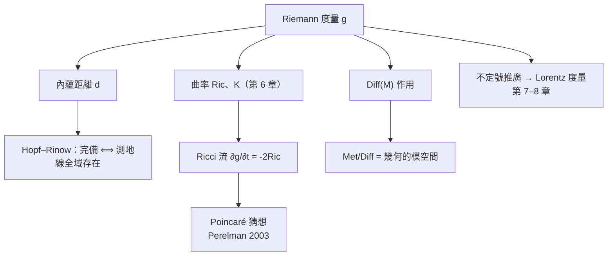

# 5.2 Riemann 度量

## 導言：把畢氏定理搬上流形

Riemann 度量是流形上每個切空間的內積，隨點光滑變化。它是第一基本形式（2.2 節）的高維推廣，也是廣義相對論中「時空幾何」的載體（不過相對論用的是不定號版本，7.2 節）。本節定義度量、建立其張量性質、討論度量的存在性與「同一流形的度量空間」。

---

## 定義

### Riemann 度量

**Riemann 度量** $g$ 是光滑流形 $M$ 上的光滑對稱正定 $(0,2)$ 型張量場：每點 $p$，

$$
g_p : T_pM \times T_pM \to \mathbb{R}
$$

是對稱、正定的雙線性型，且 $p \mapsto g_p(u, v)$ 光滑（$u, v$ 為光滑向量場）。

**局部表達**：在座標 $(x^i)$ 下

$$
g = g_{ij}\, dx^i \otimes dx^j, \qquad g_{ij} = g_{ji}, \qquad g_{ij}v^iv^j > 0\ (v \neq 0)
$$

配了度量的流形 $(M, g)$ 稱 **Riemann 流形**。

### 度量做什麼？

| 量 | 定義 |
|---|---|
| 向量長 | $\|v\| = \sqrt{g_p(v, v)}$ |
| 夾角 | $\cos\theta = \dfrac{g_p(u,v)}{\|u\|\|v\|}$ |
| 曲線長 | $L(\gamma) = \int_a^b \sqrt{g_{\gamma(t)}(\dot\gamma, \dot\gamma)}\;dt$ |
| 體積元 | $dV = \sqrt{\det(g_{ij})}\; dx^1\cdots dx^n$ |
| 兩向量的正交 | $g_p(u, v) = 0$ |

**長度、角度、面積、體積——度量一項配齊**，正如 2.2 節 $E, F, G$ 對曲面的作用。

### 張量變換律

座標變換 $x \to \tilde x$：

$$
\tilde g_{ij} = \frac{\partial x^k}{\partial \tilde x^i}\,\frac{\partial x^l}{\partial \tilde x^j}\, g_{kl}
$$

（2.2 節 $J^T g J$ 的高維寫法。）**「幾何陳述必須是張量方程」**的檢驗標準由此確立：兩邊同時是張量，則一張卡中成立即所有卡成立——愛因斯坦把這條檢驗標準提升為物理原理（廣義協變性原理，8.2 節）。

---

## 度量的存在性與例子

### 每個流形都有度量

**定理**：拋物緊緻性（或單位分割）保證任何光滑流形都有 Riemann 度量：局部取歐氏度量 $\delta_{ij}$，用單位分割加權求和：

$$
g = \sum_\alpha \rho_\alpha\, \varphi_\alpha^*(\delta), \qquad \sum_\alpha \rho_\alpha = 1
$$

正定性由凸組合保持。**度量總是存在，但絕不唯一**——選擇度量 = 選擇幾何。

### 標準例子

| $(M, g)$ | 度量表達 | 曲率 |
|---|---|---|
| 歐氏空間 $\mathbb{R}^n$ | $\delta_{ij}$ | $0$ |
| 單位球 $\mathbb{S}^n$ | $\sum g_{ij}$（誘導度量） | $+1$ |
| 雙曲空間 $\mathbb{H}^n$ | $\frac{4\sum dx_i^2}{(1-r^2)^2}$（圓盤模型） | $-1$ |
| 平坦環面 | $d\theta^2 + d\phi^2$ | $0$ |
| 產品度量 $M_1 \times M_2$ | $g_1 \oplus g_2$ | 截面曲率分別繼承 |
| Schwarzschild 時空 | 見 8.3 節 | 非零（真空但 $R_{\mu\nu}$ 型非零） |

### 誘導度量

嵌入 $F : M \to \mathbb{R}^N$ 時，拉回歐氏度量：$g = F^*\delta$——**這是第 2、3 章所有曲面的度量的來源**（子流形幾何）。Nash 嵌入定理（1954–56）：任何 Riemann 流形可等距嵌入某 $\mathbb{R}^N$——抽象度量原則上「看得見」（雖然 $N$ 很大且嵌入奇異）。

### 常曲率空間的模型

- **球面模型** $\mathbb{S}^n \subset \mathbb{R}^{n+1}$：$K = 1$；
- **雙曲模型**：Poincaré 圓盤／半平面、Klein 模型、雙曲面模型——五種模型彼此等距（透過顯式座標變換），皆 $K = -1$；
- **歐氏**：$K = 0$。

**圓周長對比**（半徑 $\rho$ 的測地圓）：

$$
C_{K>0}(\rho) = 2\pi\sin\rho < C_{K=0}(\rho) = 2\pi\rho < C_{K<0}(\rho) = 2\pi\sinh\rho
$$

**測量圓周即可判定空間曲率**——Riemann 空間的「毛蟲實驗」（2.3 節）的高維版本。

---

## 度量空間：內蘊距離的完整化

### 距離函數

$$
d(p, q) = \inf_{\gamma}\ L(\gamma)
$$

$(M, d)$ 是度量空間（滿足三角不等式），且誘導的拓樸等於原拓樸。**局部上最短線存在**（測地線，3.1 節）。

### Hopf–Rinow 定理（1931）

以下等價：

1. $(M, g)$ 完備（Cauchy 收斂）；
2. $(M, d)$ 是完備度量空間；
3. 閉有界集緊緻（Heine–Borel 性質）。

且此時**任意兩點可用最短測地線連接**。

**應用**：$\mathbb{S}^n$、$\mathbb{T}^n$、$\mathbb{H}^n$ 完備 → 測地線全域存在；開圓盤（$\mathbb{H}^2$ 的不完備度量子集）不完備 → 測地線可在有限時間「掉出邊界」。**廣義相對論中的奇點**（8.3 節 Schwarzschild 的 $r = 0$）正是「測地線不完備」：世界線在有限固有時間內終結——**奇點定理（Penrose 1965、Hawking）把「時空奇點」定義為測地不完備**，本節的定義直接成為物理的判據。

---

## 度量的空間：幾何的動力學

### 所有度量的集合

$\mathrm{Met}(M)$ = $M$ 上全部 Riemann 度量，是無窮維凸錐（凸組合仍為度量）。作用其上：

- **微分同胚群** $\mathrm{Diff}(M)$：拉回作用 $g \mapsto \phi^*g$；「同一幾何的不同座標描述」= 同一軌道；
- **純量乘法** $g \mapsto cg$：整體放大（曲率按 $1/c$ 縮放）。

**商空間** $\mathrm{Met}(M)/\mathrm{Diff}(M)$ = 「真正不同的幾何」——這是 Teichmüller 空間（二維）、形變理論、與 **Ricci 流**（Hamilton 1982）的舞台。

### Ricci 流與幾何化

$$
\frac{\partial g}{\partial t} = -2\,\mathrm{Ric}
$$

讓度量像熱方程一樣「擴散平坦化」：正曲率區縮小、負曲率區放大。**Perelman（2002–03）**用 Ricci 流 + 熵單調性證明：

- 三維 Poincaré 猜想（1904 提出：閉單連通 3 流形 $\cong \mathbb{S}^3$）；
- Thurston 幾何化猜想（1982：3 流形分解為 8 種幾何）。

**思想譜系**：Gauss–Bonnet（曲率 ⟷ 拓樸）→ Ricci 流（用曲率方程「焊接」幾何與拓樸）→ 三維分類完成。**這是 1854 年藍圖在 150 年後的最高成就**，也是幾何分析（用 PDE 研究幾何）的勝利。

---

## 例題

### 例題 1：驗證 Poincaré 圓盤度量與計算一條測地線長

度量 $g = \frac{4(dx^2 + dy^2)}{(1 - r^2)^2}$，$r^2 = x^2 + y^2 < 1$。

**(a) 對稱正定**：$g_{ij} = \frac{4\delta_{ij}}{(1-r^2)^2}$ 顯然對稱；對 $v \neq 0$，$g(v, v) = \frac{4\|v\|^2}{(1-r^2)^2} > 0$。✓

**(b) 沿直徑的長度**：曲線 $\gamma(t) = (t, 0)$，$t \in (-a, a)$，$a < 1$：

$$
L = \int_{-a}^{a} \frac{2\,dt}{1 - t^2} = \left[\ln\frac{1+t}{1-t}\right]_{-a}^{a} = 2\ln\frac{1+a}{1-a}
$$

當 $a \to 1^-$，$L \to \infty$：**邊界在無窮遠**——圓盤「看起來有邊」實際上完備（$\mathbb{H}^2$ 完備 ✓，Hopf–Rinow 適用）。

**(c) 測地圓周長**：以原點為心、內蘊半徑 $\rho$ 的圓：由對稱性沿半徑量距，$\rho = 2\ln\frac{1+a}{1-a}$ ⟹ $a = \tanh\frac{\rho}{2}$；圓的歐氏半徑為 $a$，內蘊周長

$$
C = \int_0^{2\pi} \frac{2a\,d\theta}{1 - a^2} = \frac{4\pi a}{1-a^2} = 2\pi\sinh\rho
$$

✓ 與 $K = -1$ 的預期 $C = 2\pi\sinh\rho$ 一致（負曲率：周長超過 $2\pi\rho$，且超得很快——雙曲空間「比歐氏大」）。

### 例題 2：Fisher–Rao 度量——統計流形（選讀）

參數族機率分佈 $\{p(x \mid \theta)\}$ 構成流形，Fisher 資訊矩陣

$$
g_{ij}(\theta) = E_\theta\left[ \partial_i \ln p \cdot \partial_j \ln p \right]
$$

是 Riemann 度量（Fisher–Rao；Chentsov 定理：它是統計上唯一自然的度量）。**這是「度量 = 幾何」思想在統計與機器學習的化身**：自然梯度下降（Amari）用此度量的逆校正學習率——第 10.3 節將回到這裡。**量子版**：量子 Fisher 資訊、Bures 度量，用於量子感測（Cramér–Rao 界）——度量幾何成為測量精度的界。

---

## 度量不變量與測地完備性速查

| 概念 | 定義 | 定理/性質 |
|---|---|---|
| 度量 $g$ | 對稱正定 $(0,2)$ 張量場 | 存在性由單位分割保證 |
| 內蘊距離 | 最短曲線長 | 拓樸一致；三角不等式 |
| 完備 | 測地線全域存在 | Hopf–Rinow：⟺ 度量空間完備 |
| 體積元 | $\sqrt{|g|}\,dx$ | 座標不變（Jacobi 相消） |
| 等距 | $\phi^*g = g$ | 保長度、角度、體積、曲率 |
| 共形 | $\tilde g = e^{2u}g$ | 保角；$K$ 按 $-\frac{1}{\lambda^2}\Delta\ln\lambda$ 變 |

---

## 與其他領域的關聯

### 微積分／分析

度量 = 「二次形式的場」；測地線 = 變分極值；Ricci 流 = 拋物 PDE（熱方程的張量版）。**幾何問題化為 PDE 問題**是幾何分析的綱領（丘成桐 Calabi 猜想、正質量定理 1979，後者與廣義相對論直接相關——「總質量非負」是幾何定理）。

### 線性代數

每點 $g_p$ 是對稱正定矩陣；$g^{ij}$（逆矩陣）升起指標；特徵值理論在場論化（Ricci 平坦度量的線性化 = 自伴算子的特徵值問題）。

### 算子理論

Laplace–Beltrami 算子

$$
\Delta_g f = \frac{1}{\sqrt{|g|}}\partial_i\left( \sqrt{|g|}\, g^{ij} \partial_j f \right)
$$

是自伴（緊流形）橢圓算子，譜離散（Weyl 律：$N(\lambda) \sim \frac{\omega_n}{(2\pi)^n}\mathrm{Vol}(M)\lambda^{n/2}$）。**「能否聽出鼓的形狀？」**（Kac, 1966）：譜是否決定幾何——答案是否定的（Milnor 1964 的等譜非等距流形），但譜含大量幾何資訊（熱核展開的前幾項 = 維數、體積、邊界曲率……）。

### 量子力學

- 相對論量子力學（Dirac 方程, 1928）寫在 Lorentz 流形上；電子的自旋幾何化（旋量叢 = 切叢的「平方根」）；
- 量子場論的費曼積分需要度量的行列式 $\sqrt{|g|}$；
- AdS/CFT 對偶：邊界場論的熵 = 體內 Riemann 幾何的面積（Ryu–Takayanagi, 2006）——**度量幾何成為量子糾纏的語言**。

---

## 小結

1. 度量 = 光滑變化的內積場；給出長度、角度、體積、距離。
2. 變換律 $\tilde g = J^T g J$；張量方程是座標無關陳述的檢驗標準。
3. 度量存在但不唯一；常曲率模型（球、歐、雙曲）用圓周長即可區分。
4. Hopf–Rinow：完備 ⟺ 測地線全域存在；奇點 = 測地不完備（相對論的定義）。
5. 度量的空間 + Ricci 流：Poincaré 猜想的解決是 Riemann 藍圖的世紀成就。
6. 下一節：在度量上求導——Christoffel 符號與 Levi-Civita 聯絡。
