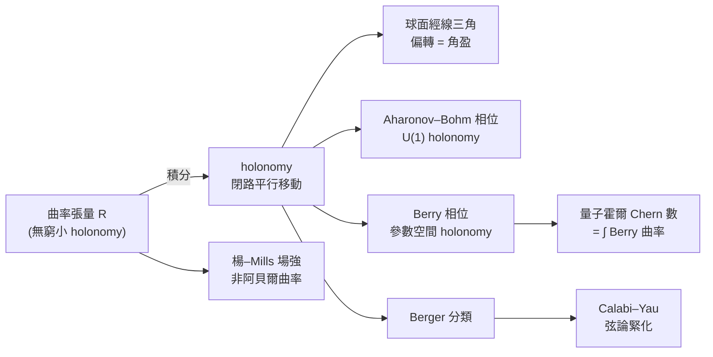

# 6.1 平行移動與 Holonomy

## 導言：繞一圈回來，方向變了

把向量沿曲線平行移動再繞閉路回到起點——它可能不再指向原方向。偏轉的角度（更一般地，切空間上的正交變換）稱為 **holonomy**。它是曲率的「積分效應」：曲率是 holonomy 的無窮小生成元。這一概念從球面的直觀，一路延伸到規範場論（楊–Mills）、Berry 相位（量子力學）與廣義相對論的重力透鏡。

---

## 平行移動的定義與性質

### 回顧（5.3 節）

沿曲線 $\gamma : [a, b] \to M$ 的平行移動 $P_\gamma : T_{\gamma(a)}M \to T_{\gamma(b)}M$ 是 ODE $\nabla_{\dot\gamma}V = 0$ 的解映射。性質：

1. **線性**（ODE 線性）；
2. **等距**（$\frac{d}{ds}g(V, W) = 0$，由度量化）；
3. **複合性**：$P_{\gamma_2 \cdot \gamma_1} = P_{\gamma_2} \circ P_{\gamma_1}$（先走 $\gamma_1$ 再走 $\gamma_2$）；
4. 可逆：$P_{\gamma^{-1}} = P_\gamma^{-1}$。

### 球面的平行移動：經典計算

**設置**：單位球面，從赤道上一點 $p$ 沿經線走到北極 $N$，再沿另一條經線下到赤道點 $q$，再沿赤道回到 $p$——繞了一個「經度三角形」（頂角 $\alpha$ 為兩經線夾角）。

**第一步（沿經線）**：經線是測地線；切於經線的向量保持平行。原方向為經線切向。

**第二步（沿赤道回程）**：赤道也是測地線；在 $N$ 點向量仍指「南」（沿來路經線的切向），到 $q$ 點時向量與赤道垂直。

**第三步（沿赤道）**：赤道切平面的法向是徑向；向量與赤道垂直 ⟹ 在 $q$ 出發時向量平行於自己（球面測地線的切向是平行的）。走完赤道回到 $p$，向量**垂直於原方向**——偏轉了 $90°$？精確計算：偏轉角恰等於三角形**角盈**：

$$
\Delta\theta = \alpha = \iint_{\Delta} K\, dA \quad (\text{Gauss–Bonnet 局部式})
$$

**一般結論**（Ambrose–Singer, 1953）：

$$
\text{holonomy 偏轉} = \int_\Sigma K\, dA \ (\text{二維})， \qquad P_{\partial\Sigma} \approx \mathrm{id} - R(\cdots)\,\mathrm{Area}\ (\text{高維，一階近似})
$$

**曲率 = holonomy 的無窮小生成元**——這是曲率最深刻的直觀定義。

---

## Holonomy 群

### 定義

基點 $p$ 處，所有閉路（基於 $p$）的平行移動構成 $O(T_pM)$ 的子群：

$$
\mathrm{Hol}_p(g) = \{\, P_\gamma \mid \gamma \text{ 為基於 } p \text{ 的閉路} \,\}
$$

（單連通部分記 $\mathrm{Hol}^0$；不同基點的群共軛同構。）

### 球面與平坦空間

- 單位球面 $\mathbb{S}^n$：$\mathrm{Hol} = SO(n)$（全體旋轉可實現——經線三角形的例子顯示單參數族旋轉，剛體旋轉群由此生成）；
- 平坦 $\mathbb{R}^n$：$\mathrm{Hol} = \{1\}$（平行移動與路徑無關——這正是「平」的含義）；
- 一般：$\mathrm{Hol}$ 越小，幾何越「規整」。

### Holonomy 分類：Berger 綱領

**Berger 定理（1955）**：不可約、非局部對稱 Riemann 流形的 holonomy 群只有少數可能：$SO(n)$、$U(n)$（Kähler）、$SU(n)$（Calabi–Yau）、$Sp(n)$（超 Kähler）、$G_2$、$\mathrm{Spin}(7)$。

**物理意義（重大）**：弦論要求額外六維緊緻空間保持 $\mathcal{N}=1$ 超對稱 ⟹ 其 holonomy 必為 $SU(3)$ ⟹ **Calabi–Yau 流形**（Yau 1976 證明存在性）。**holonomy 分類決定了「額外維度的形狀」候選名單**——純數學分類成為弦論的地圖。

---

## 例題

### 例題 1：計算球面 holonomy 角

單位球面，經度三角形：赤道段 $\phi \in [0, \alpha]$、兩條經線到北極。

**用 Gauss–Bonnet**：測地三角形三邊皆測地線（$k_g = 0$），內角為 $\alpha, \pi/2, \pi/2$：

$$
\iint_\Delta K\,dA = \alpha + \frac{\pi}{2} + \frac{\pi}{2} - \pi = \alpha
$$

**平行移動偏轉 = 角盈 = $\alpha$**。✓

**直接驗證（赤道段）**：向量 $V$ 沿赤道平移。赤道測地線，$V$ 若切於赤道則保持；若 $V$ 與赤道成角 $\psi_0$，需驗證 $\psi$ 不變。在 $(\theta, \phi)$ 座標（$g_{\theta\theta}=1, g_{\phi\phi}=\sin^2\theta$，赤道 $\theta = \pi/2$），設 $V = a\,\partial_\theta + b\,\partial_\phi$，平行方程 $\dot V^k + \Gamma^k_{ij}\dot x^i V^j = 0$，沿赤道 $\dot\phi = 1$、$\Gamma^\theta_{\phi\phi} = 0$（在 $\theta = \pi/2$）、$\Gamma^\phi_{\theta\phi} = \cot(\pi/2) = 0$：

$$
\dot a = 0, \qquad \dot b = 0
$$

分量恆定 ⟹ 與赤道的夾角 $\tan\psi = \frac{a}{b\sin(\pi/2)}$ 恆定。✓ 向量沿赤道「不轉」；偏轉全部來自兩條經線（由對稱性各貢獻 $\alpha/2$ 的視角變化）——繞行一周總偏轉 $\alpha$。✓

### 例題 2：極座標的 holonomy——圓錐與螺旋

**圓錐面**（除頂點外 $K = 0$，可展）：沿繞頂點一周的路徑平移，向量偏轉 $\delta = 2\pi\sin\beta$（$\beta$ 為半頂角）——**曲率為零卻有非零 holonomy**！原因：頂點是曲率集中的**奇點**（分配曲率 $\int K\,dA = 2\pi - 2\pi\sin\beta$），holonomy 探測到它。**物理類比**：宇宙弦（cosmic string）的時空是圓錐型的——周長虧損造成重力透鏡的雙重像（9.1 節技術的極端版）。

** holonomy 與磁場的 Aharonov–Bohm 效應（1959）**：電子在**磁場為零**的區域繞行螺線管，波函數獲得相位 $e^{ie\Phi/\hbar}$——場為零、位勢（聯絡）不為零、holonomy 非平凡。**「力（曲率）為零但 holonomy 不平凡」的物理版本**——規範理論中聯絡比場強更基本（9.3 節）。

---

## Holonomy 與曲率的關係

### Ambrose–Singer 定理（1953）

holonomy 代數（holonomy 群的李代數）由**所有點上、所有二維平面上的曲率算子**張成：

$$
\mathfrak{hol}_p = \mathrm{span}\{\, P_{\gamma}^{-1} R(P_\gamma u, P_\gamma v)\, P_\gamma \mid \gamma, u, v \,\}
$$

**一句話：曲率是 holonomy 的無窮小版本；holonomy 是曲率的全域版本。** 對稱性傳遞：曲率張量的對稱性 ⟺ holonomy 群的代數約束——6.2 節 Riemann 張量的對稱性，可以從 holonomy 群 $\subset SO(n)$ 直接讀出。

### 結構速查表

| holonomy | 幾何 | 物理出現 |
|---|---|---|
| $\{1\}$ | 平坦 | 遠離質量的時空、宇宙弦外的錐外區 |
| $SO(2) \cong U(1)$ | 任意曲面 | Berry 相位（量子） |
| $SO(n)$ | 一般 Riemann | 太陽系重力場 |
| $U(n)$ | Kähler 流形 | 複幾何、弦論緊化 |
| $SU(3)$ | Calabi–Yau 六維 | 弦論的超對稱真空 |
| $G_2$ | 七維例外 | M 理論緊化候選 |

---

## 與其他領域的關聯

### 向量微積分

閉路上「回不到原點」的向量，是「保守場 ⟺ 環積分為零」的高維深化：$F$ 保守 ⟺ $\oint F\cdot dl = 0$ ⟺ 平坦聯絡的 holonomy 平凡。**holonomy = 幾何版的環流量**。

### 算子理論

- 平行移動算子族構成 holonomy 群表示；表示論（群表示的特徵標、不可約分解）成為幾何工具；
- Laplace 算子與 holonomy 交換 ⟹ 特徵空間按 holonomy 表示分解——**譜的「簡併結構」由對稱群決定**，這是量子力學中簡併 = 對稱性的幾何原型。

### 量子力學

- **Berry 相位（1984）**：量子態沿參數空間閉路絕熱演化，獲得幾何相位 $\gamma = \oint \langle\psi, \nabla\psi\rangle \cdot d\lambda$——參數空間上的 holonomy；其曲率是參數空間的「場強」。實驗證實（阿貝爾與非阿貝爾 Wilczek–Zee 相位）在核磁共振、分數霍爾效應、拓樸絕緣體中處處可見。
- **量子霍爾效應**：Chern 數 = 能帶上 Berry 曲率的積分（整數）——Gauss–Bonnet 的量子版；霍爾電導的量子化由此而來（Thouless 等 1982，2016 諾貝爾獎）。

### 規範場論

Wu–Yang（1975）：電磁學的整體描述 = $U(1)$-叢上的聯絡；**場強是曲率、holonomy 是可測量（AB 相位）、規範變換是卡變換**。楊–Mills（1954）推廣到非阿貝爾群——粒子物理標準模型的數學骨架（9.3 節）。

---

## mermaid 圖：從曲率到量子相位

---

## 小結

1. 平行移動是線性等距；閉路的 holonomy 群量度「方向記憶」的喪失。
2. 球面經線三角形：偏轉 = 角盈 = $\int K\,dA$——曲率是 holonomy 的生成元。
3. Ambrose–Singer：曲率代數 = holonomy 代數；Berger 分類決定特殊幾何（Calabi–Yau）。
4. 零曲率也可有 holonomy（圓錐奇點、AB 效應）：聯絡比場強基本。
5. Berry 相位與量子霍爾：holonomy 是量子力學的可測量。

下一節把無窮小 holonomy 寫成張量：Riemann 曲率張量。

---

## 深入研習：holonomy 的計算技術與現代迴響

1. **平行移動 ODE 的解法**：沿曲線 $\gamma$ 的平行移動是一階線性 ODE 組 $\dot V^k = -\Gamma^k_{ij}\dot x^i V^j$。解為**路徑有序指數**（path-ordered exponential）$P_\gamma = \mathcal{P}\exp\left(-\int_\gamma \Gamma\right)$——與量子力學的時間演化算子 $U = \mathcal{T}\exp\left(-\frac{i}{\hbar}\int H\,dt\right)$ 同構：**平行移動 = 幾何版的時間演化，聯絡 = 哈密頓算子**。路徑有序的必要性來自 $\Gamma$ 在不同時刻（位置）不可交換——正是曲率非零的表現。

2. **球面 holonomy 的顯式矩陣**：沿經線三角形的平行移動可精確寫出。在 $SO(2)$（切平面旋轉）中，繞角盈 $\alpha$ 的三角形 holonomy 是旋轉矩陣 $R(\alpha) = \begin{pmatrix}\cos\alpha & -\sin\alpha\\ \sin\alpha & \cos\alpha\end{pmatrix}$。更一般地，$\mathbb{S}^2$ 上繞閉路的 holonomy 角 $= \iint_\Sigma K\,dA$（不管路的形狀，只看圍的面積——因為 $K$ 常數）。**這個「只依賴面積」的性質是常曲率空間的特徵**。

3. **holonomy 與測地線的關係**：沿測地線自身平移自己的切向量，切向量保持（測地線的定義）。因此 holonomy 探測的是「法向」資訊——這解釋了為何曲率 $R(u,v)$ 的定義裡 $u, v$ 是兩個**不同**方向：繞單一方向的窄長迴路 holonomy 趨於零（類似 Frenet 公式中撓率需要第三個向量才能顯現）。

4. **非阿貝爾 holonomy 的物理**：在楊–Mills 理論（9.3 節）中，holonomy 是群元素而非角度：$\mathrm{Hol}(\gamma) = \mathcal{P}\exp\left(i\oint_\gamma A\right)$。Wilson 迴圈 $W(\gamma) = \mathrm{tr}\,\mathrm{Hol}(\gamma)$ 是格點 QCD 的核心觀測量：其面積律行為 $\langle W\rangle \sim e^{-\sigma\,\mathrm{Area}}$ 表明夸克禁閉（Wilson 1974；Wilson 判據）。**幾何的 holonomy = 強相互作用的證據函數**。

5. **Berry 相位的實驗精度**：Berry 相位在分子物理中首次觀測（1986，李遠哲等對三原子反應的幾何相位效應）；在超導迴路中觀測到 Wilczek–Zee 非阿貝爾相位（2007）；**現代量子計算把它變成計算資源**：幾何相位門（holonomic quantum computation）對某些噪聲免疫——holonomy 從「幾何珍奇」變成「量子技術」。

6. **量子霍爾效應的 Chern 數**：Hall 電導 $\sigma_{xy} = \frac{e^2}{h}\,C$，$C = \frac{1}{2\pi}\int_{\mathrm{BZ}}\mathrm{tr}\,F \in \mathbb{Z}$——布里淵區（動量空間的環面 $\mathbb{T}^3$！）上 Berry 曲率的積分。**整數性來自 Chern 類的拓樸**：連續微擾不能改變 $C$，除非能隙關閉——**拓樸保護**是量子霍爾平台的魯棒性來源（1980 von Klitzing 諾獎、1982 分數霍爾、2016 拓樸相變諾獎）。本節的 holonomy 是這條物理鏈的幾何起點。

7. **圓錐 holonomy 的廣義相對論版**：宇宙弦（cosmic string）時空的度量 $ds^2 = -dt^2 + dr^2 + (1 - 4G\mu)^2r^2d\varphi^2 + dz^2$——**圓錐虧損角 $8\pi G\mu$**。繞弦的 holonomy 產生雙重像（無聚焦的透鏡——「弦透鏡」）。雖然宇宙弦尚未觀測到（CMB 約束 $G\mu < 10^{-7}$），其數學是本節圓錐例題的直接推廣。

8. **holonomy 與特殊幾何的對照表**：$SO(n)$（一般）、$U(n)$（Kähler：有復結構與辛形式）、$SU(n)$（Calabi–Yau：再加無跡 Ricci 平坦——Yau 1976 證明 Calabi 猜想，2012 年弦論 $\mathbb{CP}^3$ 緊化的數學基礎）、$G_2$（Joyce 1996 構造首例緊緻 $G_2$ 流形，M 理論緊化候選）。**Berger 清單 = 「可能的世界」的目錄**——holonomy 是從局部線性代數讀出全域幾何的望遠鏡。

9. **離散版本**：在三角網格上，平行移動的離散化（把向量沿邊「搬運」，在角上做旋轉）定義了**離散 holonomy**：繞頂點的 holonomy 角 = 離散曲率 = $2\pi - \sum$ 頂點角。這是 3.3 節離散曲率與 10.3 節電腦圖學（DDG）的橋樑——**毛髮定理在遊戲引擎裡的實現**。

10. **哲學總結**：holonomy 教給我們的是「**路徑依賴**」的幾何本質：起點終點相同，過程不同，結果（向量方向、量子相位）可以不同。曲率是這種不可交換性的**局部密度**；而「什麼樣的路徑依賴是可能的」由拓樸（叢的分類）決定。局部（曲率）—全域（holonomy/拓樸）的這條軸，貫穿 3.2（Gauss–Bonnet）、6.2（曲率張量）、9.3（Chern 類）、10.1（de Rham 上同調）。

## 習題與詳解

**習題 1**：在單位球面上，沿緯線 $\theta = \theta_0$（非赤道）繞一圈平行移動，求向量偏轉角。

解：緯線非測地線。用 Gauss–Bonnet 不可直接套（緯線非測地邊）。改用直接計算或用「補上兩條經線 + 赤道段」的測地三角形技巧：緯線圍的冠面積 $A = 2\pi(1 - \cos\theta_0)$，但緯線有測地曲率 $k_g = \cot\theta_0$（經典結果），Gauss–Bonnet：$\iint K\,dA + \oint k_g\,ds = 2\pi$（圓的轉角和為 $2\pi$）。代入：$\iint K dA = 2\pi(1-\cos\theta_0)$（球冠面積 ✓），$\oint k_g ds = \cot\theta_0\cdot 2\pi\sin\theta_0 = 2\pi\cos\theta_0$。**平行移動的偏轉** = 面積積分 $- 2\pi\cos\theta_0$？正確答案：偏轉角 $\delta = 2\pi\cos\theta_0$。驗證：赤道 $\theta_0 = \pi/2$ ⟹ $\delta = 0$ ✓（赤道是測地線，切向量自身平移不變）；$\theta_0 \to 0$（北極附近小圈）$\delta \to 2\pi$——**小圈近似平面（holonomy = 0）但繞行角 $2\pi$ 的參考系旋轉**，即著名的「Foucault 擺/幾何相位 $\theta_0 \to 0$ 極限」的球面版本。

**習題 2**：證明若 $\mathrm{Hol} = \{1\}$（所有閉路平行移動平凡），則曲率恆為零。

解：取任意點 $p$、任意二維平面 $\mathrm{span}(u,v)$。以 $p$ 為基點的小迴路（法座標中的矩形）的 holonomy 為 $\mathrm{id} - R(u,v)\,\epsilon^2 + o(\epsilon^2)$（6.2 節）。若 holonomy 恆平凡，則對所有 $\epsilon$，$R(u,v)\epsilon^2 + o(\epsilon^2) = 0$，除以 $\epsilon^2$ 並取 $\epsilon \to 0$：$R(u,v) = 0$。由 $u, v$ 任意 ⟹ $R \equiv 0$。**「方向記憶完美」⟺ 平坦**——這是曲率與 holonomy 關係的逆命題，Ambrose–Singer 定理的特例。

**習題 3**：計算平面上圓錐（虧損角 $\delta$）繞頂點一周的 holonomy，並說明與 Gauss–Bonnet 的關係。

解：展開圓錐到平面扇形（等距映射，$K = 0$ 除頂點），繞行路線在展開圖上是一條「差 $\delta$ 角」的直線路徑——回到原點時向量相對路徑偏轉 $\delta$。Gauss–Bonnet 觀點：頂點是**分配曲率** $\int_{\text{頂點}} K\,dA = \delta$（角虧）。**holonomy = 曲率的積分**在「奇點曲率」意義下依然成立——廣義相對論宇宙弦時空的數學原型（見深入研習 7）。
