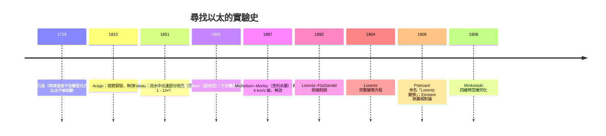

# 7.1 Maxwell 方程與以太的困境

## 導言：光為什麼需要一個「介質」？

十九世紀物理的皇冠是 Maxwell 方程（1865）——電、磁、光的大一統。但它藏著一顆炸彈：方程在**伽利略變換下不變式不成立**，卻在另一組變換下不變——這組變換暗示一個奇怪的「絕對靜止系」（以太）。1905 年 Einstein 的回答不是修補以太，而是**修改時空的幾何**。本節敘述這場危機的前因後果，它是狹義相對論的誕生劇，也是本書「幾何決定物理」主線的轉折點。

---

## Maxwell 方程

### 真空中的方程（MKSA 單位）

$$
\begin{aligned}
\nabla \cdot \mathbf{E} &= \frac{\rho}{\varepsilon_0} & &\text{(Gauss)}\\
\nabla \cdot \mathbf{B} &= 0 & &\text{(無磁單極)}\\
\nabla \times \mathbf{E} &= -\frac{\partial \mathbf{B}}{\partial t} & &\text{(Faraday)}\\
\nabla \times \mathbf{B} &= \mu_0\mathbf{J} + \mu_0\varepsilon_0\frac{\partial \mathbf{E}}{\partial t} & &\text{(Ampère–Maxwell)}
\end{aligned}
$$

### 歷史拼圖

- **Coulomb（1785）**：靜電平方反比（扭秤實驗）。
- **Ørsted（1820）**：電流使磁針偏轉——電與磁首次相連。
- **Ampère（1820s）**：電流間作用力的數學。
- **Faraday（1831）**：電磁感應；「力線」的物理直觀（無數學訓練，靠場圖像思考）。
- **Maxwell（1861–65）**：加上位移電流 $\varepsilon_0\partial_t\mathbf{E}$（為滿足電荷守恆的理論要求——**理論一致性催生新物理**），導出波動方程。
- **Hertz（1887）**：實驗證實電磁波——光即電磁波。

### 波動方程：光的出場

真空中（$\rho = \mathbf{J} = 0$），對 $\mathbf{E}$ 取旋度的旋度：

$$
\nabla \times (\nabla \times \mathbf{E}) = \nabla(\nabla \cdot \mathbf{E}) - \nabla^2\mathbf{E} = -\nabla^2\mathbf{E}
$$

右邊 $= -\frac{\partial}{\partial t}(\nabla \times \mathbf{B}) = -\mu_0\varepsilon_0\frac{\partial^2\mathbf{E}}{\partial t^2}$，故

$$
\boxed{\ \nabla^2\mathbf{E} = \mu_0\varepsilon_0\frac{\partial^2\mathbf{E}}{\partial t^2}\ }
$$

波速

$$
c = \frac{1}{\sqrt{\mu_0\varepsilon_0}} \approx 3 \times 10^8\ \text{m/s}
$$

**與光速吻合**（Fizeau 1849 齒輪法、Foucault 1850 旋轉鏡法測得）——Maxwell 寫道：「我們幾乎不可能避免這個推論：光是介質中電磁擾動的橫波。」

---

## 以太：必要的介質，測不到的存在

### 為什麼需要以太

波需要介質（水波需要水、聲波需要空氣）；$c$ 相對**什麼**？牛頓力學的速度叠加 $v' = v - u$ 說：在不同慣性系中測得的波速應不同。但 Maxwell 方程給出**唯一的** $c$——它必是相對某個「特權參考系」的速度。這個承載電磁波的特權系，被命名為**以太**（19 世紀物理的公設背景）。

### 邏輯困境

1. 以太要傳播橫波 ⟹ 必須像**固體**一樣硬（切變模量大）；
2. 行星在其中運行億年不減速 ⟹ 必須**稀薄如無物**；
3. 二者不可兼得——**力學模型的內在矛盾**。
4. Maxwell 方程在伽利略變換下**不改變形式** ⟹ Maxwell 力學與牛頓相對性原理**矛盾**。

### 精密測量的進軍

### Michelson–Morley 實驗（1887）

**設計**：光分兩路（一沿地球運動方向、一垂直），反射後匯合干涉。若以太風存在，兩路光速不同，旋轉儀器時干涉條紋應移動（預期 $\sim 0.4$ 條紋）。

**結果**：移動 $< 0.01$ 條紋——**零結果**。地球運動（30 km/s）在光速上不留痕跡。

**解釋的競賽**：

- **以太拖曳**：被光行差否定；
- **發射理論**（光速隨光源）：被雙星觀測（de Sitter 1913）與後來的邁克耳孧-莫雷重複實驗否定；
- **Lorentz–FitzGerald 收縮**（1892）：運動方向上物體收縮 $\sqrt{1 - v^2/c^2}$——恰好補償光程差。**承認收縮是真實的物理，但不知道為什麼**（Lorentz 認為是以太對分子的壓縮）；
- **Lorentz 變換（1904）**：一組使 Maxwell 方程形式不變的時空變換——數學上完備，物理上仍保留以太與「真實時間」（局域時）的區分；
- **Poincaré（1904–05）**：提出「相對性原理」之名，指出 Lorentz 變換構成群，甚至建議時間定義需要修正——離門一步；
- **Einstein（1905）**：**拋棄以太，把兩條公設（相對性 + 光速不變）作為出發點**，推導 Lorentz 變換是唯一的自洽可能，並宣布：以太概念多餘。

---

## 例題

### 例題 1：驗證 Maxwell 方程在伽利略變換下失效

伽利略變換：$x' = x - ut$、$t' = t$。考慮真空中 $\mathbf{E}$ 的波動方程：

$$
\frac{\partial^2\mathbf{E}}{\partial x^2} - \frac{1}{c^2}\frac{\partial^2\mathbf{E}}{\partial t^2} = 0
$$

**變換偏導**：$\frac{\partial}{\partial x} = \frac{\partial}{\partial x'}$、$\frac{\partial}{\partial t} = \frac{\partial}{\partial t'} - u\frac{\partial}{\partial x'}$。

代入：

$$
\frac{\partial^2 E}{\partial x'^2} - \frac{1}{c^2}\left( \frac{\partial}{\partial t'} - u\frac{\partial}{\partial x'} \right)^2 E = \left( 1 - \frac{u^2}{c^2} \right)\frac{\partial^2 E}{\partial x'^2} + \frac{2u}{c^2}\frac{\partial^2 E}{\partial x'\partial t'} - \frac{1}{c^2}\frac{\partial^2 E}{\partial t'^2}
$$

**出現混合偏導項 $\frac{\partial^2}{\partial x'\partial t'}$ 與係數 $(1 - u^2/c^2)$**——方程形式改變！若新系中的波速為 $c'$，形式要求 $c' = c \pm u$。**伽利略變換下的光速應隨參考系變化**，與 Michelson–Morley 的零結果矛盾。**結論：不是 Maxwell 方程錯，而是伽利略變換錯**——時空的變換律必須修改。

### 例題 2：由光速不變導出 Lorentz 變換（預告 7.2）

設變換保持線性（慣性系 → 慣性系）與光錐 $x^2 + y^2 + z^2 = c^2t^2 \leftrightarrow x'^2 + \ldots = c^2t'^2$。沿 $x$ 方向運動的對稱性簡化為：

$$
x' = \gamma(x - ut), \qquad t' = \gamma\left( t - \frac{ux}{c^2} \right), \qquad \gamma = \frac{1}{\sqrt{1 - u^2/c^2}}
$$

**驗證光錐不變**：取 $x = ct$：

$$
x' = \gamma(c - u)t, \qquad t' = \gamma\left( 1 - \frac{u}{c} \right)t \implies \frac{x'}{t'} = c\ \checkmark
$$

**驗證 Maxwell 方程形式不變**（概要）：$\mathbf{E}, \mathbf{B}$ 需按張量規則混合變換（7.3 節），混合後四條方程**形式不變**——Lorentz 1904 的計算，Einstein 1905 從公設出發重新導出。**「變換使方程不變」= 對稱性原理**（Noether 精神）：光的電磁理論自動選擇了時空的幾何。

---

## 危機的深層意義：兩大原理的衝突

### 衝突結構表

| | 牛頓力學 | Maxwell 電磁學 |
|---|---|---|
| 不變變換 | 伽利略 | Lorentz |
| 特權速度 | 無（相對性） | $c$（相對以太） |
| 時間 | 絕對、普適 | 方程中 $t$ 的地位待定 |
| 空間 | 歐氏三維 | 歐氏三維 + 以太系 |

**Einstein 的裁決**：相對性原理是根本（物理定律不應挑選特權系），Maxwell 方程是根本（被 Hertz 等實驗支持），**犧牲的是牛頓的絕對時間**。這個「犧牲」的幾何內容，由 Minkowski 1908 揭示：時間與空間合成四維，不變的是**時空間隔**（7.2 節）。

### 引發的新問題

1. 統一後的幾何是什麼？→ Minkowski 時空（7.2）；
2. 張量形式如何書寫？→ 四維電動力學（7.3）；
3. 重力怎麼辦？牛頓重力是「瞬時超距」 incompatible with $c$ 極限 → 等效原理與廣義相對論（第 8 章）；
4. 量子怎麼辦？光電效應同年（1905）Einstein 的光量子——**相對論與量子力學的合流問題**至今未完全解決（量子重力）。

---

## 與其他領域的關聯

### 向量微積分

Maxwell 方程是 div、curl 的最高應用；本章例題 1 正是「偏導變換下 PDE 變形」的直接計算。電磁波方程也開啟了**波動算子** $\Box = \nabla^2 - \frac{1}{c^2}\partial_t^2$ 的譜理論（7.2 節將見它在 Minkowski 幾何中的自然性）。

### 算子理論

Maxwell 方程的初值問題是雙曲算子的 Cauchy 問題；Huygens 原理在三維成立（波前清晰）、二維不成立（拖尾）——**維數影響波傳播**，與 6.3 節「三維無引力波」呼應：**波方程的幾何依賴維數**（球面波無拖尾的數學：$1/r$ 型解的奇性結構）。

### 量子力學

- 光電效應（Einstein 1905，1921 諾貝爾獎）：光的粒子性——同一年的兩篇論文分別開啟相對論與量子論；
- Maxwell 方程是 $U(1)$ 規範理論（9.3 節）：規範對稱 ⟺ 電荷守恆（Noether）；
- 量子電動力學（QED）：Maxwell + 量子的完美理論（Feynman–Schwinger–Tomonaga 1948，反常磁矩預測精確到 $10^{-10}$）。

### 工程

Michelson 干涉儀的技術譜系直接導致 **LIGO**（9.2 節）：同一原理（干涉測長），百年後測的是時空本身的漣漪。雷達、光纖通訊、GPS（需相對論修正，第 8 章末）都是 Maxwell + 相對論的工程果實。

---

## 小結

1. Maxwell 1865 統一電磁光，波速 $c = 1/\sqrt{\mu_0\varepsilon_0}$。
2. $c$ 相對「以太」的公設陷入邏輯困境；Michelson–Morley（1887）零結果摧毀測量基礎。
3. Lorentz（1904）寫出使方程不變的變換；Einstein（1905）從兩公設出發，拋棄以太。
4. 伽利略變換與 Maxwell 方程不相容——被修改的是時間與空間的幾何。
5. 下節：Minkowski 1908 把 Lorentz 變換讀成四維時空的「旋轉」——相對論的幾何本質。
