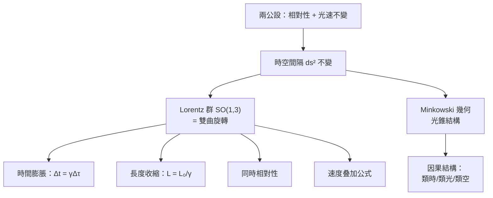

# 7.2 Lorentz 變換與 Minkowski 時空 1908

## 導言：「空間本身與時間本身將沈入陰影」

1908 年 9 月 21 日，科隆，德國自然科學家大會。Hermann Minkowski（Einstein 在蘇黎世聯邦理工的老師，曾稱他「懶狗」）發表演講，開場即成名言：

> 「從今以後，空間本身與時間本身將沈入陰影，只有兩者的某種結合能保持獨立的實在。」

Minkowski 指出：Lorentz 變換就是**四維時空中的雙曲旋轉**；Einstein 1905 的全部結果都是這個幾何的推論。本節建立 Minkowski 幾何：間隔、光錐、雙曲旋轉，與「幾何化的相對論」。

---

## 時空間隔：新的「畢氏定理」

### 定義

兩事件的間隔（Minkowski 簽號 $(-,+,+,+)$，本書採用）：

$$
\boxed{\ \Delta s^2 = -c^2\Delta t^2 + \Delta x^2 + \Delta y^2 + \Delta z^2\ }
$$

**分類**：

| 間隔 | 條件 | 幾何 | 物理意義 |
|---|---|---|---|
| 類時 | $\Delta s^2 < 0$ | 光錐內 | 可由亞光速信號連接；有因果、有先後 |
| 類光 | $\Delta s^2 = 0$ | 光錐上 | 只有光速信號連接 |
| 類空 | $\Delta s^2 > 0$ | 光錐外 | 不可連接；**同時性隨參考系改變** |

**核心斷言**：$\Delta s^2$ 在 Lorentz 變換下**不變**——它是時空的「距離」。三維歐氏距離 $dx^2 + dy^2 + dz^2$ **不再不變**；不變的是含時間的組合。**「同時」失去絕對性、「間隔」取得絕對性**——這就是相對論的幾何本質。

### 度量的觀點（第 5 章語言）

Minkowski 度量是**不定號**（偽黎曼）度量：

$$
g = \mathrm{diag}(-c^2, 1, 1, 1)\quad (\text{或 } \eta_{\mu\nu} = \mathrm{diag}(-1,1,1,1),\ x^0 = ct)
$$

Riemann 幾何（正定）講「最短」；Lorentz 幾何（不定）講「最長」——**自由粒子走類時測地線，其固有時是極大而非極小**（雙生子佯謬的幾何解釋：直線（慣性）世界線的固有時最長，轉彎的那位更年輕——不是悖論，是三角不等式反轉）。

---

## Lorentz 變換：時空的雙曲旋轉

### 標準配置

沿 $x$ 軸速度 $u$ 的兩個慣性系：

$$
x' = \gamma(x - ut), \qquad y' = y,\ z' = z, \qquad t' = \gamma\left( t - \frac{ux}{c^2} \right), \qquad \gamma = \frac{1}{\sqrt{1 - \beta^2}},\ \beta = u/c
$$

### 雙曲形式：雙曲角的旋轉

引入 $x^0 = ct$ 與快度（rapidity）$\varphi$：$\tanh\varphi = \beta$。則

$$
\begin{pmatrix} x'^0 \\ x' \end{pmatrix} = \begin{pmatrix} \cosh\varphi & -\sinh\varphi \\ -\sinh\varphi & \cosh\varphi \end{pmatrix}\begin{pmatrix} x^0 \\ x \end{pmatrix}
$$

**與旋轉矩陣 $\begin{pmatrix}\cos\theta & -\sin\theta \\ \sin\theta & \cos\theta\end{pmatrix}$ 的結構相同，三角函數換成雙曲函數**：

$$
\cos\theta \leftrightarrow \cosh\varphi, \qquad \sin\theta \leftrightarrow -\sinh\varphi, \qquad \theta^2 \leftrightarrow -\varphi^2
$$

旋轉保 $x^2 + y^2$（圓），Lorentz 保 $-c^2t^2 + x^2$（雙曲線）——**Lorentz 群 = 雙曲角旋轉群 $SO(1, 3)$**。快度可加（$\varphi_{\text{合}} = \varphi_1 + \varphi_2$）是它相對於速度的最大優點（速度叠加公式 $w = \frac{u + v}{1 + uv/c^2}$ 在快度語言中就是「相加」）。

### Lorentz 群

$$
O(1, 3) = \{\Lambda \mid \Lambda^T\eta\Lambda = \eta\}
$$

含 6 個連續參數（3 個旋轉 + 3 個 boost）+ 離散部分（宇稱 $P$、時間反演 $T$）。**速度叠加、長度收縮、時間膨脹、同時相對性**全部是群結構的推論。

---

## 經典效應的幾何速推

### 時間膨脹

固有时 $\Delta\tau$：與粒子共動鐘的讀數（類時世界線的 Minkowski 弧長$/c$）。相對速度 $u$ 的觀察者量得

$$
\Delta t = \gamma\,\Delta\tau
$$

**幾何**：世界線與時間軸夾角增大，其「長度」按雙曲度量膨脹。

### 長度收縮

運動棒的長度（同時測端點）：$L = L_0/\gamma$。**幾何**：在不同方向的「同時切片」上量同一根棒——切片不同，長度不同。

### 速度叠加

$$
w = \frac{u + v}{1 + uv/c^2}
$$

由 Lorentz 變換對速度比 $dx/dt$ 直接可得；用快度則 $w = c\tanh(\varphi_u + \varphi_v)$——**亞光速速度之和不超光速**（$\tanh < 1$）。

### 例題

**例題：π 介子的壽命延長**

實驗（1952 起的宇宙線與加速器實驗）：能量 $\gamma = 10$ 的 $\pi^\pm$（固有壽命 $\tau_0 = 26\,\mathrm{ns}$）。

- 實驗室系壽命：$\Delta t = \gamma\tau_0 = 260\,\mathrm{ns}$；
- 飛行距離（實驗室）：$d = v\,\gamma\tau_0 \approx c\,\gamma\tau_0 = 3\times10^8 \times 2.6\times10^{-7} \approx 78\,\mathrm{m}$；
- 粒子系：距離收縮，$d' = 78/\gamma = 7.8\,\mathrm{m}$，用自身時間 $26\,\mathrm{ns}$ 走完——兩系計算一致（自洽檢驗：$7.8\,\mathrm{m} = v\tau_0 \approx c\cdot 26\mathrm{ns}$ ✓）。

**GPS 的實際修正**：衛星鐘因速度膨脹慢 $7\,\mu s/$天（狹義），因重力位快 $45\,\mu s/$天（廣義，8.3 節引力紅移）；淨 $+38\,\mu s/$天，若不修正則定位每天漂移 $\sim 10$ km——**相對論是日常技術**。

---

## Minkowski 圖

### 世界線與光錐

- $t$–$x$ 圖上，光的世界線 $x = \pm ct$ 是 $\pm 45°$ 直線；
- 任何物質世界線斜率 $> 45°$（局部速度 $< c$）；
- 事件的光錐劃分因果未來/過去/「他處」。

**同時線**：慣性系的同時線是直線，boost 使其傾斜——**兩條同時線可以「掃過」整個類空區域**，解釋了順序顛倒只發生在類空分隔事件（因果安全）。

### 洛倫茲收縮的圖解

車（長 $L_0$）過隧道（長 $L_0$）佯謬：車系看隧道收縮，車怎麼放得進？答：**「整車在隧道內」在不同系指不同的同時切片**；車頭出隧道與車尾進隧道的事件是類空分隔，順序可倒——無矛盾。**佯謬 = 忘了同時的相對性**。

---

## 幾何的統一：Riemann → Lorentz → 廣義

### 譜系表

| | Riemann（1854/正定） | Minkowski（1908） | Lorentz 流形（廣義） |
|---|---|---|---|
| 度量 | $g_{ij}$ 正定 | $\eta = \mathrm{diag}(-,+,+,+)$ | $g_{\mu\nu}(x)$ 不定號 |
| 曲率 | 可能非零 | **恆零**（平直） | 非零 = 重力 |
| 測地線 | 最短 | 最長固有時 | 自由落體 |
| 對稱群 | $SO(n)$ | $O(1,3)$（Poincaré：+平移） | 局部 Lorentz（8.1） |
| 物理 | 彎曲空間 | 狹義相對論 | 廣義相對論 |

**關鍵連續性**：Minkowski 時空是 Lorentz 流形的曲率為零的特例；廣義相對論 = 「Minkowski 幾何 + 讓度量隨物質彎曲」。第 5 章的一切（聯絡、曲率、Einstein 張量）在簽號改變後全部保留（連續性成立），只是測地線從「最短」變「最長」。

---

## 歷史與迴響

### Minkowski 的貢獻與早逝

- Minkowski（1864–1909）：立陶宛出生、哥尼堡長大，數論（連分數幾何）與相對論幾何雙棲。1908 演講、1909 年初闌尾炎驟逝，年 44。Einstein 承認：「自從數學家涉足相對論，我再也不懂它了——但多虧 Minkowski，我做到了。」
- **四維形式主義**使 Einstein 得以在 1912–15 年間操作張量（7.3 節）；沒有 Minkowski 幾何，廣義相對論的數學幾乎不可書寫。

### 引發的新問題

1. 電磁場的協變形式？→ 四維張量與 $F_{\mu\nu}$（7.3）；
2. 重力如何幾何化？→ 等效原理（8.1）；
3. 非歐時空的可觀測檢驗？→ 1919 日食（9.1）；
4. Minkowski 幾何的量子版？→ 相對論量子力學（Klein–Gordon、Dirac 方程，7.3 末）與 QFT。

---

## 與其他領域的關聯

### 算子理論

波算子 $\Box = -\frac{1}{c^2}\partial_t^2 + \nabla^2$ 在 Minkowski 幾何中是「Laplace 算子」（達朗貝爾算子）；其初值問題（雙曲型）與橢圓 Laplace 對比鮮明：後者解光滑化、前者傳播奇性（有限傳播速度、Huygens 原理）——**符號差決定 PDE 的定性**（橢圓/雙曲/拋物分類的幾何根源）。

### 量子力學

- 相對論能量動量 $E^2 = p^2c^2 + m^2c^4$ 量子化（$E \to i\hbar\partial_t$、$\mathbf{p} \to -i\hbar\nabla$）得 **Klein–Gordon 方程**（1926），負解問題引出 Dirac 方程（1928）與反物質預言（1932 正電子發現）；
- **Dirac 方程 = Minkowski 時空 + 自旋**：克氏符號升級為自旋聯絡——量子與幾何的第一次深層融合（8.1 節等效原理對自旋的效應：重力引起進動）；
- 量子場論 = Minkowski 時空上的場的量子化；因果性（類空對易子為零）成為公理之一。

### 幾何與群論

- Lorentz 群 $SO(1,3)$ 的表示論**就是**粒子分類：表示的標籤 = 質量 + 自旋（Wigner 1939）——「粒子是時空對稱群的不可約表示」（10.2 節李群的物理巔峰）；
- 快度是 $SO(1,3)$ 李代數的坐標——boost 不可交換的根源（Thomas 進動，原子光譜精細結構的一部分）。

---

## 小結

1. 間隔 $\Delta s^2 = -c^2\Delta t^2 + \Delta x^2 + \ldots$ 是不變量；類時/類光/類空三分因果。
2. Lorentz 變換 = 雙曲旋轉（快度可加）；Lorentz 群 $O(1,3)$ 是時空對稱群。
3. 時間膨脹、長度收縮、速度叠加是幾何推論；π 介子實驗與 GPS 修正證實。
4. Minkowski 幾何 = 平直 Lorentz 流形；廣義相對論只是「讓度量彎曲」。
5. 表示論把粒子歸為 $SO(1,3)$ 表示——幾何對稱決定物質譜系。

下一節把電磁學與力學全部重寫成四維張量語言，為「重力 = 幾何」的最後一躰做技術準備。
