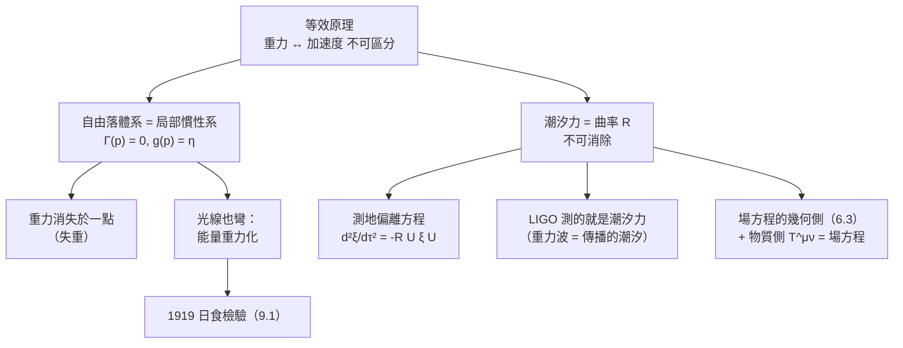

# 8.1 等效原理

## 導言：「一生最幸福的思想」

1907 年某日，Einstein 在伯恩專利局，忽然想通：

> 「如果一個人自由下落，他就不會感到自己的重量。……**這種簡單的想象在我心中產生了深刻的印象，促使我走向重力理論。**」

這就是**等效原理**：重力與加速度局部不可區分。它是廣義相對論的基石：重力不是「力」，而是**時空彎曲的表現**；自由落體沿時空的測地線運行。本節從思想實驗到數學（局部慣性系、測地線方程、潮汐力的不可消除），完成從狹義到廣義的幾何跳躍。

---

## 等效原理的內容與層次

### 思想實驗：電梯

- **密閉電梯中，觀察者無法區分**：(a) 電梯靜止於地面（重力 $g$）與 (b) 電梯以 $a = g$ 加速於太空（慣性效應）——兩者一切力學實驗結果相同；
- 反之：自由下落的電梯（a'）與慣性漂浮（b'）不可區分——**內部重力消失**。

### 三個層次

1. **弱等效原理**（WEP）：慣性質量 = 重力質量，
$$
m_{\text{慣}}\,a = m_{\text{重}}\,g \implies a = g\ \text{（與物體無關！）}
$$
一切物體以同樣加速度下落（伽利略比薩、Apollo 15 月面錘羽同落 1971）。
2. **愛因斯坦等效原理**（EEP）：WEP + 局部物理（力學、電磁、量子）在自由落體系中回到狹義相對論形式。
3. **強等效原理**：包含引力自能的物體也適用；局部不可用任何非引力實驗區分重力與加速度。

### 為什麼 WEP 深刻

牛頓力學中 $m_{\text{慣}}$（$F = ma$ 的 $m$）與 $m_{\text{重}}$（萬有引力 $F = GmM/r^2$ 的 $m$）是**概念上完全不同**的量，實驗上卻相等——伽利略已暗示、Newton（擺實驗精度 $10^{-3}$）、Bessel、**Eötvös（1889–1922，扭秤）$10^{-9}$**、**Eöt-Wash（1980s–）$10^{-13}$**、**MICROSCOPE 衛星（2022）$10^{-15}$** 層層加碼。牛頓理論把這個巧合當事實接受；Einstein 把它提升為原理：**既然所有物體的下落與自身無關，下落就不是物體的性質，而是（時空的）環境性質**——重力是幾何！

---

## 數學化：局部慣性系

### 消去 Christoffel 符號

任一時空點 $p$，取自由落體座標（沿過 $p$ 的測地線的指數映射/法座標），則（5.3 節）

$$
g_{\mu\nu}(p) = \eta_{\mu\nu}, \qquad \Gamma^\rho_{\mu\nu}(p) = 0
$$

**在 $p$ 點（及其一階鄰域），重力（Christoffel 項）消失，物理 = 狹義相對論**。EEP 的數學表述。

**測地線方程在此座標中**：$\ddot x^\mu = 0$（$p$ 附近）——自由落體「感覺不到重力」（失重）。

### 不可消除的部分：潮汐力

二階導數消不掉：$p$ 附近的展開

$$
\Gamma^\rho_{\mu\nu}(x) \approx -\frac{1}{3}R^\rho{}_{\mu\sigma\nu}\,x^\sigma + \cdots
$$

**曲率 = 「重力的梯度」= 潮汐力**。兩個自由落體的相對運動（測地偏離方程，6.2 節）：

$$
\frac{d^2\xi^\mu}{d\tau^2} = -R^\mu{}_{\nu\rho\sigma}U^\nu\xi^\rho U^\sigma
$$

**例**：地球表面，兩個並排下落的小球相向加速（都指向地心），相對加速度 $\sim 2g\,\xi/r_\oplus$——Eötvös 實驗量不到的重力「殘餘」。**等效原理只保證「一點」上重力可消；「一片」區域的重力（潮汐）就是曲率，不可消**——這是「重力 = 幾何」與「重力 = 力」的判別性差別：力可以在全域變換掉（牛頓），曲率是內蘊的、變換不掉。

---

## 等效原理的直接推論

### 1. 引力紅移

加速火箭頂底發光：光從底部到頂部，接收者加速離開 ⟹ 紅移。由等效原理，**重力場中同樣紅移**：

$$
\frac{\Delta\nu}{\nu} = \frac{\Delta\Phi}{c^2}
$$

**驗證**：Pound–Rebka（1960，哈佛 22.5 m 塔樓，Mössbauer 效應，$10^{-15}$ 精度）；**GPS 衛星鐘**（高度 2 萬 km，重力位差使鐘每天**快** $45\,\mu s$）；**重力探測 A（1976）**$7\times10^{-5}$ 精度。紅移意味著**時空不同點的時間流速不同**——時間的幾何化。

### 2. 光線偏折

等效原理：加速火箭中光線「下彎」（船內幾何）。故太陽旁的光線應偏折。**Einstein 1911（等效原理版）**：$0.87''$；**1915（廣義相對論完整版，含空間曲率）**：$1.75''$——**1919 Eddington 日食證實**（9.1 節詳述）。**偏折的兩半**：一半來自時間彎曲（等效原理），一半來自空間彎曲（完整幾何）——「空間是彎的」的觀測證據。

### 3. 時間與幾何的統一

引力紅移 ⟹ 不同高度的鐘不同速 ⟹ 單一的「全域時間」不存在 ⟹ 物理需要**時空流形 + 度量**的架構（4.1、5.2 節的語言正是為此而備）。Einstein 1912 年 realizing 這點後轉向 Riemann 幾何（Grossmann 介紹張量分析）。

---

## 例題

### 例題 1：由等效原理推導引力紅移

勻加速火箭（加速度 $a$），底部發光頻率 $\nu_0$，光到達頂部（高 $h$）需時 $\approx h/c$；此刻頂部速度 $v = ah/c$。接收者看到 Doppler 紅移（一階）：

$$
\frac{\Delta\nu}{\nu_0} \approx -\frac{v}{c} = -\frac{ah}{c^2}
$$

由等效原理，靜止於重力場（場強 $g$）中的同樣情況：

$$
\boxed{\ \frac{\Delta\nu}{\nu} = -\frac{g h}{c^2}\ }
$$

**數值**：地球表面 $gh/c^2 = 9.8 \times 22.5 / (9\times10^{16}) \approx 2.5\times10^{-15}$——Pound–Rebka 1960 年以 Mössbauer（$\gamma$ 射線 $14.4\,\mathrm{keV}$ 的 Fe-57，自然線寬 $10^{-12}$）實測成功。**等效原理的定量兌現**。

### 例題 2：地球的潮汐加速度（測地偏離計算）

牛頓重力 $\mathbf{g}(\mathbf{r}) = -\frac{GM}{r^3}\mathbf{r}$。兩個自由落體相距 $\boldsymbol{\xi}$（$|\xi| \ll r$），相對加速度：

$$
\delta\mathbf{g} = (\boldsymbol{\xi}\cdot\nabla)\mathbf{g}
$$

計算（球座標，沿徑向 $\xi = \delta r\,\hat r$）：

$$
\delta g_r = \frac{d g_r}{dr}\,\delta r = \frac{2GM}{r^3}\,\delta r
$$

沿切向：$\delta g_\theta = -\frac{GM}{r^3}\delta r_\perp$（**徑向拉伸、切向壓縮**——潮汐的經典模式，月球潮汐、土星環、麵條化皆此）。

**廣義相對論對照**：測地偏離方程右端 $-R^\mu{}_{\nu\rho\sigma}U^\nu\xi^\rho U^\sigma$ 對 Schwarzschild 度量給出（8.3 節計算）

$$
\delta g_r = \frac{2GM}{r^3}\,\delta r\ (\text{相同！})， \qquad \delta g_\perp = -\frac{GM}{r^3}\delta r_\perp\ (\text{相同！})
$$

**牛頓潮汐 = GR 曲率的弱場極限**——「潮汐力 = Riemann 張量」的定量檢驗。**LIGO 探測的重力波正是波動形式的潮汐場**：兩個相距 4 km 的鏡子以 $10^{-18}$ m 量級相對拉伸/壓縮（9.2 節）。

---

## 慣性與重力的哲學：馬赫原理

### Einstein 的靈感源頭

Einstein 引用馬赫（E. Mach, 1883《力學史》）：「慣性是相對於宇宙全體物質的」——遠方恆星決定局域慣性系。等效原理把「慣性系 = 自由落體系」變成局部定義，但**全域**的慣性結構仍由宇宙物質決定（Mach 原理的精確化一直爭議；Gödel 旋轉宇宙、Frame-dragging 引力探測器 B 2011 測得 $\sim 98\%$ 符合廣義相對論預言）——**局部幾何 ↔ 全域物質**的張力貫穿現代宇宙學（9.2 節暗物質/暗能量）。

### 等效原理的地位與現代檢驗

| 檢驗 | 年代 | 精度 |
|---|---|---|
| Eötvös 扭秤 | 1889–1922 | $10^{-9}$ |
| Dicke（金轉盤） | 1964 | $10^{-11}$ |
| Eöt-Wash | 1987– | $10^{-13}$ |
| 月球雷射測距 | 1976– | $10^{-14}$ |
| MICROSCOPE 衛星 | 2016–2022 | $10^{-15}$ |

**弦論/等效原理破壞的探尋**：若存在「第五力」（標量場、額外維度），WEP 將以 $10^{-15}$ 以下破壞——**等效原理是尋找新物理的最精密天平之一**。

---

## 與其他領域的關聯

### 牛頓力學

等效原理使「重力場強度」$g$ 與「加速度」在數學上同構（Rindler 座標：平直時空中勻加速參考系的度量恰是 Schwarzschild 弱場型式）——**牛頓重力的幾何語言化是廣義相對論的入門模型**（Rindler–Fermi 座標是 GR 教材的標準熱身）。

### 算子理論

局部慣性系 = 在一點把二階橢圓–雙曲算子「主部正規化」；不可消除的曲率項 = 算子的**特徵值/指標資料**（指標定理中熱核展開的曲率項，Atiyah–Singer 1963；Hawking 輻射的熱核推導 1976）——「局部標準形 + 曲率殘餘」的分析學版本。

### 量子力學

- **自旋–重力耦合**：等效原理對量子自旋的表述需要自旋聯絡（Cartan 撓率，5.3 節），Einstein–Cartan 理論由此而生；
- **中子干涉儀（COW 實驗, 1975）**：中子在重力場中的干涉相位差 $\Delta\varphi = \frac{m g A}{\hbar c}$（$A$ = 干涉環路面積）——**量子波動感受重力**，等效原理的量子版檢驗；
- Hawking 輻射（1974）：黑洞附近的量子場論——等效原理 + 量子場論的深層結合（8.3、9.2 節）。

### 工程與日常

GPS（第 7.2 節）、重力測量（石油探勘的重力儀 = 潮汐梯度儀）、慣性導航（加速計**原理上**無法區分重力與加速度——需要外部資訊修正）——等效原理是工程師的日常公理。

---

## 小結

1. 等效原理：重力與加速度局部不可區分（WEP：$m_{\text{慣}} = m_{\text{重}}$，實驗精度 $10^{-15}$）。
2. 數學化：局部慣性系消 $\Gamma$（一點上重力消失）；曲率（潮汐）不可消。
3. 直接推論：引力紅移（Pound–Rebka）、光線偏折（1919）、時間幾何化。
4. 測地偏離方程把牛頓潮汐幾何化；LIGO 測的重力波 = 傳播的潮汐。
5. 馬赫原理提供哲學動機；現代檢驗（MICROSCOPE）把等效原理推向新物理的前沿。

下一節：等效原理 + 張量分析 ⟹ Einstein 場方程（1915 年 11 月的四個星期四）。
