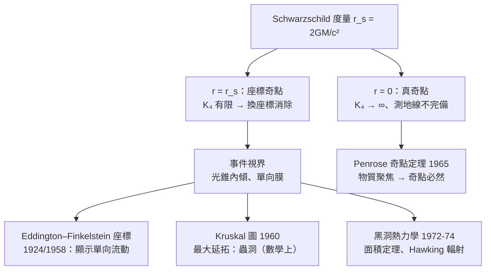

# 8.3 Schwarzschild 解與黑洞

## 導言：從「數學怪物」到「天文實體」

Schwarzschild 1915 年的精確解中藏著兩個「奇點」： $r = 0$ 與 $r = r_s$ 。五十年間，人們逐漸明白：前者是物理的（真奇點），後者只是座標的假象——而 $r = r_s$ 圍出的區域是一個**事件視界**：光也逃不出的單向膜。「黑洞」一詞 1967 年才由 Wheeler 普及；2019 年 EHT 拍到 M87 中心黑洞的影子；2022 年拍到銀河系中心 Sgr A*。本節沿 Schwarzschild 幾何，講完黑洞的數學與天文學。

---

## Schwarzschild 幾何的解剖

### 度量與兩個奇點

$$
ds^2 = -\left( 1 - \frac{r_s}{r} \right)c^2dt^2 + \left( 1 - \frac{r_s}{r} \right)^{-1}dr^2 + r^2(d\theta^2 + \sin^2\theta\,d\varphi^2), \qquad r_s = \frac{2GM}{c^2}
$$

**判別奇點**（6.2 節方法）：座標不變的曲率純量

$$
K_4 = R_{\mu\nu\rho\sigma}R^{\mu\nu\rho\sigma} = \frac{12\,r_s^2}{r^6}\ \left( = \frac{48G^2M^2}{c^4r^6} \right)
$$

- $r = r_s$ ： $K_4 = 12/r_s^4$ **有限** ⟹ 座標奇點（假奇點）；
- $r = 0$ ： $K_4 \to \infty$ **發散** ⟹ 真奇點（測地線在有限固有時終結——奇點定義）。

### 自由落體：跨越視界無事發生

徑向自由落體（從靜止落下）的固有時（簡化計算：牛頓極限一致的結果）：

$$
\tau(r) = \frac{\pi}{2}\sqrt{\frac{r_0^3}{2GM}}\left( \text{從 } r_0 \text{ 落到中心} \right)
$$

**有限**：落體穿越 $r = r_s$ 只花有限固有時，且**感覺不到任何特別**（局部慣性系，8.1 節）。**遠方觀察者**看到的座標時間則 $t \to \infty$ ：影像紅移、變暗、凍結在視界——「凍結星」（蘇聯學派的早期名稱）。**視界是「時間的單向閘門」而非實體表面**。

### 時間膨脹與視界

$$
d\tau = \sqrt{1 - r_s/r}\; dt \quad (\text{靜止鐘，} r > r_s)
$$

$r \to r_s^+$ ：鐘相對無窮遠**無限變慢**——引力紅移 $\nu_{\infty} = \nu_r\sqrt{1 - r_s/r} \to 0$ 。**視界 = 引力紅移發散面**。

---

## 視界的因果幾何

### 光錐的傾斜

Schwarzschild 座標中光錐在 $r \to r_s$ 「捏扁」——座標的病態。**Eddington–Finkelstein 座標**（1924 Eddington、1958 Finkelstein）： $v = t + r_*/c$ 、 $dr_*/dr = (1 - r_s/r)^{-1}$ ：

$$
ds^2 = -\left( 1 - \frac{r_s}{r} \right)c^2dv^2 + 2c\,dv\,dr + r^2d\Omega^2
$$

在此座標中度量在 $r = r_s$ **正則**；光錐隨 $r$ 減小**連續內傾**，在 $r = r_s$ 處一條光線正好駐留（ $r$ 不變）——**視界是光的「最後立足線」**。 $r < r_s$ ：所有光錐指向 $r$ 減小方向——**一切未來都在內部**，逃逸需要超光速。**因果結構由光錐決定**（Minkowski 幾何，7.2 節）在彎曲時空的直接體現。

### Penrose 圖與奇點定理

- **共形壓縮**（Penrose 1963）：把無窮遠壓到圖上有限處——全時空因果結構一目了然（兩個漸近平坦區 + 橋 = Kruskal 延拓的「蟲洞」；對稱性使它動態塌縮，不可穿越——TRaversable 與否的經典判別）。
- **奇點定理（Penrose 1965，2020 諾貝爾獎）**：若物質滿足能量條件（ $\mathrm{Ric}(u,u) \geq 0$ ，聚焦條件）且出現捕獲面（ trapped surface：兩方向光錐都收縮的面），則**測地不完備（奇點）不可避免**。**引力塌縮必然造出奇點**——理論完成（Hawking 推廣到宇宙學大爆炸奇點）。

---

## 黑洞熱力學與 Hawking 輻射

### 四定律（1972–73，Bardeen–Carter–Hawking）

| 熱力學 | 黑洞力學 | 對應 |
|---|---|---|
| 溫度 $T$ | 表面重力 $\kappa = \frac{c^4}{4GM}$ （Schwarzschild） | $T_H = \frac{\hbar\kappa}{2\pi k_B c} = \frac{\hbar c^3}{8\pi GMk_B}$ |
| 能量 | 質量 $M$ | 第一律 |
| 熵 | 視界面積 $A = 4\pi r_s^2$ | $S = \frac{k_B A}{4\ell_P^2}$ （Bekenstein 1972） |
| 第二律 | 面積定理（Hawking 1971） | $dA \geq 0$ |

**Bekenstein 的洞見**：熱力學第二律 + 黑洞吞物 ⟹ 黑洞必須有熵 ⟹ 熵 $\propto$ 面積（不是體積！）——**資訊住在視界上**：全息原理的起點。

### Hawking 輻射（1974）

彎曲時空量子場論：視界附近的真空漲落分離，一隻落入、一隻逃出 ⟹ 黑洞以溫度 $T_H$ 發出**黑體輻射**。

**數值**：太陽質量黑洞 $T_H \approx 6\times10^{-8}\,\mathrm{K}$ （比 CMB $2.7\,\mathrm{K}$ 低八個量級——**今日黑洞淨吸熱**；遙遠未來 CMB 冷卻後才蒸發）； $M$ 越小越熱（**負熱容量**！）；蒸發時間 $t \sim 10^{67}(M/M_\odot)^3$ 年。

**意義**： $\hbar$ 、 $G$ 、 $c$ 、 $k_B$ 四常數同框——重力、量子、熱力學的交匯點；**資訊悖論**（落入黑洞的資訊去哪？Hawking 1976 說銷毀 ⟹ 違反量子力學么正性；AdS/CFT 與 2004 年後的共識：資訊保存，經由「軟毛髮」與糾纏重構——當代最活躍的理論前沿之一）。

---

## 例題

### 例題 1：光線偏折的完整計算（1919 檢驗的數學）

Schwarzschild 度量中零測地線， $u = 1/r$ 、影響參數 $b$ 。軌道方程（類似例題 8.2.2 的推導）：

$$
\frac{d^2u}{d\varphi^2} + u = \frac{3GM}{c^2}u^2
$$

**零階解**（直線）： $u_0 = \frac{\sin\varphi}{b}$ 。**一階微擾**：代入右端 $\frac{3GM}{c^2}u_0^2$ ，共振解導致漸近方向偏移。結果：

$$
\boxed{\ \delta = \frac{4GM}{c^2 b}\ }
$$

（**兩倍**於等效原理的 $0.87''$ ：一半來自時間彎曲、一半來自空間彎曲——1911 vs 1915 的差別。）

**太陽數值**： $GM_\odot/c^2 = 1477\,\mathrm{m}$ 、 $b = R_\odot = 6.96\times10^8\,\mathrm{m}$ ：

$$
\delta = \frac{4 \times 1477}{6.96\times10^8} = 8.49\times10^{-6}\ \mathrm{rad} = 1.75''
$$

✓ **Eddington 1919**：兩支日食遠征（Sobral 巴西、Príncipe 西非），測得 $1.61'' \pm 0.30''$ 、 $1.98'' \pm 0.16''$ ——與 GR 吻合、與牛頓（無空間曲率）排斥。**1919.11.06 倫敦皇家學會宣布，Einstein 一夜成名**（泰晤士報：「科學革命——牛頓觀念被推翻」）。**現代**：VLBI 類星體偏折精度 $10^{-4}$ ；重力透鏡（1979 首例雙類星體 Q0957+561）成為暗物質測繪的主要工具（9.2 節）。

### 例題 2：視界內的時間反轉與最大延拓

**問題**：在 $r < r_s$ ，Schwarzschild 座標中 $g_{tt} > 0$ 、 $g_{rr} < 0$ ——**時間與空間交換角色**： $r$ 變成「時間方向」（必然流逝，向 $r = 0$ ）， $t$ 變成空間方向。

**Kruskal–Szekeres 座標**（1960）：

$$
U = \sqrt{\frac{r}{r_s} - 1}\; e^{(r + ct)/(2r_s)}, \qquad V = \sqrt{\frac{r}{r_s} - 1}\; e^{(r - ct)/(2r_s)}
$$

度量成為共形平坦：

$$
ds^2 = \frac{32\,G^3M^3}{c^4\,r}\,e^{-r/r_s}\left( -dV\,dU \right) + r^2d\Omega^2
$$

（ $U, V$ 平面中 $r = r_s$ 是兩條對角直線 $U = \pm V$ ——視界；奇點 $r = 0$ 是雙曲線 $UV = 1$ 。）**最大延拓含四個區域**（兩個宇宙、黑洞區、白洞區），奇點是類空的（ $UV = 1$ ）——**奇點是「時間的未來」，不是「空間的地點」**。這張圖是黑板相對論最著名的圖像之一。

**物理限制**：Kruskal 白洞區是數學延拓；真實塌縮恆星時空沒有白洞（初始條件不含它）——**延拓 ≠ 現實**（初值問題的教訓：Choquet-Bruhat 理論，8.2 節）。

---

## 黑洞天文學：從理論到影像

### 里程碑

| 年 | 事件 |
|---|---|
| 1931 | Chandrasekhar 極限 $1.4M_\odot$ （白矮星之上必塌縮；1983 諾獎） |
| 1939 | Oppenheimer–Volkoff：中子星極限；持續塌縮預言 |
| 1963 | Kerr 解（旋轉黑洞；能層、Penrose 過程提取能量） |
| 1967 | Wheeler 創「black hole」一詞 |
| 1971 | Cygnus X-1：首個黑洞候選（Hawking–Thorne 賭局，Thorne 1990 認輸） |
| 1974 | Sgr A* 射電源發現（後確認為銀心黑洞 $4\times10^6 M_\odot$ ） |
| 2015 | LIGO 雙黑洞併合 GW150914（9.2 節） |
| 2019 | EHT 影像：M87*，影子直徑 $\sim 42\,\mu\mathrm{as}$ |
| 2020 | Penrose、Genzel、Ghez 諾獎（奇點定理、銀心黑洞） |
| 2022 | EHT：Sgr A* 影像 |

**M87* 影像的幾何**：影子半徑 $\approx 2.6\,r_s$ （光線多重環繞的捕獲截面）；光子球 $r = 1.5\,r_s$ （光可繞圓軌道的不穩定圓環）——**EHT 影像就是 Schwarzschild/Kerr 幾何的光學表現**。

---

## 與其他領域的關聯

### 微積分／幾何

Schwarzschild 的推導是 Christoffel → Ricci 的計算鏈（8.2 例題 1）；Kerr 解的更複雜結構（橢圓座標、可分離的 Hamilton–Jacobi 方程）——**可積分系統**的範例；黑洞微擾理論（Regge–Wheeler 方程 1957）是特徵值問題（準正則模 QNM，振鈴階段的譜——LIGO 數據與 QNM 對照檢驗「無毛定理」）。

### 算子理論

- Regge–Wheeler / Teukolsky 方程：勢壘上的散射——**一維薛定諤型算子**；QNM 複特徵值（阻尼振盪）；
- Hawking 輻射的 Bogoliubov 變換：算子代數在不同時間切片間的變換——**算子理論的真空不唯一性**（Unruh 效應 1976：加速觀察者看到熱浴 $T = \frac{\hbar a}{2\pi ck_B}$ ——等效原理的量子版！Rindler 真空 vs Minkowski 真空）。

### 量子力學

- 黑洞熵 $S = A/4\ell_P^2$ ：量子重力最有名的公式；String theory 的 D-brane 微觀熵計數（Strominger–Vafa 1996）首次從量子理論數出黑洞熵——**弦論的招牌成就**；
- 全息原理、AdS/CFT：體內重力 = 邊界場論；糾纏熵 = 極小曲面面積（Ryu–Takayanagi 2006）——**黑洞幾何成為量子多體理論的工具**；
- 資訊悖論：量子力學么正性 vs 重力的半古典結果——本世紀理論物理的核心戰場。

### 天文工程

EHT：地球尺度的 VLBI（毫米波干涉），需要原子鐘同步到 $10^{-15}$ ；LISA（2030s 太空重力波天線）；引力波天文學 + 電磁對應體（多信使天文學，GW170817 中子星併合 2017）——**廣義相對論的觀測時代**。

---

## 小結

1. $r = r_s$ 座標奇點（ $K_4$ 有限）= 事件視界：光錐內傾、單向膜；EF 座標顯示正則。
2. $r = 0$ 真奇點（ $K_4 \to \infty$ 、測地不完備）；Penrose 定理：塌縮必造奇點。
3. 黑洞熱力學： $T_H \propto 1/M$ 、 $S \propto A$ ；Hawking 輻射使 $\hbar$ 進入重力。
4. 光偏折 $\delta = 4GM/c^2b$ ：1919 日食的完整數學；現代重力透鏡測暗物質。
5. 觀測時代：Cygnus X-1 → LIGO → EHT 影像；黑洞從數學怪物變成天文實體。

第 9 章回到歷史現場：1919 日食的戲劇、百年後的重力波、與規範場論的合流——相對論的驗證與迴響。
