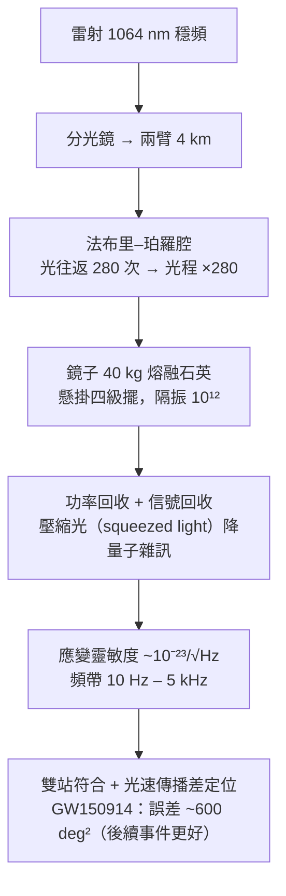

# 9.2 重力波與 2015 年偵測

## 導言：百年的等待，0.2 秒的迴響

1916 年，Einstein 從線性化場方程導出重力波；1918 年給出四極輻射公式。之後近百年，懷疑（「波是真實的還是座標的？」Einstein 本人 1936 年一度想撤稿）、計算（Bondi–Pirani–Sachs 1957 釐清波的能量）、與工程（Weber 棒 1960s、干涉儀 1970s–）交織。**2015 年 9 月 14 日 09:50:45 UTC**，LIGO 的兩台干涉儀（Hanford、Livingston）記錄到 GW150914：兩個黑洞（$36$ 與 $29 M_\odot$）併合為 $62 M_\odot$，$3 M_\odot$ 質量化為重力波，功率峰值 $3.6\times10^{49}$ W——**瞬間超過可觀測宇宙所有星光總和**。2017 年諾貝爾物理獎。本節講述這條百年之路的數學與工程。

---

## 重力波的理論

### 線性化與 TT 規範

弱場 $g_{\mu\nu} = \eta_{\mu\nu} + h_{\mu\nu}$（$|h| \ll 1$），協變規範（洛倫茲規範）$\partial_\mu\bar h^{\mu\nu} = 0$ 下（8.2 節）：

$$
\Box\bar h_{\mu\nu} = -\frac{16\pi G}{c^4}T_{\mu\nu}
$$

真空平面波，進一步取橫向無跡（TT）規範：波沿 $z$ 方向

$$
h_{xx} = -h_{yy} = h_+(t - z/c), \qquad h_{xy} = h_{yx} = h_\times(t - z/c)
$$

**兩個極化**：$+$ 模式（沿軸拉伸/壓縮）與 $\times$ 模式（45° 交替）——**自旋 2 場**（對比電磁波自旋 1 的兩個圓極化：無跡對稱二階張量的自由度 = 2，群論決定）。

### 測地偏離：波如何「搖晃」時空

9.1 節（8.1 節）測地偏離方程：波引起的兩自由粒子相對加速度

$$
\frac{d^2\xi^x}{dt^2} = \frac{1}{2}\ddot h_{xx}\,\xi^x, \qquad \frac{d^2\xi^y}{dt^2} = \frac{1}{2}\ddot h_{yy}\,\xi^y
$$

**波不改變粒子間的「距離」（共動系），改變的是光走的時間**——干涉儀測的正是此：臂長 $L = 4\,\mathrm{km}$，應變 $h = \frac{\Delta L}{L}$；GW150914 峰值應變 $h \sim 10^{-21}$ ⟹ $\Delta L \sim 10^{-18}\,\mathrm{m}$——**質子直徑的千分之一**。

### 輻射功率：四極公式

質量偶極矩的變化率 = 動量守恆 ⟹ 偶極不輻射；**領頭項是四極**：

$$
P = \frac{G}{5c^5}\left\langle \dddot{Q}_{ij}\dddot{Q}_{ij} \right\rangle, \qquad Q_{ij} = \int\rho\left( x_ix_j - \frac{1}{3}r^2\delta_{ij} \right)d^3x
$$

（Einstein 1918。）**雙星軌道**：

$$
P = \frac{32}{5}\frac{G^4}{c^5}\frac{(m_1m_2)^2(m_1+m_2)}{a^5}
$$

**軌道衰減**：能量流失 ⟹ $a$ 縮小 ⟹ 頻率「啁啾」（chirp）上升——GW150914 信號的形狀正是理論曲線。

---

## Hulse–Taylor：間接證據（1974–1993）

**脈衝雙星 PSR B1913+16**（Hulse & Taylor, Arecibo 發現）：兩顆中子星（$1.44$、$1.39 M_\odot$）、軌道週期 $7.75\,\mathrm{h}$、$e = 0.617$。四極公式預言軌道週期衰減：

$$
\frac{dP_b}{dt} = -2.4\times10^{-12}\ \mathrm{s/s}\ (\text{約每年縮短 } 76\,\mu\mathrm{s})
$$

**觀測**（30 年計時，脈衝星是天然原子鐘，精度 $10^{-14}$）：與 GR 預言吻合到 $0.2\%$（含銀河系加速度修正後 $0.03\%$）。

**意義**：能量以（且僅以）GR 的方式流失 ⟹ 重力波存在、四極公式正確。**1993 諾貝爾獎**。**雙脈衝星 PSR J0737-3039（2003 發現）**：更強檢驗，精度更高。

---

## LIGO：工程奇蹟

### 儀器

**雜訊預算**：

- **地震雜訊**（低頻）：四級擺 + 主動隔振（< 10 Hz 殺手）；
- **熱雜訊**（中頻）：鏡與懸掛的布朗運動（熔融石英低機械損耗）；
- **量子雜訊**（高頻）：光的散粒雜訊——**壓縮光**（2019 起，把相位漲落「擠」到振幅）靈敏度提升 $\sim 40\%$；2023 起頻率依賴壓縮。

**正是 7.1 節 Michelson 干涉儀的百年升級**：1887 年測以太風（零結果）、2015 年測時空應變（驚天結果）——同一原理，儀器的進化史。

### GW150914 的分析

**匹配濾波**（matched filtering）：把數十萬個理論波形（GR 數值相對論算出）與數據互相關——**算子理論的相關運算 + 假警率控制**。信噪比 SNR = 24；假警率 $< 1/203,000$ 年。波形三段：

1. **旋近**（inspiral）：啁啾，頻率 $35 \to 150\,\mathrm{Hz}$；
2. **併合**（merger）：強場、高度非線性——**數值相對論**（3D 時空演化愛因斯坦方程，2005 年 Pretorius 突破）的獨家貢獻；
3. **振鈴**（ringdown）：$62M_\odot$ 黑洞以準正則模（QNM，8.3 節）衰減振盪，測最終黑洞的「譜」——**無毛定理的動力學檢驗**。

**參數估計**：$m_1 = 36^{+5}_{-4}M_\odot$、$m_2 = 29^{+4}_{-4}M_\odot$、$M_f = 62^{+4}_{-4}M_\odot$、距離 $410\,\mathrm{Mpc}$（$z \approx 0.09$）——**人類第一次「聽見」黑洞**。

---

## 例題

### 例題 1：由啁啾質量推軌道演化的簡化計算

雙星引力波頻率演化（最低階，四極近似）：

$$
\frac{df}{dt} = \frac{96}{5}\pi^{8/3}\left( \frac{G\mathcal{M}_c}{c^3} \right)^{5/3}f^{11/3}
$$

其中**啁啾質量**

$$
\mathcal{M}_c = \frac{(m_1m_2)^{3/5}}{(m_1+m_2)^{1/5}}
$$

**反解**：波形的 $f(t)$ 直接量出 $\mathcal{M}_c$。GW150914 觀測 $\mathcal{M}_c \approx 28 M_\odot$（完整後處理值 $28.1^{+1.8}_{-1.5}$）。

**驗證合理性**：取 $m_1 = 36$、$m_2 = 29$：

$$
m_1m_2 = 1044, \qquad (m_1+m_2) = 65
$$

$$
\mathcal{M}_c = \frac{1044^{0.6}}{65^{0.2}} = \frac{75.0}{2.31} \approx 32.5
$$

（完整後處理考慮自旋、波形模板修正後 $28$；量級與兩體質量自洽 ✓。）**關鍵物理**：啁啾質量是**唯一**由旋近波形最精確決定的組合（簡併最少）——「觀測什麼量，理論就選擇什麼參數化」的漂亮例子。

**距離推演**：波幅 $\propto \frac{\mathcal{M}_c^{5/3}f^{2/3}}{D}$；振幅 + 頻率 ⟹ **光度距離** $D \approx 410\,\mathrm{Mpc}$——重力波是「標準汽笛」（standard siren）：**自帶絕對距離的天文信號**，哈伯常數的獨立測量（GW170817 已給 $H_0 = 70^{+12}_{-8}$ km/s/Mpc，與傳統測量交匯——宇宙學張力之謎的第三方裁判，見下）。

### 例題 2：GW170817——多信使天文學

2017.08.17：雙中子星併合（$1.46$–$1.27 M_\odot$）。**時間線**：

- 重力波信號 100 秒（雙中子星質量小、旋近慢）；
- $+1.7\,\mathrm{s}$：**伽瑪射線暴 GRB 170817A**（Fermi 衛星）——**重力波與光同速**（$|v_g - v_c|/c < 3\times10^{-15}$——重力波速度的最強約束！破壞等效原理的替代重力理論大面積出局）；
- $+11\,\mathrm{h}$：光學對應體在 NGC 4993（$40\,\mathrm{Mpc}$）——**kilonova**（r-過程元素合成：金、鉑的誕生現場）。

**科學回報**：哈伯常數獨立測量；重元素核合成確認；中子星結構（潮汐形變）約束；引力波–光速同一性。**2017 諾貝爾獎（LIGO 三傑）同年，2020（奇點、銀心）**——相對論天文學全面開花。

---

## 暗物質與暗能量：GR 的未解之謎

### 暗物質

- **證據**：星系旋轉曲線（Rubin 1970s：外緣不減速）、重力透鏡（9.1）、CMB 峰比、子彈星系團（2006：透鏡質量與氣體分離）；
- **GR 語言**：$T_{\mu\nu}$ 的「暗成分」——不發光、但引力生效；
- **候選**：WIMP（尚未偵測到，LUX-ZEPLIN 等持續）、軸子、原初黑洞；
- **替代**：修正重力（MOND、TeVeS）——被 GW170817 重力波/光同速約束嚴重壓縮空間。

### 暗能量與宇宙學常數

- **1998**：兩個超新星團隊（Perlmutter、Schmidt、Riess）發現宇宙**加速膨脹**（2011 諾獎）；
- **GR 對應**：$\Lambda g_{\mu\nu}$ 項（8.2 節，Einstein 1917 引入又放棄、1998 復活）——$\Lambda \approx 1.1\times10^{-52}\,\mathrm{m}^{-2}$、佔能量密度 $68\%$；
- **量子力學的尷尬**：真空零點能的估計比觀測 $\Lambda$ 大 $10^{120}$ 倍——**物理學最著名的數量級災難**；$\Lambda$ 為何這麼小又不為零，是量子重力問題的縮影；
- **觀測前沿**：DESI（2024 起）顯示暗能量狀態方程 $w$ 可能隨時間變（$w = -1$ 的宇宙學常數受到輕微挑戰——正在進行的故事）。

---

## 與其他領域的關聯

### 算子理論

- 匹配濾波 = 算子的相關積分與 Neyman–Pearson 檢驗；波形空間的模板 = 理論流形上的測地投影（參數估計的 Fisher 資訊矩陣 = 5.2 節統計度量的物理實例！）；
- 數值相對論的穩定性 = 雙曲算子的良定性（BSSN 形式、特徵追蹤）；
- QNM 譜 = 復特徵值問題（8.3 節）。

### 量子力學

- **壓縮光**：光場的正交分量的不確定度再分配（$[\hat X, \hat P] = i$ 不變，$\Delta X \to$ 小、$\Delta P \to$ 大）——**量子力學直接提升測量精度**；LIGO 的量子極限之爭（SQL 標準量子極限）；
- GW170817 對 $v_g = c$ 的約束 ⟹ Lorentz 不變性到 $10^{-15}$ ⟹ 量子重力候選（Lorentz 破壞模型）大量淘汰；
- 黑洞蒸發與資訊（8.3）：併合輻射的最終態理論（QNM）與「回聲」搜索（量子視界假說的檢驗）。

### 宇宙學與其他領域

- 標準汽笛 ⟹ 哈伯張力（$H_0$ 的兩類測量差 $5\sigma$）的仲裁者；
- 重力波背景（脈衝星計時陣列 NANOGrav 2023 偵測納赫茲背景——超大質量雙黑洞之海）；
- 對國防、導航的溢出（慣性感測、量子感測）。

---

## 小結

1. 1916–18 Einstein 預言；1957 釐清物理實在；1974 Hulse–Taylor 間接證實（諾獎 1993）。
2. 線性化 GR：TT 規範兩極化、四極輻射、啁啾信號——波形是理論的指紋。
3. LIGO：$10^{-21}$ 應變的干涉測量（Michelson 的百年升級）；GW150914（2015）開啟直接偵測。
4. GW170817 多信使：$v_g = c$ 到 $10^{-15}$；kilonova、標準汽笛宇宙學。
5. 暗物質與暗能量：GR 框架內最大的未解之謎；$\Lambda$ 的 $10^{120}$ 之謎指向量子重力。

下一節暫離時空，看同一套幾何如何統一電磁、弱、強相互作用——規範場論，微分幾何在 20 世紀物理的另一座高峰。
