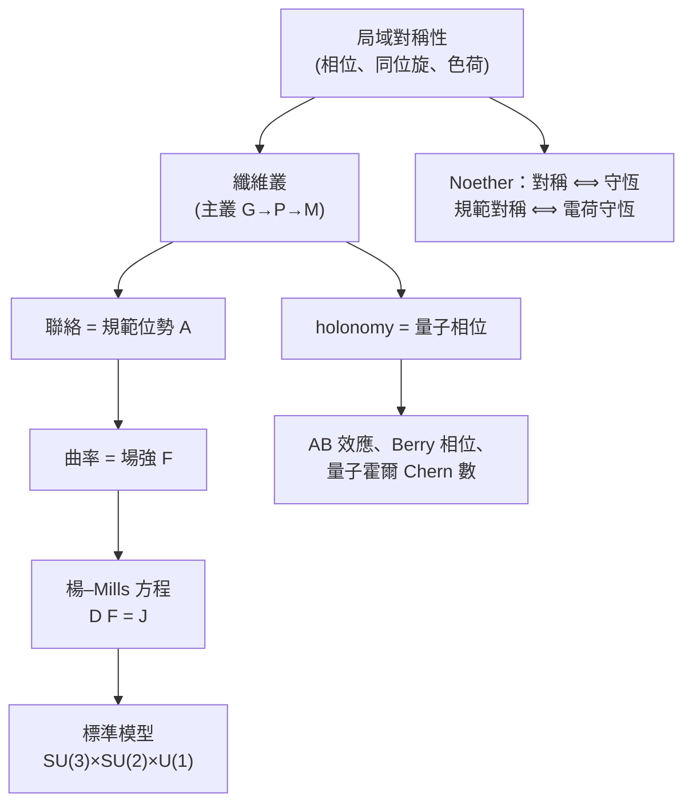

# 9.3 微分幾何與規範場論

## 導言：同一套幾何，另一種「力」

廣義相對論把重力幾何化（時空的聯絡與曲率）。1954 年，楊振寧與 Mills 問：其他基本力（電磁、弱、強）能否也幾何化？答案是**規範場論**：把「內部對稱空間」（而非時空本身）做成纖維叢，力的位勢 = 參叢上的聯絡，場強 = 曲率。**微分幾何的語言（叢、聯絡、曲率、holonomy——第 4–6 章）完整搬入粒子物理**。1970 年代起，標準模型以 SU(3)×SU(2)×U(1) 規範理論統一三種力；數學側，Wu–Yang（1975）、Atiyah–Singer、Donaldson、Seiberg–Witten 把規範理論變成微分拓樸的引擎。本節是本書「幾何 = 物理」主線的合流點。

---

## 從電磁到 Yang–Mills

### 電磁的規範結構（U(1)）

波函數的相位變換 $\psi \to e^{i\chi(x)}\psi$ 是**局域**對稱（每點可選不同相位）；為使 Schrödinger/Dirac 方程協變，導數須換成**規範協變導數**：

$$
D_\mu = \partial_\mu - i\frac{q}{\hbar}A_\mu
$$

規範變換 $A_\mu \to A_\mu + \partial_\mu\chi$。場強：

$$
F_{\mu\nu} = \frac{\hbar}{q}[D_\mu, D_\nu]\cdot\frac{q}{i\hbar} = \partial_\mu A_\nu - \partial_\nu A_\mu
$$

**結構對照（第 5–6 章的鏡像）**：

| Riemann 幾何 | 規範理論（電磁） |
|---|---|
| 切叢 $TM$ | 複線叢（帶電場的叢） |
| 聯絡 $\nabla$、$\Gamma$ | 位勢 $A_\mu$ |
| 協變導數 $\nabla_\mu$ | $D_\mu$ |
| Riemann 曲率 $R$ | 場強 $F_{\mu\nu}$ |
| holonomy | AB 相位、Berry 相位 |
| 平坦但聯絡非零 | 磁場為零區域的 AB 效應 |

**Wu–Yang（1975）的宣言**：「電磁學 = $U(1)$-叢上的聯絡；場強是曲率；AB 效應是 holonomy 的可觀測性。」——Maxwell 150 年後，其理論獲得幾何本體。

### 楊–Mills 理論（1954）

把 U(1) 換成**非阿貝爾**群 $G$（SU(2)、SU(3)…），場「帶荷」且**自相互作用**：

$$
D_\mu = \partial_\mu - i\,g\,A_\mu^a T_a, \qquad F_{\mu\nu}^a = \partial_\mu A_\nu^a - \partial_\nu A_\mu^a + g\,f^{a}{}_{bc}A_\mu^b A_\nu^c
$$

（$f^a{}_{bc}$：群的結構常數——李代數的直接出場，10.2 節。）場方程

$$
D_\mu F^{\mu\nu} = J^\nu
$$

形式上與 Maxwell 同型，但 $D_\mu$ 含 $A$ ⟹ **非線性自耦合**（強相互作用的漸近自由之數學根源，Gross–Wilczek–Politzer 1973，2004 諾獎）。

**歷史**：楊振寧（1957 諾獎得主，宇稱破壞）與 Mills（研究生）1954 年構造；當時因「無質量規範玻色子」遭 Pauli 質疑（「質量在哪？」）而沉寂；**自發對稱破壞（Higgs 機制, 1964）**解決質量問題，1970s 標準模型成形：電弱 SU(2)×U(1)（Glashow–Weinberg–Salam，1979 諾獎）+ 強 SU(3)（QCD）。2012 年 Higgs 粒子發現（CERN）——**幾何原理的最終實驗勝利**。

---

## 幾何形式：主叢上的聯絡

### 嚴格架構

- **主叢** $P \to M$（群 $G$）：每點纖維是 $G$ 的複本（「內部空間」）；
- **聯絡**：$P$ 上的 $G$-等變 1-形式 $\omega$（連接相鄰點的內部空間）；
- **曲率**：$\Omega = d\omega + \frac{1}{2}[\omega \wedge \omega]$（**結構方程**——Cartan 的第二結構方程與 Riemann 曲率的形式完全同構，6.2 節）；
- **規範變換**：局部截面的選取變換 = 卡變換（4.1 節「多張卡」的物理版）；規範不變量 = 叢的內蘊量。

**行話翻譯表**：物理學家說「規範位勢」，數學家說「聯絡形式」；「場強」=「曲率 2-形式」；「規範軌道」=「聯絡空間模掉規範群」——**同一件數學，兩種方言**。

### holonomy 與相位（6.1 節的兌現）

- 閉路上的 holonomy $\mathrm{Pexp}(i\oint A_\mu dx^\mu)$ = 量子相位因子；
- **Aharonov–Bohm**：磁場為零（曲率零）但聯絡的 holonomy 非平凡（叢不平凡）——**可觀測**（Tonomura 1986 用超導環實驗證實）；
- **Berry 相位**：參數空間的 U(1)/非阿貝爾 holonomy（Wilczek–Zee 1984）——量子力學的幾何相位；
- **Chern 數**：$\frac{1}{2\pi}\int F \in \mathbb{Z}$（量子化！Dirac 1931 的磁單極條件）——**積分曲率是整數**（Gauss–Bonnet 的規範版），量子霍爾電導由此量子化。

---

## 規範理論回饋數學

### 指標定理（Atiyah–Singer, 1963）

橢圓算子（如 Dirac 算子）的**解析指標**（$\dim\ker D^+ - \dim\ker D^-$）= **拓樸指標**（特徵類的積分）：

$$
\mathrm{ind}(D) = \int_M \hat A(M)\,\mathrm{ch}(E)
$$

**特例**：Dirac 算子在規範叢上，指標 $= \int_M \left( \frac{p_1}{24} - \frac{1}{8\pi^2}\mathrm{tr}\,F\wedge F \right)$——**曲率（幾何/規範）的積分 = 算子的解的計數**。Gauss–Bonnet（3.2）是其最簡情形；**瞬子數** $k = -\frac{1}{8\pi^2}\int\mathrm{tr}\,F\wedge F \in \mathbb{Z}$ 由指標理論解釋——物理（瞬子，Belavin–Polyakov–Schwartz–Tyupkin 1975；強 CP 問題）與數學（4 維流形分類）合流。

### Donaldson 與 Seiberg–Witten：規範理論看見 4 維

- **Donaldson（1983, Fields 獎 1986）**：自對偶 Yang–Mills 解（瞬子）的模空間用於 4 維流形的不變量——**發現怪 $\mathbb{R}^4$**（4.2 節）；
- **Seiberg–Witten（1994）**：N=2 超對稱規範理論的單極方程給出更強的不變量——**物理理論成為數學證明工具**（Thom 想象的完全反轉：不是數學服務物理，而是物理啟發數學）。

### 表格：規範幾何的數理成就

| 成就 | 年 | 群 | 意義 |
|---|---|---|---|
| 指標定理 | 1963 | 橢圓算子 | 解析 = 拓樸 |
| 瞬子 | 1975 | SU(2) | 隧穿、強 CP |
| 4 維拓樸革命 | 1983 | SU(2) | Donaldson 不變量 |
| 鏡像對稱 | 1990s | Calabi–Yau | 弦論 ↔ 代數幾何 |
| Seiberg–Witten | 1994 | N=2 SU(2) | 4 維不變量的簡化 |
| 幾何 Langlands | 2000s– | 表示論 | 規範理論與數論合流 |

---

## 例題

### 例題 1：從 U(1) 聯絡到 Aharonov–Bohm 相位

**設置**：無限長螺線管（內部磁場 $B$，外部 $B = 0$）。電子在 $r > R$ 區域繞行半徑 $\rho$ 的路徑。

**場強（曲率）**：外部 $F_{\mu\nu} = 0$——曲率為零。

**聯絡（位勢）**：取對稱規範 $A_\varphi = \frac{\Phi}{2\pi\rho}$（$\Phi$ = 磁通）——聯絡不為零。

**holonomy**：

$$
\exp\left( \frac{iq}{\hbar}\oint A_\mu dx^\mu \right) = \exp\left( \frac{iq}{\hbar}\cdot 2\pi\rho\cdot\frac{\Phi}{2\pi\rho} \right) = \exp\left( \frac{iq\Phi}{\hbar} \right)
$$

**干涉**：兩路電子（繞螺線管左右）相位差 $\Delta\varphi = \frac{q\Phi}{\hbar}$——干涉條紋移動，實驗證實（Chambers 1960、Tonomura 1986 超導環定量版）。

**幾何解讀**：外部區域的 U(1) 叢**不平凡**（雖然曲率零）：$A$ 在外部不能全域規範歸零（否則 holonomy = 1），因為繞數 $\frac{q\Phi}{h}$ 非零——**聯絡的全域拓樸攜帶資訊，場強的局域性看不到**。這是「叢 > 曲率」的最純演示，也是 Dirac 磁單極（1931：$\frac{q\Phi}{h} \in \mathbb{Z}$ 量子化）的數學核心。

### 例題 2：瞬子數與拓樸荷

SU(2) 瞬子（$\mathbb{R}^4$ 上、有限作用量、自對偶 $F = *F$ 的解，BPST 1975）：

$$
A_\mu^a = \frac{2\eta^a_{\mu\nu}x^\nu}{x^2 + \rho^2}\ (\text{單瞬子，尺度 } \rho)
$$

**作用量**：$S = \frac{1}{4g^2}\int F^a_{\mu\nu}F^{a\mu\nu}d^4x = \frac{8\pi^2}{g^2}\,k$，其中**瞬子數**

$$
k = \frac{1}{32\pi^2}\int\mathrm{tr}(F\wedge F) = \frac{1}{24\pi^2}\oint_{S^3}\mathrm{tr}(g^{-1}dg)^3 \in \mathbb{Z}
$$

（第二式：邊界 $S^3$ 上的映射 $g : S^3 \to SU(2)$ 的度數——$\pi_3(SU(2)) = \mathbb{Z}$，**拓樸不變量**。）

**驗證**：$k = 1$ 時 $S = 8\pi^2/g^2 \approx 6.3$（$g^2 = 4\pi$）——瞬子是量子隧穿（不同真空 Chern 類之間）的事件，解釋 QCD 的 U(1) 問題（$\eta'$ 介子質量，'t Hooft 1976）與強 CP 問題（軸子, Peccei–Quinn 1977——今日暗物質候選！）

**幾何對照**：$\int F\wedge F$ = 二階 Chern 特徵類；Gauss–Bonnet 的 $\int K\,dA$ = 歐拉類——**「積分曲率 = 整數」的規範版本**，Chern–Weil 理論（陳省身 1944 內蘊證明 Gauss–Bonnet 的直接後裔）。

---

## 與其他領域的關聯

### 第 1–6 章的回響（本書主線合流）

- Frenet 標架（1.3）→ 活動標架（Cartan）→ 聯絡形式 → 規範位勢；
- 參數不變性（1.1）→ 座標無關性（4.1）→ 規範不變性（本節）；
- Gauss 絕妙定理（3.2）→ 內蘊曲率 → 楊–Mills 場強。

**一句話：本書前九章的所有幾何機器，在規範場論中換了名字再演一遍。**

### 算子理論

- Dirac 算子的指標（Atiyah–Singer）：Fredholm 指標的幾何化身；
- 規範場的譜：Witten 的 Laplacian 變形（Morse 理論的規範理論證明, 1982——**用超對稱量子力學證明 Morse 不等式**：$[\hat p - i\nabla f, \hat p^\dagger + i\nabla f] = \Delta - \nabla^2 f$ 型的 Witten 變形）；
- 量子霍爾：Landau 算子 + Berry 聯絡的譜（Chern 數 = 標記）。

### 量子力學／量子場論

- 標準模型 = 規範理論的勝利；Higgs（2012）= 自發對稱破壞的實現；
- 拓樸量子物質：拓樸絕緣體、超導體——**Berry 曲率是材料科學的日常量**；
- 量子計算：規範理論的量子模擬（晶格規範理論，2020s 量子電腦實驗）。

### 數學的其他分支

- 鏡像對稱：Calabi–Yau 流形的兩種計數（弦論猜測、Candelas 1991 的數值、Givental–Lian–Liu–Yau 1996–98 證明）——**物理預言代數幾何定理**；
- 幾何 Langlands 綱領：規範理論 ↔ 數論（表示論）的深層對應；
- 規範–重力對偶（AdS/CFT, 9.2 節）：兩種「曲率」互為表裡。

---

## 小結

1. 規範場論 = 內部對稱叢上的幾何：位勢 = 聯絡、場強 = 曲率、相位 = holonomy。
2. Yang–Mills（1954）非線性自耦合；Higgs（1964/2012）解決質量；標準模型成形。
3. Wu–Yang（1975）把電磁學讀成 $U(1)$ 叢幾何；AB 效應 = holonomy 的可觀測性。
4. 規範理論回饋數學：指標定理、瞬子、Donaldson、Seiberg–Witten——4 維拓樸的引擎。
5. 本書主線在此合流：從 Frenet 標架到規範聯絡，「標架 + 聯絡 + 曲率」一以貫之。

第 10 章現代發展：流形上的微積分（形式的語言）、李群與對稱、與工程/資料科學的新疆域。
