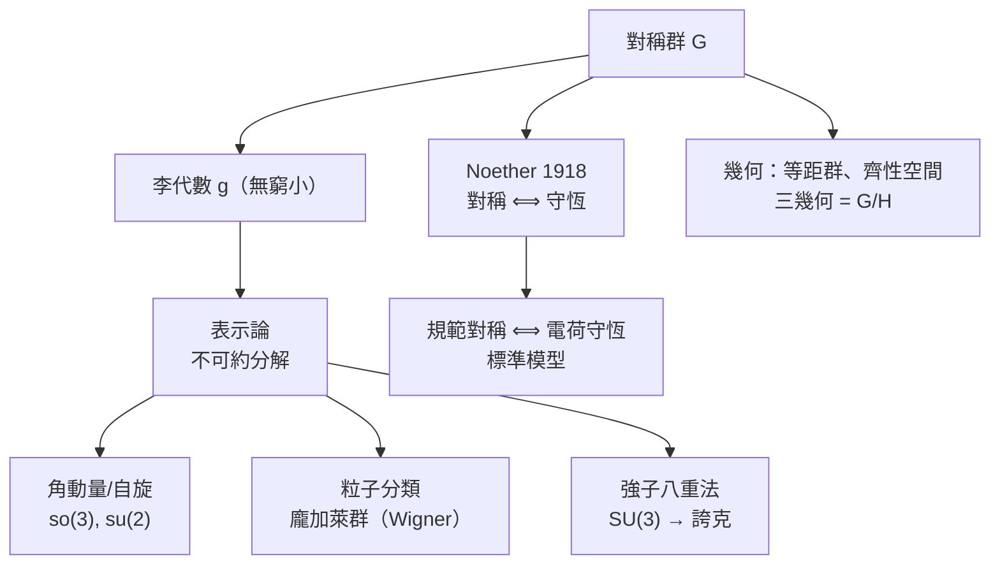

# 10.2 李群與對稱

## 導言：對稱作為第一原理

「對稱」貫穿本書：旋轉保持曲率（1.3）、等距映射保持度量（5.2）、Lorentz 群定義時空（7.2）、規範群決定相互作用（9.3）。本節把「對稱」本身變成數學對象：**李群**（光滑的群）與**李代數**（其無窮小版）。Sophus Lie（1842–1899）為微分方程而創；Noether（1918）建立「對稱 ⟺ 守恆」；Wigner（1939）以對稱群分類粒子；今日李群是幾何、物理、密碼學、機器學習的共同語言。

---

## 李群與李代數

### 定義

**李群** $G$ ：同時是光滑流形與群，且乘法與求逆光滑。例：

| 群 | 維數 | 描述 | 出現之處 |
|---|---|---|---|
| $GL(n, \mathbb{R})$ | $n^2$ | 可逆矩陣 | 一般線性變換 |
| $O(n)$ 、 $SO(n)$ | $\frac{n(n\pm1)}{2}$ | 正交/旋轉 | 剛體、holonomy（6.1） |
| $U(n)$ 、 $SU(n)$ | $n^2$ 、 $n^2-1$ | 酉/特殊酉 | 量子力學、標準模型 |
| $SO(1,3)$ | 6 | Lorentz | 時空（7.2） |
| $\mathbb{R}^n$ （加法） | $n$ | 平移 | Poincaré 群的一部分 |
| Diff $(M)$ | 無窮維 | 微分同胚 | 廣義協變性（8.2） |

**李代數** $\mathfrak{g} = T_eG$ （單位元的切空間），帶括積 $[X, Y] = XY - YX$ （矩陣群的交換子）。**指數映射**： $\exp(tX) \in G$ （單參數子群）——**「李代數是群的局部座標」**：

$$
\exp(X)\exp(Y) = \exp\left( X + Y + \frac{1}{2}[X, Y] + \cdots \right)\ (\text{BCH 公式})
$$

**括積編碼非交換性**： $[X, Y] \neq 0$ ⟹ 先轉 $X$ 再轉 $Y$ ≠ 先 $Y$ 後 $X$ ——旋轉的不可交換性（陀螺、歐拉角死鎖、Thomas 進動）都是同一件事。

### 結構例子： $\mathfrak{so}(3)$ 與角動量

$$
\mathfrak{so}(3) = \{\text{反對稱 } 3\times3\}， \qquad [L_i, L_j] = \varepsilon_{ijk}L_k
$$

**量子力學的對應**：角動量算符滿足 $[\hat L_i, \hat L_j] = i\hbar\varepsilon_{ijk}\hat L_k$ ——**同一個李代數**（差一個 $i\hbar$ ）！自旋、軌道角動量、球諧函數、薛定諳方程在中心力場的解，全部是 $\mathfrak{so}(3)$ 表示論。**「旋轉對稱 ⟺ 角動量守恆」（Noether）⟺ 表示論給出能級結構**。

---

## Lie 的原始動機：微分方程

### Lie 的計畫（1870s–）

Galois 用離散群分類代數方程；Lie 想用**連續群**分類微分方程：若方程在變換群下不變，可化簡（降階、求積）。

**例子**： $y' = f(y/x)$ （齊次方程）在伸縮變換 $(x, y) \to (\lambda x, \lambda y)$ 下不變 ⟹ 換座標 $v = y/x$ 可分離變數——**「解方程 = 找對稱群」**。

**遺產**：微分方程的對稱性分析（Lie 對稱、守恆形式）、可積系統（KdV、孤子、逆散射——20 世紀數學物理的高峰）皆 Lie 計畫的延續。

### Noether 定理（1918）

**Emmy Noether**（1882–1935）：變分問題中，**連續對稱 ⟺ 守恆量**：

| 對稱 | 守恆量 | 本書出現 |
|---|---|---|
| 時間平移 | 能量 | 8.2（時空不對稱則能量不守恆！） |
| 空間平移 | 動量 | 7.3 |
| 旋轉 | 角動量 | 7.2（Thomas 進動） |
| 規範 $U(1)$ | 電荷 | 9.3 |
| 相對論性 | 能量動量 $P^\mu$ | 7.3 |

**深度**：守恆律不再是「實驗發現」，而是**對稱性的邏輯必然**。物理定律的設計原則由此改寫：**先設對稱，後推方程**——標準模型的建構法（9.3）。Noether 作為女性在 1915 年的哥廷根被拒講師席位（Hilbert 抗議：「大學不是澡堂！」），最終以 Hilbert 名義授課——科學史的另一場戲劇。

---

## 幾何中的對稱

### 等距群與齊性空間

$(M, g)$ 的**等距群** $\mathrm{Isom}(M, g)$ 是李群（Myers–Steenrod, 1939）。

- **齊性空間**： $G/H$ 型（ $G$ 傳遞作用）——常曲率空間： $\mathbb{S}^n = SO(n+1)/SO(n)$ 、 $\mathbb{H}^n = SO(n,1)/SO(n)$ 、 $\mathbb{R}^n = E(n)/O(n)$ ——**三幾何 = 三對稱群**（5.2 節模型的群論統一）；
- **Klein 的 Erlangen 綱領（1872）**：「幾何 = 研究某變換群下的不變量」——射影幾何、仿射、拓樸各自是一個群的世界。**與 Riemann 內蘊觀點互補**（度量觀點 vs 群論觀點），Cartan 在 1920s 統一兩者（對稱空間理論）；
- **對稱空間**（Cartan, 1926）： $\nabla R = 0$ （曲率平行）——常曲率、對稱空間的分類是 20 世紀幾何的偉大成就（ $G/H$ 分類），也是宇宙學 FLRW 度量的理論背景（9.2 節各向同性）。

### 表示論：對稱的分類學

**表示**： $G \to GL(V)$ （用矩陣「實現」對稱）。**不可約表示**是基本積木。

- **Wigner（1939）**：龐加萊群的不可約表示 = **粒子**（標籤：質量 $m$ 、自旋 $s$ ）——「粒子 = 時空對稱群的表示」是相對論量子力學的定義性思想；**自旋為何量子化**： $SO(3)$ 表示論（ $s \in \frac{1}{2}\mathbb{Z}$ —— $SU(2)$ 雙覆蓋的費米子！）；
- **SU(3) 八重法**（Gell-Mann 1961）：強子的表示分類 ⟹ 誇克（1964）——**表示論預言新粒子**（ $\Omega^-$ , 1964 發現）；**蓋爾曼 1969 諾獎**；
- **標準模型**：物質場 = 規範群的表示；三次「對稱破壞」（電弱 Higgs 2012 實現）塑造物質譜。

---

## 例題

### 例題 1：驗證 $SU(2)$ 是 $SO(3)$ 的雙覆蓋（自旋的根源）

$SU(2) = \{\, U \mid U^\dagger U = I,\ \det U = 1 \,\}$ ，一般元 $U = \cos\frac{\theta}{2}I - i\sin\frac{\theta}{2}(\hat n\cdot\sigma)$ （ $\sigma$ = Pauli 矩陣）。

**作用**： $U$ 以共軛作用於跡零 Hermitian 矩陣 $X = \mathbf{x}\cdot\sigma$ ： $X' = UXU^\dagger$ ⟹ $\mathbf{x}' = R(U)\mathbf{x}$ ， $R(U) \in SO(3)$ 。**檢驗**： $U(\theta = 2\pi) = -I$ （繞任軸 $2\pi$ 旋轉在 $SU(2)$ 中是 $-I \neq I$ ），但 $R(-I) = I$ （ $SO(3)$ 中 $2\pi$ = 恆等）——** $SU(2) \to SO(3)$ 的核 = $\{\pm I\}$ ：雙覆蓋**。

**物理**：電子自旋 $\frac{1}{2}$ 的態在 $2\pi$ 旋轉下變號（ $-1$ 相位）， $4\pi$ 才還原——**中子干涉實驗（Rauch 1975、Werner 1975）直接觀測到 $4\pi$ 週期**！**費米子/玻色子的區分、自旋統計定理（Pauli 1940）都是李群拓樸**——對稱群的整體（不只局部）結構決定量子世界。

### 例題 2：用李代數推洛倫茲生成元與速度叠加

$\mathfrak{so}(1,3)$ 生成元：旋轉 $J_i$ 、boost $K_i$ 。交換關係：

$$
[J_i, J_j] = \varepsilon_{ijk}J_k, \qquad [J_i, K_j] = \varepsilon_{ijk}K_k, \qquad [K_i, K_j] = -\varepsilon_{ijk}J_k
$$

**最後一條是相對論的種子**：兩個非共線 boost 的交換子是**旋轉**！

$$
\exp(-\varphi_1 K_x)\exp(-\varphi_2 K_y)\exp(\varphi_1 K_x)\exp(\varphi_2 K_y) \approx \exp(-\varphi_1\varphi_2 J_z)
$$

**物理**：連續兩次不同方向加速後，座標系**轉了一個小角度**（Wigner 旋轉/Thomas 進動， $\omega_T \approx \frac{\gamma^2}{2}\frac{\gamma}{\gamma+1}\,|\mathbf{a}\times\mathbf{v}|/c^2$ ）——**原子中電子自旋-軌道耦合的因子 $\frac{1}{2}$ （Thomas 1926）正是此效應**，解釋了精細結構的半因子之謎（Sommerfeld 模型的修正）。**李代數的交換子表 = 物理效應的目錄**。

---

## 對稱與現代數學物理

### 對稱破壞與自發破壞

- **明確破壞**：方程本身不對稱；
- **自發破壞**（SSB）：方程對稱、基態不對稱——磁鐵（居里點）、超導（BCS）、Higgs（1964/2012）、宇宙學相變；
- **Goldstone 定理（1961）**：連續對稱自發破壞 ⟺ 無質量激發（Goldstone 玻色子）——Higgs 機制把它「吃掉」變成規範玻色子質量（9.3）；
- **凝聚態的對稱性**：拓樸相變（Kosterlitz–Thouless 1973, 2016 諾獎）、拓樸序——**李群/李代數分類物質相**（對稱保護拓樸態, SPT）。

### 離散對稱

- 宇稱 $P$ （1956 李政道–楊振寧質疑、吳健雄 1957 實驗破壞——**第一個「對稱可以被破壞」的震撼**，1957 諾獎）；
- CP（1964 CP 破壞，Cronin–Fitch——物質–反物質不對稱的必要條件之一，1980 諾獎）；CPT（理論必然）；
- **時間反演 $T$ 與量子**：Kramers 簡併、拓樸絕緣體的 $\mathbb{Z}_2$ 不變量——離散對稱的新物理。

### 湧現對稱與當代前沿

- **共形場論**：共形群（無尺度！無窮維 Virasoro 代數）——臨界現象（Ising 模型）、AdS/CFT 邊界（9.2）；
- **對偶性**：電磁對偶（ $F \leftrightarrow *F$ , 9.3 瞬子）、S-對偶、Langlands 對偶——**「對稱的對稱」成為統一原理**；
- **機器學習**：等變網路（equivariant networks）——把「保持對稱」做成網路架構（10.3 節）：群論進入 AI。

---

## 與其他領域的關聯

### 微積分／微分幾何

李群作用 = 流形上的流（4.3 節向量場的單參數群）； Killing 向量場（等距的無窮小生成元， $\mathcal{L}_X g = 0$ ）——**對稱 = 度量的李導數為零**；Schwarzschild/Kerr 的守恆量（能量、角動量）來自其 Killing 向量（8.3 節軌道積分的前提）。

### 算子理論

- 連續對稱 ⟺ 酉算子群（Stone 定理： $U_t = e^{-itA}$ ， $A$ 自伴）——**守恆量 = 酉群的生成元 = 自伴算子**（量子力學的對稱語言）；Wigner 定理：對稱 = 酉或反酉變換（1939 的另一面）；
- 表示的矩陣係數 = 球諧函數、Jacobi 多項式（特殊函數 = 李群表示論）——**譜理論與表示論合流**（Peter–Weyl 定理 1927：函數空間按表示分解 = 群上的 Fourier 分析）。

### 量子力學

- 對稱 ⟺ 守恆（Noether 的量子版）： $[\hat H, \hat Q] = 0 \iff \hat Q$ 守恆且 $\hat Q$ 生成對稱；
- **簡併 = 對稱**：能級簡併來自對稱群表示的維數；微擾破壞對稱 ⟹ 簡併解除（Zeeman、Stark 效應）——**光譜學 = 表示論的實驗**；
- 隱藏對稱：氫原子的 $SO(4)$ （Runge–Lenz 向量）、諧振子的 $SU(3)$ ——「超額簡併」由更大對稱群解釋。

### 資料科學／工程

- $SO(3)/SE(3)$ 等變網路（分子模擬、蛋白質折疊 AlphaFold 的架構元素）、群等變 CNN；
- 密碼學：橢圓曲線群（交換代數群的離散版）；
- 機器人學： $SE(3)$ 上的運動學與控制（4.1 節旋轉群的工程化）。

---

## 小結

1. 李群 = 光滑群；李代數 = 無窮小對稱，括積編碼非交換性。
2. Lie 原始動機：微分方程的對稱分類；Noether：連續對稱 ⟺ 守恆律——物理的設計原則。
3. 幾何的對稱：等距群、齊性空間 $G/H$ 、三幾何的群論統一；Erlangen 綱領與 Riemann 觀點互補。
4. 表示論：自旋 = $SU(2)$ 雙覆蓋（ $4\pi$ 週期實測）；粒子 = 龐加萊群表示；夸克 = SU(3) 表示——**對稱群是物質的週期表**。
5. 對稱破壞（宇稱、CP、Higgs）與湧現對稱（共形、拓樸相）塑造現代物理與材料。

下一節（最後一節）：微分幾何走出純數學——在工程與資料科學中的當代應用。
