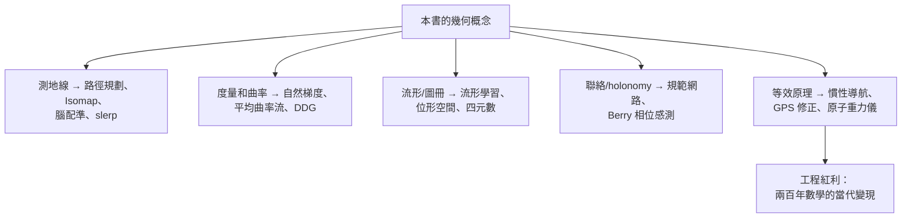
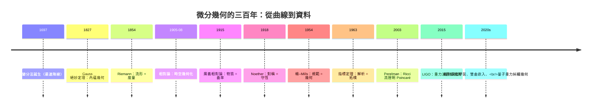

# 10.3 微分幾何在工程與資料科學

## 導言：兩百年數學的工程紅利

本書從曲線走到流形、從曲率走到規範場論。本章收尾於當代：微分幾何不再只是純數學與基礎物理的語言，而是**工程與資料科學的實用工具箱**——機器人走測地線、醫學影像用形狀空間、機器學習在流形上做梯度下降、重力波探測器是曲率的量尺。最後以全書總結與學習路線圖結束。

---

## 一、機器人學與控制

### 位形空間的幾何

- 剛體姿態 = $SO(3)$ （4.1 節）；全位形 = $SE(3) = SO(3) \ltimes \mathbb{R}^3$ ——**機器人的「世界」不是 $\mathbb{R}^6$ 而是流形**；
- 歐拉角的萬向節死鎖（Gimbal lock）：單張座標卡的奇點（4.1 節球面極點的機器人版）——**解法：四元數（ $\mathbb{S}^3$ 雙覆蓋，10.2 節）**；四元數插值（slerp = 球面測地線！3.1 節）是動畫（Pixar 起源）與太空船姿態的標準；
- **幾何控制**：在流形上直接設計控制律（避免「歐拉角微積分」的座標病態）；四旋翼無人機、機械臂的幾何力學（Lagrange 力學的流形版本，3.1 節）。

### 路徑規劃

- **測地線 = 最短路徑**：曲率受限路徑（Dubins 車、Reeds–Shepp 車——汽車的最短可駕駛路徑是**帶曲率約束的測地問題**，3.1 節變分法）；
- 位形空間障礙 = 流形挖洞（de Rham 上同調的實用版，10.1 節：閉而不恰的形式 = 遶不開的障礙）；
- 慣性導航：加速度計**無法**區分重力與加速度（等效原理 8.1！）——慣性測量單元（IMU）必須與 GPS/視覺融合，**等效原理是導航工程的第一公理**。

---

## 二、醫學影像與計算機視覺

### 形狀的空間

- 人腦皮質 = 高度彎曲的二維曲面：**腦圖譜配準 = 曲面間的微分同胚**（Large Deformation Diffeomorphic Metric Mapping, LDDMM）——「兩顆腦的差異 = 形狀流形上的測地距離」（3.1、5.2 節）；
- 主曲率/平均曲率（3.3 節）用於皮質溝回分割、視網膜 OCT 曲率分析；
- **平均曲率流**（3.3 節）：影像去噪與曲面平滑（曲率驅動的「熱流」，5.2 節 Ricci 流的二維近親）；活動輪廓（蛇形演算法）= 能量泛函極小化（變分法，3.1）。

### 計算機圖學

- 離散微分幾何（DDG）：把 $\nabla$ 、 $\Delta$ 、曲率離散到三角網格（Laplacian 網格 = 熱傳模擬、網格簡化、籠形變形）——**Laplace–Beltrami 算子的離散譜（5.2 節 Weyl 律）**用於形狀檢索（「形狀 DNA」）；
- 可展曲面（ $K = 0$ ，3.2 節）用於服裝/鈑金展開（NURBS + 等距判別）；
- 電腦動畫的流體模擬 = 辛幾何 + 離散外微分（10.1 節 DEC）。

---

## 三、機器學習中的幾何

### 資料的流形假設

高維資料（影像、語音、基因）實際落在低維流形附近——**流形假設**：

- **流形學習**：Isomap（測地距離！3.1 節：以圖上最短路近似內蘊距離）、LLE、t-SNE、UMAP——**重建資料流形的局部座標卡（4.1 節）**；
- **自動編碼器 / 擴散模型**：學到的隱空間 = 資料流形的參數化；生成 = 從簡單分佈「映射」到流形。

### Riemann 最佳化

- **自然梯度**（Amari, 1998）：參數空間帶 **Fisher 度量**（5.2 節例題 2 的統計度量），梯度按 $g^{-1}\nabla$ 校正——**深度學習的二階方法的幾何正確版**；K-FAC 等大規模實作；
- **Riemannian SGD**：直接在流形上（正定矩陣流形、球面、雙曲空間）優化——**雙曲嵌入**（hyperbolic embeddings）：層級資料（知識圖譜、語言樹）在負曲率空間中更省維（3.2 節雙曲幾何的「容量」優勢：圓周長 $\sim 2\pi\sinh\rho$ 指數增長）；
- **注意力與 Transformer 的幾何視角**：softmax 歸一化 = 單純形流形上的測度；這是活躍的研究前沿。

### 資訊幾何

- 機率分佈族 = Riemann 流形（Fisher–Rao 度量，Chentsov 唯一性）；對偶平坦結構（Amari）；
- 應用：變分推斷的幾何、Cramér–Rao 界（測量精度的理論下限）、量子 Fisher 資訊（量子感測，8.3 節 Hawking 溫度的精密測量同族技術）。

---

## 四、精密測量與量子工程

- **原子干涉重力儀**：物質波測 $g$ 到 $10^{-9}$ （等效原理的工程極致，8.1 節 COW 實驗的工業版）——重力地圖、火山監測、地下探測；
- **光鐘**（2022 諾獎相關技術）： $10^{-18}$ 級精度使**引力紅移成為可感的實驗室效應**（1 mm 高度差的紅移可測，JILA 2022）——時間的幾何（8.1 節）進入桌面；
- **壓縮光**（9.2 節 LIGO）：量子不確定度的工程再分配——量子計量學（quantum metrology）；
- **規範場的量子模擬**（2020s）：冷原子晶格中模擬 U(1) 規範理論（9.3 節）——量子電腦作為「物理的數學實驗室」。

---

## 五、全書總結：一條主線的貫穿

### 主線回顧

| 章 | 核心概念 | 「不變性」哲學 |
|---|---|---|
| 1 | 曲線、曲率、Frenet 標架 | 參數不變量（1.1） |
| 2 | 曲面、兩基本形式 | 絕妙定理： $K$ 內蘊（1827） |
| 3 | 測地線、Gauss–Bonnet | 曲率 ⟷ 拓樸 |
| 4 | 流形、圖冊、叢 | 座標卡是地圖，實在是流形 |
| 5 | 度量、聯絡 | 度量唯一決定幾何（Levi-Civita） |
| 6 | Riemann/Ricci/Einstein 張量 | 交換子失效 = 曲率 |
| 7 | Minkowski 時空 | 間隔不變；時間空間互換 |
| 8 | 等效原理、場方程、黑洞 | 物質 ⟺ 曲率 |
| 9 | 日食、重力波、規範場論 | 幾何 = 可觀測 |
| 10 | 形式、李群、應用 | 對稱 = 原理 |

**貫穿的哲學**：**描述可以任意（參數、座標、卡、規範），實在必須不變（不變量、張量、holonomy、對稱）**——從 Bernoulli 的最速降線到 LIGO 的啁啾，這條主線一以貫之。

### 歷史的節奏

### 學習路線圖（給讀者的下一步）

**數學深化**：

1. 微分形式與代數拓樸（Hatcher《代數拓樸》、Bott–Tu《微分形式》）；
2. 幾何分析（Schoen–Yau 講義、Hamilton Ricci 流）；
3. 表示論與李群（Fulton–Harris）。

**物理深化**：

1. Wald《廣義相對論》、MTW《重力》（幾何視角的經典）；
2. Nakahara《拓樸、幾何與物理》（規範理論的幾何入門）；
3. 彎曲時空量子場論（Birrell–Davies）與黑洞資訊前沿。

**應用深化**：

1. 離散微分幾何（Crane 的 DDG 系列講義）；
2. 資訊幾何（Amari）與幾何深度學習（Bronstein 等的《Geometric Deep Learning》宣言）；
3. 幾何力學（Marsden–Ratiu）與機器人幾何控制。

---

## 例題

### 例題：Isomap——用測地距離展開資料流形

**問題**：瑞士卷資料（三維空間中的二維流形： $x = t\cos t$ 、 $y = h$ 、 $z = t\sin t$ 型曲面上的採樣點）。直接用歐氏距離會「抄近道穿過卷層」，破壞內蘊結構。

**Isomap（Tenenbaum et al., 2000）三步**：

1. **建鄰近圖**：每點連 $k$ 近鄰，邊權 = 歐氏距離（**局部**——法座標思想：小範圍內歐氏 ≈ 內蘊，5.3 節法座標 $\Gamma(p) = 0$ 的離散版）；
2. **全域測地距離**：Floyd–Warshall / Dijkstra 求圖上最短路——**內蘊距離 $d(p,q)$ 的離散近似（5.2 節）**；
3. **MDS 嵌入**：對測地距離矩陣做多維尺度分析，展平到二維——**保持內蘊度量的等距映射（3.2 節絕妙定理的應用：等距保曲率，所以展平後的「曲率」由拓樸承載——卷的洞變成邊界）**。

**數值驗證（小例）**：卷上兩點「捲了三層」歐氏距離 $\approx 2$ ，沿面測地距離 $\approx 3 \times 2\pi \times 1.5 \approx 28$ ——歐氏方法判「近鄰」（錯），測地方法判「遠」（對）。**展開後的聚類/回歸性能大幅提升**。

**概念昇華**：這個 2000 年的演算法是本書三個概念（內蘊距離、法座標、等距不變量）的工程變現——**純數學 150 年（Gauss 1827 → Isomap 2000）**，與重力波（1916 → 2015）的等待時間相仿——**幾何的果實需要時間成熟，但總會落地**。

---

## 與其他領域的關聯（收束全書）

### 量子力學與資訊

- 量子態的幾何（射影希爾伯特空間、Fubini–Study 度量、Berry 相位）→ 量子感測與量子計算的幾何資源理論；
- 糾纏熵 = 極小曲面面積（Ryu–Takayanagi, 9.2 節）→ 量子多體的張量網路 = 離散幾何（MERA 網路的雙曲幾何）——**量子資訊的語言正在幾何化**。

### 算子理論的終章視角

本書反覆出現的「微分算子 + 譜 + 指標」：Laplace 譜幾何（5.2）、Dirac 指標（9.3）、Witten 變形（10.1）、QNM 譜（8.3）、Fisher 度量（本節）——**算子理論是幾何量的計算引擎**，而幾何是算子結構的直觀地圖。兩者關係是 21 世紀數學最富饒的介面。

### 結語

Gauss 在 1827 年問「毛蟲能否知道世界是彎的」；Riemann 在 1854 年回答「幾何由物理決定」；Einstein 在 1915 年寫下「物質告訴時空如何彎曲」；Noether 在 1918 年說「對稱即守恆」；Yang 與 Mills 在 1954 年把力變成幾何；Perelman 在 2003 年用曲率流證明拓樸；LIGO 在 2015 年聽見時空的弦。**本書的三十節，是同一個問題的三百種問法：什麼是不依賴描述的實在？** 幾何，就是答案的形狀。

---

## 小結

1. 機器人：位形空間是流形；四元數、測地路徑、等效原理導航。
2. 醫學影像/圖學：形狀空間、曲率流、離散微分幾何。
3. 機器學習：流形假設、自然梯度（Fisher 度量）、雙曲嵌入——本書概念的直接變現。
4. 精密測量：原子重力儀、光鐘、壓縮光——等效原理與量子幾何的工程時代。
5. 全書主線：**不變性**——從曲線參數到規範對稱，幾何是「座標無關的實在」的科學。

（全書完）
