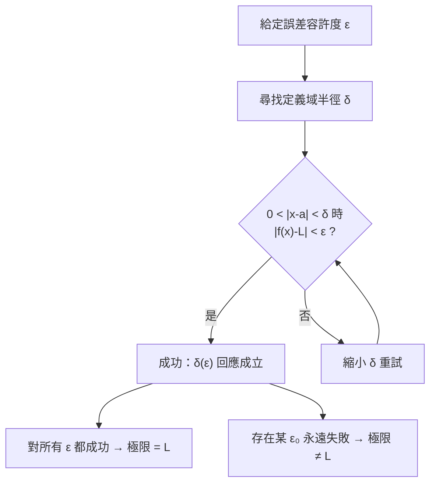

# 1.2 極限的嚴格定義 epsilon-delta

## 導言

上一節我們看到，極限概念在兩千年間停留在「無限接近」的直觀層次。本節將介紹把它變成鋼鐵邏輯的 $\varepsilon$–$\delta$ 定義：由 **Cauchy（1821）** 提出構想、**Weierstrass（1860s–1880s）** 在柏林大學的講課中定形。這一定義被譽為「分析學的憲法」——此後所有極限、連續、導數、積分、級數的定義都是它的變奏。

### 為什麼需要 $\varepsilon$–$\delta$？

「$x$ 無限接近 $a$ 時 $f(x)$ 無限接近 $L$」這句話有三大缺陷：

1. **「無限」是含糊的副詞**，不是數學名詞。
2. **動態描述依賴時間**，但函數是靜態的對應關係。
3. **無法反證**：如果有人宣稱 $\lim_{x\to 0} \frac{|x|}{x}$ 存在且等於 $1$，直觀語言難以精確駁斥。

$\varepsilon$–$\delta$ 語言的策略是**倒轉量詞**：不描述過程，而描述一場「挑戰—回應」的對局。

### 定義與邏輯結構

**定義 1.2.1（函數極限）**：設函數 $f$ 在 $a$ 的某個去心鄰域有定義，$L \in \mathbb{R}$。若

$$
\forall \varepsilon > 0,\ \exists \delta > 0,\ \text{使得}\ 0 < |x - a| < \delta \implies |f(x) - L| < \varepsilon,
$$

則稱 $x \to a$ 時 $f(x)$ 的極限為 $L$，記作 $\displaystyle\lim_{x \to a} f(x) = L$。

逐字解讀這一邏輯句：

| 片段 | 數學意涵 | 對局詮釋 |
|------|----------|----------|
| $\forall \varepsilon > 0$ | 對**任何**誤差容許度 | 對手先提出挑戰：誤差要小於 $\varepsilon$ |
| $\exists \delta > 0$ | **存在**一個接近範圍 | 我方回應：只要 $x$ 落在 $(a-\delta, a+\delta)$ |
| $0 < |x-a|$ | $x \neq a$（去心） | 挑戰與 $f(a)$ 的值無關 |
| $|f(x)-L| < \varepsilon$ | 函數值落進誤差帶 | 回應成功，此 $\varepsilon$ 被擊退 |

**量詞順序至關重要**：$\forall\varepsilon\,\exists\delta$ 表示 $\delta$ 可以**依賴於** $\varepsilon$（記作 $\delta(\varepsilon)$）；若寫成 $\exists\delta\,\forall\varepsilon$，則一個 $\delta$ 必須應付所有 $\varepsilon$，那只有在 $f$ 為常函數時才可能。否定極限（證明極限不存在）就是把量詞翻轉：

$$
\exists \varepsilon_0 > 0,\ \forall \delta > 0,\ \exists x:\ 0<|x-a|<\delta\ \text{且}\ |f(x)-L| \ge \varepsilon_0.
$$

### 各種極限的定義變奏

| 極限類型 | 定義核心（僅列差異） |
|----------|----------------------|
| 數列 $\lim_{n\to\infty} a_n = L$ | $\forall\varepsilon\ \exists N \in \mathbb{N}:\ n \ge N \implies |a_n - L| < \varepsilon$ |
| 單邊極限 $\lim_{x\to a^+}$ | 只取 $a < x < a + \delta$ |
| 無窮遠極限 $\lim_{x\to\infty} f(x) = L$ | $\forall\varepsilon\ \exists M:\ x > M \implies |f(x)-L|<\varepsilon$ |
| 函數發散到 $\infty$：$\lim_{x\to a} f(x) = \infty$ | $\forall M\ \exists\delta:\ 0<|x-a|<\delta \implies f(x) > M$ |

注意最後一列：$f(x) \to \infty$ 並非「極限存在」，而是「發散到無窮」的專門約定——$\infty$ 不是實數，極限的「存在」仍指極限值為某實數。

### 極限的運算法則

若 $\lim_{x\to a} f(x) = L$、$\lim_{x\to a} g(x) = M$，則：

$$
\lim (f \pm g) = L \pm M, \qquad
\lim (fg) = LM, \qquad
\lim \frac{f}{g} = \frac{L}{M}\ (M \neq 0),
$$

以及複合極限 $\lim_{x\to a} g(f(x)) = g(L)$（要求 $g$ 在 $L$ 連續）。證明的技術核心是**加減一項**（茶道技巧「逼項」）：

$$
|f(x)g(x) - LM| = |f(x)g(x) - Lg(x) + Lg(x) - LM| \le |g(x)|\,|f(x)-L| + |L|\,|g(x)-M|.
$$

這一技巧在證明導數法則（2.2 節）、級數運算（5.1 篂）中反覆出現。

### 例題一：用定義證明一個極限

**例題 1.2.1**：證明 $\displaystyle\lim_{x \to 2} (3x - 1) = 5$。

**證明**：給定 $\varepsilon > 0$。計算

$$
|(3x-1) - 5| = |3x - 6| = 3|x - 2|.
$$

要使 $3|x-2| < \varepsilon$，只需 $|x-2| < \dfrac{\varepsilon}{3}$。故取 $\delta = \dfrac{\varepsilon}{3}$，則當 $0 < |x-2| < \delta$ 時 $|(3x-1)-5| < \varepsilon$。證畢。 $\blacksquare$

**評註**：線性函數的 $\delta$ 可以明確寫出，這是為什麼線性函數「理所當然連續」。

### 例題二：二次函數需要更細的策略

**例題 1.2.2**：證明 $\displaystyle\lim_{x \to 3} x^2 = 9$。

**證明**：$|x^2 - 9| = |x-3|\,|x+3|$。問題：$|x+3|$ 隨 $x$ 變化。策略是**先限定 $\delta$ 的上限**：不妨要求 $\delta \le 1$，則 $|x-3|<1$ 推得 $2 < x < 4$，故 $|x+3| < 7$。於是

$$
|x^2 - 9| < 7|x-3|.
$$

給定 $\varepsilon > 0$，取 $\delta = \min\!\left(1, \dfrac{\varepsilon}{7}\right)$，則 $0<|x-3|<\delta$ 時 $|x^2-9| < \varepsilon$。 $\blacksquare$

「先限制 $\delta \le$ 某常數，再把 $|x-a|$ 之外的因子綁定為常數」是 $\varepsilon$–$\delta$ 證明的標準手法，稱為**控制法**。

### 例題三：極限不存在

**例題 1.2.3**：證明 $f(x) = \dfrac{|x|}{x}$ 在 $x \to 0$ 時極限不存在。

**證明**：對任意 $L$，取 $\varepsilon_0 = 1$。對任何 $\delta > 0$，取 $x_1 = \dfrac{\delta}{2}$ 與 $x_2 = -\dfrac{\delta}{2}$，則 $0 < |x_i| < \delta$，但 $f(x_1) = 1$、$f(x_2) = -1$。$L$ 不可能同時與 $1$ 和 $-1$ 的距離都小於 $1$（因為 $|1-(-1)| = 2 \ge 2$，由三角不等式 $|L-1| + |L+1| \ge 2$）。故極限不存在。 $\blacksquare$

更強的說法：**左右極限不等**。$\lim_{x\to 0^+} f(x) = 1 \neq -1 = \lim_{x\to 0^-} f(x)$，因此（見下述定理）極限不存在。

### 一個不顯而易見的定理：夾擠定理

**定理 1.2.4（夾擠定理 / Squeeze Theorem）**：若在 $a$ 的去心鄰域上 $g(x) \le f(x) \le h(x)$，且 $\lim_{x\to a} g(x) = \lim_{x\to a} h(x) = L$，則 $\lim_{x\to a} f(x) = L$。

**經典應用**：證明 $\displaystyle\lim_{x\to 0} \frac{\sin x}{x} = 1$。考慮單位圓上的扇形與三角形面積比較（$0 < x < \dfrac{\pi}{2}$）：

$$
\sin x < x < \tan x
\ \implies\
\cos x < \frac{\sin x}{x} < 1,
$$

而 $\lim_{x\to 0}\cos x = 1$，由夾擠定理得證。這個極限是整個三角函數微分學的基礎——$(\sin x)' = \cos x$ 的證明就依賴它（見 2.1 節）。

### 極限定義的幾何視覺化

下圖展示 $\varepsilon$–$\delta$ 對局的幾何意義：無論水平帶（誤差帶）多窄，都存在一個夠窄的垂直帶（定義域窗），使得曲線在窗內不離開水平帶。

### Weierstrass 的革命：算術化的分析

Weierstrass 的重要貢獻不只是寫下定義，而是**把分析徹底算術化**：

1. **驅逐幾何與運動直觀**：在他之前，「曲線」「連續變動」是分析的核心形象；在他之後，一切都化為實數與邏輯量詞。
2. **締造分析怪物**：Weierstrass 於 1872 年展示一個**處處連續卻處處不可導**的函數
   $$
   W(x) = \sum_{n=0}^{\infty} a^n \cos(b^n \pi x), \qquad 0 < a < 1,\ b\ \text{為奇整數且}\ ab > 1 + \tfrac{3\pi}{2}.
   $$
   這個函數震驚了當代：直觀認為「連續曲線除了尖點外應該處處有切線」，被證明是錯覺。這說明 $\varepsilon$–$\delta$ 語言不是迂腐的形式主義，而是**唯一能防止直觀背叛我們的工具**。
3. **確立 $\mathbb{R}$ 的完備性**：Weierstrass 以有界遞增數列有極限（單調收斂定理）刻畫實數完備性；隨後 **Dedekind（1872，分割理論）** 與 **Cantor（1872，基本數列）** 給出實數的嚴格構造。實數體 $\mathbb{R}$ 從此不再「顯然」，而是需要公理基礎的結構。

### 完備性：為什麼極限定義非 $\mathbb{R}$ 不可

若把極限定義搬到有理數 $\mathbb{Q}$ 上會出問題：數列 $1, 1.4, 1.41, 1.414, \ldots$（$\sqrt{2}$ 的逼近）在 $\mathbb{Q}$ 中是 Cauchy 數列（相鄰項距離趨於零），卻不收斂到任何有理數。因此**極限理論隱含地使用了實數完備性**。實數完備性的等價命題包括：

- 確界原理：非空有上界的實數集必有最小上界。
- 單調收斂定理。
- Bolzano–Weierstrass 定理：有界數列必有收斂子數列。
- Cauchy 準則：數列收斂 $\iff$ 為 Cauchy 數列。
- 區間套定理、有限覆蓋（Heine–Borel）定理。

這些定理構成分析學的「公理層」，1.3 節的中間值定理證明就要用到確界原理。

### 常見謬誤警示

| 謬誤 | 反例 | 正確觀念 |
|------|------|----------|
| $\lim(fg) = \lim f \cdot \lim g$ 但其中一個極限不存在 | $x \sin\frac{1}{x}$ 與 $x$ 乘積在 $0\to 0$ 收斂，$x\sin\frac{1}{x}$ 本身極限為 0（夾擠），但 $\sin\frac{1}{x}$ 無極限 | 法則要求**兩個極限都存在** |
| 極限存在 $\Rightarrow$ 函數連續 | $\frac{\sin x}{x}$ 在 $0$ 有極限 $1$ 但無定義 | 連續需 $f(a) = L$ |
| $\lim_{x\to a} f(g(x))$ 總可「代入」 | 需 $g$ 連續或 $g(x) \neq g(a)$ 的附加條件 | 複合極限有精細條件 |
| 「無窮多個無窮小之和為零」 | $n$ 個 $\frac{1}{n}$ 之和為 $1$ | 無窮和必須用級數理論（5.1） |

### 歷史前因後果小結

- **前因**：Berkeley 1734 年的攻擊、歐拉時代的濫用、Fourier 1807 年三角級數對「何謂收斂」的挑戰，都逼使數學界正視定義的缺失。
- **提出**：Cauchy 1821 年《分析教程》以「變量趨近」的語言界定極限；Weierstrass 1860s 起在講課中將其寫成全量詞形式，並由其學生（如 Heine 1872 年發表的極限定義）傳播。
- **解決了什麼**：導數、積分、連續、級數收斂全部獲得統一的邏輯基礎；「分析算術化」完成。
- **引發的新問題**：連續不可導函數、級數逐項積分的合法性、測度論的需求（10.2 節）——嚴格化沒有終結分析，而是開啟了二十世紀分析學的黃金時代。

## 與其他章節及領域的關聯

- **1.3 節**：連續性即「極限值等於函數值」，是本定義的第一個應用。
- **2.1 節**：導數被定義為差商極限，$\varepsilon$–$\delta$ 是其證明工具。
- **3.2 節**：Riemann 積分的 $\varepsilon$ 定義（對任意分割細度……）是本節思想的積分版。
- **5.1 節**：級數收斂即部分和數列收斂，Cauchy 準則在那裡是核心工具。
- **10.1 節**：Cauchy 與 Weierstrass 嚴格化的完整歷史。
- **點集拓撲**：$|x-a| < \delta$ 就是度量空間的開球；$\varepsilon$–$\delta$ 語言可直接推廣到度量空間、流形，成為微分幾何中「連續映射」的定義。
- **計算機科學**：$\forall\varepsilon\ \exists\delta$ 的量詞結構在數值分析中以「誤差界」「收斂階」的形式重現，例如牛頓法收斂階的證明。

## 練習

1. 用 $\varepsilon$–$\delta$ 證明 $\displaystyle\lim_{x\to 5} (2x + 3) = 13$。
2. 用控制法證明 $\displaystyle\lim_{x\to 1} \frac{1}{x} = 1$（提示：$x$ 靠近 $1$ 時 $\frac{1}{|x|}$ 有界）。
3. 證明 $\displaystyle\lim_{x\to 0} x \sin\frac{1}{x} = 0$，並說明為何不能寫成兩個極限的乘積。
4. 用量詞翻轉寫出「$\lim_{x\to a} f(x) \neq L$」的否定形式，並以此證明 $\lim_{x\to 0} \sin\frac{1}{x}$ 不存在。
5. 用 $\varepsilon$–$N$ 語言證明 $\displaystyle\lim_{n\to\infty} \frac{1}{n^2} = 0$，並回答：給定 $\varepsilon = 10^{-6}$，最小的 $N$ 是多少？
6. 思考題：若把定義中的 $0 < |x-a|$ 改為 $|x-a| \le 0$（即允許 $x=a$），哪些函數的極限行為會改變？這解釋了「去心」的必要性嗎？

### 名詞速查表（本節核心術語）

- **$\varepsilon$（誤差容許度）**：對手提出的挑戰參數，規定函數值允許偏離極限值的最大距離。
- **$\delta$（接近半徑）**：我方的回應參數，規定自變數需要多麼接近 $a$。
- **量詞**：邏輯符號 $\forall$（任意）與 $\exists$（存在），順序決定依賴關係。
- **去心鄰域**：滿足 $0 < |x - a| < \delta$ 的點集，刻意排除 $a$ 本身。
- **控制法**：先限制 $\delta$ 的上界，把多餘因子綁定為常數的證明技巧。
- **夾擠定理**：上下兩個有相同極限的函數「夾」出中間函數的極限。
- **Cauchy 數列**：項與項的距離最終任意小的數列，在完備空間中必收斂。
- **實數完備性**：$\mathbb{R}$ 中 Cauchy 數列必收斂的性質，極限理論的地基。
- **一致連續**：$\delta$ 不依賴於點的位置的加強版連續性（詳見 1.3 節）。
- **分析算術化**：Weierstrass 把分析歸約為實數與邏輯的綱領。

### 證明技巧的三段式模板

- **第一步（求差並化簡）**：計算 $|f(x) - L|$，目標是把它表達為 $|x - a|$ 乘上一個因子。
- **第二步（控制因子）**：若因子依賴 $x$，先宣布 $\delta \le c$，在 $|x - a| < c$ 內把因子綁定為常數 $K$。
- **第三步（取 $\delta$）**：令 $\delta = \min\left(c, \frac{\varepsilon}{K}\right)$，代入驗證不等式成立。
- 模板在例題一（線性）中退化為直接取 $\delta = \varepsilon/K$，因因子本來就是常數。
- 模板在例題二（二次）中完整施展：$c = 1$、$K = 7$。
- 讀者應把此模板套用於練習 1 與練習 2，驗證其普適性。
- 商式函數（如 $\frac{1}{x}$）的關鍵是證明「因子有下界」，從而 $\frac{1}{|x|}$ 有上界。
- 模板不適用時（振盪函數），應改用夾擠或否定證明，見例題三。

### 年表速查（本節涉及的關鍵年份）

- 1734：Berkeley 批評無窮小，催生嚴格化壓力。
- 1754：d'Alembert《百科全書》「極限」條目。
- 1797：Lagrange《解析函數論》嘗試繞過極限（失敗）。
- 1817：Bolzano 給出中間值定理的證明與連續性先驅定義。
- 1821：Cauchy《分析教程》——極限、收斂、連續的系統定義。
- 1860s：Weierstrass 柏林講課，$\varepsilon$–$\delta$ 語言成形。
- 1872：Heine 發表 Weierstrass 式極限定義；Cantor、Dedekind 構造實數。
- 1872：Weierstrass 展示處處連續處處不可導函數。

### 深化問答三則

**問：為什麼極限定義不允許 $x = a$？**
答：考慮 $f(x) = \frac{\sin x}{x}$。若允許 $x = a = 0$，則 $f(0)$ 無定義，命題在 $x = 0$ 處根本無從評估，定義直接崩潰。去心設計使極限成為「補值前的偵測器」——它偵測函數**應該**有的值，而連續性（1.3 節）才是「偵測值 = 實際值」的檢查。兩個概念因此分工清晰。

**問：$\delta$ 一定要找「最大值」嗎？**
答：不必。定義只要求**存在**一個 $\delta$。任何更小的 $\delta$ 都自動合格（縮小範圍只會更容易滿足誤差要求）。因此證明中取 $\delta = \min(c, \varepsilon/K)$ 的「保守取法」完全合法——數學證明的目標是存在性，不是最優性。這個「寧小勿大」的取法心理，是初學者必須克服的完美主義陷阱。

**問：夾擠定理為什麼比「直接算極限」更有用？**
答：因為它處理的是「算不出但壓得住」的情形。$\frac{\sin x}{x}$ 的極限無法由任何代數化簡直接得出（分子分母都趨零），但兩側的「夾板」（$\cos x$ 與 $1$）極限已知。夾擠的本質是：**極限是排序保持的，所以邊界確定後內部被鎖死**。這個思想在 3.2 節（Darboux 上下和）、5.1 節（比較判別法）中反覆成為主引擎。

### 補充：量詞邏輯與否定的完整演練

- 肯定句：$\forall\varepsilon > 0\ \exists\delta > 0\ \forall x\ (0<|x-a|<\delta \Rightarrow |f(x)-L|<\varepsilon)$。
- 否定句按規則逐層翻轉：$\forall$ 變 $\exists$、$\exists$ 變 $\forall$、最後的內容加否定。
- 得：$\exists\varepsilon_0 > 0\ \forall\delta > 0\ \exists x\ (0<|x-a|<\delta \wedge |f(x)-L| \ge \varepsilon_0)$。
- 翻譯：存在一個誤差 $\varepsilon_0$，無論多近的 $x$ 都能找到違反者。
- 「極限不存在於任何 $L$」= 對每個候選 $L$ 都能找到（依賴於 $L$ 的）$\varepsilon_0$。
- 例題三中 $\varepsilon_0 = 1$ 對所有 $L$ 通用，是「批量否定」的漂亮特例。
- 熟練量詞翻轉後，證明「極限不唯一」（若 $L_1 \neq L_2$ 兩者都是極限則矛盾）變得直白。
- 這套邏輯訓練也是 5.1 節級數 Cauchy 準則、5.3 節一致收斂否定的共同基礎。

（本節完）
