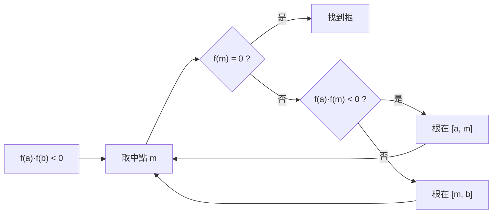

# 1.3 連續性與中間值定理

## 導言

「連續」是人類對自然的原始直觀：物體的軌跡不會瞬間跳躍，溫度不會瞬間突變。但什麼是嚴格的連續？本節以 1.2 節的極限語言定義連續性，並證明連續函數的第一個重大定理——**中間值定理（Intermediate Value Theorem, IVT）**。這個定理看似顯然，卻是方程求根、迭代法收斂性、以及整個數值分析的基石。

### 連續性的嚴格定義

**定義 1.3.1**：函數 $f$ 在點 $a$ **連續**，若

$$
\lim_{x \to a} f(x) = f(a).
$$

用 $\varepsilon$–$\delta$ 語言完全展開：

$$
\forall \varepsilon > 0,\ \exists \delta > 0:\ |x - a| < \delta \implies |f(x) - f(a)| < \varepsilon.
$$

注意與極限定義的唯一差別：這裡**允許 $x = a$**，且要求極限值**等於函數值**。因此連續性是三個條件的合取：

1. $f(a)$ 有定義；
2. $\lim_{x\to a} f(x)$ 存在（左右極限相等）；
3. 兩者相等。

三個條件各缺其一，便產生三種「不連續」的典型：

| 不連續類型 | 條件缺失 | 典型例子 |
|-----------|----------|----------|
| 可去不連續 | (3) 失敗，$L$ 存在但 $f(a)$ 缺或不等 | $f(x)=\dfrac{\sin x}{x}$ 於 $x=0$（補上 $f(0)=1$ 即連續） |
| 跳躍不連續 | (2) 失敗，左右極限存在但不等 | 符號函數 $\operatorname{sgn}(x)$ 於 $x=0$ |
| 本性（第二類）不連續 | (2) 失敗，至少一側極限不存在 | $f(x)=\sin\dfrac{1}{x}$ 於 $x=0$ |

### 連續函數的代數與極限保持

由極限運算法則立刻得到：連續函數的和、差、積、商（分母非零）連續；連續函數的複合連續。此外兩個重要的保持定理：

- **初等函數連續性**：多項式、$\sin x$、$\cos x$、$\exp$、$\ln$、一般冪函數在其定義域內皆連續。$e^x$ 的連續性由其極限定義（$\lim_{n\to\infty}(1+\frac{x}{n})^n = e^x$）保證；$\ln x$ 由反函數連續性（見下）。
- **反函數定理（單調情形）**：若 $f$ 在區間 $I$ 上嚴格單調且連續，則反函數 $f^{-1}$ 在 $f(I)$ 上連續。這是 $\ln$、$\arcsin$、$\arctan$ 連續性的來源。

### 在閉區間上連續的力量：極值定理

**定理 1.3.2（Weierstrass 極值定理）**：$f$ 在閉區間 $[a,b]$ 上連續，則 $f$ 在 $[a,b]$ 上有最大值與最小值。

兩個前提缺一不可：開區間上的 $f(x) = \frac{1}{x}$（$x\in(0,1)$）無最大值；不連續的函數如

$$
f(x) = \begin{cases} x, & 0 \le x < 1, \\ 0, & x = 1, \end{cases}
$$

在 $[0,1]$ 上也無最大值。極值定理與 IVT 同源，都依賴實數完備性（Bolzano–Weierstrass 定理是它們共同的證明引擎）。

### 中間值定理

**定理 1.3.3（Bolzano，1817；中間值定理）**：設 $f$ 在 $[a,b]$ 上連續，且 $f(a) \neq f(b)$。則對任意介於 $f(a)$ 與 $f(b)$ 之間的值 $\mu$，存在 $c \in (a,b)$ 使 $f(c) = \mu$。

特別地，若 $f(a) \cdot f(b) < 0$，則存在 $c \in (a,b)$ 使 $f(c) = 0$（**零點存在定理**）。

**歷史**：IVT 首次由 **Bernard Bolzano（1781–1848）** 在 1817 年論文《中間值的一個解析證明》中嚴格證明——比 Cauchy 的《分析教程》早四年。Bolzano 的動機正是「這麼顯然的定理為何從未被證明過？」他意識到必須先說清楚什麼是連續，於是給出了 $\varepsilon$ 式連續定義的先驅版本，並在證明中實質使用了**確界原理**（他稱之為「最大最小定理」）。這是實數完備性首次以定理形式登場。

**證明概要（二分法 + 確界原理）**：設 $f(a) < 0 < f(b)$（必要時換 $-f$）。考慮集合

$$
S = \{\, x \in [a,b] : f(x) < 0 \,\}.
$$

$S$ 非空（含 $a$）且有上界 $b$，由確界原理 $c = \sup S$ 存在。由連續性：若 $f(c) > 0$，則 $c$ 左側附近 $f < 0$，$c$ 不是上界，矛盾；若 $f(c) < 0$，則 $c$ 右側附近 $f < 0$，$c$ 不是最小上界，矛盾。故 $f(c) = 0$。 $\blacksquare$

**注意**：證明本質上是**構造性**的——確界 $c$ 可以被二分法逐步逼近，這正是數值求根的理論依據。

### 例題：用 IVT 逼近方程的根

**例題 1.3.4**：證明方程 $x^3 - x - 1 = 0$ 在區間 $(1, 2)$ 內有根，並用二分法求出兩位小數的近似值。

**解**：令 $f(x) = x^3 - x - 1$。$f$ 是多項式，處處連續。$f(1) = 1 - 1 - 1 = -1 < 0$，$f(2) = 8 - 2 - 1 = 5 > 0$。由 IVT 存在 $c \in (1,2)$ 使 $f(c) = 0$。

二分法迭代：

| 迭代 | 區間 $[a_n,b_n]$ | 中點 $m_n$ | $f(m_n)$ 符號 | 新區間長度 |
|------|------------------|-----------|----------------|------------|
| 1 | $[1, 2]$ | $1.5$ | $+0.875$ | $0.5$ |
| 2 | $[1, 1.5]$ | $1.25$ | $-0.297$ | $0.25$ |
| 3 | $[1.25, 1.5]$ | $1.375$ | $+0.225$ | $0.125$ |
| 4 | $[1.25, 1.375]$ | $1.3125$ | $-0.052$ | $0.0625$ |
| 5 | $[1.3125, 1.375]$ | $1.34375$ | $+0.083$ | $0.03125$ |
| 6 | $[1.3125, 1.34375]$ | $1.328125$ | $+0.015$ | $0.015625$ |
| 7 | $[1.3125, 1.328125]$ | $1.3203125$ | $-0.019$ | $0.0078125$ |

經過 $n$ 次迭代，根被鎖定在長度 $2^{-n}(b-a)$ 的區間內。上述結果給出 $c \approx 1.32$（實際上 $c$ 是「塑性數」，約 $1.3247\ldots$）。誤差估計為

$$
|c - m_n| \le \frac{b-a}{2^{n+1}},
$$

可見二分法**線性收斂**（每次誤差減半）；相比之下，2.3 節的牛頓法是二次收斂，但需要可導性——IVT 只需連續性，這是它無可取代的優勢。

### IVT 的三個重要應用

1. **不動點存在**：$f: [0,1] \to [0,1]$ 連續，則存在 $c$ 使 $f(c) = c$。證明：對 $g(x) = f(x) - x$，$g(0) \ge 0$、$g(1) \le 0$，由 IVT 得零點。這是迭代法 $x_{n+1} = f(x_n)$ 收斂理論的起點，也是 **Brouwer 不動點定理**（高維版本，經濟學一般均衡、博弈論的基礎）的一維原型。
2. **值域是區間**：連續函數在區間上的像必為區間（由 IVT）。這刻畫了連續性：**Darboux 函數**（滿足 IVT 的函數）不一定連續，但任何導函數都有 Darboux 性質（見 2.1 節）。
3. **存在性論證的標準套路**：微分方程、物理問題中「解存在嗎？」的第一道檢驗。例如證明任何多項式（奇次）必有實根：$p(x) \to \pm\infty$（$x \to \pm\infty$），故對夠大的 $|x|$ 兩端異號。

### 更深層的連續性：一致連續

**定義 1.3.5**：$f$ 在集合 $S$ 上**一致連續**，若

$$
\forall \varepsilon > 0,\ \exists \delta > 0:\ \forall x, y \in S,\ |x-y| < \delta \implies |f(x)-f(y)| < \varepsilon.
$$

與逐點連續的差別：$\delta$ **不依賴於點的位置**，一個 $\delta$ 通吃全集合。逐點連續的定義中 $\delta(\varepsilon, a)$ 隨 $a$ 變化，可能在某處退化得極小。

**例**：$f(x) = \frac{1}{x}$ 在 $(0,1)$ 連續但**不一致連續**——$x$ 越靠近 $0$，要維持同樣的 $\varepsilon$ 所需的 $\delta$ 越小，沒有統一下界。

**定理 1.3.6（Heine–Cantor，1872）**：閉有界區間（一般地，緊集）上的連續函數必一致連續。

一致連續是 3.2 節 Riemann 可積性證明的關鍵工具：分割夠細時，一致連續保證每個小段上函數振幅一致地小。

### 連續性的概念譜系表

| 概念 | 定義要點 | 強弱關係 |
|------|----------|----------|
| 逐點連續 | 每點：$\lim_{x\to a} f(x) = f(a)$ | 最弱 |
| 一致連續 | $\delta$ 與點無關 | 強於逐點連續 |
| Lipschitz 連續 | $|f(x)-f(y)| \le K|x-y|$ | 強於一致連續 |
| $C^k$（$k$ 階連續可導） | $k$ 階導數存在且連續 | 強於 Lipschitz（$k\ge1$ 時） |
| 解析（$C^\omega$） | 收斂冪級數表示 | 最強，見 5.2 節 |

這張階梯將貫穿全書：導數（第 2 章）需要的不只是連續；Riemann 可積（第 3 章）允許不連續但「不能太亂」；Lebesgue 積分（10.2 節）則重新定義「亂」的允許度。

### 連續性的推廣軌跡

- **多變數**：$f: \mathbb{R}^n \to \mathbb{R}$ 在 $\mathbf{a}$ 連續，即 $|x - a| < \delta \implies |f(x) - f(a)| < \varepsilon$，其中 $|\cdot|$ 是向量範數。第 6 章的偏導數、梯度都建築在此之上。
- **度量空間／拓撲**：把 $|x - a| < \delta$ 換成開球 $B_\delta(a)$，把 $|f(x)-f(a)|<\varepsilon$ 換成 $f(B_\delta(a)) \subset B_\varepsilon(f(a))$，連續性的定義原封不動——這是點集拓撲「開集原像定義連續」的出發點。
- **微分幾何**：流形之間的連續、可微映射，其定義骨架仍是 $\varepsilon$–$\delta$，只是「距離」換成了圖卡（chart）座標。

### 歷史前因後果

- **前因**：十八世紀 Euler 對「連續函數」的用法是「可以用一個式子表達的函數」，與今日意義不同；Fourier 1807 年展示由片段式子拼成的函數，迫使數學家放棄「式子單一性」的連續觀。
- **提出**：Bolzano 1817、Cauchy 1821 給出 $\varepsilon$ 式定義；Dirichlet（1829）提出病態函數（Dirichlet 函數：有理數處 $1$、無理數處 $0$，處處不連續）以劃定概念邊界。
- **解決了什麼**：方程求根的存在性有了證明；「連續」從修辭變成公理。
- **引發新問題**：連續函數可以多「病態」？Weierstrass 1872 年處處連續處處不可導函數、Lebesgue 1902 年測度論，都是對這一問題的層層回答（10.2 節）。

## 與其他章節及領域的關聯

- **2.1 節**：可導必連續（但反之不然），連續是可導的必要條件。
- **3.2 節**：閉區間上連續 $\Rightarrow$ Riemann 可積，證明用一致連續性。
- **6.3 節**：多變數極值的存在性仍靠 Weierstrass 極值定理（緊集上連續函數達到極值）。
- **數值分析**：二分法、不動點迭代、牛頓法的收斂性證明皆以 IVT／緊性為基礎。
- **微分方程**：Picard 存在唯一性定理的不動點論證，是 IVT 不動點應用的高維推廣。
- **經濟學**：一般均衡的存在性證明（Arrow–Debreu）依賴 Brouwer／Kakutani 不動點定理。

## 練習

1. 指出 $f(x) = \dfrac{x^2 - 4}{x - 2}$ 在 $x = 2$ 的不連續類型，並補值使其連續。
2. 用 IVT 證明 $x = \cos x$ 在 $(0, \pi/2)$ 內有唯一解（提示：單調性）。
3. 用二分法求 $\sqrt{2}$，誤差小於 $0.001$，列出每步的區間。
4. 證明：奇數次實係數多項式必有實根。
5. 證明 $f(x) = x^2$ 在 $[0,1]$ 上一致連續，但 $f(x) = \frac{1}{x}$ 在 $(0,1)$ 上不一致連續。
6. 思考題：Dirichlet 函數 $D(x)$ 滿足 IVT 嗎？構造一個滿足 IVT 卻不連續的函數（提示：$f(x) = \sin\frac{1}{x}$ 在 $x=0$ 補值後的變體）。

### 名詞速查表（本節核心術語）

- **可去不連續**：極限存在但函數值缺失或不符，補一個值即可修好。
- **跳躍不連續**：左右極限都存在但不相等，函數「跳了一步」。
- **本性不連續**：至少一側極限不存在（如振盪或發散）。
- **中間值定理（IVT）**：連續函數取遍兩端值之間的一切值。
- **零點存在定理**：連續函數在異號兩端之間必有零點。
- **確界原理**：非空有上界的實數集必有最小上界——IVT 的證明引擎。
- **二分法**：反覆取中點縮小含根區間的數值算法，收斂速率線性。
- **不動點**：滿足 $f(c) = c$ 的點；一維存在性由 IVT 保證。
- **一致連續**：全區間共用一個 $\delta$ 的加強版連續性。
- **Heine–Cantor 定理**：緊集上連續必一致連續。

### 三類不連續的進一步解剖

- 可去不連續的補值後函數不僅連續，有時還可導（如 $\frac{\sin x}{x}$）。
- 跳躍不連續的「跳高」$|f(a^+) - f(a^-)|$ 是一個可測量的數，在 3.2 節成為可積性分析的基本單位。
- 本性不連續分兩亞型：振盪型（$\sin\frac{1}{x}$）與發散型（$\frac{1}{x}$ 於零）。
- 發散型可透過廣義極限語言（$\lim = \infty$）部分量化，振盪型則完全失控。
- 函數在閉區間上若有無窮多個跳躍，只要跳躍總和有限，仍可 Riemann 可積（3.2 練習二）。
- Dirichlet 函數則是「處處本性不連續」的極端，象徵 Riemann 積分的邊界。
- Thomae 函數顯示「不連續點稠密」與「不可積」之間仍有縫隙。
- 這條光譜的最終裁決者將是 Lebesgue 測度（10.2 節）。

### IVT 的證明變體：二分法視角

- 另一種證明走「構造性」路線：構造閉區間套 $[a_n, b_n]$。
- 每步取中點 $m_n$，若 $f(m_n)$ 與 $f(a_n)$ 異號則取右半，否則取左半。
- 區間長度 $2^{-n}(b - a) \to 0$，由區間套定理端點 $c$ 唯一。
- 連續性保證 $f(c) = 0$：若不為零，附近全同號，與「兩端異號」的構造矛盾。
- 這個證明不僅嚴格，還直接給出算法——數學與計算在此合流。
- 精度 $\varepsilon$ 所需迭代次數 $\lceil \log_2\frac{b-a}{\varepsilon}\rceil$，是可預算的成本模型。
- 對比牛頓法（2.3 節）：快得多但需要導數與好初值。
- 工程實務常見策略：先二分粗定位，再牛頓精修——IVT 提供保險，牛頓提供速度。

### 深化問答三則

**問：IVT 的「連續」條件能放寬嗎？**
答：能放寬到「Darboux 性質」（滿足中間值性質），而這恰好是所有導函數具備的性質（2.1 節 Darboux 定理）。因此導函數即使不連續，也服從 IVT——這在證明「某些函數不是任何函數的導數」時極為好用：跳躍型函數因違反 Darboux 性質，必然沒有原函數。

**問：為什麼 Bolzano 的 1817 年證明在歷史上如此重要？**
答：因為他做了兩件前人未做之事：第一，明確地把「連續」作為需要定義的概念提出；第二，在證明中實質使用了確界原理（完備性），首次暴露「實數需要公理基礎」。IVT 看似顯然，但其證明需求逼出了整個實數理論——**最「顯然」的定理往往藏著最深的公理**。

**問：不動點定理為什麼被稱為「存在性工具」？**
答：因為它只保證解存在，不給出找法（區間上的 $f(x) = 1 - x$ 之類的構造性例外除外）。存在性論證在數學中的價值：先知道「有解」，才有動力與安全感去「找解」；若存在性不明，數值計算可能永遠在追一個幻影。經濟學一般均衡、微分方程 Picard 定理，都是「存在性先行、構造性在後」的範例。

（本節完）
