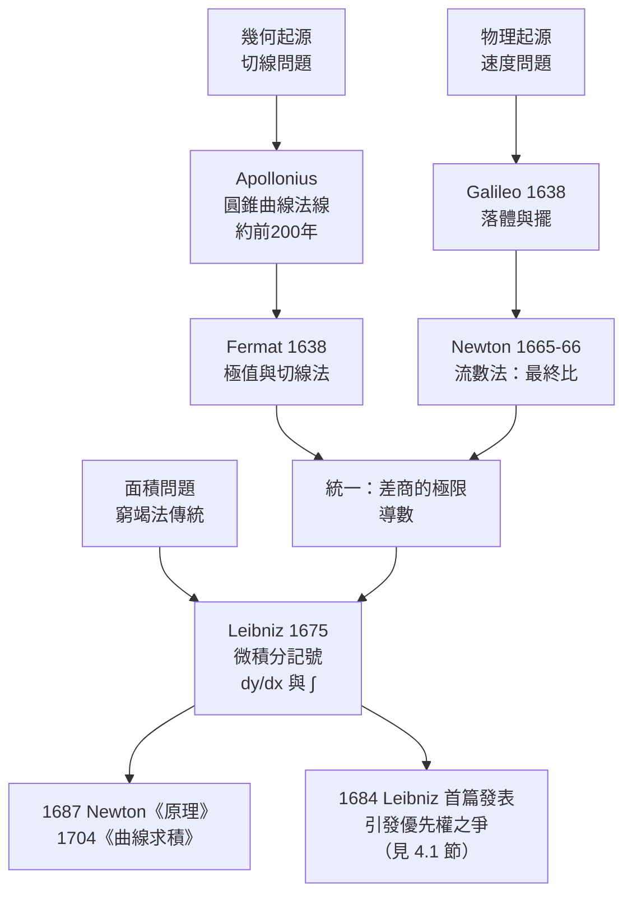

# 2.1 切線與速度兩大起源

## 導言

導數有兩個幾乎獨立誕生的源頭：**幾何的**（曲線的切線斜率）與**物理的**（運動的瞬時速度）。Fermat 在 1630s 為了求極值發展切線法；Galileo、Descartes 與 Mersenne 學派為了彈道與鐘擺研究瞬時速度。兩條路線在十七世紀中葉匯流，最終由 Newton 與 Leibniz 統一為「導數」。本節從這兩大起源出發，建立導數的嚴格定義。

### 起源一：切線問題

給定曲線 $y = f(x)$ 與其上一點 $P(a, f(a))$ ，什麼是「切線」？

古希臘的定義是**靜態的**：切線是「只接觸曲線一點的直線」。這個定義對圓成立，卻對拋物線、螺線失效（切線可再交曲線於他處）。Fermat（1638）與 Descartes（1637《幾何學》）各自給出**動態定義**：

> 切線是割線的極限位置——當第二點 $Q$ 沿曲線滑向 $P$ 時，割線 $PQ$ 的極限。

具體計算：取 $Q(a + h, f(a+h))$ ，割線斜率為

$$
m_{\text{sec}} = \frac{f(a+h) - f(a)}{h}.
$$

當 $h \to 0$ （ $Q \to P$ ），割線的極限斜率就是切線斜率。

### 起源二：速度問題

物體沿直線運動，位置函數 $s = s(t)$ 。平均速度是

$$
v_{\text{avg}} = \frac{s(t + h) - s(t)}{h}.
$$

但「瞬時速度」是什麼？速度定義為「位移除以時間」，而瞬時 $\Delta t = 0$ ，除法失去意義。這是 Zeno 悖論的現代版：**運動在單一瞬間似乎無速度可言**。

Newton 的洞見（1665–1666，瘟疫年間在 Woolsthorpe 的思考）：瞬時速度是平均速度在 $h \to 0$ 時的**最終比**（ultimate ratio）——不是「 $0$ 時刻的速度」，而是「無限縮短的時間段內平均速度的極限」。數學上：

$$
v(t) = \lim_{h \to 0} \frac{s(t+h) - s(t)}{h}.
$$

**兩大起源的統一**：切線斜率與瞬時速度是同一個數學結構——「差商的極限」。這種跨領域的結構同一性，正是微積分力量的泉源。

### 導數的定義

**定義 2.1.1**：函數 $f$ 在 $a$ 處**可導**，若極限

$$
f'(a) = \lim_{h \to 0} \frac{f(a+h) - f(a)}{h}
$$

存在（為有限實數）。此極限值稱為 $f$ 在 $a$ 的**導數**。等價記法：

$$
f'(a) = \left.\frac{df}{dx}\right|_{x=a} = \lim_{x \to a} \frac{f(x) - f(a)}{x - a}.
$$

若 $f$ 在區間上每一點可導， $x \mapsto f'(x)$ 是新函數，稱為導函數。

**Leibniz 記號的深意**： $\dfrac{dy}{dx}$ 表面上是「 $dy$ 除以 $dx$ 」，歷史上它是無窮小的商；現代詮釋中它是極限算子 $\dfrac{d}{dx}$ 作用於 $y$ 。這個記號的價值在於**可操作代數性**：鏈鎖律寫成 $\dfrac{dy}{dx} = \dfrac{dy}{du} \cdot \dfrac{du}{dx}$ ，如同分數相消（其嚴格證明見 2.2 節）。

### 例題一：用定義求 $x^2$ 的導數

**例題 2.1.2**：求 $f(x) = x^2$ 在 $x = 3$ 的導數與切線方程。

**解**：

$$
f'(3) = \lim_{h\to 0} \frac{(3+h)^2 - 9}{h} = \lim_{h\to 0} \frac{6h + h^2}{h} = \lim_{h\to 0} (6 + h) = 6.
$$

切線方程： $y - 9 = 6(x - 3)$ ，即 $y = 6x - 9$ 。

一般地， $f(x) = x^n$ 時：

$$
\frac{(x+h)^n - x^n}{h} = \frac{\sum_{k=1}^{n} \binom{n}{k} x^{n-k} h^k}{h} = n x^{n-1} + \sum_{k=2}^{n} \binom{n}{k} x^{n-k} h^{k-1} \xrightarrow{h\to0} n x^{n-1},
$$

得到**冪法則** $\dfrac{d}{dx} x^n = n x^{n-1}$ 。Fermat 1638 年求極值時已實質使用此法則（對整數 $n$ ）。

### 例題二：三角函數的導數

**例題 2.1.3**：用定義證明 $(\sin x)' = \cos x$ 。

**解**：

$$
\frac{\sin(x+h) - \sin x}{h} = \frac{\sin x \cos h + \cos x \sin h - \sin x}{h} = \sin x \cdot \frac{\cos h - 1}{h} + \cos x \cdot \frac{\sin h}{h}.
$$

由 1.2 節的兩個基本極限 $\displaystyle\lim_{h\to 0}\frac{\sin h}{h} = 1$ 、 $\displaystyle\lim_{h\to 0}\frac{\cos h - 1}{h} = 0$ ，得

$$
(\sin x)' = \sin x \cdot 0 + \cos x \cdot 1 = \cos x. \qquad \blacksquare
$$

同法得 $(\cos x)' = -\sin x$ 。**歷史註**：這兩個公式是 Newton 流數法的首項成果——他正是為了驗證圓周運動的加速度（向心力）而需要 $\sin$ 的導數，進而推導出萬有引力定律的雛形。

### 例題三：指數函數與 $e$ 的必然性

**例題 2.1.4**：設 $a > 0$ ，求 $f(x) = a^x$ 的導數。

**解**：

$$
\frac{a^{x+h} - a^x}{h} = a^x \cdot \frac{a^h - 1}{h},
$$

故 $(a^x)' = a^x \cdot c_a$ ，其中 $c_a = \lim_{h\to0}\frac{a^h-1}{h}$ 是只依賴於 $a$ 的常數。**存在一個特殊的底數 $e$ **，使得 $c_e = 1$ ，此時

$$
(e^x)' = e^x.
$$

Napier（1614）發明對數時已隱約接觸這個常數；Bernoulli（1683）研究複利 $\left(1+\frac1n\right)^n$ 得到 $e \approx 2.71828$ ；Euler（1748《無窮分析引論》）確立記號 $e$ 並證明其超越性質。 $e$ 的特殊性在於：**它是唯一使指數函數成為自身導數的底**——這使它成為微積分、複利、放射性衰變、正態分布的天然基礎（見 5.2 節 $e^x$ 的冪級數）。

### 不可導的三種方式

導數是極限，極限可以不存在。函數在 $a$ 不可導的典型方式：

| 方式 | 例子 | 幾何解釋 |
|------|------|----------|
| 尖點 | $f(x) = |x|$ 於 $0$ ：左右極限 $-1, +1$ | 左右切線不同 |
| 垂直切線 | $f(x) = \sqrt[3]{x}$ 於 $0$ ：差商 $\to \infty$ | 切線垂直 |
| 振盪 | $f(x) = x\sin\frac{1}{x}$ （ $f(0)=0$ ）於 $0$ | 無限抖動 |

**重要定理**：若 $f$ 在 $a$ 可導，則 $f$ 在 $a$ 連續。證明：

$$
f(x) - f(a) = \frac{f(x)-f(a)}{x-a} \cdot (x - a) \xrightarrow{x\to a} f'(a) \cdot 0 = 0.
$$

**逆命題不成立**： $|x|$ 處處連續卻在 $0$ 不可導。連續是可導的必要而非充分條件——而 Weierstrass 1872 年的函數（1.2 節）更是**處處連續處處不可導**，粉碎了「連續曲線必有切線」的百年直觀。

### 單側導數與 Darboux 性質

**單側導數**： $f'_+(a) = \lim_{h\to0^+}\frac{f(a+h)-f(a)}{h}$ ， $f'_-(a)$ 同理。 $f'(a)$ 存在 $\iff$ 兩單側導數存在且相等。

**Darboux 定理（1875）**：導函數即使不連續，也必滿足中間值性質（IVT 型質）。因此**導函數不可能有跳躍不連續**——若 $f'$ 在某點附近左右極限不等，它必然振盪（如 $\frac{x^2 \sin(1/x)}{}$ 的導數在 $0$ 附近振盪）。這是 1.3 節 IVT 的深刻延伸：**積分能還原的函數、導數的像都有中間值結構**。

### 兩大起源匯流的歷史圖景

Fermat 的「準等式」法（1638）：欲求 $y = x^3 - 2x^2$ 的極值，他設 $x$ 增加無窮小量 $e$ 後函數值「準相等」：

$$
(x+e)^3 - 2(x+e)^2 \approx x^3 - 2x^2
\implies 3x^2 e + 3xe^2 + e^3 \approx 4xe + 2e^2,
$$

除以 $e$ 、再捨去含 $e$ 的項： $3x^2 = 4x$ ，得極值點 $x = 0, \dfrac43$ 。這正是 $f'(x) = 0$ 的原始形式。Descartes 為此與 Fermat 筆戰（他認為方法不嚴格），但最終承認其效力——這場爭論是「極限方法」對「代數方法」的第一次勝利。

### 導數高階化：從速度到加速度

若位置 $s(t)$ 的導數 $v(t) = s'(t)$ 是速度，速度的導數 $a(t) = v'(t) = s''(t)$ 是加速度。**二階導數**的記號： $f''(x) = \dfrac{d^2y}{dx^2}$ 。Newton 的力學體系正建立於此：

$$
F = m \ddot{s} \quad \text{（Newton 第二定律的微分形式）}
$$

《自然哲學的數學原理》（1687）全書就是一部「已知力求位置」的二階微分方程求解史。這條線索延伸至今日：**微分方程論**（常微分、偏微分）是導數概念的直接繼承者，凡是「變化率決定狀態」的科學問題——量子力學的 Schrödinger 方程、廣義相對論的 Einstein 方程、ML 中的梯度流——本質上都在解微分方程。

### 為什麼導數是「局部」概念

導數 $f'(a)$ 只依賴 $f$ 在 $a$ 的**任意小鄰域**的值。這「局部性」有三重後果：

1. **兩個函數若在 $a$ 附近相等，則在 $a$ 的導數相同**——這是分部化簡的依據。
2. **導數不「看見」遠處**： $f$ 在別處的行為與 $f'(a)$ 無關；全局性質（極值、單調）需要更多定理（見 4.2、5.3 節）。
3. **線性化的哲學**：可導 $\iff$ 函數在局部可以「很好的直線」逼近（微分 $df = f'(a)\,dx$ ，見 2.3 節）。多變數版本（6.1 節）：可微 $\iff$ 可以「很好的平面」逼近；流形版本（微分幾何）：可微映射的「推前（pushforward）」正是這一思想的無限維推廣。

## 與其他章節及領域的關聯

- **2.2 節**：本節的定義配上求導法則，構成完整的微分代數系統。
- **2.3 節**：微分 $dy = f'(x)\,dx$ 與線性近似、誤差傳播。
- **4.2 節**：導數與積分透過微積分基本定理互逆。
- **6.1 節**：偏導數是「凍結其他變數」的導數；梯度是導數的向量化。
- **5.3 節**：高階導數與 Taylor 展開： $f^{(n)}(a)$ 決定函數在 $a$ 附近的形狀。
- **微分方程**：任何 ODE 都是「導數之間的關係式」；導數定義是其解析基礎。
- **控制論與機器學習**：梯度下降法 $\theta \leftarrow \theta - \eta \nabla L$ 是「沿負導數方向走」的數值實現；反向傳播是鏈鎖律（2.2 節）的自動化。

## 練習

1. 用定義求 $f(x) = \dfrac{1}{x}$ 在 $x = 2$ 的導數。
2. 用定義證明 $(\cos x)' = -\sin x$ 。
3. 證明 $f(x) = x|x|$ 在 $x=0$ 可導，並求 $f'(0)$ 。
4. 求曲線 $y = x^3 - 3x$ 上斜率等於 $9$ 的所有切線。
5. 一球自塔頂落下， $s(t) = 4.9t^2$ （公尺）。求 $t=2$ 秒時的瞬時速度與前 2 秒平均速度，並解釋兩者關係。
6. 思考題：構造函數使其在 $0$ 連續、 $f'_+(0)$ 與 $f'_-(0)$ 都存在但不相等；再構造一個在 $0$ 不可導、但其導函數極限為 $0$ 的例子（考慮 $x^2\sin\frac1x$ 型），並討論 Darboux 定理如何限制這類構造。

### 名詞速查表（本節核心術語）

- **割線斜率**： $\frac{f(a+h) - f(a)}{h}$ ，導數是它當 $h \to 0$ 的極限。
- **切線**：割線在第二點滑向第一點時的極限位置。
- **流數（fluxion）**：Newton 的導數稱呼，源於「流動的量」。
- **流量（fluent）**：Newton 的原函數稱呼，即隨時間流動的量。
- **單側導數**：僅從一側取極限的差商極限；兩側相等才有導數。
- **尖點**：左右單側導數存在但不相等的點（如 $|x|$ 於原點）。
- **Darboux 性質**：導函數滿足中間值性質，即使它不連續。
- **線性化**：用切線近似曲線的思想，2.3 節正式展開。
- **高階導數**：導數的導數，加速度為二階的典型。
- **微分幾何的推前**：導數概念的流形推廣（切映射）。

### 導數定義的變形速查

- 標準形式： $f'(a) = \lim_{h\to0}\frac{f(a+h)-f(a)}{h}$ 。
- 對稱形式： $f'(a) = \lim_{x\to a}\frac{f(x)-f(a)}{x-a}$ ，適合「代點驗證」。
- 雙參數形式： $f'(a) = \lim_{s,t\to0^+}\frac{f(a+s)-f(a-t)}{s+t}$ ，中心差分的理論版。
- 對稱差分在數值計算中精度為 $O(h^2)$ ，是一階形式（ $O(h)$ ）的升級（3.2 節取樣表對照）。
- 反函數形式： $\left(f^{-1}\right)'(f(a)) = \frac{1}{f'(a)}$ ，2.2 節證明。
- 積分定義（反觀）： $f'(x) = \frac{d}{dx}\int$ 型的操作在 4.2 節 FTC1 中出現。
- 記住：所有形式在導數存在時等價，但在奇點附近各「看見」不同的病態。
- 分析病態時，對稱形式可能「假裝」存在（如 $|x|$ 於原點給出 0），務必以標準形式為準。

### 例題補充：從定義出發的三個經典計算

**補一： $\sqrt{x}$ 的導數。** 有理化差商：

$$
\frac{\sqrt{a+h} - \sqrt{a}}{h} = \frac{h}{h(\sqrt{a+h} + \sqrt{a})} = \frac{1}{\sqrt{a+h} + \sqrt{a}} \to \frac{1}{2\sqrt{a}},
$$

故 $(\sqrt{x})' = \frac{1}{2\sqrt{x}}$ ——這是冪法則 $n = \frac12$ 的情形，Wallis 1656 年以插值猜想、Newton 以二項級數證實的結果在此用初等代數直接得到。

**補二： $\frac{1}{x}$ 的導數。** 通分：

$$
\frac{\frac{1}{x+h} - \frac{1}{x}}{h} = \frac{x - (x+h)}{h\,x(x+h)} = \frac{-1}{x(x+h)} \to -\frac{1}{x^2},
$$

與冪法則 $n = -1$ 一致。注意 $x = 0$ 處差商的分母出現 $x$ ，導數無定義——雙曲線沒有「過原點的切線」。

**補三：分段線性函數。** $f(x) = |x|$ ：右側差商恆為 $1$ 、左側恆為 $-1$ ，極限不等，導數不存在。但考慮 $f(x) = x|x|$ ：右側差商 $\to 0$ 、左側 $\to 0$ ，導數存在且為 $0$ ——**乘上一個「消除跳變」的因子可以把不可導點修復**，這是構造 $C^1$ 但非 $C^2$ 函數的標準手法。

### 深化問答三則

**問：切線的「靜態定義」（接觸一點）與「動態定義」（割線極限）為何後者勝出？**
答：因為前者無法處理拐點處的切線（三次曲線的切線可以穿過曲線再交於他處）。動態定義不承諾「只碰一次」，它只承諾「局部最佳直線近似」——這一承諾（2.3 節微分的誤差 $o(\Delta x)$ ）可以嚴格證明，並且推廣到多變數（切平面）與流形（切空間）。

**問：可導必連續的證明用了什麼「結構」？**
答：把增量分解為「差商 × 步長」： $f(x) - f(a) = \frac{f(x)-f(a)}{x-a}\cdot(x-a)$ 。第一因子趨於有限值 $f'(a)$ ，第二因子趨於零，乘積歸零。這是「有界 × 無窮小 = 無窮小」的典範用法，之後在隱函數定理、積分收斂估計中反覆出現。

**問：為什麼說導數是「局部」的，而原函數是「全局」的？**
答： $f'(a)$ 只看 $a$ 的任意小鄰域（改變 $f$ 在遠處的值不影響 $f'(a)$ ）；但積分 $\int_a^b f$ 累積全域資訊。FTC（4.2 節）把兩者連接：「全域的累積 = 端點的原函數差」。局部量與全局量的這種配對，是微積分乃至現代數學（上同調）的深層結構。

（本節完）
