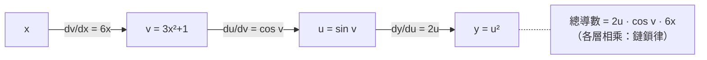
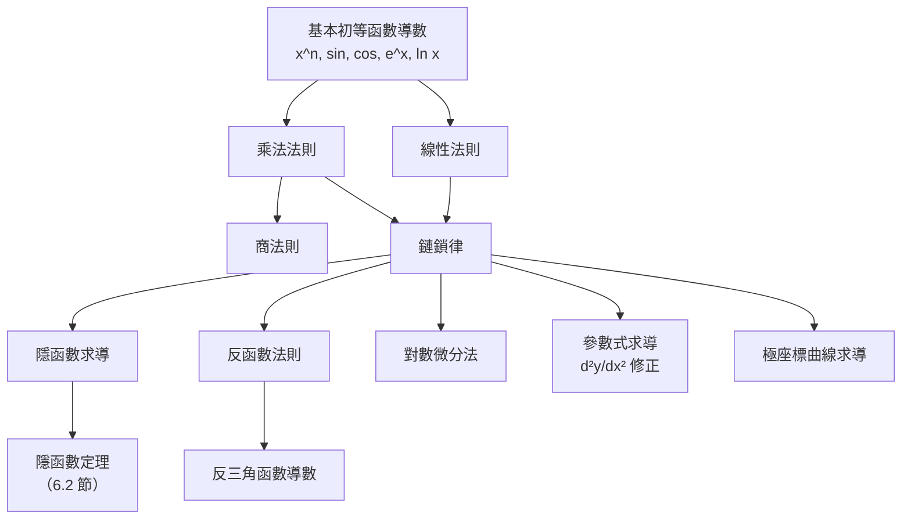

# 2.2 求導法則與鏈鎖律

## 導言

若每次求導都要回到 $\varepsilon$–$\delta$ 定義，微積分將寸步難行。本節建立求導的「代數系統」：四則法則、鏈鎖律、反函數法則。這些法則在 Leibniz 1684 年的論文中首次系統發表——正是其記號的可操作代數性，使微積分從「個案技巧」升級為「通用演算法」。其中**鏈鎖律**是微積分最重要的單一定理，也是現代機器學習反向傳播的數學核心。

### 四則求導法則

設 $f, g$ 在 $x$ 可導，$c$ 為常數：

| 法則 | 公式 | 證明核心 |
|------|------|----------|
| 線性 | $(cf \pm g)' = cf' \pm g'$ | 極限的線性 |
| 乘法（Leibniz 律，1675） | $(fg)' = f'g + fg'$ | 加減項技巧 |
| 商法則 | $\left(\dfrac{f}{g}\right)' = \dfrac{f'g - fg'}{g^2}$（$g \neq 0$） | 乘法則 + 誘導 |

**乘法法則證明**（加減項「茶道」）：

$$
\frac{f(x+h)g(x+h) - f(x)g(x)}{h} = \frac{f(x+h)g(x+h) - f(x)g(x+h)}{h} + \frac{f(x)g(x+h) - f(x)g(x)}{h},
$$

第一項趨於 $f'(x)g(x)$（用到 $g$ 的連續性），第二項趨於 $f(x)g'(x)$。這個「加減一項」技巧源自 1.2 節極限運算法則的證明，將在 9.1 節散度的乘積公式中再次出現。

**Leibniz 記號的乘法法則**：

$$
d(uv) = u\,dv + v\,du,
$$

形式上像「展開 $(u+du)(v+dv) = uv + u\,dv + v\,du + du\,dv$ 後捨去二階無窮小 $du\,dv$」。Leibniz 正是如此思考的；現代嚴格化後，這成為**微分形式的乘積法則**，且在高階情況給出優美的廣義 Leibniz 公式：

$$
(fg)^{(n)} = \sum_{k=0}^{n} \binom{n}{k} f^{(k)} g^{(n-k)},
$$

與二項式定理完全同構——「求導是一階差分算子」的冪展開。

### 鏈鎖律

**定理 2.2.1（鏈鎖律）**：設 $g$ 在 $a$ 可導，$f$ 在 $g(a)$ 可導，則複合函數 $F = f \circ g$ 在 $a$ 可導，且

$$
F'(a) = f'(g(a)) \cdot g'(a), \qquad \text{即} \qquad \frac{dy}{dx} = \frac{dy}{du}\cdot\frac{du}{dx}.
$$

**證明的陷阱與出路**：天真的想法是寫

$$
\frac{f(g(a+h)) - f(g(a))}{h} = \frac{f(g(a+h)) - f(g(a))}{g(a+h) - g(a)} \cdot \frac{g(a+h) - g(a)}{h},
$$

令 $h \to 0$。但若 $g(a+h) - g(a) = 0$（例如 $g(u) = u^2$ 在 $u=0$ 附近不斷回到 $0$），分母消失，除法失效。**出路**是改用「誤差函數」表述：

$$
\varepsilon(k) = \frac{f(g(a)+k) - f(g(a))}{k} - f'(g(a)) \quad (k \neq 0), \qquad \varepsilon(0) := 0.
$$

由 $f$ 在 $g(a)$ 可導，$\varepsilon(k) \to 0 = \varepsilon(0)$，即 $\varepsilon$ 在 $0$ **連續**。於是對**所有** $k$（含 $k=0$）有

$$
f(g(a)+k) - f(g(a)) = \big(f'(g(a)) + \varepsilon(k)\big)\,k.
$$

代入 $k = g(a+h) - g(a)$，除以 $h$，令 $h \to 0$：$k \to 0$（$g$ 連續），$\varepsilon(k) \to 0$，得

$$
F'(a) = f'(g(a))\, g'(a). \qquad \blacksquare
$$

這個證明的哲學意義深遠：**把「商的極限」改寫為「線性主部 + 高階誤差」**——這正是 2.3 節「微分」的定義，也是多變數可微性（6.1 節）與微分幾何中切映射的統一範式。

### 反函數求導法則

**定理 2.2.2**：設 $f$ 嚴格單調、在 $a$ 可導且 $f'(a) \neq 0$，$g = f^{-1}$，則

$$
g'(f(a)) = \frac{1}{f'(a)}, \qquad \text{即} \qquad \frac{dx}{dy} = \frac{1}{\frac{dy}{dx}}.
$$

**證明思路**：反函數的差商恰為原函數差商的倒數；$f$ 可導必連續，嚴格單調連續函數的反函數連續（1.3 節），故 $k = f(x) - f(a) \to 0$ 保證 $x \to a$。

**應用：反三角函數的導數**。設 $y = \arcsin x$，即 $x = \sin y$，$y \in (-\frac{\pi}{2}, \frac{\pi}{2})$：

$$
\frac{dy}{dx} = \frac{1}{\cos y} = \frac{1}{\sqrt{1 - \sin^2 y}} = \frac{1}{\sqrt{1 - x^2}}.
$$

同法可得：

$$
(\arctan x)' = \frac{1}{1+x^2}, \qquad (\arccos x)' = -\frac{1}{\sqrt{1-x^2}}, \qquad (\ln x)' = \frac{1}{x}.
$$

**歷史註**：$(\ln x)' = \frac1x$ 是十七世紀的重大發現——Gregory 與 Mercator（1668）證明 $\ln(1+x) = x - \frac{x^2}{2} + \frac{x^3}{3} - \cdots$，其逐項導數級數正是 $1 + (-x) + x^2 - \cdots = \frac{1}{1+x}$ 的幾何級數，這是冪級數理論（5.2 節）的起點之一。

### 隱函數求導

方程 $F(x, y) = 0$ 定義的曲線未必能解出 $y = y(x)$，但可以**形式上**對 $x$ 求導，把 $y$ 視為 $x$ 的函數，用鏈鎖律展開。

**例題 2.2.3**：求圓 $x^2 + y^2 = 25$ 上點 $(3, 4)$ 處的切線斜率。

**解**：兩邊對 $x$ 求導：

$$
2x + 2y\,\frac{dy}{dx} = 0 \implies \frac{dy}{dx} = -\frac{x}{y}.
$$

代入 $(3,4)$：$y' = -\dfrac{3}{4}$。切線：$y - 4 = -\dfrac34(x-3)$，即 $3x + 4y = 25$。

**嚴格化**：何時「隱函數」真的存在且可導？答案是**隱函數定理**（見 6.2 節）：若 $F_x, F_y$ 連續且 $F_y \neq 0$，則局部可解出 $y(x)$，且 $y' = -F_x / F_y$。上例中 $F_y = 2y = 8 \neq 0$，合法。隱函數定理是微分幾何（流形定義）、經濟學（比較靜態）的基石。

### 高階導數與記號系統

記號的三大家族：

| 記號 | 發明者 | 特點 |
|------|--------|------|
| $f'(x), f''(x), f^{(n)}(x)$ | Lagrange（1770s） | 簡潔，適合函數層次表述 |
| $\dfrac{dy}{dx}, \dfrac{d^n y}{dx^n}$ | Leibniz（1675–1684） | 顯示變數，適合鏈鎖律、偏導、變分法 |
| $\dot{x}, \ddot{x}$ | Newton（流數記號） | 物理文獻（時間導數）沿用至今 |

**Leibniz 記號的高階形式**：$\dfrac{d^2 y}{dx^2}$「看似」是 $\dfrac{d}{dx}\!\left(\dfrac{dy}{dx}\right)$ 的分數擴寫，形式上像 $\frac{d^2 y}{(dx)^2}$。嚴格說它**不是分數**，但在變數變換公式中（7.2 節 Jacobian、10.3 節張量分析）它表現出驚人的代數正確性——這不是巧合，而是「微分形式」理論的先聲。

### 例題：鏈鎖律的實戰

**例題 2.2.4**：求 $y = \sin^2(3x^2 + 1)$ 的導數。

**解**：三層複合：$y = u^2$，$u = \sin v$，$v = 3x^2+1$。逐層：

$$
\frac{dy}{du} = 2u, \qquad \frac{du}{dv} = \cos v, \qquad \frac{dv}{dx} = 6x.
$$

鏈鎖：

$$
\frac{dy}{dx} = 2u \cdot \cos v \cdot 6x = 12x \sin(3x^2+1)\cos(3x^2+1) = 6x \sin(2(3x^2+1)),
$$

最後一步用了 $\sin 2\theta = 2\sin\theta\cos\theta$。

**「多層鏈鎖 = 逐層導數連乘」**在自動微分（PyTorch/TensorFlow 的 autograd）中被機械化為計算圖的**反向遍歷**：每條邊乘以局部導數，路徑乘積求和——數百萬參數的神經網路訓練，本質上是鏈鎖律的大規模工業化。

### 三角函數族的完整導數表

$$
\begin{aligned}
(\sin x)' &= \cos x, & (\csc x)' &= -\csc x \cot x, \\
(\cos x)' &= -\sin x, & (\sec x)' &= \sec x \tan x, \\
(\tan x)' &= \sec^2 x, & (\cot x)' &= -\csc^2 x.
\end{aligned}
$$

**例**：$(\tan x)' = \left(\dfrac{\sin x}{\cos x}\right)' = \dfrac{\cos^2 x + \sin^2 x}{\cos^2 x} = \dfrac{1}{\cos^2 x} = \sec^2 x$。

**負角公式**的結構：奇函數的導數是偶函數（$\sin' = \cos$），偶函數的導數是奇函數（$\cos' = -\sin$）。這一對稱性可推廣：$f$ 為偶函數 $\Rightarrow f'$ 為奇函數；奇函數的原函數（若存在）必為偶函數——這在對稱積分（3.3 節）中大量使用。

### 指數與對數的鏈鎖結構

由 $(e^x)' = e^x$ 與 $a^x = e^{x \ln a}$：

$$
(a^x)' = e^{x\ln a} \cdot \ln a = a^x \ln a.
$$

由 $(\ln x)' = \frac1x$ 與對數微分法：對 $y = f(x) > 0$ 取 $\ln y = \ln f(x)$ 再求導：

$$
\frac{y'}{y} = \frac{d}{dx}\ln f(x) \implies y' = f(x)\,\frac{d}{dx}\ln f(x).
$$

**例題 2.2.5（對數微分法）**：求 $y = x^x$（$x>0$）的導數。

**解**：$\ln y = x \ln x$，求導：$\dfrac{y'}{y} = \ln x + 1$，故

$$
y' = x^x (\ln x + 1).
$$

**歷史**：Johann Bernoulli（1697）以對數微分法處理 $u^v$ 型函數，這類「變指數」是 Leibniz 記號威力的展示場——在 Newton 的流數記號下處理它們相當笨拙。

### 求導法則的邏輯地圖

**參數式求導**：曲線 $x = x(t)$、$y = y(t)$，則

$$
\frac{dy}{dx} = \frac{dy/dt}{dx/dt}, \qquad
\frac{d^2 y}{dx^2} = \frac{\frac{d}{dt}\!\left(\frac{dy/dt}{dx/dt}\right)}{dx/dt}.
$$

第二式常被寫錯（誤以為是 $\frac{d^2y/dt^2}{d^2x/dt^2}$）——注意 $\frac{d^2 y}{dx^2}$ 是對 $x$ 再求導，需再經一次鏈鎖。這個「修正」預示了 9.1 節曲率公式與微分幾何中的聯絡概念。

### 法則失效與例外警示

| 陷阱 | 說明 |
|------|------|
| $(fg)' \neq f'g'$ | 反例：$f=g=x$，左 $=2x$，右 $=1$ |
| 商法則要求 $g\neq0$ 在**點的鄰域**成立 | $g$ 僅在該點非零不夠 |
| 鏈鎖律要求 $g$ 在 $a$ 可導（非僅連續） | 內層函數不可導時需直接用定義 |
| 隱函數求導需驗證 $F_y \neq 0$ | 否則可能出現垂直切線或多值 |
| 絕對值函數分段求導要檢查接點 | $|x|$ 在 0 處兩側導數不等 |

### 歷史前因後果

- **前因**：Fermat 與 Descartes 的切線法只能逐案處理；十七世紀中葉 Huygens、Hudde 發展出針對多項式的求導規則。
- **提出**：Leibniz 1684 年《一種求極大極小與切線的新方法》發表乘法、商法則與（未明言的）鏈鎖律思想；L'Hôpital 1696 年《無窮小分析》普及之；歐拉與 Lagrange 完成系統化。
- **解決了什麼**：一切初等函數的導數成為**機械可計算**——微積分從技藝變成演算法。
- **引發新問題**：鏈鎖律在高維的推廣（Jacobian 矩陣乘法，6.2 節）、在無窮維的推廣（變分法、泛函分析）、離散世界的推廣（自動微分、差分法）至今仍是活躍領域。

## 與其他章節及領域的關聯

- **6.2 節**：鏈鎖律的多變數形式是矩陣乘法 $\mathbf{J}_{f\circ g} = \mathbf{J}_f \cdot \mathbf{J}_g$——單變數的「相乘」升級為「矩陣相乘」，這是線性代數與微積分的交會點。
- **7.2 節**：座標變換的 Jacobian 行列式是鏈鎖律在重積分中的化身。
- **8.2 節**：保守場的位能函數 $f$ 滿足 $\nabla f = \mathbf{F}$，隱函數與反函數思想貫穿位勢理論。
- **5.2 節**：對 $(\arctan x)' = \frac{1}{1+x^2}$ 做幾何級數展開再積分，得 $\arctan$ 的冪級數（Machin 1706 年用以算 $\pi$ 到 100 位）。
- **自動微分**：鏈鎖律的計算圖實現是深度學習框架的核心；「前向模式」與「反向模式」分別對應 Jacobian 的列與行計算策略。
- **微分幾何**：切映射 $df_p: T_pM \to T_{f(p)}N$ 是鏈鎖律的座標無關表述；鏈鎖律保證 $(g\circ f)_* = g_* \circ f_*$。

## 練習

1. 用乘法法則證明 $(x^2 e^x)' = (x^2 + 2x)e^x$，並推廣 $\left(x^2 e^x\right)^{(n)}$ 的公式。
2. 用鏈鎖律求 $y = \cos(e^{-x^2})$ 的導數。
3. 對心臟線 $r = 1 + \cos\theta$ 用極座標求 $\dfrac{dy}{dx}$，說明在 $\theta = 0$ 處切線方向。
4. 用對數微分法求 $y = (\ln x)^x$（$x>1$）的導數。
5. 證明：可導的偶函數其導數為奇函數；並用 $\sin$、$\cos$、$x^2$ 驗證。
6. 思考題：設 $g(x) = x^2 \sin\frac{1}{x}$（$g(0)=0$）。$g$ 在 $0$ 可導嗎？$g'$ 在 $0$ 連續嗎？這對「鏈鎖律條件能否放寬為內層函數僅連續」給出什麼啟示？

### 補充研讀：法則的結構性總結

- **一個記憶錨點**：所有求導法則都是「極限的代數性質」的推論——極限保持加減乘除（分母不為零時），求導法則自動繼承。
- **鏈鎖律的記憶錨點**：「局部導數連乘、多路徑求和」——它統一了單變數、多變數、參數、隱函數四種情境。
- **反函數法則的記憶錨點**：「正逆互為倒數」——圖像上，$f$ 與 $f^{-1}$ 的圖形關於 $y = x$ 對稱，斜率互為倒數。
- **隱函數求導的記憶錨點**：「把 $y$ 當 $x$ 的函數，兩邊微分，解出 $y'$」——機械步驟，但需檢查 $F_y \neq 0$ 的合法性。
- **對數微分法的適用範圍**：$u^v$ 型、連乘連除型、帶根號的複雜積型——先取對數化繁為簡。
- **參數求導的常見錯誤**：把 $\frac{d^2y}{dx^2}$ 寫成 $\frac{y''(t)}{x''(t)}$；正確做法是「一階商對 $t$ 求導後再除以 $x'(t)$」。
- **高階導數的 Leibniz 公式**：$(fg)^{(n)} = \sum \binom{n}{k}f^{(k)}g^{(n-k)}$，二項式定理的求導版。
- **記號的選擇策略**：做計算用 Lagrange 記號 $f'$，做變數變換用 Leibniz 記號 $\frac{dy}{dx}$，兩者互補。

### 補充例題：鏈鎖律的三層組合演練

**補一：** 求 $y = \tan^3(e^{2x})$ 的導數。三層：外層 $u^3$、中層 $\tan v$、內層 $v = e^{2x}$（其自身又兩層）。

$$
y' = 3\tan^2(e^{2x})\cdot\sec^2(e^{2x})\cdot 2e^{2x} = 6e^{2x}\tan^2(e^{2x})\sec^2(e^{2x}).
$$

**補二：** 證明 $(\ln|\sin x|)' = \cot x$（$x$ 避開 $\pi$ 的倍數）。由鏈鎖律：$\frac{1}{\sin x}\cdot\cos x = \cot x$。**推論**：$\int \cot x\,dx = \ln|\sin x| + C$——導數表的逆讀自動成為積分表條目（4.3 節）。

**補三：** 心臟線 $r = a(1+\cos\theta)$ 的切線斜率。參數式 $x = a(1+\cos\theta)\cos\theta$、$y = a(1+\cos\theta)\sin\theta$，對 $\theta$ 求導後 $\frac{dy}{dx} = \frac{y'}{x'}$，在 $\theta = \frac{\pi}{2}$ 處可得水平切線的幾何結論——極座標曲線的分析全部化歸參數鏈鎖。

### 深化問答三則

**問：為什麼「商法則」不直接寫成 $\left(\frac{f}{g}\right)' = \frac{f'}{g'}$？**
答：量綱與反例都反對：$f = g = x^2$ 時左邊為 0、右邊為 1。本質原因：除法的增量不線性——$\frac{f+\Delta f}{g+\Delta g}$ 展開後出現 $\Delta f\,\Delta g$ 型交叉項。商法則的分子 $f'g - fg'$ 正是「交叉相消」後的倖存者，它也是 9.1 節各種「行列式導數」結構的雛形。

**問：鏈鎖律在什麼情況下會「靜默失敗」？**
答：當內層函數 $g$ 在 $a$ 不可導時，$\frac{dy}{dx} = f'(g(a))g'(a)$ 沒有意義，但學生常忘記檢查。更陰險的情形：$g$ 不可導但 $f \circ g$ 仍可導（如 $f$ 為常函數）。此時結論碰巧成立，但**推理**無效——數學上區分「結論對」與「證明對」是基本功。

**問：Leibniz 記號的「分數相消」何時真的是分數？**
答：在二階以上開始失效：$\frac{d^2y}{dx^2} \neq \frac{d(y/x)}{dx}$ 型的操作無意義。但在一階鏈鎖、一階換元、隱函數 $\frac{dy}{dx} = -F_x/F_y$ 中，記號的代數表現完全正確。這不是巧合而是設計：Leibniz 記號把「一階微分」編碼為線性對象，其代數恰是 1-形式的代數（9.3 節微分形式理論的最小樣本）。

（本節完）
