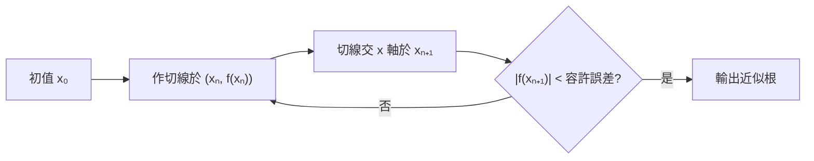

# 2.3 微分與近似應用

## 導言

導數的定義回答了「切線斜率是多少」，但科學與工程真正反覆使用的，是它的一個更樸素的化身：**微分（differential）**——用切線代替曲線、用線性代替非線性。Laplace 說過：「分析的語言中，微分符號是整個系統的槓桿。」本節建立微分概念，發展線性近似、誤差傳播、牛頓法與洛必達法則，展示「以直代曲」如何驅動從測量學到人工智慧的各種應用。

### 微分的定義

**定義 2.3.1**：設 $y = f(x)$ 在 $a$ 可導。定義自變數的**微分** $dx = \Delta x$ （任意增量），函數的**微分**為

$$
dy = f'(a)\,dx.
$$

注意： $dy$ 是 $dx$ 的線性函數，而函數的**實際增量**是

$$
\Delta y = f(a + dx) - f(a) = f'(a)\,dx + \underbrace{\big[\Delta y - f'(a)\,dx\big]}_{o(dx)}.
$$

由導數定義，方括號內的誤差滿足 $\dfrac{\Delta y - f'(a)\,dx}{dx} \to 0$ （ $dx \to 0$ ），記作 $o(dx)$ （「比 $dx$ 更高階的小量」）。因此：

$$
\Delta y = f'(a)\,dx + o(dx)
\qquad\Longleftrightarrow\qquad
f \text{ 在 } a \text{ 可導}.
$$

**這個等價性正是可導性的本質**：可導 $\iff$ 函數增量能分解為「線性主部 + 高階小量」。此表述可以直接推廣到多變數（6.1 節： $\Delta \mathbf{y} = \mathbf{J}\,\Delta\mathbf{x} + o(|\Delta\mathbf{x}|)$ ）、無窮維空間（Fréchet 導數）、乃至隨機過程（Itō 微積分中 $dW^2 = dt$ 破壞了純線性結構——那裡的高階小量不再可捨去，是金融數學的起點）。

### Leibniz 記號的合法性辯護

在 Leibniz 記號下 $\dfrac{dy}{dx} = f'(x)$ 形式上是分數。現代詮釋： $dx$ 與 $dy$ 都是確定的（有限的）量， $dy = f'(x)\,dx$ 是定義式，比值恰還原導數。這個記號的實用優勢：

1. **鏈鎖律像分數相消**： $\dfrac{dy}{du}\cdot\dfrac{du}{dx}$ ；
2. **反函數像倒數**： $\dfrac{dx}{dy} = 1 \big/ \dfrac{dy}{dx}$ ；
3. **積分記號自然**： $\displaystyle\int f'(x)\,dx = f + C$ ，被積表達式形如「微分」；
4. **高階微分**： $d^2y = f''(x)\,dx^2$ （ $dx$ 固定時），為變分法與微分方程記號奠基。

### 線性近似（切線逼近）

**定理 2.3.2（線性化）**： $f$ 在 $a$ 可導，則對靠近 $a$ 的 $x$ ：

$$
f(x) \approx f(a) + f'(a)(x - a).
$$

**推導**： $\Delta y = f(a+\Delta x) - f(a) \approx f'(a)\Delta x$ ，移項即得。

**歷史**：這一思想 Fermat（1638）用於極值、Newton 用於迭代、Euler 用於力學。Euler 的名言是微積分的操作哲學：「以無窮小量捨去的誤差，不影響最終結果的正確性」——十九世紀嚴格化（10.1 節）證明這句話在 $o(\cdot)$ 語言下成立。

### 例題一：數值近似

**例題 2.3.3**：用線性近似估計 $\sqrt{4.02}$ 。

**解**：取 $f(x) = \sqrt{x}$ ， $a = 4$ ， $dx = 0.02$ 。 $f(4) = 2$ ， $f'(x) = \frac{1}{2\sqrt x}$ ， $f'(4) = \frac14$ 。

$$
\sqrt{4.02} \approx 2 + \frac14 (0.02) = 2.005.
$$

真值 $\sqrt{4.02} \approx 2.004994\ldots$ ，誤差約 $6 \times 10^{-6}$ ——遠小於「線性」直覺的預期。原因見下：**二次項修正**。

### 誤差估計：近似的定量控制

線性近似的誤差有精確界。若 $f''$ 在 $a$ 附近有界 $|f''| \le M$ ，由 Taylor 定理（5.2 節）：

$$
|f(a + dx) - f(a) - f'(a)\,dx| \le \frac{M}{2}\,(dx)^2.
$$

**誤差階對照表**：

| 近似階 | 公式 | 誤差量級 | 需要條件 |
|--------|------|----------|----------|
| 零階（常值） | $f(a+\Delta x)\approx f(a)$ | $O(\Delta x)$ | 連續 |
| 一階（線性） | $\approx f(a) + f'\Delta x$ | $O(\Delta x^2)$ | 二階導有界 |
| 二階 | $\approx f(a) + f'\Delta x + \frac{f''}{2}\Delta x^2$ | $O(\Delta x^3)$ | 三階導有界 |

例題 2.3.3 中 $f''(x) = -\frac{1}{4}x^{-3/2}$ ， $|f''(4)| = \frac{1}{32}$ ，故誤差 $\le \frac{1}{64}(0.02)^2 \approx 6.3\times10^{-6}$ ——與實際誤差吻合。

### 例題二：誤差傳播（測量學的核心問題）

**例題 2.3.4**：測得球的半徑為 $r = 5.0$ 公分，測量誤差最多 $0.01$ 公分。用 $V = \frac43\pi r^3$ 估計體積的最大絕對誤差與相對誤差。

**解**：視 $r$ 有誤差 $dr = \pm 0.01$ ：

$$
dV = V'(r)\,dr = 4\pi r^2\,dr = 4\pi (25)(0.01) = \pi \approx 3.14\ \text{cm}^3.
$$

$V(5) = \dfrac{500\pi}{3} \approx 523.6\ \text{cm}^3$ 。相對誤差：

$$
\frac{dV}{V} = \frac{4\pi r^2 dr}{\frac43 \pi r^3} = 3\,\frac{dr}{r} = 3 \times \frac{0.01}{5} = 0.6\%.
$$

**一般原理**： $y = f(x)$ 時相對誤差近似為 $\left|\dfrac{dy}{y}\right| = \left|\dfrac{f'(x)}{f(x)}\right|\left|\dfrac{dx}{x}\right|\cdot|x|$ ，特別地**冪函數 $y = cx^n$ 把相對誤差放大 $n$ 倍**——這解釋了為什麼工程上最怕測長度（體積誤差 = 3 倍長度誤差）、為什麼光學鏡面的曲率要求極端精密。

**對數微分版的速記**： $\ln y = n\ln x + \ln c \implies \dfrac{dy}{y} = n\,\dfrac{dx}{x}$ 。

### 中值定理：由局部到全局的橋樑

**定理 2.3.5（Lagrange 中值定理，MVT，1797）**： $f$ 在 $[a,b]$ 連續、在 $(a,b)$ 可導，則存在 $\xi \in (a,b)$ 使

$$
f'(ξ) = \frac{f(b) - f(a)}{b - a}.
$$

**幾何意義**：割線（平均變化率）總平行於某處切線。**證明骨架**：輔助函數 $h(x) = f(x) - f(a) - \frac{f(b)-f(a)}{b-a}(x-a)$ （曲線減去割線）， $h(a) = h(b) = 0$ ，由 **Rolle 定理**（1691）——兩端等值則內部有水平切線——得證。Rolle 定理又依賴 Weierstrass 極值定理（1.3 節）與 Fermat 內點極值原理（內點可導且極值 $\Rightarrow f' = 0$ ，1638）。

**MVT 的兩大推論**：

1. **導數恆正 $\Rightarrow$ 函數嚴格遞增**（全局單調性由逐點導數決定）；
2. **導數恆零 $\Rightarrow$ 函數常數**——這是「原函數存在唯一性」的基礎（4.2 節）。

**誤差傳播的精確形式**： $|f(x) - f(a)| = |f'(ξ)|\,|x - a|$ ，若 $|f'| \le K$ 則 $|f(x)-f(a)| \le K|x-a|$ （Lipschitz 估計）——MVT 是把局部的 $o(\cdot)$ 誤差升級為全局估計的機器。

### 例題三：洛必達法則

**定理 2.3.6（L'Hôpital，1696；實為 Johann Bernoulli 所作）**：若 $\lim f = \lim g = 0$ （或 $\pm\infty$ ），且 $\lim \dfrac{f'(x)}{g'(x)} = L$ ，則 $\lim \dfrac{f(x)}{g(x)} = L$ 。

**證明核心**： $\dfrac{f(x)-f(a)}{g(x)-g(a)} = \dfrac{f'(ξ)}{g'(ξ)}$ （Cauchy 推廣的 MVT）。

**例題 2.3.7**：求 $\displaystyle\lim_{x\to 0} \frac{x - \sin x}{x^3}$ 。

**解**： $\frac00$ 型。一次洛必達： $\displaystyle\lim_{x\to0}\frac{1-\cos x}{3x^2}$ 仍為 $\frac00$ 。二次： $\displaystyle\lim_{x\to0}\frac{\sin x}{6x} = \frac16$ 。故原極限為 $\dfrac16$ 。

**警示**：洛必達是「局部線性比值的再現」，只能用於 $\frac00$ 與 $\frac\infty\infty$ ；其他不定式（ $0\cdot\infty$ 、 $0^0$ 、 $\infty-\infty$ 、 $1^\infty$ ）須先變形。**反例警示**： $\lim_{x\to\infty}\frac{x+\sin x}{x}$ 存在（ $=1$ ），但 $\frac{f'}{g'} = 1 + \cos x$ 無極限——法則的單向性（ $\frac{f'}{g'}$ 收斂 $\Rightarrow$ 原式收斂）不可逆用。

**歷史**：Guillaume de l'Hôpital（1661–1704）1696 年出版史上第一本微積分教科書《闡明曲線的無窮小分析》，其中「洛必達法則」是他向 Johann Bernoulli（1667–1748）付費購買的成果之一（Bernoulli 當時受僱於他）。這樁「知識買賣」的通信於 1920 年代重見天日，證實了版權歸屬——科學史上罕見的公案。

### 牛頓法：以直代曲的迭代機器

**算法**：求 $f(x) = 0$ 的根。從初值 $x_0$ 出發，反覆用切線的零點代替曲線的零點：

$$
x_{n+1} = x_n - \frac{f(x_n)}{f'(x_n)}.
$$

**幾何**：在 $(x_n, f(x_n))$ 作切線，交 $x$ 軸於 $x_{n+1}$ 。

**例題 2.3.8**：用牛頓法解 $x^3 - x - 1 = 0$ ，初值 $x_0 = 1.5$ 。

**解**： $f(x) = x^3 - x - 1$ ， $f'(x) = 3x^2 - 1$ 。

$$
x_{n+1} = x_n - \frac{x_n^3 - x_n - 1}{3x_n^2 - 1}.
$$

| $n$ | $x_n$ | $f(x_n)$ | 誤差 $|x_n - 1.32472|$ |
|-----|--------|----------|------------------------|
| 0 | $1.5$ | $0.875$ | $1.75\times10^{-1}$ |
| 1 | $1.34783$ | $0.047$ | $2.31\times10^{-2}$ |
| 2 | $1.32520$ | $0.00058$ | $4.8\times10^{-4}$ |
| 3 | $1.32472$ | $\sim 10^{-7}$ | $4\times10^{-7}$ |

對照 1.3 節二分法（需 $\sim 20$ 次才達 $10^{-6}$ ），牛頓法 3 次即達——**二次收斂**：每次誤差近似滿足 $e_{n+1} \approx C e_n^2$ ，有效數字**每輪翻倍**。代價：需要 $f'$ 、初值要好、且可能發散（初值落在極值附近或進入循環，如 $f(x)=x^{1/3}$ 從非零初值出發形成 2-循環）。牛頓 1669 年手稿首用此法（解多項式，形式不同，今日稱 Simpson–Newton 法），Raphson 1690 年給出現代迭代式；Simpson（1740）以微積分語言重述。

### 高階應用速覽

- **近似開方與超越函數求值**：計算器與數學庫的 `sqrt`、`exp`、`log` 內部即牛頓法／多項式逼近（minimax 多項式）。
- **優化**：極值條件 $f'=0$ 用牛頓法解，即 **Newton–Raphson 優化**；多變數版用 Hessian 矩陣（6.3 節）；帶阻尼的版本是現代擬牛頓法（BFGS）。
- **物理**：小擺動近似 $\sin\theta \approx \theta$ （線性化）使單擺方程變成諧振子方程，週期 $T = 2\pi\sqrt{L/g}$ ——線性近似的教科書案例；非線性修正給出 $T \approx 2\pi\sqrt{L/g}\left(1 + \frac{\theta_0^2}{16}\right)$ 。
- **工程**：結構微小變形分析（一階理論）、控制系統的 PID 與線性化模型，全部立足於「工作點附近以導數刻畫響應」。

### 極值判別與函數作圖的微積分工具箱

| 檢驗 | 條件 | 結論 |
|------|------|------|
| 一階導數檢驗 | $f'(a)=0$ 且 $f'$ 由正轉負／由負轉正 | 局部極大／極小 |
| 二階導數檢驗 | $f'(a)=0$ ， $f''(a)<0$ ／ $>0$ | 極大／極小（ $f''(a)=0$ 時失效） |
| 凹凸性 | $f''>0$ （下凸）／ $f''<0$ （上凸） | 拋物線方向 |
| 反曲點 | $f''$ 變號處 | 凹凸轉折 |

**例題 2.3.9**：分析 $f(x) = x^3 - 3x^2 + 1$ 的形狀。

**解**： $f' = 3x^2 - 6x = 3x(x-2)$ ，臨界點 $x = 0, 2$ 。 $f'' = 6x - 6$ ： $f''(0) = -6 < 0$ （極大值 $1$ ）， $f''(2) = 6 > 0$ （極小值 $-3$ ）。 $f''=0$ 於 $x=1$ ，反曲點 $(1, -1)$ 。這套「導數符號表」方法把作圖從藝術變成程序。

### 歷史前因後果

- **前因**：天文測量與航海需要高精度數值計算；微觀力學需要「瞬時量」的可計算替身。
- **提出**：Leibniz 1684 正式定義 $dx, dy$ ；Lagrange 1797 以 MVT 為微積分基石；Cauchy 1823 年《無窮小分析概要》給出中值定理的現代形式與嚴格誤差控制。
- **解決了什麼**：把「無窮小捨去」變成有明確誤差界的合法操作；數值求根、優化、誤差分析從此有理論保證。
- **引發新問題**：逼近的更高階（Taylor 理論，5.2 節）、多變數線性化（6.1 節）、以及「何時線性化失效」（混沌、奇異攝動）——二十世紀動力系統理論正是研究線性近似失效處的新數學。

## 與其他章節及領域的關聯

- **5.2 節**：Taylor 多項式是線性近似的無限升級版； $o(\Delta x)$ 是 Taylor 餘項的縮影。
- **6.1 節**：多變數微分 $\Delta \mathbf{f} \approx \mathbf{J}\,\Delta \mathbf{x}$ ，Jacobian 矩陣是 $f'$ 的推廣。
- **6.3 節**：極值的二階檢驗推廣為 Hessian 矩陣正定性；Lagrange 乘數法是約束優化的牛頓法近親。
- **3.2 節**：積分的上和下和估計中，MVT 提供積分中值定理，是「Riemann 和 $\to$ 定積分」的引擎。
- **數值分析**：牛頓法、Euler 法解 ODE（ $y_{n+1} = y_n + h f(y_n)$ 正是 $dy = f'\,dx$ 的離散化）、有限元素法——「以直代曲」的各種現代化身。
- **機器學習**：梯度下降的一步更新 $\theta_{n+1} = \theta_n - \eta \nabla L$ 是「沿切線方向修正」；牛頓法對應二階方法（Hessian），學習率 $\eta$ 便是步長控制。

## 練習

1. 用線性近似估計 $\cos 31°$ （提示： $a = 30° = \frac{\pi}{6}$ ，化為弧度）。
2. 單擺週期公式 $T = 2\pi\sqrt{L/g}$ 。若 $L$ 測量有 $1\%$ 誤差， $T$ 的相對誤差是多少？
3. 用牛頓法求 $\sqrt{10}$ （即解 $x^2 - 10 = 0$ ），初值 $x_0 = 3$ ，迭代三次，驗證二次收斂（計算各輪誤差比 $e_{n+1}/e_n^2$ ）。
4. 用洛必達法則求 $\displaystyle\lim_{x\to 0^+} x \ln x$ 與 $\displaystyle\lim_{x\to0} (1+2x)^{1/x}$ 。
5. 證明：若 $f'$ 在 $(a,b)$ 上有界 $K$ ，則 $f$ 在 $(a,b)$ 上一致連續（MVT 應用）。
6. 思考題：對 $f(x) = \sqrt{|x|}$ 用牛頓法會發生什麼（考慮 $x_0 \neq 0$ ）？說明 $f'$ 在 $0$ 的發散如何破壞收斂，並查閱「牛頓法分形」（Newton fractal）了解複平面上初值域的混沌結構。

### 名詞速查表（本節核心術語）

- **微分 $dy$ **：函數增量的線性主部 $f'(a)\,dx$ 。
- **高階小量 $o(\cdot)$ **：比括號內量更快趨零的餘項記號。
- **線性近似**： $f(a+\Delta x) \approx f(a) + f'\Delta x$ ，誤差為二階。
- **誤差傳播**：輸入誤差經 $f'$ 放大為輸出誤差的定量估計。
- **相對誤差放大**：冪函數 $y = cx^n$ 把相對誤差放大 $n$ 倍。
- **中值定理（MVT）**：割線斜率在某內點被切線斜率實現。
- **Rolle 定理**：兩端等值的可導函數必有水平切線。
- **洛必達法則**： $\frac00$ 、 $\frac\infty\infty$ 型極限的導數比值法。
- **牛頓法**： $x_{n+1} = x_n - \frac{f}{f'}$ ，二次收斂的求根迭代。
- **凹凸性與反曲點**：二階導數的符號與變號位置。

### 誤差分析速查表（工程實務版）

- 測量長度 $l$ 、誤差 $\delta l$ ：面積誤差 $\approx 2\bar l\,\delta l$ （放大 2 倍），體積誤差 $\approx 3\bar l^2\,\delta l$ （放大 3 倍）。
- 角度測量換弧度後方可微分： $d\theta$ 以弧度計， $1° = \frac{\pi}{180} \approx 0.01745$ 。
- 三角函數近似： $\sin\theta \approx \theta$ 、 $\cos\theta \approx 1 - \frac{\theta^2}{2}$ （ $\theta$ 小時）。
- 對數近似： $\ln(1 + u) \approx u - \frac{u^2}{2}$ （ $|u|$ 小時），用於複利與增長率合成。
- 指數近似： $e^u \approx 1 + u + \frac{u^2}{2}$ ，用於小增長率下的複利檢查。
- $\frac{1}{1+u} \approx 1 - u$ ：彈性力學一階理論的通用替身。
- 這些「展開式」在 5.2 節獲得統一的 Taylor 框架，誤差從此有精確界。
- 儀器規格書上的「精度 0.1%」經常需用本節方法換算為輸出量的誤差。

### 洛必達法則的完整使用手冊

- 適用核心型： $\frac00$ 與 $\frac{\infty}{\infty}$ ；每次使用前必須確認型別。
- $0 \cdot \infty$ 型：把一個因子倒進分母，化為核心型（選「好求導」的當分母）。
- $\infty - \infty$ 型：通分或有理化，化為核心型。
- $0^0$ 、 $1^\infty$ 、 $\infty^0$ 型：取對數化為 $0\cdot\infty$ 型，最後回代指數。
- 常見陷阱：對非不定型（如 $\frac{\text{有限}}{\text{有限}}$ ）使用——結果可能完全錯誤。
- 常見陷阱：反覆使用時忘記每次確認型別，尤其是振盪函數（見 2.3 正文的反例）。
- 洛必達的真正身世：Johann Bernoulli 撰寫、L'Hôpital 出資署名——1696 年的「知識買賣」。
- 與 Taylor 展開比較：洛必達快而脆，Taylor 展開一次到位且給出誤差階，高階極限（如 $\frac{x-\sin x}{x^3}$ ）建議直接展開。

### 深化問答三則

**問：微分 $dy$ 是「無窮小」嗎？**
答：在現代定義中不是—— $dx$ 是任意給定的（有限）增量， $dy = f'(x)dx$ 是其線性映像。無窮小只是**修辭**：當 $dx$ 縮小時， $\Delta y$ 與 $dy$ 之差是更高階的小量，相對誤差趨於零。把 $dy$ 想成「無窮小」在快速推導時方便，但寫證明時必須回到「線性主部 + $o(dx)$ 」的嚴格表述。

**問：中值定理的「中值」為什麼不唯一、也不可構造？**
答： $\xi$ 的存在由 Rolle 定理間接保證，定理本身不含定位方法。例如 $f(x) = x^2$ 於 $[0,1]$ ： $\xi = \frac12$ 恰好唯一；但 $f(x) = x^3 - x$ 於 $[-1,1]$ 有多個 $\xi$ 。MVT 的用途是「存在某處速度等於平均速度」，而非「告訴你哪裡」——它是估計工具（誤差界、Lipschitz 界），不是計算工具。

**問：牛頓法為什麼可能發散，工程上如何防護？**
答：初值落在 $f'$ 接近零處時切線近乎水平，下一步被拋到極遠處； $f(x) = x^{1/3}$ 型函數則形成循環。防護手段：阻尼（步長減半搜尋下降方向）、混合二分法（hybrid method，如 Brent 演算法——牛頓快、二分保底）、以及多初值並行。這些策略的共同哲學：**任何快速算法都需要一個緩慢但穩健的保險**。

（本節完）
