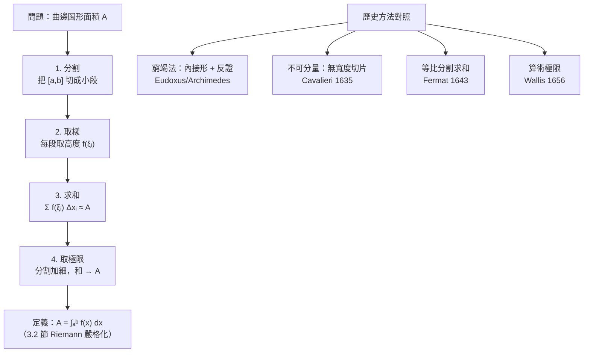

# 3.1 面積問題與窮竭法

## 導言

面積是比切線更古老的問題：尼羅河每年氾濫後重測田地（幾何 geometry 的字源即「測地」），中國《九章算術》以出入相補求田畝，希臘人則面對真正棘手的對手——**曲邊圖形的面積**。直線圍成的面積可以切割拼補，曲線圍成的呢？本節沿著「窮竭法 → 不可分量 → 積分思想」的脈絡，為 3.2 節的 Riemann 積分鋪路。

### 問題的精確化

給定連續函數 $f \ge 0$ 與區間 $[a,b]$，「曲線下方面積」$\displaystyle A = \int_a^b f(x)\,dx$ 直觀明確，但**面積究竟是什麼**？三個層次的回答：

1. **描述層**（古希臘—十七世紀）：面積是「填滿圖形的量」，用已知圖形逼近。
2. **構造層**（Riemann 1854）：面積是「分割—取樣—求和—取極限」的結果。
3. **公理層**（Lebesgue 1902，10.2 節）：面積是滿足可加性、平移不變性等公理的測度。

### 窮竭法：Eudoxus 與 Archimedes 的偉大妥協

**Eudoxus（約前408–355）** 窮竭法的邏輯骨架：

- 欲證圖形 $S$ 的面積為 $A$；
- 用一系列內接圖形 $S_1 \subset S_2 \subset \cdots \subset S$（面積 $A_1 < A_2 < \cdots$）逼近；
- 證明：對任意小量 $\varepsilon$，存在 $n$ 使 $A - A_n < \varepsilon$（「窮竭」公理，本質是**阿基米德性質**：任何正量經足夠多次對半必小於 $\varepsilon$）；
- 於是 $A$ 是數列 $\{A_n\}$ 的「必然歸宿」。

**Archimedes 的傑作：拋物線弓形**。《求拋物線弓形的面積》（約前250年）證明：拋物線弦下的弓形面積等於內接「三尖形」的 $\dfrac{4}{3}$ 倍，且可以無窮分割：

$$
A = T\left(1 + \frac14 + \frac{1}{16} + \frac{1}{64} + \cdots\right) = T \cdot \frac{1}{1 - \frac14} = \frac43 T,
$$

其中 $T$ 是以弦為底、頂點為拋物線頂點的三角形面積。注意 Archimedes 寫的是**窮竭式論證**（部分和小於 $\frac43 T$ 且任意接近），但直觀上他已在操作**幾何級數**——這是 $\sum q^n = \frac{1}{1-q}$ 的第一個嚴肅應用，比級數理論（5.1 節）早了一千八百年。

**Archimedes 給 Eratosthenes 的信**（1906 年在海德堡發現的《方法》重抄本）揭示了他的「發現法」：把圖形切成無窮多薄片，槓桿平衡求和。他區分「發現的啟發法」與「證明的窮竭法」——這份自覺正是他超越時代之處。

### 中國與印度的平行傳統

- **劉徽（263 年注《九章算術》）**：以「割圓術」求圓周率——「割之彌細，所失彌少，割之又割，以至於不可割，則與圓周合體而無所失矣」。這句話是極限思想的完美表述，與窮竭法異曲同工。劉徽以正 192 邊形得 $\pi \approx 3.14$。
- **祖沖之（429–500）**：算得 $\pi \in (3.1415926, 3.1415927)$，並提出密率 $\frac{355}{113}$（精度千年前無人超越）。其方法（兒子祖暅整理為「祖暅原理」：等高處截面積相等則體積相等）正是 Cavalieri 原理的中國先聲，早了約 1100 年。
- **印度 Kerala 學派（14–16 世紀）**：Madhava（約1340–1425）給出 $\sin x$、$\cos x$、$\arctan x$ 的冪級數與 $\pi$ 的級數 $\frac{\pi}{4} = 1 - \frac13 + \frac15 - \cdots$（今日稱 Gregory–Leibniz 級數），其推導基於「無窮多個小弧的貢獻相加」——實質的積分級數思想，比歐洲早兩個世紀，惜未傳入歐洲主流。

### Cavalieri 與不可分量：危險但豐產

**Bonaventura Cavalieri（1598–1647）**，Galileo 的學生，1635 年出版《以連續不可分量新法幾何學》：

> 平面圖形由無窮多條等距、無寬度的「線」（不可分量，indivisibles）組成；立體由無窮多張無厚度的「面」組成。

由此他推出「Cavalieri 原理」：兩圖形若在每個高度處截面（不可分量）等長，則面積相等。**應用實例**：半徑 $r$ 的球體積。半圓盤（半徑 $r$）與倒圓錐在高度 $h$ 處的截面長度：

- 半圓盤在 $h$ 處的弦長：$2\sqrt{r^2 - h^2}$；
- 圓錐在 $h$ 處的直徑：$2h$；
- 互補圖形（半徑 $r$ 圓盤去掉圓錐投影）在 $h$ 處：$2(r - h)$？——標準論證是：半圓與圓錐的截面**平方和**恆為 $r^2$，從而（取正方形截面的立體比較）得 $V_{\text{半球}} = \pi r^3 - \frac13\pi r^3 = \frac23\pi r^3$。

**批評**：無寬度的線如何疊出面積？ Jesuit 數學家 Paul Guldin（1577–1643）嚴厲攻擊 Cavalieri「把幾何變成算術戲法」。Toricelli 的辯護是「哲學式」的：不可分量如「布中的線」，是潛在而非實在的組成。這場論戰持續到十七世紀末，甚至有耶穌會限制教「不可分量」的記錄（歷史學家 A. Alexander 稱之為「數學與神學的衝突」）——因為「實無窮」被視為威脅到上帝的無限唯一性。

### Fermat 的積分：求冪曲線下的面積

**Fermat（約 1643）** 計算 $\displaystyle\int_0^a x^p\,dx$ 的方法，是窮竭法到積分學的直接橋樑。他以**幾何級數分割**（而非等分）區間 $[0, a]$：取 $q < 1$，分割點 $a q^n$。第 $n$ 段 $[aq^{n+1}, aq^n]$ 上的矩形面積近似：

$$
(aq^n - aq^{n+1})\,(aq^n)^p = a^{p+1}(1-q)\,q^{n(p+1)}.
$$

總和是幾何級數：

$$
a^{p+1}(1-q)\sum_{n=0}^{\infty} q^{n(p+1)} = a^{p+1}(1-q)\,\frac{1}{1 - q^{p+1}}.
$$

令 $q \to 1$：$1 - q^{p+1} \approx (p+1)(1-q)$，故極限為

$$
\int_0^a x^p\,dx = \frac{a^{p+1}}{p+1}.
$$

**這就是今日定積分的完整雛形**：分割、取樣、求和、取極限——比 Riemann 早兩百年，且 Fermat 處理的是不等距分割。他解決了除 $p = -1$ 外的所有冪函數；$p = -1$（雙曲線下方面積）由 **Gregory of St. Vincent（1647）** 用等比分割解出，結果 $\int \frac{dx}{x}$ 的行為正是對數——對數由此從「算術表格」升級為「積分對象」，Gregoire de Saint-Vincent 與 de Sarasa 在 1649 年確立「雙曲線下面積 = 對數」。

### Wallis 的算術化與「積分」的誕生

**John Wallis（1616–1703）**，1656 年《無窮算術》（Arithmetica Infinitorum），把 Cavalieri 的幾何不可分量**翻譯成算術**：曲線下的面積 $\int_0^1 x^p dx$ 對應「無窮多個 $0, h^p, (2h)^p, \ldots$ 的和除以項數」：

$$
\int_0^1 x^p\,dx = \lim_{n\to\infty} \frac{0^p + 1^p + \cdots + (n-1)^p}{n^{p+1}} = \frac{1}{p+1}.
$$

他用**歸納與插值**（以分數指數連續化整數結果）得到 $\sqrt{x}$、$x^{3/2}$ 的積分，並推得單位圓面積的表達式，產生著名的 **Wallis 乘積**：

$$
\frac{\pi}{2} = \frac{2}{1}\cdot\frac{2}{3}\cdot\frac{4}{3}\cdot\frac{4}{5}\cdot\frac{6}{5}\cdot\frac{6}{7}\cdots
$$

Wallis 是 Newton 的直接先驅：Newton 自述其早期數學「從 Wallis 的著作開始」。Wallis 首次使用 $\infty$ 記號，並把「積分」從幾何直觀變成**數列極限的算術問題**——Riemann 和的祖先。

### 從面積問題到定積分：四步範式

### 例題：用分割求和重演 Fermat

**例題 3.1.1**：用等距分割與右端點取樣，計算 $\displaystyle\int_0^1 x^2\,dx$ 的近似序列並取極限。

**解**：$n$ 等分 $[0,1]$，第 $i$ 段右端點 $x_i = \frac{i}{n}$。和：

$$
S_n = \sum_{i=1}^{n} \left(\frac{i}{n}\right)^2 \cdot \frac1n = \frac{1}{n^3}\sum_{i=1}^n i^2 = \frac{1}{n^3}\cdot\frac{n(n+1)(2n+1)}{6} = \frac{2n^3 + 3n^2 + n}{6n^3}.
$$

| $n$ | $S_n$ | 與 $\frac13$ 的差 |
|-----|--------|-------------------|
| 10 | $0.385$ | $0.0517$ |
| 100 | $0.33835$ | $0.00502$ |
| 1000 | $0.333834$ | $5.0\times10^{-4}$ |

極限：$S_n \to \dfrac{2}{6} = \dfrac13$，故 $\displaystyle\int_0^1 x^2\,dx = \dfrac13$。

**Archimedes 的對照**：他在《論劈錐曲面體與旋轉橢球體》中用窮竭法證明了同一結果（旋轉拋物面的體積按截面面積 $x^2$ 累積），但論證需一頁反證；Riemann 和寫法三行搞定。**記號與極限語言把兩千年的功力壓縮成一個運算**——這正是微積分的革命性。

### 窮竭法的遺產與局限

**遺產**：
- 「面積 = 逼近量的極限」成為定積分定義的核心直覺；
- 阿基米德性質與反證式論證孕育了實數完備性的概念（1.2 節）；
- 幾何級數求和預演了級數理論（5.1 節）。

**局限**：
- 每個問題都要重新設計內接圖形，沒有通用算法；
- 論證冗長，且嚴格性依賴「窮竭公理」未經系統闡述；
- 無法處理振盪劇烈的函數（這要等到 Riemann 與 Lebesgue）。

**從窮竭到積分的觀念躍遷**：窮竭法是「**逐一證明**已知答案」；積分學是「**統一計算**未知答案」。Kepler 1615 年為酒商算酒桶體積（無窮多圓錐薄片求和）時抱怨：Archimedes 方法太精緻，我要的是**實用的快速演算**——這種「不夠嚴格但夠用」的需求，正是新科學時代（實驗科學、工程）與古希臘純粹幾何傳統的分水嶺。

### 歷史前因後果小結

- **前因**：土地測量、天文曆法、力學中「總量」問題（路程、體積、重心）長期積累。
- **提出**：Eudoxus（前四世紀）窮竭法 → Archimedes（前三世紀）登峰 → 劉徽／祖暅（三—五世紀）平行發展 → Cavalieri（1635）不可分量 → Fermat（1643）等比分割 → Wallis（1656）算術化。
- **解決了什麼**：一批曲邊面積、體積、重心問題獲得（各自的）解答；「無窮多個量之和可以有限」從悖論變成工具。
- **引發新問題**：窮竭法逐案證明的低效、不可分量的邏輯漏洞、「求和」與「微分」的互逆關係（還沒有人看清）——最後這一點由微積分基本定理（第 4 章）一錘定音。

## 與其他章節及領域的關聯

- **3.2 節**：Riemann 和把本節的四步範式鑄成嚴格定義；Fermat 的等比分割是「非均勻分割」的先例（今日稱 tagged partition 的理論）。
- **3.3 節**：積分的線性、可加性、單調性對應「面積」的公理性質。
- **4.2 節**：微積分基本定理揭示「面積累積」與「切線斜率」互逆——Archimedes 未見的統一。
- **7.1 節**：二重積分是「體積問題」的現代化；Fubini 定理允許「切薄片」直觀嚴格化。
- **10.2 節**：Lebesgue 重新定義「面積」，使窮竭法的精神在測度論中獲得終極形式。
- **傅立葉分析**：Fourier 1807/1822 以積分定義三角係數 $a_n = \frac1\pi\int f\cos nx\,dx$，積分由此成為函數空間的內積——信號處理的起點。
- **機率論**：機率 $P(a \le X \le b) = \int_a^b p(x)\,dx$（密度曲線下方面積）是「面積即機率」的現代應用。

## 練習

1. 用 Archimedes 的級數論證說明：拋物線弓形面積 $= \frac43 T$；再用 Riemann 和（$\int_0^1 (1-x^2)dx$ 型）驗證之。
2. 用 $n$ 等分右端點和求 $\displaystyle\int_0^1 x^3\,dx$（需 $\sum i^3 = \left[\frac{n(n+1)}{2}\right]^2$）。
3. 用 Cavalieri 原理解釋：底半徑 $r$、高 $h$ 的圓錐體積為 $\frac13\pi r^2 h$。
4. 仿 Fermat 的等比分割，計算 $\displaystyle\int_0^a x^{1/3}\,dx$（注意 $p+1 = \frac43$ 時級數仍收斂）。
5. 證明 Wallis 乘積的右邊小於 $\frac{\pi}{2}$ 且遞增（提示：$\int_0^\pi \sin^n x\,dx$ 的遞推）。
6. 思考題：劉徽「割之又割……與圓周合體」若要用現代極限語言重述，需要補充哪些（$\varepsilon$、單調有界）？寫出你對「內接正 $6n$ 邊形周長趨於圓周」的嚴格證明綱要。

（本節完）
