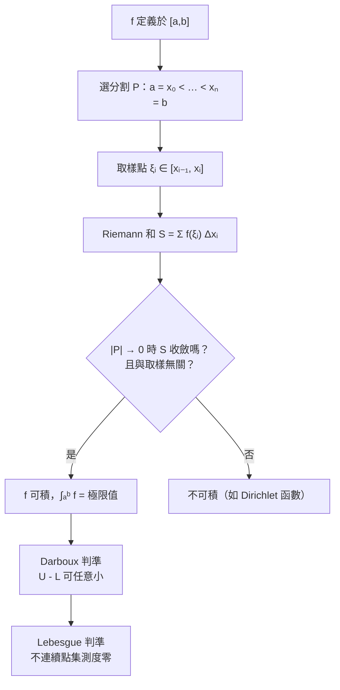

# 3.2 Riemann 和與定積分

## 導言

3.1 節的「分割—取樣—求和—極限」四步範式，在兩千年間始終是逐案技巧。**Bernhard Riemann（1826–1866）** 在 1854 年的哈勒任職論文《論函數的三角級數表示》中，把它鑄成對**一般函數**的嚴格定義。本節介紹 Riemann 積分的定義、可積條件與計算，這是微積分嚴格化工程（10.1 節）的核心成就之一，也是 Lebesgue 積分（10.2 節）出場前的終點線。

### 歷史背景：為什麼 1854 年需要重新定義積分

十九世紀中葉，「積分」的通行定義是 Cauchy 的（1823）：對**連續函數**，取等距分割、左端點和的極限。但 Fourier 級數理論（1807 起）拋出一連串問題：

- 逐項積分何時合法？
- 不連續函數（如 Fourier 級數的和函數）可積嗎？
- 「可積函數」的極限還可積嗎？（Riemann 自己構造了一個可積函數，其不連續點集在「稠密意義」上很亂）

Riemann 的定義把 Cauchy 的「等距 + 連續」放寬為「**任意分割 + 任意取樣**」，使可積函數類大幅擴張。

### Riemann 積分的定義

**定義 3.2.1**：設 $f$ 定義在 $[a,b]$ 上。一個**分割** $P$ 是點列 $a = x_0 < x_1 < \cdots < x_n = b$ ；記 $\Delta x_i = x_i - x_{i-1}$ ，**範數** $|P| = \max_i \Delta x_i$ 。在每段上取**樣點** $\xi_i \in [x_{i-1}, x_i]$ ，形成 Riemann 和

$$
S(f, P) = \sum_{i=1}^{n} f(\xi_i)\,\Delta x_i.
$$

若存在實數 $I$ 使得：對任意 $\varepsilon > 0$ ，存在 $\delta > 0$ ，凡 $|P| < \delta$ 時**不論樣點如何選取**皆有 $|S(f,P) - I| < \varepsilon$ ，則稱 $f$ 在 $[a,b]$ 上 **Riemann 可積**， $I$ 為定積分：

$$
I = \int_a^b f(x)\,dx.
$$

三個關鍵設計：

1. **任意取樣**：極限值不得依賴於樣點的取法——這排除了「挑好樣點作弊」。
2. **任意分割**：只用等距分割不夠（有函數等距可積卻非 Riemann 可積）。
3. **定義依賴分割範數**：與「網格加細」（refinement）的定義在 Riemann 情形等價（Darboux 理論），後者在證明上更方便。

### Darboux 上和與下和：可積性的判準

**Jean-Gaston Darboux（1842–1917）** 給出等價而更利於證明的表述。對分割 $P$ ，令

$$
M_i = \sup_{[x_{i-1},x_i]} f, \qquad m_i = \inf_{[x_{i-1},x_i]} f,
$$

定義**上和** $U(f,P) = \sum M_i \Delta x_i$ 、**下和** $L(f,P) = \sum m_i \Delta x_i$ 。則 $L \le S \le U$ 對一切取樣成立，且**加細分割時上和不增、下和不減**。

**定理 3.2.2（Riemann 可積判準）**： $f$ 可積 $\iff$ 對任意 $\varepsilon > 0$ 存在分割 $P$ 使 $U(f,P) - L(f,P) < \varepsilon$ 。

幾何解讀： $U - L$ 是把每段上「函數振幅 $\omega_i = M_i - m_i$ 」塗在寬 $\Delta x_i$ 的矩形裡的總面積。可積 $\iff$ **總振幅面積可以任意小**。這立刻給出：

- 連續函數在 $[a,b]$ 可積（一致連續性 1.3 節使 $\omega_i$ 一致地小）；
- **單調函數**可積（振幅總和 $\le |f(b)-f(a)|\cdot|P|$ ）；
- **有限個不連續點**的函數可積（不連續點附近的小區間總寬可控）。

### 可積函數類的精確刻畫（Lebesgue 判準）

**Lebesgue（1902）判準**： $f$ Riemann 可積 $\iff$ $f$ 有界且**不連續點集的測度為零**。

「測度為零」的意思：可以被總長任意小的區間族覆蓋。例如有限集、 $\mathbb{Q} \cap [0,1]$ （可數集）測度皆為零；而 Dirichlet 函數（有理處 $1$ 、無理處 $0$ ）的**每個**小区間振幅都是 $1$ ， $U = L$ 的條件永遠不成立——**處處不可積**。這個判準揭示了 Riemann 積分的邊界：它能容忍「稀疏的壞點」，不能容忍「稠密的壞點」。進一步的病態（不連續點集測度不為零但很「薄」的構造）最終催生了 Lebesgue 積分（10.2 節）。

### 定積分的基本性質

| 性質 | 敘述 | 來源 |
|------|------|------|
| 線性 | $\int(\alpha f + \beta g) = \alpha\int f + \beta\int g$ | 和的極限 |
| 區間可加 | $\int_a^b + \int_b^c = \int_a^c$ （定向） | 分割拼接 |
| 單調 | $f \le g \Rightarrow \int f \le \int g$ | 樣點不等式 |
| 絕對值界 | $\left|\int f\right| \le \int |f|$ | 三角不等式 |
| 積分中值定理 | $\int_a^b f = f(\xi)(b-a)$ ， $f$ 連續 | MVT + IVT |

**積分中值定理的幾何意義**：連續函數曲線下的面積，恰等於某個「平均高度」 $f(\xi)$ 的矩形面積。 $\bar f = \dfrac{1}{b-a}\int_a^b f$ 稱為 $f$ 的**平均值**——物理中的平均速度、均方根電壓、統計中的期望值（7.3、10.3 節）都是這個概念的化身。

### 例題一：用 Riemann 和算一個積分

**例題 3.2.3**：用 Riemann 和證明 $\displaystyle\int_0^b x\,dx = \frac{b^2}{2}$ 。

**解**： $n$ 等分，右端點取樣：

$$
S_n = \sum_{i=1}^{n} \frac{ib}{n}\cdot\frac{b}{n} = \frac{b^2}{n^2}\sum_{i=1}^n i = \frac{b^2}{n^2}\cdot\frac{n(n+1)}{2} = \frac{b^2}{2}\left(1 + \frac1n\right) \xrightarrow{n\to\infty} \frac{b^2}{2}. \qquad \blacksquare
$$

當然，有了基本定理（4.2 節），此積分一行得出： $\int_0^b x\,dx = \frac{x^2}{2}\Big|_0^b$ 。但**在 1854 年之前的兩千年裡**，上面這個求和是唯一手段——基本定理的價值正在於把這類計算整體報銷。

### 例題二：不可積函數的驗證

**例題 3.2.4**：證明 Dirichlet 函數 $D(x) = \begin{cases}1, & x \in \mathbb{Q},\\ 0, & x \notin \mathbb{Q}\end{cases}$ 在 $[0,1]$ 上不可積。

**解**：任何小區間都同時含理數與無理數（兩者皆稠密），故每段上 $M_i = 1$ 、 $m_i = 0$ 。於是對任何分割： $U(f,P) = \sum 1\cdot\Delta x_i = 1$ ， $L(f,P) = 0$ 。 $U - L = 1$ 不可能小於 $\varepsilon < 1$ ，不可積。 $\blacksquare$

**對照**：Thomae 函數（popcorn 函數）

$$
t(x) = \begin{cases} \frac1q, & x = \frac pq\ \text{（既約）},\\ 0, & x \text{ 無理},\end{cases}
$$

**處處不連續於有理點、連續於無理點**，卻 Riemann 可積（不連續點集 $\mathbb{Q}\cap[0,1]$ 測度為零，且 $\int_0^1 t = 0$ ）。它完美展示「稠密壞點 vs. 測度零壞點」的分界。

### Riemann 和的計算圖景

**取樣策略對照表**（數值積分的雛形）：

| 取樣 | 名稱 | 誤差階（光滑 $f$ ） |
|------|------|--------------------|
| 左/右端點 | 矩形法 | $O(|P|)$ |
| 中點 | 中點法 | $O(|P|^2)$ |
| 梯形（兩端平均） | 梯形法 | $O(|P|^2)$ |
| Simpson（三點拋物線） | Simpson 法 | $O(|P|^4)$ |

**例**：以 $n = 4$ 等分計算 $\int_0^1 \frac{1}{1+x^2} dx = \frac{\pi}{4}$ （真值 $0.785398$ ）：

- 左端點法： $\frac14\left(1 + \frac{1}{1+0.25} + \frac{1}{1+0.25} + \frac{1}{1+2.25}\right)$ ？——具體： $\frac14(1 + 0.8 + 0.5 + 0.30769) \approx 0.65192$ （誤差大）；
- 中點法： $\frac14\left(\frac{1}{1+0.125^2}+\frac{1}{1+0.375^2}+\frac{1}{1+0.625^2}+\frac{1}{1+0.875^2}\right) \approx 0.78670$ ；
- Simpson 法： $\frac{1}{12}\left(1 + 4\cdot\frac{1}{1+0.0625} + 2\cdot\frac{1}{1+0.25} + 4\cdot\frac{1}{1+0.5625} + 0.5\right) \approx 0.78540$ 。

可見高階取樣大幅提升精度——**Riemann 和的具體取樣方式決定了數值積分的收斂階**，這是計算數學「數值積分（quadrature）」領域的源頭（Gauss 求積、Monte Carlo 積分皆是後裔）。

### 定積分定義的推廣譜系

| 推廣 | 關鍵變動 | 用途 |
|------|----------|------|
| 廣義積分（反常積分） | 區間無窮或 $f$ 無界，用極限定義 | $\int_0^\infty e^{-x}dx = 1$ ；機率分布 |
| Riemann–Stieltjes 積分 | $\sum f\,\Delta g$ （對一般增函數 $g$ ） | 機率論（ $dg$ 為分布）、物理譜分解 |
| Lebesgue 積分 | 按「值域分割」測度求和 | 測度論、 $L^p$ 空間、傅立葉分析基礎 |
| Itō 積分 | 對隨機過程 $W_t$ 積分 | 金融數學、隨機微分方程 |
| 線積分／面積分 | 積分域為曲線／曲面 | 第 8、9 章 |

**廣義積分例**： $\displaystyle\int_1^\infty \frac{dx}{x^p}$ 當 $p > 1$ 收斂（值 $\frac{1}{p-1}$ ）、 $p \le 1$ 發散； $\displaystyle\int_0^1 \frac{dx}{x^p}$ 當 $p < 1$ 收斂。這種「臨界指數」現象在機率分布（重尾）、級數（ $p$ -級數，5.1 節）、維度分析（重整化）中反覆出現——**無窮與奇點之間的邊界由冪律守衛**。

### 歷史前因後果

- **前因**：Cauchy 1823 的連續函數積分論；Fourier 理論對可積範圍的挑戰；Dirichlet 1829 對病態函數的構造。
- **提出**：Riemann 1854（1868 年正式發表《論用三角級數表示函數》），同文中他還創立了今日 Riemann 可積性理論並提出「函數的傅立葉級數收斂點集」問題。
- **解決了什麼**：積分第一次有了對一般有界函數的嚴格定義；可積性成為可研究的數學問題；「積分 = 面積」的直觀獲得邏輯基礎。
- **引發新問題**：Riemann 可積函數的極限不一定可積（不完備！）；逐項積分條件繁瑣；Hankel（1870s）等的研究暴露理論的笨拙——最終由 Lebesgue 1902 年的測度論積分全面接班（10.2 節）。

### 為什麼仍要學 Riemann 積分

既然 Lebesgue 積分更強，為何教科書（包括本書）仍以 Riemann 為主？

1. **教學可及性**：定義只需分割與極限，不需測度論前置。
2. **涵蓋日常函數**：初等函數、分段函數、有限跳躍——工程與物理幾乎所有用例。
3. **計算橋樑**：基本定理 + 原函數的計算體系在 Riemann 框架內完整。
4. **觀念階梯**：上和下和的振幅分析是理解 Lebesgue「值域分割」思想的最佳準備。

## 與其他章節及領域的關聯

- **4.2 節**：微積分基本定理把「Riemann 和的極限」與「原函數差值」接通，計算從此起飛。
- **7.1 節**：二重、三重積分是 Riemann 和在高維的重演；Fubini 定理對應「先切一個方向」。
- **10.2 節**：Lebesgue 積分以「值域分割」取代「定義域分割」，解決 Riemann 積分的不完備性。
- **8.2、9.1 節**：線積分 $\int \mathbf{F}\cdot d\mathbf{r}$ 與曲面積分是 Riemann 和在曲線、曲面參數化下的推廣。
- **數值分析**：Simpson、Gauss 求積、自適應積分、Monte Carlo——工程上「算不出原函數」時的必備技術。
- **統計與機器學習**：期望 $E[X] = \int x\,p(x)\,dx$ ；神經網路損失中的積分近似（mini-batch 是「取樣的 Riemann 和」）。
- **傅立葉分析**：Fourier 係數的積分定義要求可積性；Lebesgue 可積（ $L^1$ 、 $L^2$ ）使整個理論完備。

## 練習

1. 用 $n$ 等分、右端點取樣求 $\displaystyle\int_0^1 e^x\,dx$ （用 $\sum q^i$ 公式），並驗證極限為 $e-1$ 。
2. 證明 $f(x) = \begin{cases} 0, & x = \frac1n\ (n\in\mathbb{N}^+),\\ 1, & \text{其他}\end{cases}$ 在 $[0,1]$ 可積並求積分值。
3. 證明單調遞增函數在 $[a,b]$ 上可積（估計 $U - L \le (f(b)-f(a))|P|$ ）。
4. 用中點法與 Simpson 法以 $n=4$ 計算 $\int_0^1 \sin x\,dx$ ，與真值 $1-\cos 1$ 比較誤差。
5. 判斷 $\displaystyle\int_1^\infty \frac{dx}{x\sqrt{x}}$ 與 $\displaystyle\int_0^1 \frac{dx}{\sqrt{x}}$ 的斂散性，收斂者求值。
6. 思考題：Riemann 可積函數列的逐點極限何時可積？構造一列可積函數其極限為 Dirichlet 函數（提示：用有限個有理點上的「刺」），說明這一現象如何指向新的積分理論。

（本節完）
