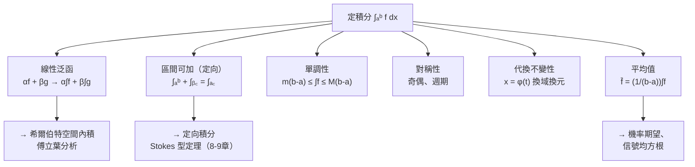

# 3.3 積分的性質

## 導言

積分不只是「算面積的機器」，它是一個**線性泛函**：把函數映成數，且保持加法與數乘。本節系統整理定積分的運算性質、對稱性技巧與估計不等式。這些性質看似平凡，卻是所有後續理論（基本定理、級數逐項積分、多重積分的 Fubini 定理、Fourier 分析）的操作基礎。**Leibniz 記號 $\int_a^b f\,dx$ 中 $\int$ 是拉長的 S（summa，總和）**——積分性質多半可以直接從「總和」的代數直觀讀出。

### 積分作為線性泛函

設 $f, g$ 在 $[a,b]$ 可積， $\alpha, \beta \in \mathbb{R}$ ：

$$
\int_a^b \big(\alpha f(x) + \beta g(x)\big)\,dx = \alpha\int_a^b f\,dx + \beta\int_a^b g\,dx.
$$

**證明**（Riemann 和一行完成）：和的極限保持線性：

$$
\sum (\alpha f + \beta g)(\xi_i)\Delta x_i = \alpha \sum f(\xi_i)\Delta x_i + \beta\sum g(\xi_i)\Delta x_i.
$$

**區間可加性（定向積分約定）**：定義 $\displaystyle\int_a^a f = 0$ 且 $\displaystyle\int_b^a f = -\int_a^b f$ ，則對任意排列的 $a, b, c$ ：

$$
\int_a^b f + \int_b^c f = \int_a^c f.
$$

「反轉區間變號」不是技巧而是**定向**（orientation）概念：積分承載了從 $a$ 到 $b$ 的方向資訊。這個觀念在 8.2 節線積分（路徑反向變號）、9.1 節曲面積分（法向反轉變號）中是核心——**定向積分是斯托克斯型定理的統一語言**。

### 單調性與估計工具箱

若 $m \le f(x) \le M$ 於 $[a,b]$ ，則

$$
m(b-a) \le \int_a^b f\,dx \le M(b-a).
$$

更精細的工具：

| 不等式 | 敘述 | 應用 |
|--------|------|------|
| 三角不等式 | $\left|\int f\right| \le \int|f|$ | 誤差估計 |
| Schwarz（Cauchy–Bunyakovsky） | $\left(\int fg\right)^2 \le \int f^2 \int g^2$ | $L^2$ 內積、傅立葉係數界 |
| Chebyshev 和不等式 | 同向單調的 $f,g$ ： $\frac1{b-a}\int fg \ge \bar f \bar g$ | 統計相關性 |
| 積分中值定理 | $f$ 連續： $\int_a^b f = f(\xi)(b-a)$ | 平均值的存在性 |

**Schwarz 不等式的意義深遠**：它把積分變成**內積** $\langle f, g\rangle = \int_a^b fg\,dx$ ，於是「可積函數空間」成為（準）希爾伯特空間——幾何（夾角、投影、正交）進入了分析。傅立葉級數（10.2、10.3 節）就是「函數在三角函數正交基上的投影」，Schwarz 不等式保證投影係數 $\left|\frac{\langle f,\phi_n\rangle}{\|\phi_n\|^2}\right| \le \frac{\|f\|}{\|\phi_n\|}$ 收斂合理。

### 對稱性：奇偶函數與週期函數

**定理 3.3.1**： $f$ 在對稱區間 $[-a, a]$ 可積：

- $f$ 奇函數（ $f(-x) = -f(x)$ ）： $\displaystyle\int_{-a}^a f = 0$ ；
- $f$ 偶函數（ $f(-x) = f(x)$ ）： $\displaystyle\int_{-a}^a f = 2\int_0^a f$ 。

**證明**：區間對半，在負半段代換 $x = -u$ ，用定向積分把方向「翻正」，符號由 $f(-u) = \pm f(u)$ 吸收。

**週期函數**： $f$ 週期 $T$ ，則 $\displaystyle\int_a^{a+T} f\,dx$ 與 $a$ 無關——積分「感覺不到」起點。這是 Fourier 理論（只看整週期積分）與交流電平均功率計算的基礎。

### 例題一：對稱性計算

**例題 3.3.2**：計算 $\displaystyle\int_{-\pi/2}^{\pi/2} x^3\cos^2 x\,dx$ 。

**解**： $x^3$ 奇、 $\cos^2 x$ 偶，乘積為奇函數；對稱區間上積分為 $0$ 。**一行解決**——逐項積分 $x^3\cos^2 x = \frac{x^3}{2}(1 + \cos 2x)$ 需要繁重分部積分，對稱性把它整體報銷。這說明**積分技巧的第一步永遠是檢查對稱性**。

### 例題二：代換公式的性質面向

**定理 3.3.3（換元積分）**： $\phi$ 在 $[\alpha,\beta]$ 可微、嚴格單調， $\phi(\alpha) = a$ 、 $\phi(\beta) = b$ ， $f$ 連續，則

$$
\int_a^b f(x)\,dx = \int_\alpha^\beta f(\phi(t))\,\phi'(t)\,dt.
$$

**例題 3.3.4**：計算 $\displaystyle\int_0^1 \frac{dx}{1 + \sqrt x}$ 。

**解**：令 $t = \sqrt x$ ， $x = t^2$ ， $dx = 2t\,dt$ ； $x: 0 \to 1$ 對應 $t: 0 \to 1$ ：

$$
\int_0^1 \frac{2t}{1+t}\,dt = 2\int_0^1 \left(1 - \frac{1}{1+t}\right)dt = 2\left[t - \ln(1+t)\right]_0^1 = 2 - 2\ln 2.
$$

**注意定積分換元與不定積分換元的差別**：定積分換元**連積分限一起換**，無需回代。歷史上，代換法的系統化歸功於 Leibniz 記號（ $dx = \phi'(t)dt$ 形式分母消去）與 Euler、Lagrange 的嚴格化；其最終基礎是基本定理（4.2 節）。

### 積分的結構視角

### 積分不等式的實戰：估計藝術

很多積分**算不出**原函數（如 $e^{-x^2}$ 、 $\frac{\sin x}{x}$ ），但不等式仍能給出有用的界。

**例題 3.3.5**：證明 $0 \le \displaystyle\int_0^1 e^{-x^2}dx \le \int_0^1 e^{-x}\,dx$ ... 更細地證明 $\displaystyle\int_0^1 e^{-x^2} dx$ 介於 $\frac{11}{18}$ 與 $\frac{2}{3}$ 之間。

**解**：在 $[0,1]$ 上 $1 - x^2 \le e^{-x^2} \le 1$ （利用 $e^{-u} \ge 1 - u$ ）。但上界 $\int_0^1 1 = 1$ 太粗。用線性近似 $e^{-u} \le 1 - u + \frac{u^2}{2}$ （ $u \ge 0$ ，由 Taylor 餘項）：

$$
\int_0^1 e^{-x^2}dx \le \int_0^1 \left(1 - x^2 + \frac{x^4}{2}\right)dx = 1 - \frac13 + \frac{1}{10} = \frac{23}{30}.
$$

再用 $e^{-x^2} \ge 1 - x^2$ ： $\int_0^1 e^{-x^2} \ge \frac23$ 。故 $\dfrac23 \le \displaystyle\int_0^1 e^{-x^2}dx \le \dfrac{23}{30}$ （真值 $\approx 0.7468$ ）。

**哲學**：「估計」是分析學的日常主食。級數收斂比較判別法（5.1 節）、Picard 迭代的壓縮估計、PDE 的能量估計，本質都是積分不等式。**Cauchy–Schwarz 的應用示例**：證明 $\left(\int_0^1 \sqrt{1+x^2}\,dx\right)^2 \le \int_0^1 (1+x^2)dx \cdot \int_0^1 1\,dx = \frac43$ ，故積分 $\le \frac{2}{\sqrt3} \approx 1.1547$ （真值 $\approx 1.1478$ ）。

### 積分中值定理與廣義化

**第一中值定理**： $f$ 連續、 $g$ 可積且不變號，則存在 $\xi \in [a,b]$ ：

$$
\int_a^b f(x)g(x)\,dx = f(\xi)\int_a^b g\,dx.
$$

（ $g \equiv 1$ 時即 3.2 節形式。）證明用 $m\int g \le \int fg \le M \int g$ 與 IVT。**加權平均**的解讀： $g$ 是權重， $f(\xi)$ 是加權平均高度。機率論中 $E[X] = \int x\,d\mu$ 、物理中的質心（7.3 節）都是加權平均。

**第二中值定理**（Bonnet，Weierstrass 精煉）： $f$ 單調、 $g$ 可積，則存在 $\xi$ 使 $\int_a^b fg = f(a)\int_a^\xi g + f(b)\int_\xi^b g$ 。它是 Dirichlet 判別法（5.1 節級數、廣義積分的 Abel/Dirichlet 審斂）的分析引擎。

### 定積分定義的延伸性質

**Leibniz 積分法則（變限求導）**：若 $f$ 連續、 $\alpha(x), \beta(x)$ 可微，則

$$
\frac{d}{dx}\int_{\alpha(x)}^{\beta(x)} f(t)\,dt = f(\beta(x))\beta'(x) - f(\alpha(x))\alpha'(x).
$$

這是基本定理（4.2 節 FTC1）+ 鏈鎖律的直接推論，在微分方程（Green 函數對參數的依賴）、流體力學（控制體積通量對時間求導的 Reynolds 輸運定理）中是標配工具。

**Wallis 公式**（由積分遞推 $I_n = \int_0^{\pi/2}\sin^n x\,dx = \frac{n-1}{n}I_{n-2}$ ）：

$$
\lim_{n\to\infty} \frac{\int_0^{\pi/2}\sin^n x\,dx}{\int_0^{\pi/2}\sin^{n+1}x\,dx} = 1
\implies
\lim_{n\to\infty}\frac{2\cdot2\cdot4\cdot4\cdots(2n)(2n)}{1\cdot3\cdot3\cdot5\cdots(2n-1)(2n+1)} = \frac{\pi}{2}.
$$

Wallis 1656 年以純算術插值猜得此式；積分證明是這一猜測的分析學確認，也是 $\Gamma$ 函數（ $\Gamma(\frac12) = \sqrt\pi$ ）與 Stirling 公式的入口。

### 歷史前因後果

- **前因**：Newton 與 Leibniz 時代，積分性質以「面積直觀」被自由使用；Euler 大量運用線性、代換、對稱性於其分析巨著。
- **提出**：Cauchy 1823 年首先以嚴格方式定義積分並證明其基本性質（線性、可加、中值定理）；Riemann 1854 擴大函數類；Darboux 1875 完善上和下和理論。
- **解決了什麼**：積分的操作規則從「幾何常識」升級為「可證定理」；對稱性與估計技巧獲得邏輯保證。
- **引發新問題**：線性泛函的觀點（把積分視為函數空間上的「測量」）開啟了泛函分析（Hilbert 空間、 $L^p$ 空間）；「積分對什麼樣的測度有意義」引向 Radon–Nikodym 理論與現代機率論（Kolmogorov 1933 以測度論重構機率）。

## 與其他章節及領域的關聯

- **4.2 節**：線性與可加性是 FTC 證明的第一磚；變限積分求導直接產生 FTC1。
- **5.1 節**：積分判別法用單調性把級數與積分互譯；Schwarz 不等式是收斂性證明的常客。
- **7.1 節**：Fubini 定理是「區間可加性」的二維化；對稱性在重積分中同樣先行檢查。
- **8.2 節**：線積分的定向性（路徑反向變號）繼承自 $\int_b^a = -\int_a^b$ ；保守場環路積分為零是可加性的推論。
- **10.2 節**：積分作為內積 $\langle f,g\rangle$ 使 $L^2$ 成為希爾伯特空間，傅立葉級數的 Parseval 定理是「畢氏定理」的無窮維版本。
- **物理**：質心 $\bar x = \frac{\int x\,dm}{\int dm}$ 、均方根 $\sqrt{\frac{1}{T}\int_0^T f^2}$ 、Poynting 向量平均功率——加權平均與對稱性無處不在。
- **機器學習**：正則化項的期望 $\int \ell(f(x), y)\,p(x)\,dx$ 、重要性採樣（以測度變換視角看代換公式）。

## 練習

1. 利用對稱性計算 $\displaystyle\int_{-\pi}^{\pi} x^5\sin^4 x\,dx$ （不真正積分）。
2. 證明：若 $f$ 週期 $T$ ，則 $\displaystyle\int_a^{a+T} f\,dx = \int_0^T f\,dx$ 對一切 $a$ 成立。
3. 用代換 $x = a\tan\theta$ 計算 $\displaystyle\int_0^a \frac{dx}{a^2 + x^2}$ （ $a>0$ ），並解釋結果與 $\arctan$ 導數表的一致性。
4. 用 $e^{-u} \le 1 - u + \frac{u^2}{2} - \frac{u^3}{6} + \frac{u^4}{24}$ （ $u\ge0$ ）改進 $\int_0^1 e^{-x^2}dx$ 的上界。
5. 證明 Schwarz 不等式的積分形式（提示：對任意 $\lambda$ ， $\int(f+\lambda g)^2 \ge 0$ ，判別式論證）。
6. 思考題：第一中值定理要求 $g$ 不變號。構造反例說明 $g$ 變號時「 $f(\xi)\int g$ 」型等式可失效，並思考 $f$ 常數時為何又總是成立。

（本節完）
