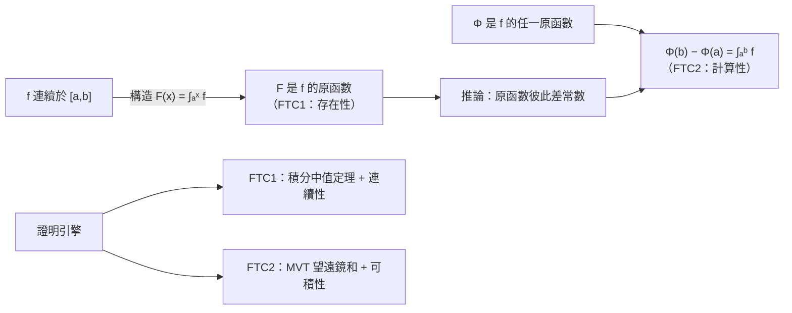

# 4.2 基本定理的兩個形式

## 導言

微積分基本定理（Fundamental Theorem of Calculus, FTC）是全書的樞紐：它把「切線」（導數）與「面積」（積分）兩條兩千年的問題線焊接成一體。本節給出它的兩個形式的嚴格證明，並討論條件、推論與高維推廣的方向。歷史見 4.1 節；此處完成 Cauchy 1823 年式的水準。

### 形式一：變限積分的導數（FTC1）

**定理 4.2.1（FTC1）**：設 $f$ 在 $[a,b]$ 上連續，定義

$$
F(x) = \int_a^x f(t)\,dt, \qquad x \in [a,b].
$$

則 $F$ 在 $[a,b]$ 上（內部可導、端點單側可導）處處可導，且

$$
F'(x) = f(x).
$$

**證明**：取 $x, x + h \in [a,b]$（$h \neq 0$）。由區間可加性（3.3 節）：

$$
F(x+h) - F(x) = \int_a^{x+h} f - \int_a^x f = \int_x^{x+h} f(t)\,dt.
$$

由積分中值定理（$f$ 連續），存在 $\xi_h$ 介於 $x$ 與 $x+h$ 之間使

$$
F(x+h) - F(x) = f(\xi_h)\,h.
$$

當 $h \to 0$ 時 $\xi_h \to x$（被夾在 $x$ 與 $x+h$ 之間），由 $f$ 的連續性 $f(\xi_h) \to f(x)$。故

$$
F'(x) = \lim_{h\to0} \frac{F(x+h)-F(x)}{h} = \lim_{h\to0} f(\xi_h) = f(x). \qquad \blacksquare
$$

**三個要點**：

1. **條件的分工**：「連續」用在兩處——中值定理的存在性與 $f(\xi_h) \to f(x)$。若 $f$ 只有可積而不連續，$F$ 仍連續，且在 $f$ 的連續點處 $F' = f$（Lebesgue 之後的精煉；跳躍點處 $F$ 出現角點）。
2. **存在性側產物**：FTC1 同時證明了**每個連續函數都有原函數**——原函數的存在性不是顯然的（可導函數的導數未必有原函數，如 $\sin\frac{1}{x^2}$ 的導數），而是由積分**構造**出來的。
3. **與 Darboux 性質呼應**（2.1 節）：原函數的導數（=被積函數）自然滿足中間值性質。

### 形式二：原函數差值公式（FTC2）

**定理 4.2.2（FTC2 / Newton–Leibniz 公式）**：設 $f$ 在 $[a,b]$ 上可積，$\Phi$ 在 $[a,b]$ 上連續、在 $(a,b)$ 內可導且 $\Phi'(x) = f(x)$。則

$$
\int_a^b f(x)\,dx = \Phi(b) - \Phi(a).
$$

**證明**：對任意分割 $P: a = x_0 < x_1 < \cdots < x_n = b$， telescope（望遠鏡求和）：

$$
\Phi(b) - \Phi(a) = \sum_{i=1}^n \big[\Phi(x_i) - \Phi(x_{i-1})\big] = \sum_{i=1}^n f(\xi_i)\,\Delta x_i,
$$

其中 $\xi_i \in (x_{i-1}, x_i)$ 由**MVT（2.3 節）**提供。右端是一個 Riemann 和。令 $|P| \to 0$，由 $f$ 可積，Riemann 和收斂於 $\int_a^b f$；左端是常數。故等式成立。 $\blacksquare$

**條件的細察**：$\Phi$ 只需「連續 + 內部導數 = 可積的 $f$」，端點導數不必存在。**致命陷阱**：$\Phi'$ 存在但**不可積**（有界性不保）時公式可失效——Volterra 函數（1881，可導、導數有界但不 Riemann 可積）是經典反例，這也是 Riemann 理論的內在缺陷（10.2 節 Lebesgue 與 Denjoy–Perron 積分的動機之一）。

### 兩個形式的邏輯關係

**核心推論：原函數的唯一性（差一常數）**。若 $\Phi_1' = \Phi_2' = f$，則 $(\Phi_1 - \Phi_2)' = 0$，由 MVT 推論（2.3 節：導數恆零則常數），$\Phi_1 - \Phi_2 = C$。因此「不定積分」寫作 $\int f\,dx = \Phi(x) + C$ 是有嚴格基礎的。

### 例題一：FTC1 的直接應用

**例題 4.2.3**：求 $g(x) = \displaystyle\int_0^{x^2} \sin(t^3)\,dt$ 的導數。

**解**：設 $u = x^2$，由 Leibniz 變限法則（3.3 節）與鏈鎖律：

$$
g'(x) = \sin\big((x^2)^3\big)\cdot 2x = 2x\sin(x^6).
$$

**注意**：$\sin(t^3)$ 沒有初等原函數——**FTC1 允許我們對「積不出來」的積分求導**。這是「定義為積分的函數」的標準研究法：誤差函數 $\operatorname{erf}(x) = \frac{2}{\sqrt\pi}\int_0^x e^{-t^2}dt$、正弦積分、橢圓積分等特殊函數皆由此定義，其性質（單調、漸近）全由對被積函數的分析讀出。

### 例題二：FTC2 的計算威力

**例題 4.2.4**：計算 $\displaystyle\int_0^\pi \sin x\,dx$ 與曲線 $y = \sin x$ 一拱下的面積。

**解**：$\Phi(x) = -\cos x$ 滿足 $\Phi' = \sin$。

$$
\int_0^\pi \sin x\,dx = [-\cos x]_0^\pi = (-\cos\pi) - (-\cos 0) = 1 + 1 = 2.
$$

**對照 3.1 節**：在 1650 年前，這個積分需要 Cavalieri 式的不可分量論證（他確實算出來了，但論證飽受批評）；有了 FTC2，它是一次代入。**「面積 = 原函數差值」這一步，把幾何測量問題轉化為代數運算**——這是微積分革命的核心。

**例題 4.2.5（帶絕對值的應用）**：求 $y = x^2 - 4x + 3$ 與 $x$ 軸在 $[0,3]$ 之間圍成的面積。

**解**：先求零點 $x = 1, 3$。在 $[0,1]$ 上 $f \ge 0$，在 $[1,3]$ 上 $f \le 0$：

$$
A = \int_0^1 f\,dx + \left|\int_1^3 f\,dx\right| = \frac{4}{3} + \frac{4}{3} = \frac83.
$$

（若不加絕對值，$\int_0^3 f\,dx = 0$——**「面積」要求 $\int |f|$，「淨變化」才是 $\int f$**。這一區分在物理（位移 vs. 路程）、統計（誤差絕對值 vs. 帶符號誤差）中至關重要。）

### FTC 的條件譜系與現代精煉

| 假設組合 | 結論 | 備註 |
|----------|------|------|
| $f$ 連續 | FTC1、FTC2 完整成立 | 教科書標準情形 |
| $f$ 可積、$f$ 連續於 $x$ | $F' (x) = f(x)$ 在該點成立 | 跳躍點處 $F$ 有角 |
| $\Phi' = f$ 可積 | FTC2 成立 | 本節定理 |
| $\Phi' = f$ 存在但不可積 | FTC2 失效 | Volterra 反例 |
| $f$ Lebesgue 可積 | $F$ 絕對連續時 $F' = f$ a.e.，FTC2 成立 $\iff$ $F$ 絕對連續 | 10.2 節 |
| $f$ 是分布的導數 | 廣義 FTC | Schwartz 分布論 |

**「絕對連續」**是二十世紀給 FTC 找到的精確條件：$F$ 絕對連續 $\iff$ $F(x) = F(a) + \int_a^x F'$（Lebesgue 積分）。Cantor 函數（魔鬼階梯：連續、遞增、導數幾乎處處為零，卻從 0 爬到 1）說明：**僅「連續 + 導數 a.e. 為零」不足以支撐 FTC**——它是 FTC2 的反例（$\int_0^1 0\,dx = 0 \neq 1$）。這些精煉構成實變函數論的核心章節。

### FTC 的高維回聲：廣義 Stokes 定理

FTC 的真正身份是**廣義 Stokes 定理**的一維情形：

$$
\int_{\partial D} \omega = \int_D d\omega,
$$

即「區域邊界上的積分 = 區域內部微分後的積分」。對照表：

| 維度 | 定理 | 形式 |
|------|------|------|
| 一維 | FTC2 | $\int_a^b \Phi'(x)\,dx = \Phi(b) - \Phi(a)$ |
| 平面 | Green 定理（8.3 節） | $\oint_{\partial D} P\,dx + Q\,dy = \iint_D \left(\frac{\partial Q}{\partial x} - \frac{\partial P}{\partial y}\right)dA$ |
| 空間 | Gauss（9.2）、Stokes（9.3） | 通量與環量的體／面積分化 |
| 流形 | 廣義 Stokes | $\int_{\partial M} \omega = \int_M d\omega$ |

**統一哲學**：「內部的微分資訊，由邊界的積分測得」——這是所有守恆律（連續性方程、Maxwell 方程）、散度定理在物理中的數學骨架。讀者學完第 9 章後應回顧本節，體會 FTC 是「一維的 Green 定理」。

### 歷史前因後果

- **前因**：Torricelli、Gregory、Barrow 的互逆性直觀（4.1 節表）；Newton 的流量／流數互逆；Leibniz 的和差互逆。
- **嚴格化**：Cauchy 1823 年《無窮小分析概要》首次以連續性假設嚴格證明兩個形式；Dirichlet、Riemann 擴大可積類；Lebesgue 1902–1904 給出以「絕對連續」表述的終極形式。
- **解決了什麼**：積分計算從「逐案求和」變成「找原函數」；原函數存在性獲得構造性證明；變化與累積的對偶成為定量科學的公理級工具。
- **引發新問題**：哪些函數有原函數？（答：不是所有可積函數都有 Riemann 意義下的好原函數）哪些 $F$ 滿足 $F(x) - F(a) = \int F'$？（絕對連續性）——這些問題直接催生實變函數論（10.2 節）。

## 與其他章節及領域的關聯

- **4.3 節**：FTC2 是積分技巧（分部、代換）的合法性來源。
- **8.2 節**：保守場位函數的存在性證明「線積分只依賴端點」，其證明結構正是 FTC2 的高維版。
- **9.2 節**：Gauss 定理中「散度積分 = 邊界通量」是 FTC 的三維變形；一維情形 $f'(x)$ 的「散度」就是斜率。
- **10.2 節**：絕對連續性、Cantor 函數反例、Lebesgue 版 FTC。
- **微分方程**：積分方程 $y(x) = y_0 + \int_{x_0}^x f(t, y(t))dt$ 是 ODE 的積分形式，Picard 迭代基於 FTC1 的估計。
- **機率論**：分布函數 $F(x) = P(X \le x)$ 與密度 $p$ 的關係 $F(x) = \int_{-\infty}^x p$，是 FTC1 的直接應用；「$F$ 可微處 $F' = p$」的幾乎處處版本屬於 Lebesgue 理論。

## 練習

1. 求 $\dfrac{d}{dx}\displaystyle\int_{\sqrt x}^{x^2} e^{-t^2}\,dt$。
2. 用 FTC2 計算 $\displaystyle\int_0^2 |x - 1|\,dx$（分段處理）。
3. 設 $f$ 連續且 $\displaystyle\int_0^x f(t)\,dt = x e^{-x}$，求 $f(x)$ 與 $f(0)$。
4. 證明：若 $f$ 在 $[a,b]$ 連續且 $\int_a^b f = 0$，則存在 $\xi$ 使 $f(\xi) = 0$（提示：FTC1 + Rolle）。
5. 求曲線 $y = x^3 - 3x$ 與 $x$ 軸圍成的全部面積。
6. 思考題：構造函數 $F$ 連續、$F' = 0$ 幾乎處處（在測度零的集合外），但 $F$ 非常數。（查閱 Cantor 函數的構造，用三進位表述。）解釋為何它不違反 MVT——它可導嗎？

（本節完）
