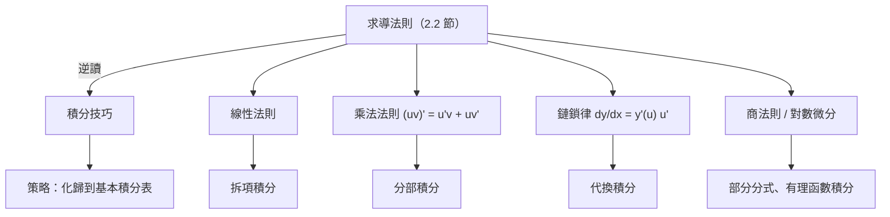

# 4.3 積分技巧

## 導言

有了基本定理，積分計算轉化為「找原函數」。但原函數不會自己現身——需要一套技巧：分部積分、代換、部分分式、三角代換，以及「積不出來」的判斷。這套技巧體系成形於十七—十八世紀（Leibniz、Bernoulli 兄弟、Euler），本節系統整理，並強調：**技巧的每一條都對應基本定理 + 求導法則的一個翻譯**。

### 技巧總綱：積分是求導法則的逆讀

**基本積分表**（全部由求導表逆讀）：

$$
\int x^n dx = \frac{x^{n+1}}{n+1} + C\ (n \neq -1), \quad
\int \frac{dx}{x} = \ln|x| + C, \quad
\int e^x dx = e^x + C,
$$
$$
\int \sin x\,dx = -\cos x + C, \quad
\int \cos x\,dx = \sin x + C, \quad
\int \sec^2 x\,dx = \tan x + C,
$$
$$
\int \frac{dx}{1+x^2} = \arctan x + C, \quad
\int \frac{dx}{\sqrt{1-x^2}} = \arcsin x + C.
$$

**特別註記**： $\int x^{-1} dx$ 不能用冪公式（分母 $n+1 = 0$ ），其原函數正是對數——這一「漏洞」使對數成為積分學的中心函數（Gregory 1647 年發現 $\int \frac{dx}{x}$ 與對數的關係，見 3.1 節）。

### 分部積分

**定理 4.3.1**： $u, v$ 可導且 $u'v$ 可積，則

$$
\int u\,dv = uv - \int v\,du.
$$

**來源**：乘法法則 $(uv)' = u'v + uv'$ 兩邊積分（FTC2）移項。歷史上 Leibniz 1676 年即已掌握；它被 Jacob Bernoulli 稱為「積分的四則運算」。**推廣**：高階分部（对 $(fg)^{(n)}$ 的 Leibniz 公式逆用）給出 Taylor 公式的積分餘項（5.2 節）。

**選 $u$ 的經驗法則（LIATE）**：反三角（Inverse trig）> 對數（Log）> 代數（Algebraic）> 三角（Trig）> 指數（Exponential）——越靠前越適合當 $u$ （因為求導會簡化），越靠後越適合當 $dv$ 。

**例題 4.3.2**：計算 $\displaystyle\int x^2 e^x\,dx$ 。

**解**：分部兩次：

$$
\int x^2 e^x dx = x^2 e^x - 2\int x e^x dx = x^2 e^x - 2\left(x e^x - \int e^x dx\right) = e^x(x^2 - 2x + 2) + C.
$$

**循環分部技巧**： $\displaystyle\int e^x \sin x\,dx$ 。分部兩次後原積分重現：

$$
I = e^x(\sin x - \cos x) + I \implies \text{移項解出}\ I = \frac{e^x(\sin x - \cos x)}{2} + C.
$$

這種「自己解自己」的方程式技巧（Johann Bernoulli 擅長）展示了分部積分的代數本質。

**定積分的分部**：

$$
\int_a^b u\,dv = \big[uv\big]_a^b - \int_a^b v\,du.
$$

**經典應用——Wallis 公式**（3.3 節）與 ** $\Gamma$ 函數遞推**： $\Gamma(s+1) = s\Gamma(s)$ 由分部積分得，從而 $n! = \Gamma(n+1)$ ；歐拉 1729 年以積分插值階乘， $\Gamma$ 函數成為連接離散（階乘）與連續（積分）的橋樑，深入機率（ $\chi^2$ 、Gamma 分布）、數論（素數定理的證明）。

### 代換積分

**定理 4.3.3**： $\phi$ 可微， $f$ 連續，則

$$
\int f(\phi(x))\,\phi'(x)\,dx = \int f(u)\,du, \quad u = \phi(x)
$$

（不定積分形式；定積分版本換限，見 3.3 節。）**來源**：鏈鎖律逆讀。Leibniz 記號的威力在此顯現： $du = \phi'(x)dx$ 直接「代入」。

**例題 4.3.4**：計算 $\displaystyle\int \frac{e^{\sqrt x}}{\sqrt x}\,dx$ 。

**解**：令 $u = \sqrt x$ ， $x = u^2$ ， $dx = 2u\,du$ ：

$$
\int \frac{e^u}{u}\cdot 2u\,du = 2\int e^u du = 2e^{\sqrt x} + C.
$$

**三角代換表**：

| 被積式含 | 代換 | 變換後 |
|----------|------|--------|
| $\sqrt{a^2 - x^2}$ | $x = a\sin\theta$ | $a\cos\theta$ |
| $\sqrt{a^2 + x^2}$ | $x = a\tan\theta$ | $a\sec\theta$ |
| $\sqrt{x^2 - a^2}$ | $x = a\sec\theta$ | $a\tan\theta$ |

**例題 4.3.5**：計算 $\displaystyle\int_0^1 \frac{dx}{(1+x^2)^{3/2}}$ 。

**解**： $x = \tan\theta$ ， $dx = \sec^2\theta\,d\theta$ ， $1 + x^2 = \sec^2\theta$ ； $x: 0\to1$ 對應 $\theta: 0 \to \frac\pi4$ ：

$$
\int_0^{\pi/4} \frac{\sec^2\theta}{\sec^3\theta}d\theta = \int_0^{\pi/4} \cos\theta\,d\theta = \frac{\sqrt2}{2}.
$$

**萬能代換**： $t = \tan\frac{x}{2}$ 將 $\sin x = \frac{2t}{1+t^2}$ 、 $\cos x = \frac{1-t^2}{1+t^2}$ 、 $dx = \frac{2\,dt}{1+t^2}$ ，把任何 $\sin, \cos$ 的有理函數積分化為有理函數積分——Weierstrass 1876 年系統化，是「三角有理式」的終極武器。

### 有理函數積分：部分分式

**定理 4.3.6**：實係數真分式可唯一分解為一次因式與不可約二次因式的部分分式之和；每項的原函數是對數、冪函數與 $\arctan$ 型。

**例題 4.3.7**：計算 $\displaystyle\int \frac{x+7}{x^2 - x - 12}\,dx$ 。

**解**：分解 $x^2 - x - 12 = (x-4)(x+3)$ ，設

$$
\frac{x+7}{(x-4)(x+3)} = \frac{A}{x-4} + \frac{B}{x+3} \implies x + 7 = A(x+3) + B(x-4).
$$

代入 $x = 4$ ： $11 = 7A \Rightarrow A = \frac{11}{7}$ ；代入 $x = -3$ ： $4 = -7B \Rightarrow B = -\frac47$ 。故

$$
\int = \frac{11}{7}\ln|x-4| - \frac{4}{7}\ln|x+3| + C.
$$

**理論地位**：Hermite（1873）證明**任何有理函數的原函數都是初等函數**（有理部分 + 對數 + $\arctan$ ）——有理函數類是「積分封閉」的；而 $\int e^{-x^2}dx$ 、 $\int\frac{e^x}{x}dx$ 、 $\int \frac{dx}{\ln x}$ 等被 Liouville（1835–1841）證明**無初等原函數**（Liouville 定理：初等可積的判據）。Liouville 的結果是微分代數（Risch 演算法 1969，計算機代數系統的符號積分核心）的起點。

### 積分技巧策略表

| 情形 | 首選技巧 |
|------|----------|
| 複合函數 + 其內層導數因子 | 代換 |
| 兩類函數乘積（多項式 × 指數/三角） | 分部 |
| 反三角、對數單獨出現 | 分部（ $u =$ 它本身， $dv = dx$ ） |
| $\sin, \cos$ 有理式 | 萬能代換 $t = \tan\frac x2$ |
| $\sqrt{a^2 \pm x^2}$ 、 $\sqrt{x^2 - a^2}$ | 三角代換 |
| 有理函數 | 部分分式 |
| $\sin^m x\cos^n x$ | 奇偶拆分 + 代換 $u = \sin$ 或 $\cos$ |
| 檢查對稱性、區間 | 先做（3.3 節），常一步報銷 |

### 例題：積分技巧的綜合演出

**例題 4.3.8**：計算 $\displaystyle\int_0^{\ln 2} \frac{e^x}{1 + e^{2x}}\,dx$ 。

**解一（代換）**： $u = e^x$ ， $dx = \frac{du}{u}$ ； $x: 0 \to \ln 2$ 對應 $u: 1 \to 2$ ：

$$
\int_1^2 \frac{u}{1+u^2}\cdot\frac{du}{u} = \int_1^2 \frac{du}{1+u^2} = \arctan 2 - \arctan 1 = \arctan 2 - \frac{\pi}{4}.
$$

**解二（直接觀察）**： $\frac{e^x}{1+e^{2x}} = \frac{(e^x)'}{1 + (e^x)^2}$ ，形如 $\frac{u'}{1+u^2}$ ，其原函數 $\arctan(e^x)$ 。故直接：

$$
\big[\arctan(e^x)\big]_0^{\ln 2} = \arctan 2 - \frac{\pi}{4}. \qquad \blacksquare
$$

**教學點**：代換是「看不見的觀察」的機械化；熟練者直接辨認 $\frac{u'}{1+u^2}$ 模式。積分技巧的終極目標不是背誦，而是培養對「微分模式」的辨識力——這種模式辨識在 PDE（變數分離）、物理（守恆量）中同樣是核心能力。

### 積不出來的積分與數值方法

**著名非初等積分**：

$$
\int e^{-x^2}dx\ (\text{誤差函數}), \quad
\int \frac{\sin x}{x}dx\ (\text{正弦積分}), \quad
\int \sqrt{1 - k^2\sin^2 x}\,dx\ (\text{橢圓積分}),
$$

$$
\int \frac{dx}{\ln x}\ (\text{對數積分，數論中 } \operatorname{li}(x) \sim \pi(x)).
$$

**歷史**：Fagnano（1716 前後）與 Euler、Legendre 研究橢圓積分，發現「無法初等化但具有優美加法定理」；Abel 與 Jacobi（1827）把它們**反轉**為橢圓函數，開創了雙週期函數論——**「積不出來」不是死胡同，而是新數學（特殊函數論、代數幾何）的產房**。實用層面：數值積分（3.2 節 Simpson、Gauss 求積）接管計算任務；軟體（quad、SciPy.integrate）是現代工程師的日常。

### 歷史前因後果

- **前因**：Leibniz 記號的代數操作誘惑；Bernoulli 兄弟在 1690s 以通信競賽（brachistochrone 最速降線問題 1696）發展出分部積分與變分法前夜。
- **提出**：Euler《積分學原理》（1768–1770）三卷系統化全部技巧；Legendre《橢圓函數論》（1825–28）整理特殊積分。
- **解決了什麼**：初等函數積分的龐大分類問題；建立「積分表 + 化歸策略」的演算法傳統。
- **引發新問題**：積分的極限（何時非初等）、積分的反演（橢圓函數、Abel 函數）、符號積分的自動化（Risch 演算法）——積分技巧的終點是積分理論的起點。

## 與其他章節及領域的關聯

- **5.2 節**：冪級數逐項積分是「積不出來時」的系統出路： $\arctan x$ 、 $\ln(1+x)$ 、 $\operatorname{erf}$ 的級數表示。
- **6.2 節**：多變數換元（Jacobian）是代換法的高維版；分部積分的高維版是 Green 恆等式（9.2 節）。
- **8.2 節**：位勢函數的構造（保守場積分）是線積分版的「找原函數」。
- **10.3 節**：物理中的積分技巧——重心、轉動慣量、功與能量的計算全賴於此。
- **計算機代數**：Mathematica/SymPy 的符號積分基於 Risch 演算法與規則庫；「積分技巧」已被部分自動化，但模式辨識仍屬人類直觀的勝地。
- **微分方程**：變數分離法 $g(y)dy = f(x)dx$ 兩邊積分，是代換法在 ODE 的化身。

## 練習

1. 用分部積分計算 $\displaystyle\int x\arctan x\,dx$ 與 $\displaystyle\int \ln x\,dx$ 。
2. 計算 $\displaystyle\int_0^{\pi/2} \sin^3 x\,dx$ （奇冪拆分）與 $\displaystyle\int_0^{\pi/2} \sin^4 x\,dx$ （Wallis 遞推），並用後者驗證 Wallis 公式的一步。
3. 用萬能代換計算 $\displaystyle\int \frac{dx}{1 + \sin x}$ 。
4. 用部分分式計算 $\displaystyle\int \frac{dx}{x^2(x+1)}$ 。
5. 證明 $\int e^x \cos x\,dx = \frac{e^x(\sin x + \cos x)}{2} + C$ （循環分部）。
6. 思考題：查閱 Liouville 定理的敘述，解釋為何 $\int e^{x^2}dx$ 無初等原函數的證明思路（提示：假設 $\int e^{x^2} =$ 初等函數，分析其在複數域的極點行為導出矛盾）。

（本節完）
