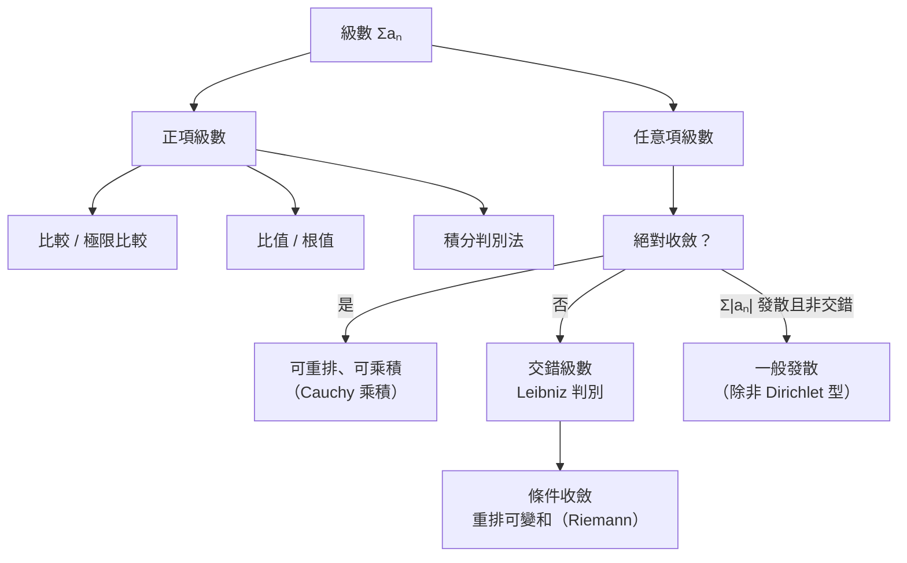

# 5.1 無窮級數與收斂判別

## 導言

把無窮多個數加起來，有意義嗎？Zeno 的悖論說「無窮多段路加起來走不完」；Archimedes 的窮竭法說「無窮多塊面積可以剛好填滿」（3.1 節）。答案取決於**收斂**。本節建立級數理論：級數的定義、正項級數的判別法、交錯級數與絕對收斂。級數是十七—十九世紀分析學的心臟：沒有它就沒有冪級數（5.2 節）、傅立葉級數，也沒有今日的訊號處理與數值方法。

### 級數的定義：極限的第二次登場

**定義 5.1.1**：給定數列 $\{a_n\}$ ，**無窮級數** $\displaystyle\sum_{n=1}^\infty a_n = a_1 + a_2 + a_3 + \cdots$ 的**部分和**為 $S_N = \sum_{n=1}^N a_n$ 。若 $\lim_{N\to\infty} S_N = S$ 存在（有限），稱級數**收斂**於 $S$ ；否則稱**發散**。

**關鍵觀念**：級數的「和」**定義**為部分和數列的極限——它不是「加完」的結果（永遠加不完），而是一個極限過程的歸宿。這是 1.2 節 $\varepsilon$ – $N$ 語言的直接應用。

**歷史**：級數的使用遠早於定義。Archimedes（幾何級數）、Madhava（三角級數）、Gregory 與 Mercator（對數級數）、Newton（二項級數 1665）都大量操作級數而無收斂概念；**Cauchy 1821 年《分析教程》**第一次把「級數收斂」定義為部分和極限，並系統建立判別法。此前 Abel 1826 年著名的抱怨代表了時代的焦慮：

> 「發散級數是魔鬼的發明，用這些級數去證明任何東西都是可恥的。」
> （Abel 指的是十八世紀對 $1 - 1 + 1 - 1 + \cdots = \frac12$ 之類的形式操作。）

### 幾何級數：一切的模板

$$
\sum_{n=0}^\infty ar^n = \frac{a}{1 - r}, \qquad |r| < 1;\qquad |r| \ge 1\ \text{發散}.
$$

**證明**： $S_N = a\frac{1 - r^{N+1}}{1 - r}$ ； $|r|<1$ 時 $r^{N+1} \to 0$ 。歷史上這是最老的級數：Archimedes 用之於拋物線弓形（3.1 節）；**Zeno 悖論的化解**：阿基里斯追烏龜所需時間正是幾何級數 $\frac{d}{v}+\frac{d q}{v}+\cdots = \frac{d}{v(1-q)}$ ——有限！無窮多段「時間段」之和可以是有限時間，這是潛無窮無害的第一個明證。

**應用例**：循環小數 $0.\overline{9} = \sum 9\cdot10^{-n} = \frac{0.9}{1 - 0.1} = 1$ ——嚴格等於 1，常引發哲學爭論，根源正是「級數和 = 極限」的觀念。

### 調和級數的發散：Oresme 的一擊

**定理 5.1.2**： $\displaystyle\sum_{n=1}^\infty \frac1n$ 發散。

**證明（Nicholas Oresme，約 1350 年，史上第一個發散性證明）**：按分母長度分組：

$$
1 + \frac12 + \underbrace{\left(\frac13 + \frac14\right)}_{>\ \frac12} + \underbrace{\left(\frac15 + \cdots + \frac18\right)}_{>\ \frac12} + \cdots > 1 + \frac12 + \frac12 + \frac12 + \cdots = \infty. \qquad \blacksquare
$$

**Johann Bernoulli 的證明（1689）**：若 $\sum \frac1n$ 收斂於 $S$ ，則

$$
S = \frac11 + \frac12 + \frac13 + \cdots = \left(1 + \frac12 + \frac14 + \cdots\right) + \left(\frac13 + \frac16 + \frac19 + \cdots\right) \text{ 等拆分將導出 } S = 1 + \frac S2，\text{即 } S = 2，\text{矛盾於 } S > 1 + \frac12 + \frac14+\cdots=2 \text{ 的嚴格性}——\text{細節見習題}。
$$

**意義**：調和級數的一般項 $\frac1n \to 0$ ，卻發散——**「一般項趨於零」是必要而非充分條件**。這是級數理論的第一個深刻教訓。 $\frac1n$ 的緩慢發散在實踐中處處現身： $\sum_{n=1}^N \frac1n \approx \ln N + \gamma$ （Euler 常數 $\gamma \approx 0.5772$ ），出現在演算法分析（快速排序平均比較次數）、電磁學（長直導線的勢）。

### 正項級數的判別法

| 判別法 | 敘述 | 適用 |
|--------|------|------|
| 比較判別法 | $0 \le a_n \le c b_n$ ， $\sum b_n$ 收斂 $\Rightarrow \sum a_n$ 收斂 | 已知模板級數 |
| 極限比較 | $\frac{a_n}{b_n} \to L \in (0,\infty)$ ，同斂散 | 同階比較 |
| ** $p$ -級數** | $\sum \frac{1}{n^p}$ ： $p>1$ 收斂， $p\le1$ 發散 | 基準級數 |
| 比值（d'Alembert，1768） | $\frac{a_{n+1}}{a_n} \to \rho$ ： $\rho<1$ 收斂、 $\rho>1$ 發散 | 含階乘、指數 |
| 根值（Cauchy，1821） | $\sqrt[n]{a_n} \to \rho$ ：同上 | 幂次形式 |
| 積分判別法 | $f$ 正、連續、遞減： $\sum f(n)$ 與 $\int_1^\infty f$ 同斂散 | $p$ -級數的證明 |

** $p$ -級數定理的證明（積分判別法）**： $\int_1^N \frac{dx}{x^p} = \frac{N^{1-p} - 1}{1-p}$ （ $p \neq 1$ ）： $p > 1$ 時收斂於 $\frac{1}{p-1}$ ， $p<1$ 發散； $p = 1$ 即調和級數發散。**歷史**： $p$ -級數的斂散性由 Leibniz、Johann Bernoulli 與 Euler 先後研究；積分判別法由 **Cauchy 與 Maclaurin**（1742）獨立提出，故又稱 Maclaurin–Cauchy 判別法。

**例題 5.1.3**：判別 $\displaystyle\sum_{n=1}^\infty \frac{n!}{n^n}$ 的斂散性。

**解**：比值判別法：

$$
\frac{a_{n+1}}{a_n} = \frac{(n+1)!}{(n+1)^{n+1}}\cdot\frac{n^n}{n!} = \left(\frac{n}{n+1}\right)^n = \frac{1}{\left(1+\frac1n\right)^n} \to \frac1e < 1.
$$

收斂。且收斂速度由 $\frac1e$ 控制——比值判別法不僅判斷收斂，還給出收斂的「幾何速率」。

### 交錯級數與 Leibniz 判別法

**定理 5.1.4（Leibniz 判別法，1682）**：設 $a_n > 0$ 單調遞減且 $a_n \to 0$ ，則交錯級數 $\sum (-1)^{n+1} a_n$ 收斂，且**餘項估計**：

$$
\left|\sum_{n=1}^\infty (-1)^{n+1}a_n - S_N\right| \le a_{N+1}.
$$

**範例**：Madhava–Gregory–Leibniz 級數

$$
\frac{\pi}{4} = 1 - \frac13 + \frac15 - \frac17 + \cdots = \arctan(1).
$$

部分和 100 項誤差 $< \frac{1}{201} \approx 0.005$ ——收斂但**慢得可恥**（算 $\pi$ 到 10 位需百億項）。Machin 1706 年用 $\arctan$ 恆等式 $\frac{\pi}{4} = 4\arctan\frac15 - \arctan\frac{1}{239}$ 大幅加速（100 位）。**教訓**：收斂 ≠ 快；收斂速率是數值分析的命脈。

**餘項估計的幾何**：交錯級數的部分和「蛇形」包圍極限值， $S_{2N} \uparrow S$ 、 $S_{2N-1} \downarrow S$ ——上下夾逼自然形成，這使它成為最「友善」的級數。

### 絕對收斂與條件收斂

**定義 5.1.5**： $\sum a_n$ **絕對收斂**若 $\sum |a_n|$ 收斂；**條件收斂**若自身收斂但絕對值級數發散。

- 絕對收斂 $\Rightarrow$ 收斂（Cauchy 1821；證明用 $S_N$ 的 Cauchy 性）。
- 典型條件收斂： $\sum \frac{(-1)^{n+1}}{n} = \ln 2$ （ $|\cdot|$ 級數是調和級數，發散）。

**Riemann 重排定理（1867，Riemann 級數論文）**：條件收斂級數可以**重排**成收斂到任何預定實數，甚至發散！原因：正項子級數與負項子級數各自發散（否則絕對收斂），可以輪流取項把部分和「導航」到任意目標。**絕對收斂級數則可任意重排而不變和**。這是無窮加法與有限加法的本質斷裂：**條件收斂的「和」依賴於求和順序**。物理應用：電磁學中電荷分布的勢能級數若條件收斂，求序即成問題——數學家由此發展出 Ewald 求和等技巧。

### Cauchy 準則：收斂的內在判據

**定理 5.1.6（Cauchy 準則，1821）**： $\sum a_n$ 收斂 $\iff$ $\forall\varepsilon>0\ \exists N:\ m > n \ge N \implies \left|\sum_{k=n+1}^m a_k\right| < \varepsilon$ 。

這是「部分和數列是 Cauchy 數列」的翻譯，其根基是實數完備性（1.2 節）——**在有理數中級數理論整體崩塌**。Cauchy 準則的價值：**不需要知道極限值即可證明收斂**。由它推出比值/根值判別法（比較於幾何級數）、以及「收斂級數一般項 $\to 0$ 」的必要性（取 $m = n+1$ ）。

### 級數理論的概念地圖

**乘法**：絕對收斂級數的 Cauchy 乘積（ $\sum c_n, c_n = \sum_{k} a_k b_{n-k}$ ）收斂且等於兩和之積（Cauchy 1821；Mertens 1875 放寬條件）。這是冪級數相乘（5.2 節）合法性的基礎。

### 歷史前因後果

- **前因**：Archimedes 幾何級數、Oresme 調和級數、十七世紀形式操作的輝煌與混亂（Bernoulli 兄弟的 $\sum \frac{1}{n^2} = \frac{\pi^2}{6}$ 挑戰、Grandi 的 $1-1+1-\cdots$ ）。
- **突破**：Euler 1734 年解 Basel 問題 $\sum \frac{1}{n^2} = \frac{\pi^2}{6}$ （以類比於多項式因式分解的「非法」論證，今日用 Fourier 級數可嚴格證明，見 10.3 節）——級數開始展現連接 $\pi$ 、分析、數論的深層結構。
- **嚴格化**：Cauchy 1821 定義收斂、建立判別法；Abel、Dirichlet（Dirichlet 判別法 1837，用於三角級數收斂）完善；Riemann 1854 重排定理與傅立葉級數研究。
- **引發新問題**：收斂的「點態 vs. 一致」（Weierstrass）、級數求和的推廣（Cesàro、Abel 求和——發散級數的「廣義和」，今日分布理論與重整化的數學基礎）、函數項級數（5.2 節直接接手）。

## 與其他章節及領域的關聯

- **5.2 節**：冪級數是函數項級數的特例；收斂半徑由根值判別法給出。
- **3.2 節**：積分判別法是級數與積分的橋樑；廣義積分的 $p$ -臨界與 $p$ -級數完全平行。
- **10.2 節**：函數項級數的逐項積分/求導需要一致收斂；Lebesgue 積分以控制收斂定理大幅簡化。
- **傅立葉分析**：三角級數 $\sum (a_n\cos nx + b_n \sin nx)$ 的收斂問題（Dirichlet 核、Carleson 定理 1966）是十九—二十世紀分析學的主戰場。
- **數值分析**：級數截斷誤差 = 餘項估計；迭代法收斂速度、矩陣級數（Neumann 級數 $(I-A)^{-1} = \sum A^n$ ）。
- **機率論**：期望的定義 $\sum x p(x)$ 本身是級數（可數分布）；大數律、隨機級數。
- **物理**：微擾論展開（量子力學、QED）、熱力學的維里展開——「逐階求和」是理論物理的基本操作；發散漸近級數（Borel 求和）至今活躍。

## 練習

1. 用 Oresme 分組法證明 $\sum \frac{1}{\sqrt{n}}$ 發散；再判別 $\sum \frac{1}{n\sqrt n}$ 。
2. 用比值判別法判別 $\sum \frac{2^n}{n!}$ 與 $\sum \frac{(n!)^2}{(2n)!}$ 。
3. 證明 $\sum \frac{(-1)^{n+1}}{n} = \ln 2$ ，並用 Leibniz 餘項估計求 $\ln 2$ 到誤差 $10^{-4}$ 。
4. 用積分判別法證明 $p$ -級數定理（分 $p = 1$ 與 $p \neq 1$ ）。
5. 構造一個正項級數，其一般項 $\to 0$ 、比值 $\frac{a_{n+1}}{a_n} \to 1$ ，但級數發散（如 $2^{-\lfloor \log_2 n\rfloor}$ 型），說明比值判別法的失效區。
6. 思考題：把 $\ln 2 = 1 - \frac12 + \frac13 - \frac14 + \cdots$ 重排為「一正一負兩正一負」的順序，新的和是什麼？（提示：正項、負項子級數各為何級數？比例如何決定極限。）驗證 Riemann 重排定理。

（本節完）
