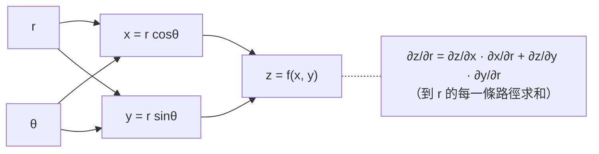

# 6.2 鏈鎖律與 Jacobian

## 導言

單變數鏈鎖律說「導數相乘」（2.2 節）。多變數世界裡，一個變數的變化會**同時**推動多個下游變數，導數不再是單一數字，而是**矩陣**——Jacobian 矩陣。鏈鎖律升級為「矩陣相乘」。這一節是多變數微積分與線性代數的交會點：座標變換（7.2 節）、隱函數定理、自動微分、廣義相對論的張量運算，全部由此展開。

### 向量值函數與 Jacobian 矩陣

**設定**：$\mathbf{f}: \mathbb{R}^n \to \mathbb{R}^m$，$\mathbf{f} = (f_1, \ldots, f_m)$。

**定義 6.2.1（可微性）**：$\mathbf{f}$ 在 $\mathbf{a}$ 可微，若存在線性映射 $L$ 使

$$
\mathbf{f}(\mathbf{a} + \mathbf{h}) = \mathbf{f}(\mathbf{a}) + L(\mathbf{h}) + o(|\mathbf{h}|).
$$

**Jacobian 矩陣**是 $L$ 的矩陣表示：

$$
\mathbf{J}_{\mathbf{f}}(\mathbf{a}) =
\begin{pmatrix}
\frac{\partial f_1}{\partial x_1} & \cdots & \frac{\partial f_1}{\partial x_n} \\
\vdots & \ddots & \vdots \\
\frac{\partial f_m}{\partial x_1} & \cdots & \frac{\partial f_m}{\partial x_n}
\end{pmatrix}.
$$

**讀法**：第 $i$ 列是分量 $f_i$ 的梯度（的轉置）。Jacobian 是「所有偏導數的完整收編」：$m = 1$ 時是梯度（列向量），$n = 1$ 時是曲線的速度向量（切向量），$m = n = 1$ 時退回普通導數。

**幾何意義**：$\mathbf{J}_{\mathbf{f}}(\mathbf{a})$ 是把 $\mathbf{a}$ 處的小位移映到 $\mathbf{f}(\mathbf{a})$ 處的小位移的**線性望遠鏡**。面積如何變化？由 $\det \mathbf{J}$（行列式）控制——這是 7.2 節重積分換元的靈魂；方向如何扭曲？由奇異值/特徵結構控制——微分幾何中「切空間的線性映射」。

### 鏈鎖律的矩陣形式

**定理 6.2.2**：設 $\mathbf{g}: \mathbb{R}^p \to \mathbb{R}^n$ 在 $\mathbf{t}$ 可微、$\mathbf{f}: \mathbb{R}^n \to \mathbb{R}^m$ 在 $\mathbf{g}(\mathbf{t})$ 可微，則 $\mathbf{f} \circ \mathbf{g}$ 在 $\mathbf{t}$ 可微，且

$$
\mathbf{J}_{\mathbf{f}\circ\mathbf{g}}(\mathbf{t}) = \mathbf{J}_{\mathbf{f}}\big(\mathbf{g}(\mathbf{t})\big)\,\mathbf{J}_{\mathbf{g}}(\mathbf{t}).
$$

**「導數相乘」升級為「矩陣相乘」**——記號的巧合還是必然？是必然：複合的線性近似必然複合（$L_f \circ L_g$），而線性映射的複合對應矩陣乘法。單變數的標量乘法是 $1\times1$ 矩陣乘法的特例。

**例題 6.2.3**：設 $z = f(x, y)$，$x = r\cos\theta$、$y = r\sin\theta$。求 $\frac{\partial z}{\partial r}$。

**解**：座標映射 $\mathbf{g}(r,\theta) = (r\cos\theta, r\sin\theta)$ 的 Jacobian：

$$
\mathbf{J}_g = \begin{pmatrix} \cos\theta & -r\sin\theta \\ \sin\theta & r\cos\theta \end{pmatrix}.
$$

鏈鎖律（$\mathbf{t} = (r,\theta)$，$z$ 對 $\mathbf{t}$ 的導數是行向量 $(z_r, z_\theta)$）：

$$
\frac{\partial z}{\partial r} = f_x\cos\theta + f_y\sin\theta, \qquad
\frac{\partial z}{\partial \theta} = -f_x\,r\sin\theta + f_y\,r\cos\theta.
$$

**樹狀圖記憶法**：

「**逐路徑求和**」：總導數 = 所有傳播路徑上「局部導數連乘」的總和——這正是 2.2 節單鏈規則的多路徑推廣，也是反向傳播演算法的圖論表述。

### 多變數鏈鎖律的三種典型情境

**情境一：$z = f(x, y)$，$x = x(t)$、$y = y(t)$（曲線上函數）**：

$$
\frac{dz}{dt} = \frac{\partial z}{\partial x}\frac{dx}{dt} + \frac{\partial z}{\partial y}\frac{dy}{dt} = \nabla f \cdot \mathbf{r}'(t).
$$

**應用**：沿路徑的溫度變化率 = 溫度梯度與速度的內積。若 $\frac{dz}{dt} = 0$，路徑是等值線——由此推出「梯度垂直等值線」（6.1 節）。

**情境二：$w = f(x, y, z)$，$x, y, z$ 皆依賴 $s, t$（參數面）**：$w$ 對 $s$、對 $t$ 各得一條鏈鎖公式，$1 \times 2$ 的 Jacobian 結構。

**情境三：極座標的 Laplace 算子**。對 $u = f(x, y)$，兩次鏈鎖 + 二階展開可證：

$$
\nabla^2 u = u_{xx} + u_{yy} = u_{rr} + \frac1r u_r + \frac{1}{r^2} u_{\theta\theta}.
$$

這是偏微分方程（Laplace 方程在圓域上求解、分離變數法）的必備公式。二階鏈鎖的計算繁瑣易錯——**矩陣視角**（Hessian 的座標變換 $H' = J^T H J + \sum_i \frac{\partial f}{\partial x_i} H_{x_i}$）能降低出錯率，也預示了張量變換法則（廣義相對論中度規張量的座標變換 $\mathbf{g}' = \mathbf{J}^T \mathbf{g} \mathbf{J}$ 完全同構）。

### 隱函數定理

**定理 6.2.4（隱函數定理）**：設 $F(x, y)$ 有連續偏導，$F(a, b) = 0$ 且 $\dfrac{\partial F}{\partial y}(a, b) \neq 0$。則在 $(a, b)$ 附近存在唯一的可微函數 $y = y(x)$ 使 $F(x, y(x)) = 0$、$y(a) = b$，且

$$
\frac{dy}{dx} = -\frac{F_x}{F_y}.
$$

**證明思想（不動點迭代 + 一致收斂）**：把 $F(x,y) = 0$ 改寫為 $y = b - \frac{1}{F_y(a,b)}\big(F(x,y) - F_y(a,b)(y-b)\big)$ 型的收縮映射，用 Banach 不動點定理迭代收斂。**歷史**：隱函數思想自 Newton、Euler 已有；Cauchy 1820s 給出收斂證明；現代形式（基於壓縮映射）屬 Banach 空間理論（1920s）。

**推論（反函數定理）**：$\mathbf{f}: \mathbb{R}^n \to \mathbb{R}^n$ 在 $\mathbf{a}$ 的 Jacobian $\det \mathbf{J} \neq 0$，則 $\mathbf{f}$ 在 $\mathbf{a}$ 附近**局部可逆**，且逆映射的 Jacobian 是

$$
\mathbf{J}_{\mathbf{f}^{-1}}(\mathbf{f}(\mathbf{a})) = \big(\mathbf{J}_{\mathbf{f}}(\mathbf{a})\big)^{-1}.
$$

（「逆的導數 = 導數的逆」——矩陣求逆取代單變數的取倒數。）**深遠意義**：$\det \mathbf{J} \neq 0$ 的點附近，座標變換是局部雙射且光滑——這是**微分同胚**與流形定義（微分幾何）的技術核心，也是 7.2 節座標變換合法性的根據。

**例題 6.2.5**：方程 $x^2 + y^2 + z^2 - 3z = 0$ 在點 $(1, 1, 2)$ 附近把 $z$ 解為 $(x, y)$ 的函數，求 $z_x, z_y$。

**解**：$F = x^2 + y^2 + z^2 - 3z$，$F_z = 2z - 3 = 1 \neq 0$（合法）。兩邊對 $x$ 求導：

$$
2x + 2z z_x - 3z_x = 0 \implies z_x = -\frac{2x}{2z-3}.
$$

同理 $z_y = -\frac{2y}{2z - 3}$。在 $(1,1,2)$：$z_x = z_y = -2$。

### 例題：相關變化率（Jacobian 思想的古典應用）

**例題 6.2.6**：圓錐形水箱，深 4 m、頂半徑 2 m。注水速率 $2\ \mathrm{m^3/min}$。求水深 3 m 時水面上升速率。

**解**：體積 $V = \frac13 \pi r^2 h$，由相似三角形 $r = \frac{h}{2}$，故

$$
V = \frac{\pi h^3}{12} \implies \frac{dV}{dt} = \frac{\pi h^2}{4}\frac{dh}{dt}.
$$

代入 $h = 3$、$\frac{dV}{dt} = 2$：$\dfrac{dh}{dt} = \dfrac{8}{9\pi} \approx 0.283\ \mathrm{m/min}$。

**結構**：相關變化率是鏈鎖律的物理讀法——所有量都是時間 $t$ 的函數，對 $t$ 全微分（逐路徑求和）。

### 自動微分：鏈鎖律的工業化

神經網路訓練需要計算損失對百萬參數的梯度。**反向模式自動微分**：

- **前向掃描**：記錄每個中間變量（計算圖節點）；
- **反向掃描**：從輸出逆行，沿計算圖按鏈鎖律累積 $\frac{\partial L}{\partial(\text{節點})}$；
- **複雜度**：反向模式一次反向掃描得到**整個梯度向量**，成本約為函數求值的常數倍——對 $n$ 個參數比數值差分（$n$ 次求值）或前向模式（$n$ 次掃描）都高效。

**數學核心**：$\mathbf{J}_{f\circ g} = \mathbf{J}_f \mathbf{J}_g$ 中，從左乘還是右乘：前向模式乘 $\mathbf{J}_g$（對輸入方向的傳播），反向模式乘 $\mathbf{J}_f^T$（伴隨傳播，adjoint method）。**伴隨方法**在 PDE 最優控制、氣象資料同化、形狀優化中同樣是核心——**鏈鎖律的反向版本是當代大規模計算科學的單一最重要的公式**。

### 歷史前因後果

- **前因**：Leibniz 記號下「分數相消」的鏈鎖律；Euler 與 Lagrange 在變分法中操作多層依賴；Euler 1755 年系統研究多元微分。
- **提出**：Jacobi 1841 年以行列式系統化變數變換理論（"Jacobian" 行列式之名由此）；Ostrogradsky、Cauchy 完善多變數鏈鎖律；二十世紀 Banach、Dieudonné 以線性映射語言重寫微分學（Fréchet 導數），使鏈鎖律成為「線性近似的範疇論式複合」。
- **解決了什麼**：座標變換、參數曲線曲面、隱函數、約束系統的微分計算有了統一機器。
- **引發新問題**：無窮維情形（Fréchet–Gateaux 導數、變分法）、不可微處的廣義導數（次梯度，凸分析；分布導數）、離散時間系統（差分方程的「Jacobian」用於混沌系統的 Lyapunov 指數）。

## 與其他章節及領域的關聯

- **7.2 節**：$\det \mathbf{J}$ 作為面積/體積縮放因子進入重積分換元公式——Jacobian 的行列式身份。
- **6.3 節**：Lagrange 乘數法的證明用「梯度平行」+ 隱函數定理。
- **9.1 節**：曲面參數化 $\mathbf{r}(u,v)$ 的切向量 $\mathbf{r}_u, \mathbf{r}_v$ 正是參數映射的兩列 Jacobian；法向量 $\mathbf{r}_u \times \mathbf{r}_v$。
- **微分幾何**：切映射（pushforward）$d\mathbf{f}_p$；流形間的光滑映射由「圖卡複合的 Jacobian 連續」定義；廣義相對論中張量按 Jacobian 變換。
- **機器學習**：反向傳播 = 反向模式鏈鎖律；GAN、VAE 的重參數化技巧（reparameterization trick）是 Jacobian 修正項的應用（Normalizing flows 直接以 $\det \mathbf{J}$ 校正機率密度）。
- **機器人學**：運動學 Jacobian 把關節速度映到末端速度；奇異位形（$\det J = 0$）是機器人失控點——反函數定理失效的物理呈現。
- **動力系統**：平衡點分類（$\mathbf{J}$ 的特徵值：節點、鞍點、螺旋）、線性化穩定性——混沌的 Lyapunov 指數是 Jacobian 乘積的增長率。

## 練習

1. 設 $z = e^{u v}$，$u = x y$，$v = x + y$。用矩陣鏈鎖律求 $\frac{\partial z}{\partial x}$，並與逐路徑法核對。
2. 求柱座標 $(r, \theta, z)$ 變換的 Jacobian 矩陣與行列式（答案應為 $r$，將用於 7.2 節）。
3. 對 $u = f(x, y)$ 推導極座標 Laplace 算子公式（提示：先求 $u_r, u_\theta$，再對 $r$ 求導時記住 $\cos\theta, \sin\theta$ 也依賴 $\theta$）。
4. 用隱函數定理判斷 $x^3 + y^3 - 3xy = 0$（笛卡兒葉形線）在原點附近哪些區域可解出 $y(x)$，並計算 $y'$。
5. 證明反函數定理在 $n=1$ 時就是「$f' \neq 0$ 則局部可逆」+ 反函數導數公式；並構造 $f$ 可逆（全域）但 $f' (a) = 0$ 的例子（$f(x) = x^3$），說明「局部可逆但逆不可微」的微妙性。
6. 思考題：Normalizing flow 模型用可逆變換 $\mathbf{z} = \mathbf{f}(\mathbf{x})$ 變換機率密度：$p_z(\mathbf{z}) = p_x(\mathbf{x}) / |\det \mathbf{J}_{\mathbf{f}}|$。用「小方塊質量守恆」論證這個公式的來源，並聯繫 7.2 節的換元積分。

（本節完）
