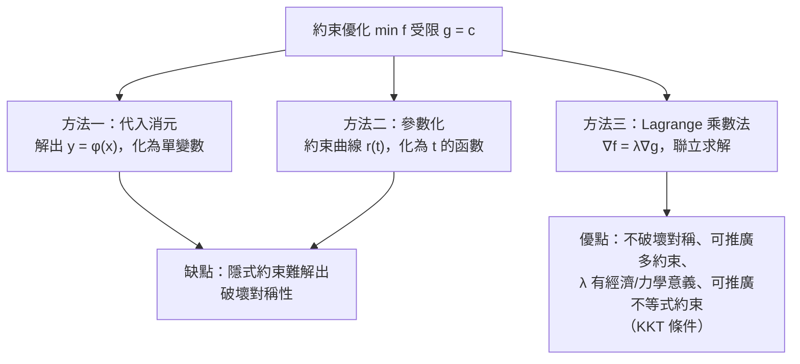

# 6.3 極值與 Lagrange 乘數法

## 導言

優化是最古老的數學活動之一：古代建築者求最堅固的樑、Kepler 1615 年為酒商求最省木料的酒桶形狀。Fermat（1638）的內點極值原理開啟了用導數求極值的時代。多變數世界裡，無約束極值靠**梯度與 Hessian**，帶約束極值靠 **Lagrange 乘數法**（Joseph-Louis Lagrange，1788《分析力學》）。本節建立這套理論，它直接支撐著今日的經濟學、機器學習與工程優化。

### 無約束極值：梯度與 Hessian

**定理 6.3.1（必要條件，Fermat 內點原理的多維版）**：$f$ 在內點 $\mathbf{a}$ 可微且取局部極值，則

$$
\nabla f(\mathbf{a}) = \mathbf{0}.
$$

**證明**：沿任意單位向量 $\mathbf{u}$ 的方向導數 $D_{\mathbf u} f = \nabla f \cdot \mathbf{u}$ 必為零（否則沿 $\pm\mathbf{u}$ 一升一降），故梯度零向量。 $\blacksquare$

滿足 $\nabla f = 0$ 的點稱**臨界點**（critical point / stationaary point）。臨界點不一定是極值——還可能是**鞍點**（saddle point，如 $f = xy$ 在原點）。

**二階判別（Hessian 檢驗）**：設 $f$ 有連續二階偏導、$\nabla f(\mathbf{a}) = \mathbf{0}$。$H(\mathbf{a})$ 為 Hessian 矩陣，則：

| $H(\mathbf{a})$ 的性態 | $f$ 在 $\mathbf{a}$ 附近形狀 | 二維判據 |
|------------------------|------------------------------|----------|
| 正定 | 局部極小（碗形） | $f_{xx} > 0$ 且 $\det H > 0$ |
| 負定 | 局部極大（倒碗） | $f_{xx} < 0$ 且 $\det H > 0$ |
| 不定 | 鞍點 | $\det H < 0$ |
| 半定/退化 | 需更高階分析 | $\det H = 0$（判據失效） |

**證明骨架**：二階 Taylor 展開 $f(\mathbf{a} + \mathbf{h}) = f(\mathbf{a}) + \frac12 \mathbf{h}^T H \mathbf{h} + o(|\mathbf{h}|^2)$；二次型 $\mathbf{h}^T H \mathbf{h}$ 的符號由特徵值決定——**正定 = 所有方向都是碗底**。Hessian 的特徵值也給出「主曲率」：特徵方向是彎曲最劇/最緩的方向（主軸理論，土木工程的主應力、影像處理的特徵值分析同源）。

**例題 6.3.2**：求 $f(x, y) = x^3 - 3x + y^2$ 的極值。

**解**：$\nabla f = (3x^2 - 3, 2y) = (0, 0)$ 得臨界點 $(1, 0)$、$(-1, 0)$。Hessian：

$$
H = \begin{pmatrix} 6x & 0 \\ 0 & 2 \end{pmatrix}.
$$

- $(1, 0)$：$H = \operatorname{diag}(6, 2)$ 正定 → **局部極小**，$f = -2$；
- $(-1, 0)$：$H = \operatorname{diag}(-6, 2)$ 不定（$\det H = -12 < 0$）→ **鞍點**。

**注意**：$f \to +\infty$（$|y| \to \infty$）但 $x \to -\infty$ 時 $f \to -\infty$——此函數**沒有全局極小**。這提醒我們：**極值定理（1.3 節 Weierstrass）需要緊定義域**；開放域上的優化必須檢查「無窮遠處」的行為（ coercion 條件）。

### 約束極值的幾何直覺

問題：在曲線/曲面 $g(x, y) = c$（約束集）上求 $f$ 的極值。例如：在椭圓 $\frac{x^2}{a^2} + \frac{y^2}{b^2} = 1$ 上找離原點最遠的點。

**幾何圖像**：沿約束曲線行走，$f$ 的變化率是方向導數 $D_{\mathbf{u}} f = \nabla f \cdot \mathbf{u}$（$\mathbf{u}$ 沿切向）。極值處 $D_{\mathbf{u}} f = 0$ 對一切切向 $\mathbf{u}$ 成立，即 $\nabla f \perp$ 切向。而 $\nabla g$ 也垂直切向（梯度垂直等值線，6.1 節）。故：

$$
\nabla f \parallel \nabla g \quad\Longleftrightarrow\quad \nabla f = -\lambda \nabla g \quad \text{（某數 } \lambda\text{）}.
$$

**等高線相切的圖像**：極值處，目標函數的等值線與約束曲線**相切**——再推就離開約束集了。

### Lagrange 乘數法

**定理 6.3.3（Lagrange，1788）**：設 $f, g$ 有連續偏導，$\nabla g \neq \mathbf{0}$ 於約束集上，$\mathbf{a}$ 是 $f$ 在 $g = c$ 上的局部極值點，則存在實數 $\lambda$ 使

$$
\nabla f(\mathbf{a}) = \lambda \nabla g(\mathbf{a}), \qquad g(\mathbf{a}) = c.
$$

**$n + 1$ 個未知數（$\mathbf{x}$ 與 $\lambda$）、$n + 1$ 個方程**——約束優化化為聯立方程求解。**$\lambda$ 的意義**（影子價格，shadow price）：放鬆約束一單位，目標值變化 $\lambda$。經濟學中效用最大化問題的 $\lambda$ 是「邊際效用貨幣值」，資源分配、定價理論的核心概念。

**例題 6.3.4**：在椭圓 $\frac{x^2}{9} + \frac{y^2}{4} = 1$ 上求 $f = xy$ 的極值。

**解**：約束 $g = \frac{x^2}{9} + \frac{y^2}{4}$，$\nabla f = (y, x)$，$\nabla g = \left(\frac{2x}{9}, \frac{y}{2}\right)$。方程組：

$$
y = \lambda\frac{2x}{9}, \qquad x = \lambda\frac{y}{2}, \qquad \frac{x^2}{9} + \frac{y^2}{4} = 1.
$$

前兩式相乘：$xy = \frac{\lambda^2 xy}{18}$。若 $xy \neq 0$：$\lambda^2 = 18$。由 $y = \frac{2\lambda x}{9}$ 代入約束：$\frac{x^2}{9}\left(1 + \frac{4\lambda^2}{36}\right) = \frac{x^2}{9}(1 + 2) = 1 \Rightarrow x^2 = 3, y^2 = 8$。故 $f = xy = \pm 2\sqrt6$：**最大 $2\sqrt6$、最小 $-2\sqrt6$**（緊集上連續函數必達到最值，故這就是全局答案——IVT/極值定理的優化版應用）。

**多約束情形**：$k$ 個約束 $g_1 = \cdots = g_k = 0$ 時，$\nabla f = \sum_{i=1}^k \lambda_i \nabla g_i$——$\nabla f$ 落在約束法向量的張成空間內。Lagrange 乘數向量 $(\lambda_1, \ldots, \lambda_k)$ 在力學中正是**約束反力**（分析力學的原初語境：理想約束不做功，Lagrange 方程由此）。

### 為什麼乘數法有效：嚴格證明骨架

用**隱函數定理**（6.2 節）：$\nabla g \neq 0$（設 $g_y \neq 0$）保證約束曲線局部可寫為 $y = \phi(x)$。於是優化化為單變數問題 $F(x) = f(x, \phi(x))$，其極值條件：

$$
0 = F'(x) = f_x + f_y \phi'(x), \qquad \phi'(x) = -\frac{g_x}{g_y}.
$$

整理：$f_x - f_y \frac{g_x}{g_y} = 0$，即 $\frac{f_x}{g_x} = \frac{f_y}{g_y} = \lambda$（當分母非零），正是 $\nabla f = \lambda \nabla g$。**乘數法 = 隱函數定理 + 單變數 Fermat 條件的包裝**——「消去約束」與「引入乘數」是同一件事的兩種記法。

### 三大方法的對照

**例題 6.3.5（方法對照）**：最大體積內接於半徑 $R$ 球的長方體。

**解**：設半邊長 $x, y, z \ge 0$，約束 $x^2 + y^2 + z^2 = R^2$，目標 $V = 8xyz$。乘數法：$\nabla V = \lambda \nabla g$：

$$
8yz = 2\lambda x, \quad 8xz = 2\lambda y, \quad 8xy = 2\lambda z.
$$

兩兩相除（變數皆正）：$\frac{y}{x} = \frac{x}{y}$ 等，得 $x = y = z$。代回：$3x^2 = R^2$，$V = 8\left(\frac{R}{\sqrt3}\right)^3 = \frac{8R^3}{3\sqrt3}$——**正方體最優**。對稱問題用乘數法一步鎖定對稱解，消元法則需更多計算（且需論證邊界情形 $x=0$ 給 $V=0$ 非最優）。

### 不等式約束與現代優化

實際問題常是不等式（資源上限、非負性）。**KKT 條件**（Karush 1939；Kuhn–Tucker 1951）：

$$
\nabla f = \sum_i \lambda_i \nabla g_i, \quad g_i \le 0, \quad \lambda_i \ge 0, \quad \lambda_i g_i = 0\ \text{（互補鬆弛）}.
$$

乘數要麼為零（約束不活躍）、要麼約束取等號——「影子價格不付冤枉錢」。KKT 條件是：

- **線性規劃/凸優化**（單純形法 1947 Dantzig、內點法 1984 Karmarkar）的最優性刻畫；
- **支持向量機（SVM）**：分類間隔最大化 → 乘數非零的樣本即「支持向量」；
- **經濟學**：資源約束下的最優配置，乘數 = 影子價格（Koopmans、Dantzig 的線性規劃與諾貝爾經濟學獎工作）。

### 應用速覽

| 領域 | 優化問題 | 工具 |
|------|----------|------|
| 物理學 | 最小作用量、能量極小（平衡態） | 變分法（乘數法的泛函版） |
| 統計學 | 最大概似估計 | 梯度方程 + 約束（如變異數矩陣正定） |
| 機器學習 | 損失最小化 + 正則化 | 梯度下降、KKT、對偶 |
| 經濟學 | 效用/利潤最大化 | 乘數法（影子價格） |
| 工程 | 結構最輕量化 | 有限元素 + KKT |
| 資訊理論 | 最大熵分布 | 乘數法（$\lambda$ 對應溫度、化學勢） |

**最大熵例**：在 $\sum p_i = 1$ 約束下最大化 $-\sum p_i \ln p_i$。乘數條件 $-(\ln p_i + 1) = \lambda$ 給 $p_i = e^{-1-\lambda}$ 均勻——**熵最大化給出均勻分布**；加入平均能量約束則得 Boltzmann 分布 $p_i \propto e^{-\beta E_i}$——統計力學的基礎分布由 Lagrange 乘數法「長」出來，$\beta = \frac{1}{kT}$ 正是溫度倒數（10.3 節）。

### 歷史前因後果

- **前因**：Fermat 1638 內點極值；Newton 與 Leibniz 時代的極值應用；Euler 與 Lagrange 的變分法（1750s–1788）把「優化函數」升級為「優化泛函」。
- **提出**：Lagrange 1788《分析力學》以乘數法處理約束力學系統；經濟學中的影子價格解釋由 Kantorovich（1939，線性規劃與資源配置）與 Kuhn–Tucker（1951）完成。
- **解決了什麼**：約束優化的系統算法；力學中「理想約束的處理」從幾何直覺變成代數程序。
- **引發新問題**：凸性與全局最優（凸分析，Rockafellar 1970）、對偶理論（原問題與對偶問題的最優值關係 = 弱/強對偶）、非凸的 NP 難（組合優化的複雜性）——現代優化理論的骨架在「乘數法 + 凸性 + 對偶」三件套上。

## 與其他章節及領域的關聯

- **6.1 節**：梯度垂直等值線是乘數法的幾何核心；方向導數給出「沿約束的變化率」。
- **6.2 節**：隱函數定理是乘數法的嚴格基礎（約束局部可解）。
- **7.3 節**：質心、轉動慣量是積分形式的「平均優化」；慣量主軸是 Hessian 對稱矩陣特徵值問題的物理版。
- **2.3 節**：單變數極值與二階判別是本節的 $n=1$ 情形；牛頓法的多維版用 Hessian。
- **10.3 節**：最小作用量原理與變分法是「無限維優化」——Euler–Lagrange 方程是「梯點零」的泛函版。
- **機器學習**：SVM、正則化（LASSO 的稀疏性由 KKT 條件解釋）、生成模型的對偶訓練；梯度下降的收斂分析依賴 Hessian 的條件數。
- **微分幾何**：測地線是「長度泛函的臨界點」；變分法 + Lagrange 乘數（保持參數化）給出測地線方程——廣義相對論中自由落體軌跡。

## 練習

1. 求 $f(x, y) = x^2 + xy + y^2 - 3x$ 的臨界點並分類；求全局最小值（配方法驗證）。
2. 用乘數法求原點到直線 $x + 2y = 5$ 的最短距離，並與「點到直線距離公式」核對。
3. 在 $x^2 + y^2 + z^2 = 1$ 上求 $f = x + 2y + 3z$ 的最大值（提示：這是投影問題，答案 $\sqrt{14}$）。
4. 求內接於半徑 $R$ 圓柱體積最大的長方體，並解釋為何答案是正四棱柱。
5. 用最大熵原理：在 $E[p] = \mu$ 約束下導出指數分布 $p(x) = \frac{1}{\mu}e^{-x/\mu}$（$x \ge 0$）。
6. 思考題：KKT 互補鬆弛條件 $\lambda g = 0$ 的經濟學解釋是「影子價格不付冤枉錢」。構造一個簡單的資源分配例子（兩種商品、一個預算約束），驗證：當某商品的最優消費量觸及非負約束邊界（$x_i = 0$）時，其對應乘數（邊際效用）大於等於內點商品，並解釋直觀。

（本節完）
