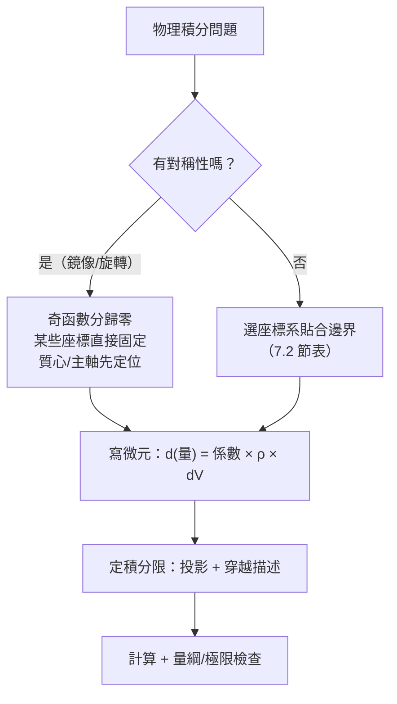

# 7.3 物理應用：質心與轉動慣量

## 導言

重積分的最大主顧是物理學：質心（重心在哪？）、轉動慣量（旋轉多難？）、引力（天體如何吸引？）、機率期望（平均值是多少？）。這些量有統一的數學形式——**密度加權的積分**。本節以質心與轉動慣量為主軸，展示重積分如何把幾何對稱性轉化為物理結論，並連接 Archimedes 兩千年前的槓桿直觀與今日的剛體力學、衛星工程。

### 密度、質量與積分的物理語法

設物體占據區域 $D$（平面薄片）或 $E$（立體），密度函數 $\rho$（連續、$\ge 0$）：

$$
\text{質量}\ M = \iint_D \rho(x, y)\,dA \qquad \text{或} \qquad M = \iiint_E \rho\,dV.
$$

**微元法（積分的物理語法）**：把物體切成微小塊，每塊近似為均勻的（密度取樣 $\rho(\xi)$），寫出微元的貢獻 $d\text{（物理量）} = (\text{係數})\,\rho\,dA$（或 $dV$），再「把所有微元加起來」= 積分。這個「切割—近似—求和」的語法與 Riemann 和（3.2 節）完全一致，是所有連續物理量的建模語言：電荷 $dq = \rho_e\,dV$、流量 $dm = \rho\,|\mathbf{v} \cdot \mathbf{n}|\,dS$、機率 $dP = p(x)\,dx$。

### 質心：Archimedes 槓桿原理的積分化身

**一維直觀**：兩質點 $m_1$ 在 $x_1$、$m_2$ 在 $x_2$，支點 $C$ 平衡（槓桿原理）：$m_1(x_C - x_1) = m_2(x_2 - x_C)$，解得

$$
x_C = \frac{m_1 x_1 + m_2 x_2}{m_1 + m_2}.
$$

**推廣到連續體（微元法）**：每個微元 $dm = \rho\,dA$ 貢獻「矩」$x\,dm$，質心是矩的總和除以總質量：

$$
\bar x = \frac{1}{M}\iint_D x\,\rho(x,y)\,dA, \qquad \bar y = \frac{1}{M}\iint_D y\,\rho(x,y)\,dA.
$$

**性質**：

- $\iint_D (x - \bar x)\rho\,dA = 0$：質心是「使一階矩歸零」的點——平衡點；
- **對稱性定理**：若密度與區域關於直線/平面对稱，質心在對稱軸/面上（被積函數為奇函數，積分為零——3.3 節對稱性的直接應用）；
- 密度均勻時質心只依賴幾何，稱**形心**。

**例題 7.3.1**：求均勻密度、由 $y = x^2$ 與 $y = 4$ 圍成區域的形心。

**解**：對稱性：區域關於 $y$ 軸對稱 → $\bar x = 0$。面積 $A = \int_{-2}^{2}(4 - x^2)dx = \frac{32}{3}$。

$$
\bar y = \frac{1}{A}\int_{-2}^{2}\int_{x^2}^{4} y\,dy\,dx = \frac{3}{32}\int_{-2}^2 \frac{16 - x^4}{2}dx = \frac{3}{32}\cdot\frac{128}{5} = \frac{12}{5}.
$$

**檢查**：$\frac{12}{5} = 2.4$，區域在 $y \in [0, 4]$，質心偏向寬的上部——合理（下端尖細，質量集中於上方）。 $\blacksquare$

**歷史**：Archimedes《平面圖形的平衡》（前250年）以槓桿原理求拋物線弓形、扇形等的形心——**重積分思想的先聲**；他甚至用形心方法（把弓形與矩形按質心平衡）「發現」了 $\int x^2 = \frac{a^3}{3}$ 型結果（3.1 節）。Pappus（四世紀）的**第二重心定理**：平面圖形繞不與之交的軸旋轉所得體積 = 面積 × 形心路徑長（$V = 2\pi \bar x A$）——用形心算旋轉體積，或反過來用體積定形心；它是 Cavalieri 原理的姊妹篇，也是 Torricelli 小號（Gabriel 號角）分析的關鍵。

### 轉動慣量：旋轉的「質量」

**物理問題**：質點 $m$ 距轉軸 $r$，圓周運動速度 $v = \omega r$（$\omega$ 角速度），動能：

$$
KE = \frac12 m v^2 = \frac12 (m r^2)\,\omega^2.
$$

與平動 $KE = \frac12 m v^2$ 對照，$I = mr^2$ 扮演「旋轉質量」——**轉動慣量**（moment of inertia）。連續體（微元法）：

$$
I_{\text{軸}} = \iiint_E r^2\,\rho\,dV, \qquad r = \text{到轉軸的距離}.
$$

**例題 7.3.2**：均勻密度 $\rho$、半徑 $R$ 的圓盤，求對中心垂直軸的轉動慣量。

**解**：用極座標，$r$ 就是極徑：

$$
I = \int_0^{2\pi}\int_0^R r^2\,\rho\,r\,dr\,d\theta = 2\pi\rho\,\frac{R^4}{4}.
$$

質量 $M = \rho\pi R^2$，故 $I = \frac12 MR^2$。**對照表**：

| 物體（均勻，質量 $M$） | 轉軸 | $I$ |
|--------------------------|------|-----|
| 細桿長 $L$ | 過中心垂直桿 | $\frac{1}{12}ML^2$ |
| 圓盤半徑 $R$ | 中心法向 | $\frac12 MR^2$ |
| 實心球半徑 $R$ | 直徑 | $\frac25 MR^2$ |
| 空心薄球殼 | 直徑 | $\frac23 MR^2$ |
| 圓環半徑 $R$ | 中心軸 | $MR^2$ |

**意義**：$I = \left(\text{係數}\right)MR^2$，係數衡量「質量離軸多遠」——空心球（$\frac23$）比實心球（$\frac25$）難轉，因為同樣的質量分布得更靠外。**工程應用**：飛輪用輪緣重的設計（高 $I$ 儲能）；花樣滑冰收臂加速（角動量 $I\omega$ 守恆，$I$ 減小則 $\omega$ 增大）；汽車輪轂的輕量化直接影響加速性。

### 平行軸定理與慣量張量

**平行軸定理（Steiner）**：對過質心、方向相同的軸，平移距離 $d$：

$$
I = I_{\text{cm}} + Md^2.
$$

**證明**：$r^2 = |\mathbf{r}_{cm} + \mathbf{d}|^2$ 展開，交叉項 $\mathbf{d}\cdot\iint \mathbf{r}_{cm}\,\rho\,dV = \mathbf{d}\cdot \mathbf{0} = 0$（質心定義！）。**質心的「一階矩歸零」性質在此發揮關鍵作用**——兩個概念（質心、慣量）以代數方式咬合。

**慣量張量**：對一般過原點的軸 $\hat{\mathbf{u}}$，$I_{\mathbf{u}} = \hat{\mathbf{u}}^T \mathcal{I}\,\hat{\mathbf{u}}$，其中

$$
\mathcal{I} = \iiint_E \left(|\mathbf{r}|^2 \mathbb{1} - \mathbf{r}\mathbf{r}^T\right)\rho\,dV
$$

是 $3\times3$ 對稱矩陣（慣量張量）。**特徵值問題**：找使 $\mathcal{I}$ 對角化的方向 = **慣量主軸**——對稱矩陣的特徵分解（線性代數）在剛體力學的化身。地球的慣量主軸（自轉軸附近）與歲差、極移的計算；飛彈與衛星的姿態穩定（繞最大或最小慣量軸的穩定性，中間軸不穩——網球拍的「翻轉」現象，Dzhanibekov 效應）都依賴於此。

### 引力與位勢：積分的宇宙級應用

**Newton 的球殼定理**（《原理》1687，第一冊命題 70–71）：均勻球殼對殼外質點的引力 = 全部質量集中於球心；對殼**內**質點引力為零。

**現代證明**（位勢方法）：質點 $m$ 距球心 $a > R$，位能：

$$
U = -Gm\sigma R^2 \int_0^{2\pi}\int_0^{\pi} \frac{\sin\phi\,d\phi\,d\theta}{\sqrt{a^2 + R^2 - 2aR\cos\phi}}.
$$

令 $u = \cos\phi$，分母 $= \sqrt{a^2 + R^2 - 2aRu}$，積分：

$$
U = -2\pi Gm\sigma R^2 \int_{-1}^{1}\frac{du}{\sqrt{a^2 + R^2 - 2aRu}} = -\frac{2\pi Gm\sigma R^2}{aR}\big[(a+R) - (a - R)\big] = -\frac{Gm(4\pi R^2 \sigma)}{a}.
$$

**正是點質量公式**（$M = 4\pi R^2\sigma$）。殼內（$a < R$）計算得 $U$ 為常數 → 引力（$-\nabla U$）為零。**意義**：Kepler 行星運動可以視太陽為點；地殼內部的引力平衡（地質學）；**Newton 之所以發明/需要微積分，正是為了證明這個定理**——球殼定理是微積分存在的宇宙級理由（10.3 節）。

### 機率：密度積分的另一個宇宙

機率密度 $p(x, y)$（$\iint p = 1$）：

$$
E[X] = \iint x\,p\,dA \quad (\text{期望 = 一階矩，質心的機率版}),
$$
$$
\operatorname{Var}(X) = \iint (x - E[X])^2 p\,dA \quad (\text{變異數 = 慣量的機率版}).
$$

**二維常態分布** $p \propto e^{-\frac{(x-\mu_x)^2}{2\sigma_x^2} - \frac{(y-\mu_y)^2}{2\sigma_y^2}}$ 的期望就是質心 $(\mu_x, \mu_y)$，協方差矩陣是「機率慣量張量」——**主成分分析（PCA）**找資料雲的主軸，數學上就是找「機率慣量」的特徵向量（與剛體主軸同一問題）。質心—慣量的形式結構跨越物理與統計，是「矩方法」的普遍性明證。

### 計算策略：對稱性先行

**量綱檢查**（工程師保命技）：$I$ 的量綱 $[M][L]^2$；若算出 $I = \frac25 MR^3$——立刻知道錯了。**極限檢查**：$R \to 0$ 時 $I \to 0$？$d \to 0$ 時平行軸定理退化？這些檢查不需要重算就能抓住大部分錯誤。

### 歷史前因後果

- **前因**：Archimedes 的形心與槓桿（前3世紀）；Kepler 行星問題；Huygens 1673 擺鐘研究提出「離心力量」的積分。
- **提出**：Newton 1687《原理》以流數計算球殼引力與轉動體性質；Euler 1765《固體運動理論》建立剛體動力學與慣量張量；Steiner 十九世紀整理平行軸定理；Coriolis、Poisson 完善工程力學公式。
- **解決了什麼**：天體力學（行星—太陽點質量化）、工程設計（飛輪、轉子、建築平衡）、航海（船的穩性=形心與浮心關係）。
- **引發新問題**：非剛體（流體）的轉動、自引力天體的形狀（Maclaurin 椭球、Jacobi 椭球，1840s——分岔與混沌的前夜）、廣義相對論中的慣量與重力波（四極矩輻射）。

## 與其他章節及領域的關聯

- **7.1–7.2 節**：重積分定義與座標變換是本節的計算引擎。
- **8.2 節**：引力做功與保守場、位勢函數——本節的 $U$ 計算是線積分的立體版。
- **9.2 節**：Gauss 定理給出球殼定理的更優雅證明（$\oint \mathbf{g} \cdot d\mathbf{S} = -4\pi G M_{\text{內}}$，Gauss 引力定律）——通量觀點一擊必殺。
- **6.3 節**：慣量主軸與 Hessian 特徵值是同一線性代數；最大/最小慣量方向的變分刻畫。
- **10.3 節**：Kepler 問題、人造衛星軌道設計、重力探測（GRACE 衛星以重力異常反演地下水——密度積分的逆問題）。
- **機器學習/統計**：矩、協方差、PCA——質心與慣量的資料科學轉世。
- **計算物理**：分子動力學中的慣量計算、天體 N 體模擬的多極展開（把遠處質量分布用「質心 + 慣量張量 + 高階矩」近似—— Barnes–Hut 演算法，$O(N\log N)$）。

## 練習

1. 求均勻半圓盤（半徑 $R$）的形心（答案 $\bar y = \frac{4R}{3\pi}$，用極座標）。
2. 用 Pappus 定理求圓環（圓半徑 $r$，繞距圓心 $R > r$ 的軸旋轉）的體積，並與 $2\pi^2 R r^2$ 核對。
3. 均勻細桿長 $L$：直接積分求對端點軸的 $I$，驗證平行軸定理（$\frac13 ML^2 = \frac{1}{12}ML^2 + M(L/2)^2$）。
4. 計算均勻實心球對直徑的 $I = \frac25 MR^2$（提示：切成垂直圓盤，$dz$ 積分，每片用 $\frac12 r^2 dm$）。
5. 求密度 $\rho = k z$（隨高度線性增加）的圓錐（高 $h$、底半徑 $R$）的質心。
6. 思考題：Dzhanibekov 效應——剛體繞中間慣量主軸旋轉不穩定。用 Euler 方程（剛體自由轉動）對三個主軸分別做微擾分析，證明：$\omega_1$ 附近的擾動方程 $\dot\eta = c\,\eta$ 型（$c > 0$）當且僅當 $I_1$ 是中間值。這是線性化穩定性分析（6.2 節 Jacobian 特徵值）在力學的經典範例。

（本節完）
