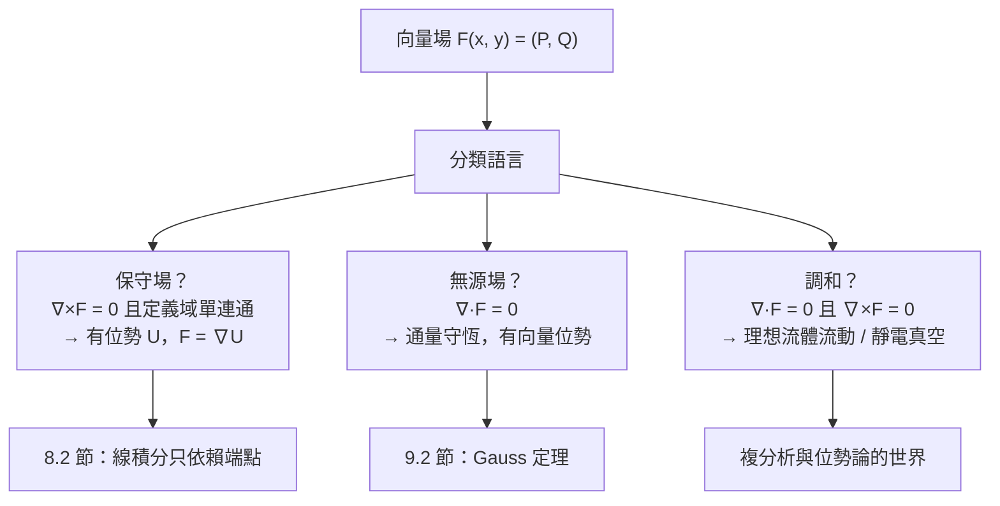

# 8.1 向量場

## 導言

風的速度在每個地點都不同——空間中每一點配一個向量，這就是**向量場**。河流的流速、磁鐵周圍的磁力、溫度的梯度、股價的動量：凡是「每點有方向與大小」的量都是向量場。向量場是十九世紀物理數學化的核心語言（Maxwell 1873 的電磁學），也是流體力學、氣象、機器人導航的日常工具。本節建立向量場的概念、視覺化與分類語言。

### 向量場的定義與表示

**定義 8.1.1**：**向量場**是映射

$$
\mathbf{F}: D \subset \mathbb{R}^n \to \mathbb{R}^n, \qquad \mathbf{F}(x, y) = \big(P(x, y),\ Q(x, y)\big),
$$

每個定義域的點配一個向量。三維： $\mathbf{F} = (P, Q, R)$ 。

**記號與例子**：

- $\mathbf{F}(x,y) = (-y, x)$ ：**旋轉場**（剛體旋轉的速度場）——每點向量垂直於半徑、大小正比於半徑；
- $\mathbf{F}(x,y) = (x, y)$ ：**放射場**（源頭在原點，均勻膨脹的速度場）；
- $\mathbf{F} = -\nabla U$ ：**力場**（保守場，重力、靜電）；
- $\mathbf{v}(x, y, t)$ ：**時變速度場**（流體）。

**兩種視覺化**：

1. **向量箭頭圖**（vector field plot）：每點畫箭頭；
2. **場線（流線/軌線）**：處處與場相切的曲線——滿足微分方程 $\dfrac{d\mathbf{r}}{dt} = \mathbf{F}(\mathbf{r})$ 的解曲線。磁力線、氣流線、電力線都是場線；它們把向量場變成「看得見的流動」。

### 向量場的微分學：兩個基本算子

向量場的「導數」有兩個各管一面的純量/向量量（嚴格定義與定理在 9.2、9.3 節，此處先建立直觀）：

**散度（divergence）**： $\nabla \cdot \mathbf{F} = \dfrac{\partial P}{\partial x} + \dfrac{\partial Q}{\partial y}$ （三維加 $\dfrac{\partial R}{\partial z}$ ）。

- **物理意義**：單位體積的「淨流出率」——正為**源**（水從此冒出）、負為**匯**（水於此消失）、零為**不可壓縮**。
- 例： $\mathbf{F} = (x, y)$ 的散度 $= 2 > 0$ ：處處是源（膨脹流）； $\mathbf{F} = (-y, x)$ 散度 $= 0$ ：旋轉不產生體積（不可壓縮旋轉）。

**旋度（curl）**：二維純量版 $\nabla \times \mathbf{F} = \dfrac{\partial Q}{\partial x} - \dfrac{\partial P}{\partial y}$ ；三維向量：

$$
\nabla \times \mathbf{F} = \det\begin{pmatrix} \mathbf{i} & \mathbf{j} & \mathbf{k} \\ \partial_x & \partial_y & \partial_z \\ P & Q & R \end{pmatrix}.
$$

- **物理意義**：局部「旋轉傾向」——把小葉輪放在場中，它自轉的角速度（的一半）正比於旋度。正為逆時針渦旋。
- 例： $\mathbf{F} = (-y, x)$ 旋度 $= 2$ ：純旋轉場，處處渦旋； $\mathbf{F} = (x, y)$ 旋度 $= 0$ ：放射不旋轉。

**微積分基本對等式**（Hamilton–Cayley 型的恆等式）：

$$
\nabla \times (\nabla f) = \mathbf{0} \quad (\text{梯度場無旋}), \qquad \nabla \cdot (\nabla \times \mathbf{G}) = 0 \quad (\text{旋度場無源}).
$$

（直接求偏導核對，混合偏導相消——Clairaut–Schwarz 定理 6.1 節的功勞。）這兩個恆等式是電磁學「電場無旋（靜電）、磁場無源」的數學骨架，也是第 9 章兩大定理（Gauss、Stokes）的萌芽。

### 保守場的初判：線積分的預告

**定義 8.1.2**： $\mathbf{F}$ 是**保守場**，若存在純量函數 $U$ （位勢）使 $\mathbf{F} = -\nabla U$ （物理慣例取負；數學常寫 $\mathbf{F} = \nabla f$ ）。

**判定（簡單連通域上）**：

$$
\mathbf{F} = \nabla f \iff \nabla \times \mathbf{F} = \mathbf{0} \iff \frac{\partial P}{\partial y} = \frac{\partial Q}{\partial x}\ (\text{二維}).
$$

**位勢的求法**（「逐分量積分 + 核對」）：對 $\mathbf{F} = (P, Q)$ ，令 $f_x = P$ ，積分得 $f = \int P\,dx + g(y)$ ；再由 $f_y = Q$ 定出 $g'(y)$ 。

**例題 8.1.3**：判斷 $\mathbf{F} = (2xy + 1, x^2 + 3y^2)$ 是否保守，是則求位勢。

**解**： $\dfrac{\partial P}{\partial y} = 2x = \dfrac{\partial Q}{\partial x}$ ✓。積分第一分量：

$$
f = \int (2xy + 1)\,dx = x^2 y + x + g(y).
$$

求導： $f_y = x^2 + g'(y) = x^2 + 3y^2 \Rightarrow g(y) = y^3 + C$ 。故

$$
f(x, y) = x^2 y + x + y^3 + C. \qquad \blacksquare
$$

**物理意義**：沿任何路徑把質點從 $A$ 移到 $B$ ，這個場做的功相同（= 位能差）；沿閉路做功為零——**能量守恆**的數學形態（8.2 節線積分正式展開）。

**歷史**：「保守場」概念成形於十九世紀力學（Helmholtz 1858 年《渦旋運動論》系統研究無旋/無源場）；Kelvin（湯姆生）1850 論證「沿閉路環量為零 $\iff$ 可定義位勢」（今日稱 Stokes 定理的推論）；**Hermann von Helmholtz（1821–1894）** 與 **William Thomson（Kelvin 勳爵，1824–1907）** 的工作直接啟發了 Maxwell 與 Heaviside 的向量分析。

### 向量場的例子百科

| 場 | 公式 | 特徵 | 出現領域 |
|----|------|------|----------|
| 均勻場 | $\mathbf{F} = \mathbf{c}$ | 直線場線 | 重力（近地）、均勻電場 |
| 放射場 | $\mathbf{F} = \frac{\mathbf{r}}{|\mathbf{r}|^3}$ | 點源，散度集中於原點 | 點電荷、重力、點光源 |
| 旋轉場 | $\mathbf{F} = (-y, x, 0)$ | 純渦旋 | 剛體轉動、颱風核心 |
| 剪切場 | $\mathbf{F} = (y, 0, 0)$ | 層間滑動 | 黏性流體、板塊剪切 |
| 位勢流 | $\mathbf{F} = \nabla\phi$ （無旋） | 理想流體 | 機翼升力、繞流 |
| 磁偶極場 | $\nabla\cdot\mathbf{B} = 0$ | 無源、有旋 | 磁鐵、地球磁場 |
| 梯度場 | $\mathbf{F} = -\nabla T$ | 沿負梯度流動 | 熱傳導、化學梯度 |

**放射場的深度計算**： $\mathbf{F} = \dfrac{\mathbf{r}}{|\mathbf{r}|^3} = \left(\dfrac{x}{r^3}, \dfrac{y}{r^3}, \dfrac{z}{r^3}\right)$ （ $r = |\mathbf{r}|$ ）。計算散度：

$$
\frac{\partial}{\partial x}\left(\frac{x}{r^3}\right) = \frac{1}{r^3} - \frac{3x^2}{r^5},
$$

三個分量相加： $\nabla\cdot\mathbf{F} = \dfrac{3}{r^3} - \dfrac{3(x^2+y^2+z^2)}{r^5} = \dfrac{3}{r^3} - \dfrac{3r^2}{r^5} = 0$ （ $r \neq 0$ ）！

**但**對包含原點的球面計算通量（9.1 節曲面積分）： $\oint \mathbf{F}\cdot \hat{\mathbf{n}}\,dS = 4\pi$ 不為零。**悖論？** 不——散度在原點**無定義**，全部「源」集中在原點這一點（點電荷/點質量的數學化身）。**這正是 9.2 節 Gauss 定理與 10.2 節分布理論（ $\delta$ 函數）的出場理由**：經典微積分在「點源」面前需要升級。此場還是調和函數 $\frac{1}{r}$ 的負梯度（位勢論的核心），且引出 6.1 節練習中的 $\ln(x^2+y^2)$ 二維版本。

### 向量場的積分學預告

向量場有兩種「總量」要算：

1. **沿曲線的總量**：做功 $\int_C \mathbf{F}\cdot d\mathbf{r}$ 、流量沿線 $\int_C \mathbf{F}\cdot\mathbf{n}\,ds$ ——**線積分**（8.2 節）；
2. **穿過曲面的總量**：通量 $\iint_S \mathbf{F}\cdot\hat{\mathbf{n}}\,dS$ ——**曲面積分**（9.1 節）。

**四大定理的統一**（6.1 節已預告，9.3 節收束）：梯度、散度、旋度分別對應一個「把內部微分換成邊界積分」的定理：

| 算子 | 定理 | 形式 |
|------|------|------|
| 梯度（微分） | FTC | $\int_a^b f' dx = f(b) - f(a)$ |
| 旋度 | Green / Stokes | $\iint \nabla\times\mathbf{F}\,dA = \oint \mathbf{F}\cdot d\mathbf{r}$ |
| 散度 | Gauss | $\iiint \nabla\cdot\mathbf{F}\,dV = \iint \mathbf{F}\cdot\hat{\mathbf{n}}\,dS$ |

### 歷史前因後果

- **前因**：Newton 與 Euler 的流體與天體力學已隱含場概念（以分量處理）；Lagrange 位勢理論（1770s，拉普拉斯方程）；Fourier 1822 熱傳導（梯度流）。
- **提出**：**William Rowan Hamilton（1805–1865）** 1837–1846 的四元數系統包含 $\nabla$ 算子；**Hermann Grassmann** 的外代數（1844）；**James Clerk Maxwell（1831–1879）** 1873《電磁通論》大量使用；**Josiah Willard Gibbs（1839–1903）** 1881《向量分析講義》與 **Oliver Heaviside（1850–1925）** 1885 前後把四元數「砍」成今天的向量分析（點積、叉積、 $\nabla$ 、 $\nabla\cdot$ 、 $\nabla\times$ ）——Gibbs 與英國四元數學派（Tait）的論戰以向量分析的勝利告終。
- **解決了什麼**：場論的統一語言；Maxwell 方程組從二十個分量方程壓縮為四條向量方程（Heaviside 1884 整理）。
- **引發新問題**：向量分析在曲面/彎曲空間失效？→ 張量分析與微分幾何（Ricci、Einstein）；「點源」的數學化 → 分布理論（10.2 節）；向量場的分類與拓撲（Poincaré–Hopf 指數定理：球面上沒有處處非零的切向量場——「毛球定理」）。

## 與其他章節及領域的關聯

- **8.2 節**：線積分——沿路徑「感受」向量場的總量；保守場的路徑無關性。
- **8.3 節**：Green 定理把二維旋度與環量連接。
- **9.1–9.3 節**：通量、散度、Gauss 與 Stokes——向量場積分學的其餘三分之二。
- **6.1 節**：梯度場是最基本的向量場生成方式；方向導數 = 內積結構的來源。
- **微分方程**：場線方程 $\dot{\mathbf{r}} = \mathbf{F}(\mathbf{r})$ 是自治 ODE 系統——動力系統理論（相空間、吸引子、混沌）就是向量場的定性研究。
- **流體力學**：Navier–Stokes 方程是速度場的演化方程；渦量（旋度）是流體結構的核心量（飛機升力、天氣系統）。
- **電磁學**： $\mathbf{E} = -\nabla V - \partial_t \mathbf{A}$ 、 $\mathbf{B} = \nabla\times\mathbf{A}$ （向量位勢）——電磁場完全由位勢生成，規範理論（粒子物理標準模型）的數學起點。
- **機器學習**：機率密度的 score function $\nabla_x \log p(x)$ 、擴散模型（denoising 沿向量場逆向漂移）——生成式 AI 的數學核心是一個學出來的向量場。

## 練習

1. 畫出 $\mathbf{F} = (x, -y)$ 的場線族（解 $dy/dx = -y/x$ ），並計算其散度與旋度，說明這是「鞍點流」。
2. 判斷下列場是否保守，保守者求位勢：
   (a) $\mathbf{F} = (y\cos xy, x\cos xy)$ ；(b) $\mathbf{F} = (y, -x)$ 。
3. 證明 $\mathbf{F} = \frac{\mathbf{r}}{r^3}$ 的散度為零（ $r \neq 0$ ），並計算它穿過半徑 $a$ 球面的通量（參數化球面直接積分 $\mathbf{F}\cdot\hat{\mathbf{n}} = \frac1{a^2}$ ）。
4. 對剪切場 $\mathbf{F} = (ky, 0, 0)$ 計算三維旋度，說明渦旋軸方向。
5. 求向量場 $\mathbf{F} = (2x, 2y, 2z)$ 的場線並說明其物理（放射流）；再求使 $\mathbf{F} = \nabla f$ 的 $f$ 。
6. 思考題：毛球定理說球面上不存在處處非零的切向量場。用「把地球風場收縮到單點」的論證（Poincaré–Hopf：場線奇點指數之和 = 2）直觀解釋為何地球上總有「無風點」。這與 6.3 節的臨界點、9.2 節的源匯有何關聯？

（本節完）
