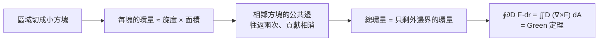

# 8.3 Green 定理

## 導言

一維的基本定理把「內部導數的積分」換成「邊界的函數值」。二維有沒有對應物？**George Green（1793–1841）** 1828 年自費出版的小冊子《電磁理論的數學分析》給出答案（Cauchy 1846、Riemann 1851 也獨立得到；俄語文獻稱 Ostrogradsky 定理）：**區域內部「旋度」的積分 = 邊界上的環量**。這是高維微積分基本定理的第一個完整形態，把 8.2 節的保守場理論與 9.2、9.3 節的兩大定理串成一族。

### 定理的敘述

**定理 8.3.1（Green 定理）**：設 $D$ 是平面上的閉有界區域，邊界 $\partial D$ 為分段光滑的簡單閉曲線，取**正向**（逆時針，使 $D$ 在左側）。若 $P, Q$ 有連續偏導，則

$$
\oint_{\partial D} P\,dx + Q\,dy = \iint_D \left(\frac{\partial Q}{\partial x} - \frac{\partial P}{\partial y}\right) dA.
$$

**兩種讀法**：

1. **切向形式**：$\oint \mathbf{F}\cdot d\mathbf{r} = \iint (\nabla\times\mathbf{F})\,dA$——環量 = 旋度的總和。內部每一小塊的「微渦旋」加起來，內部相鄰邊的貢獻互相抵消，只剩外邊界——**這是定理的靈魂圖像**。
2. **法向形式（散度定理的二維版）**：令 $(P, Q) = (-Q_1, P_1)$，得

$$
\oint_{\partial D} \mathbf{F}\cdot\mathbf{n}\,ds = \iint_D \left(\frac{\partial P_1}{\partial x} + \frac{\partial Q_1}{\partial y}\right) dA = \iint_D \nabla\cdot\mathbf{F}\,dA,
$$

——通量 = 散度的總和：流出邊界的總量 = 內部產生（源匯）的總量。

### 例題一：用 Green 定理簡化環量

**例題 8.3.2**：計算 $\displaystyle\oint_C \left(x^2 y\,dx + y^3\,dy\right)$，$C$ 為半徑 1 圓（逆時針）。

**解**：$P = x^2 y$、$Q = y^3$：

$$
\frac{\partial Q}{\partial x} - \frac{\partial P}{\partial y} = 0 - x^2 = -x^2.
$$

$$
\oint_C = \iint_D (-x^2)\,dA = -\int_0^{2\pi}\int_0^1 (r^2\cos^2\theta)\,r\,dr\,d\theta = -\pi\cdot\frac14 = -\frac{\pi}{4}. \qquad\blacksquare
$$

直接參數化圓也能算（$\int \cos^2 t \sin t\,dt$ 等較繁）；Green 定理把線積分化為一次極座標積分。**選型原則**：被積函數簡單而邊界複雜 → 用 Green；反之（內部奇點、區域難描述）→ 直接參數化。

### 例題二：面積公式——Green 定理的優雅副產品

**定理 8.3.3（平面面積的線積分公式）**：取 $P = -y$、$Q = 0$（或 $P=0, Q=x$，或平均值 $P = -\frac y2, Q = \frac x2$）：

$$
\operatorname{Area}(D) = \oint_{\partial D} x\,dy = -\oint_{\partial D} y\,dx = \frac12 \oint_{\partial D} (x\,dy - y\,dx).
$$

**例題 8.3.4**：用上式求椭圓 $x = a\cos t$、$y = b\sin t$（$0 \le t \le 2\pi$）的面積。

**解**：$dx = -a\sin t\,dt$、$dy = b\cos t\,dt$：

$$
A = \frac12\int_0^{2\pi} \big(a\cos t \cdot b\cos t - b\sin t\cdot(-a\sin t)\big)dt = \frac12 ab\int_0^{2\pi} 1\,dt = \pi ab. \qquad\blacksquare
$$

**實用之處**：數字化輪廓的面積——掃描儀沿多邊形/曲線的頂點序列，用 shoelace（鞋帶）公式 $\frac12\sum (x_i y_{i+1} - x_{i+1} y_i)$（正是線積分的離散化）即刻算出面積，GIS、CAD、電腦圖形學的標準操作。

### 多重邊界與「洞」的處理

若 $D$ 有洞（如圓環），正向邊界 = 外邊界逆時針 + **內洞順時針**（區域總在左手邊）。**挖洞法**：函數在洞上有奇點時，用內外邊界之間的「甜甜圈」區域套 Green：

$$
\oint_{\text{外}} = \oint_{\text{內}} + \iint_{\text{環}}(\text{旋度})\,dA.
$$

**範例**：8.2 節的渦旋角場 $\mathbf{F} = \frac{(-y, x)}{x^2 + y^2}$：在去掉原點的環形域上旋度為零，故

$$
\oint_{\text{外圓}} \mathbf{F}\cdot d\mathbf{r} = \oint_{\text{內圓}} \mathbf{F}\cdot d\mathbf{r} = 2\pi
$$

——**環量與半徑無關，全部來自中心的奇點**。這定量展示了 8.2 節「單連通性失效」的後果：環量的「量子」$2\pi$ 被中心奇點持有。拓撲荷、量子化磁通（超導）、螺線管外磁場的 Aharonov–Bohm 效應，都是這個數學結構的物理化身。

### Green 定理的證明骨架（一塊積木式）

**證明**（簡單情形，$x$-簡單域 $D$）：證兩半：

$$
\oint_{\partial D} P\,dx = -\iint_D \frac{\partial P}{\partial y}\,dA, \qquad
\oint_{\partial D} Q\,dy = \iint_D \frac{\partial Q}{\partial x}\,dA.
$$

**第一半**：$D = \{(x,y): \phi_1(x) \le y \le \phi_2(x)\}$，直接計算右邊：

$$
\iint_D \frac{\partial P}{\partial y} dA = \int_a^b \big[P(x, \phi_2(x)) - P(x, \phi_1(x))\big] dx.
$$

左邊：邊界分下曲線（右行）、上曲線（左行）兩段，$\oint P\,dx = \int_a^b P(x,\phi_1)\,dx - \int_a^b P(x,\phi_2)\,dx$——兩式相等。 $\blacksquare$

**一般區域**：切成 $x$-簡單與 $y$-簡單塊之和，公共邊貢獻相消（可加性 + 定向）。**歷史**：Green 1828 年的自費小冊子以勢論（用於電學）為主題，幾乎無人問津，直到 Kelvin 1845 年發現並推廣它（Green 函數、Green 定理之名由此）；Green 是磨坊主人自學成才（只受過一年正式教育），他的「位勢函數」思想領先物理學數十年。

### 保守場理論的完成

Green 定理補上 8.2 節定理的關鍵一環 **(3)⇒(4)⇒(1)**：

- **(3)⇒(4)**：若所有閉路積分為零，任取點 $\mathbf{a}$ 與微小矩形，$\frac{\partial Q}{\partial x} - \frac{\partial P}{\partial y}$ 若在某點非零，則其小鄰域上的積分（Green）非零，可縮成小閉路——矛盾；
- **(4)⇒(1)（單連通）**：對任意閉路 $C$，因 $D$ 單連通，$C$ 所圍區域 $S \subset D$，Green 定理給 $\oint_C = \iint_S \nabla\times\mathbf{F} = 0$。

**位勢理論與 Laplace 方程**：由 Green 定理導出**分部積分的二維版**（Green 恆等式）：

$$
\iint_D (u\nabla^2 v - v \nabla^2 u)\,dA = \oint_{\partial D} \left(u\frac{\partial v}{\partial n} - v\frac{\partial u}{\partial n}\right) ds.
$$

這是位勢論（Laplace 方程 $\nabla^2 u = 0$ 的邊值問題）、**Green 函數法**（點源響應函數，PDE 理論的核心工具，量子場論的傳播子）的起點——Green 1828 年小冊子的主題正是這個。

### 應用：平面流體與電磁學速寫

- **不可壓縮流**：$\nabla\cdot\mathbf{v} = 0$ $\Rightarrow$ 任意閉曲線的淨通量為零（法向形式）——流入 = 流出；
- **無旋流**：$\nabla\times\mathbf{v} = 0$ 且單連通 $\Rightarrow$ 速度有位勢 $\mathbf{v} = \nabla\phi$，且 $\phi$ 調和（$\nabla^2\phi = 0$）——機翼繞流理論（Kutta–Joukowski 升力定理用環量 $\Gamma = \oint \mathbf{v}\cdot d\mathbf{r}$ 表示升力 $L = \rho v \Gamma$）；
- **靜電 Gauss 定律二維版**：$\oint \mathbf{E}\cdot\mathbf{n}\,ds = \frac{Q_{\text{內}}}{\varepsilon_0}$——線電荷的電場 $\propto \frac{1}{r}$（二維放射），與三維 $\frac{1}{r^2}$（9.2 節）形成維度對照；
- **平面區域的形心**：$A\bar x = \iint_D x\,dA = \frac12\oint (x^2\,dy)$ 型公式（由 Green 翻轉），是 7.3 節形心計算的線積分速算法。

### 歷史前因後果

- **前因**：Cauchy 1825 複積分定理（解析函數閉路積分為零）與 Green 定理同構；Ampère 1826 的電磁環量定律是物理前身。
- **提出**：Green 1828；Cauchy 1846（平面形式）；Riemann 1851（複分析框架）；Ostrogradsky 1831（俄文傳統）。
- **解決了什麼**：二維場論的積分—微分橋樑；位勢邊值問題的系統方法（Green 函數）；複分析與實分析的深度連接。
- **引發新問題**：高維推廣（9.2 Gauss、9.3 Stokes）；帶洞區域的拓撲不變量（環量守恆 → de Rham 上同調，數學家 Cartan、Whitney 1930s 完成）；奇點的「荷」（指數定理、Poincaré–Hopf）。

## 與其他章節及領域的關聯

- **4.2 節**：Green 定理是 FTC 的高維近親——「內部微分 ↔ 邊界積分」哲學的第二站。
- **8.2 節**：保守場等價條件的證明引擎；渦旋角場的定量解剖。
- **9.2 節**：Gauss 定理（散度定理）是法向形式的立體推廣；9.3 節 Stokes 定理是切向形式的立體推廣。
- **10.3 節**：Maxwell 方程組的積分形式（Ampère、Faraday）在微分形式下由 Green/Stokes 一族定理統一。
- **複分析**：Cauchy 積分定理 = Green 定理 + Cauchy–Riemann 方程；留數定理是「洞中的奇點荷」理論。
- **微分幾何**：$\oint P\,dx + Q\,dy = \iint d(P\,dx + Q\,dy)$（外微分 $d\omega$）——廣義 Stokes 定理 $\int_{\partial M}\omega = \int_M d\omega$ 的二維特例。
- **計算機科學**：shoelace 面積公式、掃描線演算法、路徑積分的離散化；機器學習中的 normalizing flow 對數 Jacobian 與「面積守恆」變換。

## 練習

1. 用 Green 定理計算 $\displaystyle\oint_C (3y\,dx + 2x\,dy)$，$C$ 為頂點 $(0,0), (2,0), (0,4)$ 的三角形（正向）。
2. 用面積公式計算心臟線 $r = 1 + \cos\theta$ 圍成的面積（參數化 $x = r\cos\theta, y = r\sin\theta$ 代入線積分）。
3. 驗證 Green 定理對 $\mathbf{F} = (x^2, xy)$ 與正方形 $[0,1]^2$ 成立（兩邊都直接算）。
4. 計算 $\displaystyle\oint_C \frac{-y\,dx + x\,dy}{x^2 + y^2}$，$C$ 為不繞原點的任意閉曲線，並解釋與繞原點情形的差別。
5. 用 Green 定理（切向形式）證明：若 $\mathbf{F}$ 在單連通域無旋，則任何閉路積分為零——補完 8.2 節的等價鏈。
6. 思考題：Galperin 檯球法用完全彈性碰撞「計算」$\pi$（碰撞次數給出 $\pi$ 的各位數字）。查閱其幾何：質點在「楔形相空間」的反彈軌跡，面積展開係數是 $\sin\theta$ 的小角度展開。用 Green 定理/面積公式寫出相空間三角形的面積，解釋 $\pi$ 從何而來。

（本節完）
