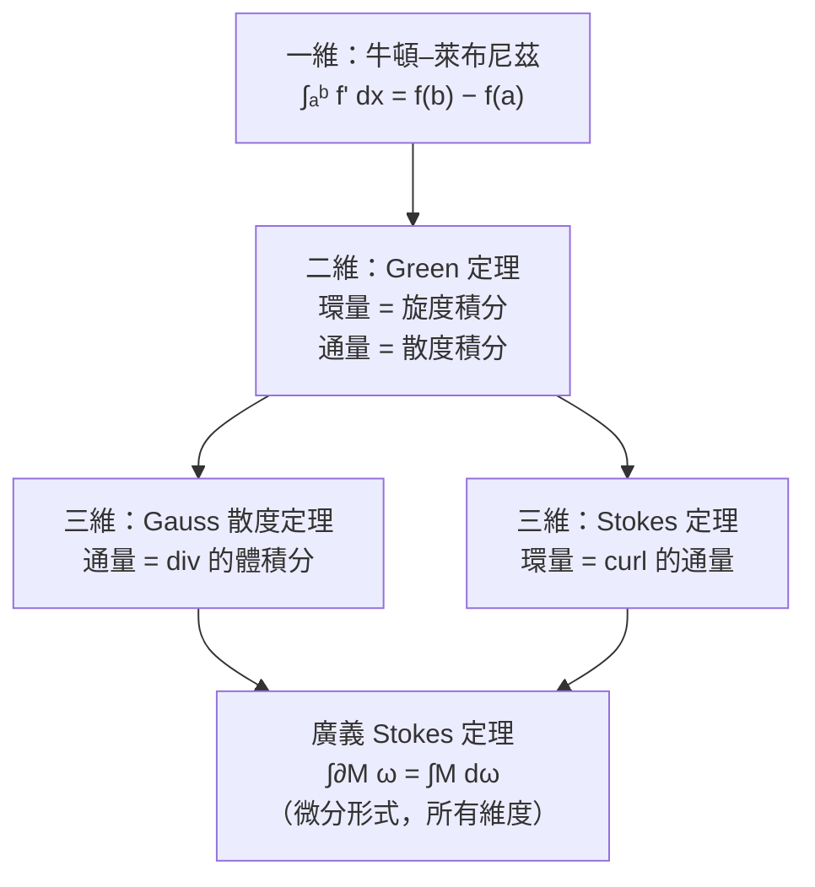

# 9.3 旋度與 Stokes 定理

## 導言

Gauss 定理處理「源與通量」；它的姊妹定理——**Stokes（斯托克斯）定理**——處理「渦旋與環量」：**向量場沿閉曲線的環量 = 旋度穿過該曲線所張任何曲面的通量**。此定義由 **George Stokes（1819–1903）** 1854 年在劍橋 Smith 獎試卷中首次出現（他從 Kelvin 1850 年的信中獲知，故又稱 Kelvin–Stokes 定理）。本節完成向量微積分的三大定理，並以廣義 Stokes 定理統一全書「內部微分 ↔ 邊界積分」的主題。

### 旋度：逐點的「渦旋強度」

**定義 9.3.1**： $\mathbf{F} = (P, Q, R)$ 的旋度：

$$
\nabla\times\mathbf{F} =
\det\begin{pmatrix}
\mathbf{i} & \mathbf{j} & \mathbf{k} \\
\partial_x & \partial_y & \partial_z \\
P & Q & R
\end{pmatrix}
= \left(\frac{\partial R}{\partial y} - \frac{\partial Q}{\partial z},\ \frac{\partial P}{\partial z} - \frac{\partial R}{\partial x},\ \frac{\partial Q}{\partial x} - \frac{\partial P}{\partial y}\right).
$$

**幫助記憶**：三個循環對 $(x, y, z) \to (y, z, x) \to (z, x, y)$ 。

**極限定義**：取過 $\mathbf{x}$ 、法向 $\hat{\mathbf{n}}$ 的小圓盤 $D_\varepsilon$ ：

$$
(\nabla\times\mathbf{F})\cdot\hat{\mathbf{n}} = \lim_{\varepsilon\to0} \frac{1}{\operatorname{Area}}\oint_{\partial D_\varepsilon}\mathbf{F}\cdot d\mathbf{r}.
$$

**旋度在 $\hat{\mathbf{n}}$ 方向的分量 = 單位面積的環量**。物理：小葉輪置於場中，其角速度 $\omega = \frac12\nabla\times\mathbf{F}$ （剛體旋轉場 $\mathbf{F} = \boldsymbol\omega\times\mathbf{r}$ 的旋度恰為 $2\boldsymbol\omega$ ）。

**例子**：

| 場 | 旋度 | 圖景 |
|----|------|------|
| $\mathbf{F} = (-y, x, 0)$ | $(0, 0, 2)$ | 剛體旋轉（角速度 1） |
| $\mathbf{F} = (x, y, z)$ | $\mathbf{0}$ | 放射不旋 |
| 剪切 $\mathbf{F} = (ky, 0, 0)$ | $(0, 0, k)$ | 層間滾動 |
| $\mathbf{F} = \nabla f$ | $\mathbf{0}$ | 梯度場無旋（6.1 節恆等式） |

### Stokes 定理

**定理 9.3.2（Kelvin–Stokes，1850/1854）**：設 $S$ 是以分段光滑閉曲線 $\partial S$ 為邊界的定向曲面， $\mathbf{F}$ 連續可微，法向與邊界定向滿足**右手約定**（沿 $\partial S$ 前進時頭部朝 $\hat{\mathbf{n}}$ 、區面在左），則

$$
\oint_{\partial S} \mathbf{F}\cdot d\mathbf{r} = \iint_S (\nabla\times\mathbf{F})\cdot\hat{\mathbf{n}}\,dS.
$$

**證明骨架**：平面片 $z = g(x, y)$ 時，直接計算（投影到 $xy$ 平面，用 Green 定理）：

$$
\iint_S (\nabla\times\mathbf{F})\cdot\hat{\mathbf{n}}\,dS
= \iint_{\text{投影}} \left[\left(R_y - Q_z\right)\left(-g_x\right) + \left(P_z - R_x\right)\left(-g_y\right) + \left(Q_x - P_y\right)\right] dx\,dy,
$$

而右邊恰是 $(P + Q g_x + R g_z)$ 型場的 Green 旋度（求偏導後 $g$ 的二階項依 Clairaut–Schwarz 相消）——線積分 $\oint P\,dx + Q\,dy + R\,dz$ 沿 $\partial S$ 的參數化在 $xy$ 平面的投影正是 Green 的邊界。**一般曲面**：切成小平面片，內部邊相消（8.3 節同一張圖），只剩外圈。

**深刻之處**：**右邊的曲面 $S$ 可以任意換**——只要邊界相同！因為兩曲面的差被散度定理吸收（ $(\nabla\times\mathbf{F})$ 無散，9.2 節推論 1）。環量是**邊界的性質，不是曲面的性質**。

### 例題一：用 Stokes 定理算環量

**例題 9.3.3**：計算 $\displaystyle\oint_C \mathbf{F}\cdot d\mathbf{r}$ ， $\mathbf{F} = (z^2, x, y^2)$ ， $C$ 為平面 $z = y$ 上、以 $(0,0,0), (1,0,0), (1,1,0)$ 的投影圓……具體取 $C$ ： $x^2 + y^2 = 1$ 、 $z = y$ 的斜橢圓（逆時針自 $+z$ 上方看）。

**解**：直接參數化很痛。用 Stokes：取 $S$ 為 $z = y$ 上的圓盤。 $\nabla\times\mathbf{F} = (2y - 0, 2z - 0, 1 - 0) = (2y, 2z, 1)$ 。

法向： $S: g = z - y = 0$ ， $\nabla g = (0, -1, 1)$ ，單位法向 $\hat{\mathbf{n}} = \frac{(0,-1,1)}{\sqrt2}$ （上指，符合定向）。旋度在法向的投影：

$$
(\nabla\times\mathbf{F})\cdot\hat{\mathbf{n}} = \frac{1}{\sqrt2}\left(-2y + 2z\right) = \frac{2(z - y)}{\sqrt2} = 0 \quad (\text{因曲面上 } z = y!).
$$

故 $\displaystyle\oint_C \mathbf{F}\cdot d\mathbf{r} = \iint_S 0\,dS = 0. \qquad\blacksquare$

**教訓**：換曲面（換成最「配合場」的）+ 投影簡化，可以把環量積分變成零。這正是 Stokes 定理的戰略價值：**環量問題可以選擇任何張在同邊界上的曲面**。

### 例題二：與 Green 定理的一致性

**例題 9.3.4**：取 $S$ 為 $xy$ 平面上的平面區域 $D$ （ $\hat{\mathbf{n}} = \mathbf{k}$ ），場 $\mathbf{F} = (P, Q, 0)$ ：

$$
\oint_{\partial D} P\,dx + Q\,dy = \iint_D \left(\frac{\partial Q}{\partial x} - \frac{\partial P}{\partial y}\right) dA,
$$

——**Green 定理**。Green 是 Stokes 的特例（也經由「 $z$ 方向的旋度分量」）。全書的定理譜系：

### 例題三：物理應用——Ampère 定律與 Faraday 定律

**例題 9.3.5（Ampère 定律）**：無限長直導線電流 $I$ （沿 $z$ 軸），磁場 $\mathbf{B} = \dfrac{\mu_0 I}{2\pi r}\hat{\boldsymbol\theta}$ 。驗證 $\oint \mathbf{B}\cdot d\mathbf{r} = \mu_0 I$ （半徑 $a$ 的圓）並與旋度聯繫。

**解**：直接（8.2 節渦旋角場的三維版）： $\mathbf{B}\cdot d\mathbf{r} = \frac{\mu_0 I}{2\pi a}\cdot a\,d\theta$ ，積分得 $\mu_0 I$ 。**旋度側**：柱座標下 $\nabla\times\mathbf{B}$ 在 $r \neq 0$ 處為零（ $B_\theta \propto \frac1r$ 的旋度恰消，如 8.2 節計算），但導線上（ $r=0$ ）有「渦旋奇點」承載全部環量——與 8.2 節、9.2 節的點源完全同構：**電流是磁場的「旋度源」**， $\nabla\times\mathbf{B} = \mu_0\mathbf{J}$ 。取任意張在迴路上的曲面，Stokes 定理保證環量只數「穿過曲面的電流」——**選不同曲面（如穿過電容極板間）就會發現電流不守恆，逼出 Maxwell 的位移電流**（9.2 節的歷史重點在此以環量語言重現）。

**Faraday 定律**： $\varepsilon = \oint \mathbf{E}\cdot d\mathbf{r} = -\dfrac{d\Phi_B}{dt} = -\iint_S \partial_t\mathbf{B}\cdot\hat{\mathbf{n}}\,dS$ 。對固定曲面用 Stokes 翻轉左邊：

$$
\iint_S \left(\nabla\times\mathbf{E} + \frac{\partial\mathbf{B}}{\partial t}\right)\cdot\hat{\mathbf{n}}\,dS = 0 \quad \forall S \implies \nabla\times\mathbf{E} = -\frac{\partial\mathbf{B}}{\partial t}.
$$

**積分形式 → 微分形式的標準操作**（「對任意曲面成立故被積式為零」）——Maxwell 1861 年正是用這一步把 Faraday 的實驗定律寫成微分方程。發電機、變壓器、無線充電，全部是 Stokes 定理的工業產品。

### 流體力學：Kelvin 環量定理與渦旋

**Kelvin 環量定理（1869）**：理想（無黏、正壓、體力保守）流體中，沿**隨流體移動**的閉曲線，環量守恆：

$$
\frac{D\Gamma}{Dt} = 0, \qquad \Gamma = \oint_C \mathbf{v}\cdot d\mathbf{r}.
$$

由 Stokes 定理， $\Gamma = \iint \boldsymbol\omega\cdot d\mathbf{S}$ （ $\boldsymbol\omega = \nabla\times\mathbf{v}$ 為渦量）——**渦旋（旋風、颱風、機翼尾渦）一旦生成便不生不滅**（Helmholtz 1858）。**應用**：

- **機翼升力**（Kutta–Joukowski，1902/1906）： $L = \rho v_\infty \Gamma$ ——升力正比於環量；環量由後緣起動渦的「誕生」補償（Kelvin 定理：總環量守恆，機翼帶走 $+\Gamma$ ，尾渦留下 $-\Gamma$ ）；
- **渦街**（Kármán 渦街）：橋樑風振、 Tacoma 海峽大橋（1940）事故的流體力學；
- **超流體**：環量量子化 $\Gamma = n\frac{h}{m}$ （Onsager–Feynman，1949/1955）——經典環量的拓撲荷思想在量子流體重生。

### 廣義 Stokes 定理：一本書的主題句

**定理 9.3.6（Cartan 形式的廣義 Stokes）**： $M$ 為 $(n+1)$ 維帶邊定向流形， $\omega$ 是 $n$ 次微分形式，則

$$
\int_{\partial M} \omega = \int_M d\omega.
$$

全書出現過的所有積分定理都是它的特例：

| 情形 | $\omega$ | 定理 |
|------|----------|------|
| $M = [a, b]$ ， $\omega = f$ （0-形式） | $\int_a^b f'\,dx = f(b) - f(a)$ | FTC |
| $M \subset \mathbb{R}^2$ ， $\omega = P\,dx + Q\,dy$ | $\iint d\omega = \iint (Q_x - P_y)\,dA$ | Green |
| $M \subset \mathbb{R}^3$ ， $\omega = \mathbf{F}\cdot d\mathbf{S}$ （2-形式） | 通量 = 散度積分 | Gauss |
| $M$ = 曲面， $\omega = \mathbf{F}\cdot d\mathbf{r}$ （1-形式） | 環量 = 旋度通量 | Stokes |

**統一哲學**：「邊界上的積分 = 內部微分後的積分」。**歷史**：Poincaré（1899）發現一般形式；Cartan（1899、1922）以外微分語言完成；Élie Cartan 的學生與後繼者（de Rham 1931 上同調）把它變成現代數學的基礎設施——微分幾何、電磁學的微分形式表述（Maxwell 方程 $dF = 0, d{*F} = J$ 兩行！）、規範場論（Yang–Mills）皆築於此。

### 保守場理論的終局

現在可以完整回收 8.2 節：

$$
\mathbf{F} \text{ 保守} \iff \nabla\times\mathbf{F} = \mathbf{0}\ (\text{單連通域})
\overset{\text{Stokes}}{\iff} \oint \mathbf{F}\cdot d\mathbf{r} = 0\ \forall\ \text{閉路}.
$$

**二維渦旋角場**與**三維螺線管外的磁場**（ $\mathbf{B}$ 沿 $\hat\theta \propto \frac{1}{r}$ ，管外旋度為零、環量 $\neq 0$ ）是「單連通性破壞等價鏈」的標本——拓撲（洞）透過積分定理對分析的影響，正是 **de Rham 上同調**的主題：一維的「洞」由 1-形式的閉而非恰當探測（電磁學的向量位勢 $\mathbf{A}$ 具有同樣的非唯一性： $\mathbf{A} \to \mathbf{A} + \nabla\lambda$ 不改變 $\mathbf{B} = \nabla\times\mathbf{A}$ ——規範自由度）。

### 歷史前因後果

- **前因**：Ampère 1826 環量定律；Green 1828；Kelvin 1850 給出定理敘述（信件中）；Cauchy 1846 平面形式。
- **提出**：Stokes 1854 年設為 Smith 獎考題（英國數學傳統：以考題發表定理）；Maxwell 1861–73 電磁應用；Heaviside 1885 向量記號定型。
- **解決了什麼**：環量—旋度的互譯；電磁學積分↔微分形式的橋樑；流體渦旋動力學的基礎。
- **引發新問題**：渦旋的拓撲（渦環、渦絲的穩定性）、規範場論（fiber bundle 上的聯絡與曲率——電磁場強 $F$ 即「曲率」，Stokes 定理的叢版本陳述了 Chern 特徵類）、重力波的四極輻射（環量型的通量估計）。

## 與其他章節及領域的關聯

- **4.2 節**：FTC 是 Stokes 族的第一站；「邊界 — 內部」對偶貫穿全書。
- **8.3 節**：Green 定理 = Stokes 的平面特例；補丁相消圖像共用。
- **9.1、9.2 節**：通量積分與散度定理供給本節的語言與對偶。
- **微分幾何**：1-形式的積分、外微分、de Rham 理論；陳類（ Chern 1944）——Stokes 定理是纖維叢理論的積分學。
- **電磁學**：Maxwell 四方程的微分/積分形式互譯、電動勢、位移電流的發現邏輯。
- **流體力學**：渦量動力學、Kutta–Joukowski 升力、氣象（位渦守恆——天氣預報的核心守恆量）。
- **量子物理**：Aharonov–Bohm 效應（向量位勢的環量有可測效應）、超導磁通量子化、Berry 相位——「環量的量子化」是二十世紀物理反覆出現的主題。

## 練習

1. 用 Stokes 定理計算 $\displaystyle\oint_C (y\,dx + z\,dy + x\,dz)$ ， $C$ 為三角形邊界 $(1,0,0) \to (0,1,0) \to (0,0,1) \to (1,0,0)$ （取 $S$ 為該平面三角形，法向 $\frac{(1,1,1)}{\sqrt3}$ ）。
2. 對 $\mathbf{F} = (x z, y z, xy)$ 與上半球面（含邊界圓），用 Stokes 定理計算邊界環量；再用直接參數化驗證。
3. 證明 $\nabla\times(\nabla f) = \mathbf{0}$ ，並用 Stokes 定理給出「環量為零」的解釋。
4. 一電子以速度 $\mathbf{v}$ 通過磁場 $\mathbf{B}$ （Lorentz 力 $\mathbf{F} = q\mathbf{v}\times\mathbf{B}$ ）。用 Stokes 定理解釋：為什麼帶電粒子在均勻磁場中做圓周運動的軌道角動量變化率與穿過軌道的磁通量變化率相關（提示：計算 $\frac{d}{dt}\oint \mathbf{p}\cdot d\mathbf{r}$ 與 Faraday 定律對照）。
5. 計算螺線管外磁場 $\mathbf{B} = \frac{\mu_0 n I R^2}{2r}\hat\theta$ （ $r > R$ ）沿半徑 $r$ 圓的環量，並說明為何「管外 $\nabla\times\mathbf{B} = 0$ 但環量不為零」與 Stokes 定理不矛盾（管外無渦但曲面穿過管內——奇性承載環量）。
6. 思考題：用微分形式語言把 9.2 節 Maxwell 方程寫成 $dF = 0$ 、 $d{*F} = J$ 。查閱並解釋：為什麼 $dF = 0$ 局部蘊含 $F = dA$ （Poincaré 引理），而全域上「洞」可能阻礙它（磁單極的數學障礙）？這與本節 de Rham 討論如何呼應？

（本節完）
