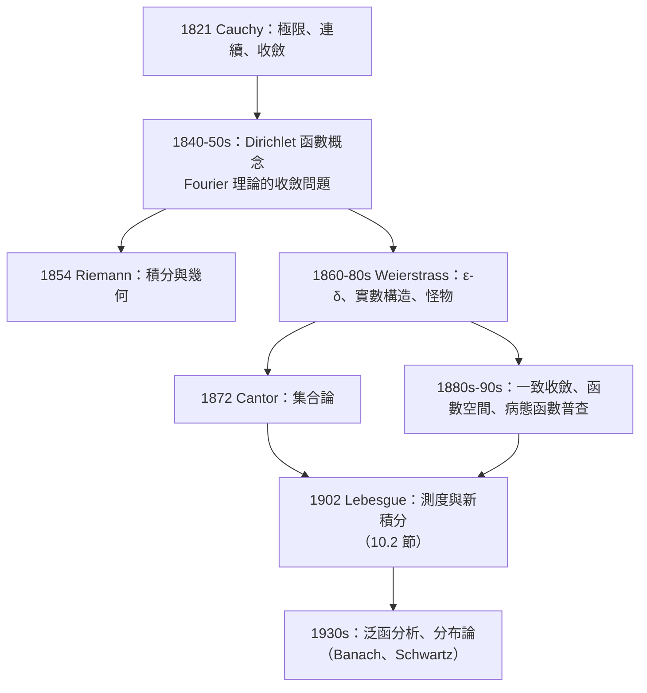

# 10.1 Cauchy 與 Weierstrass 的嚴格化

## 導言

十八世紀的微積分是一台效率驚人、地基鬆動的機器：Euler 用它打開了半個數學世界，但「無窮小」「發散級數」「連續」等核心詞彙沒有一個經得起追問。十九世紀上半葉，**Augustin-Louis Cauchy（1789–1857）** 與 **Karl Weierstrass（1815–1897）** 先後完成了分析學的嚴格化——把極限、連續、導數、積分、級數全部鑄成邏輯無懈可擊的定義與定理。本節梳理這場「分析算術化」運動的完整歷程與其深遠影響。

### 危機清單：十八世紀末分析的軟肋

到 1800 年前後，分析學面對的問題清單：

| 問題 | 具體症狀 | 後果 |
|------|----------|------|
| 無窮小本體不明 | $dx$ 是零還是非零？（1.1 節兩難） | Berkeley「已死量的幽靈」攻擊（1734） |
| 級數濫用 | $1 - 1 + 1 - \cdots = \frac12$ 型操作、發散級數得出錯誤值 | 錯誤結論混入文獻 |
| 「函數」概念混亂 | Euler 的「解析式」vs. Fourier 的「任意曲線」（1807） | 連續性、可展開性的定義缺失 |
| 極限無定義 | d'Alembert 的描述性語言無法承載證明 | 關鍵定理（如級數逐項操作）靠直覺 |
| 積分無定義 | 「原函數的反運算」與「面積」二義 | 何時可積？何時可換序？ |

**Fourier 1807 年的熱傳導論文**是壓垮舊框架的一根稻草：他斷言任意（甚至分段不連續的）函數可展開為三角級數——這在「函數=解析式」的世界觀裡不可思議（三角級數是無窮多解析式之和，其和不連續！）。拉格朗日反對、泊松懷疑，但傅立葉的計算成功了。**「什麼樣的函數存在」成為必須回答的問題**——嚴格化不再是哲學潔癖，而是理論存亡問題。

### Cauchy 的《分析教程》（1821）：定義的革命

**Cauchy 1821–1829 年的三大著作**（《分析教程》《無窮小計算概要》《微分學講義》）做成了五件大事：

1. **極限的正式定義**：「若一變量的連續狀態逐漸向某極限靠近，使其與極限之差可小於任意給定量，則稱該極限為其極限」——「無窮小」被**降級**為「趨於零的變量」，不再是本體論的實體。
2. **連續性**：$f(x + \alpha) - f(x)$ 隨 $\alpha$ 無窮小而無窮小——首次以極限定義連續。
3. **級數收斂**：部分和極限 + **Cauchy 準則**（不用知道和即可判斷收斂）——發散級數被逐出嚴格數學（至少暫時）。
4. **積分**：定義為「和的極限」（對連續函數）——積分從「反微分」獨立出來，之後（1823）證明 FTC 連接兩者。
5. **中值定理**：以連續性 + 可導性嚴格證明 MVT，成為誤差估計的引擎。

**Cauchy 的工程學心態**：他在巴黎綜合理工學院教書，面對的是未來工程師——他需要**可教、可查、可用的定義**。他自述其方法：

> 「至於方法，我力求賦予它幾何中要求的全部嚴格性，絕不援引從代數的一般原則引來的論據——這類論據雖然被廣泛接受，卻主要適用於實際用途，與數學的嚴格性背道而馳。」

（意指：十八世紀「冪級數代數操作」的傳統做法在邏輯上不合法。）**Cauchy 的遺產**：今日教科書的極限—連續—導數—積分順序（包括本書第 1–4 章）就是他的《分析教程》結構。

**Cauchy 的未竟之業**：

- 他的連續性定義仍是「動態」的（「無窮小增量」）——全量詞的 $\varepsilon$–$\delta$ 尚未成形；
- 1821 年他**錯了**一次：聲稱連續函數級數之和連續（反例：$\sum \frac{\sin nx}{n}$ 的鋸齒和不連續）——1853 年他自我修正，補上「一致收斂」的觀念（5.3 節）；
- 連續函數是否可導？他與同代人相信「除了個別尖點外可導」——Weierstrass 的怪物即將粉碎它。

### Abel 與 Dirichlet：概念邊界的擴張者

- **Niels Henrik Abel（1802–1829）** 1826 年《論無窮級數》：批判歐拉式操作，證明二項級數收斂域的精確定理（Abel 定理：冪級數在收斂端點的連續性）。他感嘆「分析學中還有這麼多沒有證明的東西」。
- **Peter Gustav Lejeune Dirichlet（1805–1859）** 1829 年論 Fourier 級數收斂性（Dirichlet 判別法的來源），並提出**Dirichlet 函數**：

$$
D(x) = \begin{cases} 1, & x \in \mathbb{Q}, \\ 0, & x \notin \mathbb{Q}, \end{cases}
$$

——**無法用任何單一解析式表示、處處不連續**的函數。Dirichlet 主張：函數是「**任意的對應法則**」——每個 $x$ 按某規則對應一個 $y$ 即可，無需解析式。**這是現代函數概念的正式誕生**（雖然 Euler 1755 年已有類似表述）。舊世界（函數=式子）與新世界（函數=對應）的分水嶺。

### Weierstrass：算術化的完成者

**Karl Weierstrass** 的職業路徑傳奇：中學教師（教體育、書法、算術）自學分析十四年，1854 年以橢圓函數論文震動學界，1856 年獲柏林大學教職。他的影響主要通過**講課**（1860s–1880s，聽者包括 Hölder、Cantor、Kovalevskaya、Mittag-Leffler、Frobenius……）。

**四大貢獻**：

1. **$\varepsilon$–$\delta$ 語言**（1860s 講義；由學生 Heine 1872 年發表）：把 Cauchy 的動態語言翻譯為全量詞邏輯——1.2 節的定義。**連續性、極限、可微、一致收斂全部獲得統一的句式**。Weierstrass 說：「如果不在時間中思考變量如何變動，而只把它看作通過一系列確定值的量，就能避免一切模糊。」——**驅逐時間與運動，只留靜態邏輯**。
2. **實數的構造**（1872 講義，公開於學生手記）：以有理數的總體（實數 = 有界單調有理數列的等價類）構造 $\mathbb{R}$，確立**完備性**。**隨後的兩篇里程碑**：Dedekind 1872《連續性與無理數》（分割理論）、Cantor 1872（基本數列）——**分析學的地面（實數體）從此自己也是建造出來的**，微積分的邏輯鏈最終落到集合與自然數。
3. **Weierstrass 函數**（1872 年報告）：

$$
W(x) = \sum_{n=0}^{\infty} a^n \cos(b^n \pi x), \qquad 0 < a < 1,\ b\ \text{奇}，\ ab > 1 + \tfrac{3\pi}{2}.
$$

由 M-判別法一致收斂（連續），但逐項求導的項 $\sum (ab)^n\sin(\cdot)$ 發散——**處處連續、處處不可導**。Du Bois-Reymond 1875 年正式發表並稱之為「理性的折磨」(Scherz und Ernst)。**直觀的死刑判決**：「連續曲線必有切線（除有限點）」被證偽；幾何直觀從此不能作為分析的仲裁者。
4. **解析函數論與一致收斂**：Weierstrass 以冪級數為基礎重建複分析（與 Riemann 的幾何路線對立而互補），確立一致收斂為級數操作的合法性標準（5.3 節）——「Weierstrass M-判別法」。

### Riemann 的並行革命

**Bernhard Riemann（1826–1866）**（Gauss 的接班人）在同一時代的三項工作重塑了分析：

- **1854 年兩篇講演**：《論幾何基礎的假設》（Riemann 幾何——六十年後愛因斯坦廣義相對論的數學）與三角級數論文（Riemann 積分——3.2 節）；
- **概念風格**：與 Weierstrass 的「算術化」不同，Riemann 是**拓撲/幾何**直觀的大師（Riemann 面、Riemann 和都是「對象 + 結構」的思維）；
- 兩人風格對立（Weierstrass 曾批評 Riemann 的證明「缺乏嚴格性」），但後世證明兩條路都通向現代分析——**算術化（邏輯）與結構化（幾何）是嚴格化的雙翼**。

### 嚴格化的連鎖效應

**病態函數普查**（十九世紀末的「怪獸畫廊」）：

| 年代 | 函數 | 打破的信念 |
|------|------|------------|
| 1829 | Dirichlet 函數 | 函數須可表達 |
| 1872 | Weierstrass 函數 | 連續 ⇒ 幾乎處處可導 |
| 1881 | Volterra 函數 | 可導函數的導數可積（Riemann 意義） |
| 1890 | Peano 曲線 | 曲線不降維（一條曲線填滿正方形！） |
| 1902 | Cantor 集（1883）與函數 | 「小集合」的測度理論需求 |

每一個「反例」不是搗亂，而是**概念邊界的測繪**：它們迫使數學家區分連續/可微/可積的精確層級（5.3 節階梯表），並最終要求更強的積分理論——Lebesgue 登場（10.2 節）。

### 教育學的迴響：我們如何教微積分

嚴格化塑造了二十世紀微積分教學的兩難：

- **Cauchy 路線**（本書採用）：直觀引入 → 嚴格定義 → 定理證明 → 技巧訓練；
- **Kline 批判**（Morris Kline《Why the professor can't teach》，1977）：過早的 $\varepsilon$–$\delta$ 壓垮初學者——畢竟人類花兩千年才消化它；
- **現代折衷**：先操作（1.1 節歷史與計算），再嚴格（1.2 節），把「為何需要嚴格」的歷史動機（Berkeley、怪物、Fourier）作為學習的燃料——**歷史不是裝飾，而是理解的骨架**，這正是本書每節配歷史的原因。

## 與其他章節及領域的關聯

- **1.1–1.3、3.2、5.3 節**：本節歷史直接對應的那些定義與定理。
- **10.2 節**：嚴格化的下一步——Lebesgue 積分與測度論。
- **10.3 節**：嚴格化之後，微積分如何驅動二十世紀科學。
- **數理邏輯**：Weierstrass 的量詞句式、Cantor 的集合論、Frege–Peano–Hilbert 的公理化——分析算術化是數理邏輯誕生的直接動力之一；Hilbert 1900 年問題清單的第 6 問（物理公理化）與第 2 問（連續統假設）皆由此譜系生長。
- **哲學**：形式主義 vs. 直觀主義的世紀之爭（Hilbert–Brouwer）的源頭之一。
- **計算機科學**：$\varepsilon$–$\delta$ 的量詞結構、可計算性（Turing 1936 對「實數」的重新審視——可計算實數只是實數的可數子集）、浮點誤差分析（Wilkinson）——Weierstrass 精神的數位後裔。

## 練習

1. 寫出 Cauchy 1821 極限定義與 Weierstrass $\varepsilon$–$\delta$ 的對照，指出「動態 vs. 靜態」的翻譯點。
2. 用 M-判別法證明 Weierstrass 函數連續；解釋為何 $ab > 1$ 的條件破壞逐項可導性。
3. 說明 Fourier 1807 的斷言如何逼出「函數概念」與「收斂概念」的雙重革命。
4. 對照 Riemann 積分與 Cauchy 積分定義的差異（分割自由度、函數類範圍）。
5. 查閱 Peano 曲線的構造（區間套 + 三進位編碼），說明它如何「填滿」正方形；這對「維數」概念的衝擊引出了什麼（拓撲維數、Hausdorff 維數）？
6. 思考題：如果 Weierstrass 函數在 1820 年就被發現，微積分的發展會怎樣不同？（考慮：嚴格化的動機是否提前、物理學家的直觀是否受挫、教育路線是否改變。）寫 300 字的「反事實科學史」。

（本節完）
