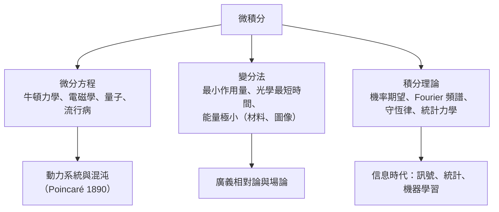

# 10.3 微積分如何驅動科學

## 導言

全書最後一節回到宏觀：微積分不只是數學的一章，而是**近代科學的操作系統**。從 Newton 的行星軌道到 Maxwell 的光速、Einstein 的時空彎曲、Schrödinger 的波函數、Tukey 與 Fourier 的訊號、深度學習的梯度下降——三百年來，「變化率」與「累積」的數學一次次成為新科學的語法。本節縱覽這些應用，並回望微積分留給未來的問題。

### 微積分的科學語法：三個母模板

絕大多數定量科學模型可歸結為三種微積分模板：

1. **微分方程**（變化律）： $\dot{\mathbf{x}} = \mathbf{F}(\mathbf{x})$ ——「現在的變化率決定未來」。
2. **變分原理**（優化律）：真實軌跡使某泛函 $\int L\,dt$ 取極值——「大自然走最經濟的路」。
3. **積分變換與平均**（測量律）：物理量由積分定義（能量、熵、期望、頻譜）。

### 第一次驅動：力學與天文（1666–1800）

**Kepler 問題的解**：Newton 由 $\ddot{\mathbf{r}} = -\frac{GM}{r^3}\mathbf{r}$ （平方反比 + 7.3 節球殼定理）推出椭圓軌道、面積定律（角動量守恆 $\frac{d}{dt}(\mathbf{r}\times\dot{\mathbf{r}}) = 0$ ）、週期定律——開普勒三條經驗定律被一個微分方程統一。**這是「數學預言自然」的範式確立時刻**：Halley 1705 用之預言彗星回歸（1758 應驗）、1846 年 Le Verrier 以天王星軌道擾動**算出海王星的位置**（柏林天文台當夜找到，誤差 1° 內）——微積分的預言力達到神話級。

**Lagrange 與 Hamilton 的抽象化**：Lagrange 方程（1788）

$$
\frac{d}{dt}\frac{\partial L}{\partial \dot{q}_i} - \frac{\partial L}{\partial q_i} = 0,
$$

把力學化為「優化泛函」的數學（10.3 模板 2）；Hamilton 1834 的正則形式（ $\dot{q} = \partial H/\partial p$ ）成為量子力學與 symplectic 幾何的入口。**變分法（Euler–Lagrange 1744）**本身是微積分的無窮維推廣：「導數為零」升級為「泛函變分為零」。

### 第二次驅動：電磁學與光（1820–1900)

**Maxwell 方程組**（9.2、9.3 節）是微積分最大的一次科學勝利：

$$
\nabla\cdot\mathbf{E} = \frac{\rho}{\varepsilon_0},\quad
\nabla\cdot\mathbf{B} = 0,\quad
\nabla\times\mathbf{E} = -\frac{\partial\mathbf{B}}{\partial t},\quad
\nabla\times\mathbf{B} = \mu_0\mathbf{J} + \mu_0\varepsilon_0\frac{\partial\mathbf{E}}{\partial t}.
$$

**推導波動方程**：真空（ $\rho = \mathbf{J} = 0$ ）中對第四式取旋度、代入第三式（用 $\nabla\times(\nabla\times) = \nabla(\nabla\cdot) - \nabla^2$ ）：

$$
\nabla^2\mathbf{E} = \mu_0\varepsilon_0\frac{\partial^2\mathbf{E}}{\partial t^2},
\qquad c = \frac{1}{\sqrt{\mu_0\varepsilon_0}} \approx 3\times10^8\ \mathrm{m/s}.
$$

**與光速吻合**——1865 年 Maxwell 寫道：「光就是電磁擾動。」Hertz 1887 年實驗證實。**數學一致性（位移電流）→ 理論預言（電磁波）→ 技術革命（無線電、雷達、光纖、手機）**——這條鏈的每一環都是微積分：散度、旋度、波動方程、Fourier 分析（頻帶分配）。

### 第三次驅動：統計、熱與機率（1800–1933）

**Fourier 熱傳導（1822）**：熱方程 $\partial_t u = k\nabla^2 u$ 的分離變數解 $u = \sum c_n e^{-n^2t}\sin nx$ 引出 Fourier 級數——**訊號分析的誕生**。今日一切壓縮（JPEG、MP3）、濾波、頻譜分析，都是 1822 年那篇論文的子孫。

**統計力學**：Boltzmann 分布 $p_i \propto e^{-E_i/kT}$ 由最大熵 + Lagrange 乘數法導出（6.3 節）；配分函數 $Z = \sum e^{-\beta E_i}$ 的各階導數給出能量、熱容（微積分在微觀—宏觀之間的翻譯機）。**Maxwell 速率分布**（1860） $f(v) \propto v^2 e^{-mv^2/2kT}$ 的歸一化正是 Gauss 積分（7.2 節）。

**Kolmogorov 公理化（1933）**：機率 = 測度（10.2 節），微積分成為不確定性的數學。

### 第四次驅動：相對論與量子（1905–1930）

**廣義相對論（Einstein 1915）**：度規張量 $g_{\mu\nu}$ 滿足場方程（Ricci 曲率 = 能量動量）——**Riemann 1854 年的幾何 + 張量分析（Ricci–Levi-Civita 1900）** 的應用。測地線方程（變分法： $\delta\int ds = 0$ ）就是自由落體；光線彎曲（1919 Eddington 日食觀測）與引力波（LIGO 2015 直接探測）都是場方程的積分/微分推論。**微積分的極限（9.2 節散度定理的流形版）承載了時空守恆律**。

**量子力學（1925–1932）**：Schrödinger 方程 $i\hbar\psi_t = -\frac{\hbar^2}{2m}\nabla^2\psi + V\psi$ （Laplacian——微積分核心算子）；Heisenberg 矩陣力學；von Neumann 1932 以希爾伯特空間（Lebesgue $L^2$ 的抽象化）公理化——**測度論是量子論的數學載體**；不確定原理 $\Delta x\,\Delta p \ge \frac{\hbar}{2}$ 的證明是 Cauchy–Schwarz 不等式（3.3 節）。

### 第五次驅動：計算與資訊（1945–）

**數值分析**：有限差分、有限元素（Courant 1943）、譜方法——微分方程的離散化；數值積分（3.2 節的後裔）計算一切算不出的積分。**Monte Carlo**（Ulam–von Neumann 1946，核武模擬）以隨機取樣估計積分——高維積分的唯一實用解法。

**控制論與導航**：Kalman 濾波（1960）——最小平方 + 條件期望（測度論）；阿波羅登月軌道、GPS、導彈防禦，全部在解微積分。

**訊號與壓縮**：Shannon 1948 的資訊熵 $H = -\sum p\log p$ （連續版 $-\int p\log p$ ，微積分 + 最大熵）；Nyquist–Shannon 取樣定理（帶寬有限函數可由樣本完全重構——Fourier 理論）是數位世界的憲法。

### 第六次驅動：機器學習（1986–）

**深度學習的數學核心全部在本書內**：

| ML 概念 | 微積分本源 | 本書章節 |
|---------|------------|----------|
| 損失最小化 | 梯度與極值 | 6.1、6.3 |
| 反向傳播 | 鏈鎖律（反向模式） | 2.2、6.2 |
| Adam/RMSProp | 一二階矩的移動平均（積分式平均） | 3.2、7.1 |
| Softmax 與交叉熵 | 最大熵 + Lagrange 乘數 | 6.3 |
| Normalizing flow | 變數變換 Jacobian | 7.2 |
| 擴散模型 | 隨機微分方程（梯度場漂移） | 8.1、10.2 |
| 泛化界 | 一致收斂 | 5.3 |
| 注意力機制 | 指數核的加權平均（Softmax = Boltzmann） | 10.3 本節 |

**2018 年圖靈獎**頒給反向傳播三巨頭（Hinton、LeCun、Bengio）——本質上頒給了 2.2 節的鏈鎖律。**微積分第一次成為「就業技能」的直接組成**：梯度、Jacobian、期望、KL 散度（最大熵的積分形式）是機器學習工程師的每日詞彙。

### 未解與未來：微積分的開放邊疆

1. **Navier–Stokes 光滑性**（Clay 千禧問題）：湍流的微積分基礎仍未完成；
2. **湍流理論**：Kolmogorov 1941 的 $5/3$ 律（譜冪律——Fourier 空間的微積分）是唯象理論，嚴格推導缺失；
3. **量子引力的數學**：路徑積分 $\int \mathcal{D}\phi\,e^{iS/\hbar}$ （無窮維的「積分」）至今缺乏嚴格定義——Feynman 積分是 Lebesgue 積分的未竟擴張；
4. **深度學習理論**：過參數化網路的泛化（「為什麼不過擬合」）、神經正切核（NTK，無限寬網路的核函數——再現 5.3 節核與 Hilbert 空間）、隨機梯度動力學的測度論描述；
5. **數位實數的哲學**：可計算分析學（computable analysis）——把 $\varepsilon$ – $\delta$ 變成演算法規格，Weierstrass 的精神進入圖靈機。

### 回望：兩千三百年的主線

| 時代 | 關鍵詞 | 人物 |
|------|--------|------|
| 前 400 年 | 窮竭法 | Eudoxus、Archimedes |
| 263–1400 | 割圓術、級數 | 劉徽、祖沖之、Madhava |
| 1635–1665 | 不可分量、切線 | Cavalieri、Fermat、Wallis |
| 1665–1684 | 流數、微分 | Newton、Leibniz |
| 1687–1800 | 應用的黃金世紀 | Euler、Lagrange、Laplace |
| 1821–1880 | 嚴格化 | Cauchy、Dirichlet、Riemann、Weierstrass |
| 1902–1933 | 測度與公理化 | Lebesgue、Hilbert、Kolmogorov |
| 1945– | 分布、計算、學習 | Schwartz、Turing、現代 ML |

**主線**：每一代人以直觀開路、以嚴格收尾、以應用回饋動機。Zeno 的悖論變成了收斂的定義；Berkeley 的嘲笑變成了 $\varepsilon$ – $\delta$ ；Fourier 的「非法」級數變成了 $L^2$ 空間；物理學家的 $\delta$ 函數變成了分布理論。**微積分最深的教訓不是任何一條定理，而是這個循環本身**——直觀、爭議、嚴格、應用、再直觀。願本書的讀者帶著這個循環走向自己的領域。

## 與全書的回環

- **第 1 章**的極限是這一切的邏輯種子；**第 10 章**的分布論是它的哲學果實。
- **第 4 章**的 FTC 在 **9.3 節**長成廣義 Stokes 定理——「邊界與內部」的對偶是數學少有的跨兩百年主題。
- **第 5 章的級數**在 10.2 的 $L^2$ 中獲得幾何身份（正交分解）；**第 6–9 章的多變數與向量工具**在相對論、電磁學、ML 中各自找到工位。
- 每一節的「歷史」與「關聯」小節，此刻應該合併為一張網——讀者可以驗證：書中任何兩節之間都存在至少一條數學或歷史的路徑。**知識的圖譜，本來就是一個連通域。**

## 練習（全書總複習式）

1. 用一句話向中學生解釋導數、積分、極限各自「解決了什麼問題」。
2. 把 Maxwell 推出電磁波的推導（本節）寫成 8 行以內，標明用到的每個微積分工具及其出處章節。
3. 從 Lagrange 乘數法出發，完整推導最大熵分布：(a) 離散有限集 → 均勻；(b) 離散 + 平均能量約束 → Boltzmann；(c) 連續 + 固定變異數 → 常態分布。三題共用什麼數學結構？
4. 查閱 Clay 研究所對 Navier–Stokes 問題的正式敘述，辨認其中的微積分概念（光滑性、能量估計、散度），寫出你對「難點在哪」的分析。
5. 寫一段 500 字短文：如果你向 1687 年的 Newton 展示今天的深度學習（反向傳播訓練百億參數），他最能共鳴的是哪個數學結構？為什麼？
6. 思考題（終極）：本書以「無窮小的困擾」開篇，以「分布理論中 $\delta$ 的嚴格化」收尾。請論證：Leibniz 的 $dx$ 、Cauchy 的極限、Robinson 的非標準分析、Schwartz 的分布，四者對「無窮小」的回答各自解決了什麼、犧牲了什麼——並指出下一個「嚴格化」可能發生的領域。

（全書完）
