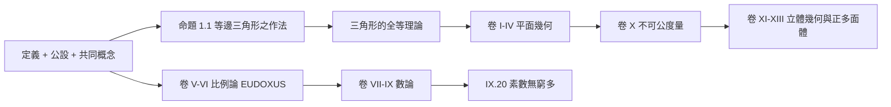

# 1.1 EUCLID原本與公理方法的兩千年

## 本章導言

數學基礎的故事，不是從危機開始，而是從一次了不起的勝利開始：約西元前 300 年，Euclid 在亞歷山大寫下《原本》（Στοιχεῖα），把幾何、數論的數百條結果組織成「少數公設 → 定義 → 逐步演繹」的結構。此後兩千餘年，「公理方法」成為數學知識的典範，也埋下了本書全部主角的種子：什麼是不用證明就接受的起點？起點之間自洽嗎？第五公設是不是「多餘的」？這些問題將一路逼出非歐幾何、形式邏輯、集合論與不完備定理。

### 《原本》的結構：公理方法的第一次勝利

《原本》十三卷、約 465 個命題，起點是 23 個定義、5 條公設（postulates，限幾何）、5 條共同概念（common notions，一般量的常識）。關鍵的公設與共同概念如下：

- **公設 1**：過任意兩點可作一直線。
- **公設 2**：直線可無限延長。
- **公設 3**：以任意點為圓心、任意長為半徑可作圓。
- **公設 4**：所有直角彼此相等。
- **公設 5（平行公設）**：一直線與兩直線相交，若同側內角和小於兩直角，則兩直線延長後在該側相交。
- **共同概念**：等量加等量其和相等；全量大於部分，等等。

方法論上的驚人之處：**每一步推理都指明依據**——或引前證命題，或引公設。亞里士多德在《後分析篇》中已給出理論框架：科學是「從第一因出發的必然演繹」，第一因必須真、直接、比結論更可知。Euclid 是這套哲學的工程實現。

### 第五公設的兩千年圍剿

Euclid 自己似乎都覺得公設 5 不夠「自明」——它敘述冗長、像是定理，而且他在卷 I 前二十八個命題中都刻意不用它。於是兩千年間，數學家的共同事業變成「證明它」：把它從公理降格為定理。

| 人物 | 年代 | 進路 | 結局 |
|------|------|------|------|
| Proclus | 5 世紀 | 指其「應為定理」 | 自己的「證明」偷用了等距假設 |
| Ibn al-Haytham | 約1000 | 用「平行線距離恆定」 | 假設了等價命題 |
| Saccheri | 1733 | 反證法：否定公設推矛盾 | 推出離奇結果，誤當矛盾 |
| Lambert | 1766 | 系統研究「虛幾何」 | 意識到面積與角虧成正比 |
| Legendre | 1794–1833 | 多次「證明」 | 屢被自己或後人推翻 |

最戲劇性的是 **Saccheri**：他在《Euclid 無懈可擊》（1733）中假設第五公設為假，推出四角形有「銳角假設」（角和小於兩直角）與「鈍角假設」兩支，再拼命推矛盾。銳角一支愈推愈遠，得到「過線外一點有無窮多條平行線」「三角形內角和小於 $180°$ 且面積有上界」等結果——這些正是非歐幾何的定理，他卻以「與直線的本性矛盾」宣布放棄。**真理已到眼前，直覺卻擋在門口。**

### 非歐幾何：換掉一條公理的宇宙

十九世紀二十年代，三個人幾乎同時想通了關鍵一步：否定第五公設不會導致矛盾，而是導致**另一個同樣自洽的幾何**。

- **Gauss**（約1813起，未發表）：私下通信中稱之為「非歐幾何」，並實測三座山頭的三角形內角和檢驗空間性質。
- **Lobachevsky**（1829，喀山）：首度公開發表，稱「虛幾何」。
- **Bolyai**（1832，軍官，附於父親書中附錄）：Gauss 收到後回信「讚美它等於讚美我自己」，Bolyai 崩潰。

其模型化證明遲至 1868 年由 **Beltrami** 給出：在圓盤內以「測地線」重新詮釋「直線」，雙曲幾何的全部公理在歐氏圓盤內都成立。這一步的哲學殺傷力遠超幾何本身：

> **公理不再是「顯然為真的命題」，而是「一個理論的起點」；公理系統的真理問題變成「模型是否存在、是否自洽」的問題。**

### 一個具體例子：雙曲平面上的三角形

**例題 1.1.1**：在雙曲幾何（Lobachevsky–Bolyai 幾何）中，證明三角形的內角和小於 $180°$ ，且由三個「理想點」（無窮遠處）構成的理想三角形內角和為 $0$ 。並驗證 Poincaré 圓盤模型中一個具體三角形的角。

**解**：在雙曲幾何中，設三角形內角為 $\alpha, \beta, \gamma$ ，**Gauss–Bonnet 定理**給出

$$
(\pi - (\alpha+\beta+\gamma)) = \operatorname{Area}(\Delta),
$$

其中面積以曲率 $K=-1$ 計。因面積恆正，故 $\alpha+\beta+\gamma < \pi$ ；角虧 $d = \pi - (\alpha+\beta+\gamma)$ **恰為面積**——這解釋了 Lambert 的困惑（「面積與角虧成正比」），也說明雙曲三角形**沒有相似而不全等**的情形：角決定形。

在 Poincaré 圓盤中取三點 $(-r,0), (r,0)$ 及盤心附近 $A$ ，使其構成的三角形三邊皆為與單位圓正交的圓弧（即測地線）。當三個頂點趨近單位圓時，三個角都趨於 $0$ ，內角和趨於 $0$ ，此三角形面積趨於極大值 $\pi$ 。反之，取極小的三角形，角和趨於 $\pi$ ：**非歐幾何在小尺度上連續地退化回歐氏幾何**——這正是它能自我一致、又難以被日常直覺否定的原因。

### 公理方法的推廣：從幾何到一切

非歐幾何之後，公理方法迅速擴張。Pasch（1882）補上 Euclid 滿篇圖示卻從未明言的**次序公理**；Hilbert 1899《幾何基礎》給出歐氏幾何的完整 20 條公理，並提出著名宣言：

> 「必須隨時能用桌子、椅子、啤酒杯代替點、線、面。」

意思是：公理的意義**完全由公理間的邏輯關係決定**，不在於詞語的直觀內容。這是「隱式定義」（implicit definition）的誕生——數學從「關於空間的科學」變成「關於公理系統的科學」。同時 Peano（1889）公理化自然數，Huntington（1904）公理化布爾代數，公理化狂熱席捲全學科（見 3.3 節）。

但公理方法的勝利同時暴露了自己的軟肋：**一個公理系統自洽嗎？** 幾何的相對一致性靠 Beltrami 模型歸約到實數系，實數系的一致性歸約到集合論——歸約鏈的最底層是什麼？這正是第 2、3 章的主題。

### 歷史啟示

- **質疑最「顯然」的假設是數學最深的革命**：第五公設被圍剿兩千年，最後的答案不是「證明它」而是「多個它」。
- **模型的發明先於本體論的裁決**：Beltrami 模型使「哪個幾何是真的空間」成為物理問題而非數學問題。
- **公理方法的完備化要求，直接催生了後設數學**：要談「公理系統的性質」（一致性、獨立性、完備性），必須站在系統之外——這個「之外」就是即將誕生的數理邏輯。

## 與其他章節及領域的關聯

- **1.2 節**：分析的算術化把 Euclid 傳統從幾何移到數——「數學是幾何的」千年信念被反轉。
- **1.3 節**：Frege 想用邏輯取代公設，回答「起點從何而來」。
- **3.3 節**：Hilbert 的公理化狂熱是其直接繼承者，一致性問題成為中心。
- **5.1、6.1 節**：形式語言與不完備定理是「公理方法自我檢查」的終極工具。
- **計算機科學**：演繹系統的機械化（定理證明器、Lean/Coq）是公理方法的直接後裔；《原本》是第一個「可檢驗的知識庫」。
- **物理**：廣義相對論使 Lobachevsky 的問題「空間究竟是哪種幾何」成為實驗問題——非歐幾何成了物理學的日常工具。

## 練習

1. 證明：Euclid 公設 1–4（不含公設 5）在球面上「幾乎」成立，指出何處失效（提示：公設 2 的「直線」與公設 4 的「直角」在球面幾何的命運）。
2. 在 Poincaré 圓盤模型中，畫出過兩定點 $P, Q$ 的所有測地線族，並說明「過 $P$ 而不與直線 $l$ 相交的直線有無窮多條」。
3. 用 Gauss–Bonnet 公式計算雙曲三角形 $\alpha=\beta=\gamma=\pi/4$ 的面積，並與歐氏同角三角形比較。
4. 證明 Saccheri 四角形在銳角假設下，上底中點處的兩個直角平分線與下底不相交。
5. 思考題：Hilbert 的「啤酒杯宣言」是否與「公理應自明」的 Euclid 傳統相容？給出你的分析。

## 進階研讀：三個深化場景

**場景一：獨立性證明的原型**。證明公設 5 獨立於其餘公理的方法——構造模型使前者假、後者真——成為二十世紀「獨立性證明」的範本：選擇公理獨立於 ZF（第 8 章）、連續統假設獨立於 ZFC，全部沿用「造一個模型」的同一招式。

**場景二：Euclid IX.20 的對角線種子**。《原本》卷 IX 命題 20「素數多於任何給定的有限多個」用的是反證法與乘積加一構造，是 Cantor 對角線法（2.1 節）的遠祖：**都在「假設枚舉完畢後構造一個漏網之魚」**。

**場景三：Tarski 的初等幾何**。二十世紀 Tarski 把歐氏幾何重寫為一階理論，並證明它是可判定的——存在算法判定任意幾何命題的真假。幾何基礎因此與第 5、7 章的一階邏輯與可計算性正面相連：**Euclid 的兩千年事業，最後變成一段電腦程式。**

### 名詞速查表

- **公設（postulate）**：特定理論中不加證明而接受的起點命題。
- **第五公設／平行公設**：《原本》公設 5，等價於「過線外一點恰有一條平行線」。
- **Saccheri 四角形**：底角皆直角的等腰四角形，頂角大小決定幾何類型。
- **角虧**： $\pi$ 減三角形內角和，雙曲幾何中正比於面積。
- **Beltrami 模型**：雙曲幾何在歐氏圓盤內的解釋，證明其相對一致性。
- **隱式定義**：詞項意義由公理系統整體決定的觀點。

### 年表速查

- 約前300：Euclid《原本》。
- 前4世紀：亞里士多德《後分析篇》奠定演繹科學理論。
- 約1000：Ibn al-Haytham 嘗試證明平行公設。
- 1733：Saccheri《Euclid 無懈可擊》。
- 1766：Lambert《平行線理論》（死後出版）。
- 1829：Lobachevsky 首度發表非歐幾何。
- 1832：Bolyai 附錄發表。
- 1868：Beltrami 模型。
- 1882：Pasch《新幾何講義》補次序公理。
- 1899：Hilbert《幾何基礎》。

### 深化問答三則

**問：兩千年間為何無人「想通」非歐幾何？**
答：障礙不是智力而是**概念框架**：在「幾何即空間的科學」框架下，否定平行公設等於否定空間本身。只有在「公理系統可有多個模型」的框架下（Hilbert 之前夕），非歐幾何才成為可想的。概念革命常需先換框架，再談技術。

**問：Gauss 為何不發表？**
答：他自稱怕「波哀提亞人的叫囂」——當時康德哲學視歐氏幾何為先天綜合判斷，否定它近乎否定理性的形式。科學社會學在此清晰可見：基礎理論的發表成本遠高於常規科學。

**問：公設 4「所有直角相等」為何需要單列？**
答：因「直角」定義為與補角相等之角，公設 4 斷言此等性可傳遞至任意位置——本質上是空間**均勻性**的假設。雙曲與球面幾何都滿足它，故它不區分三種幾何；真正分歧的是第五公設。可見 Euclid 的公理清單早已隱含了「三選一」的結構。

（本節完）
