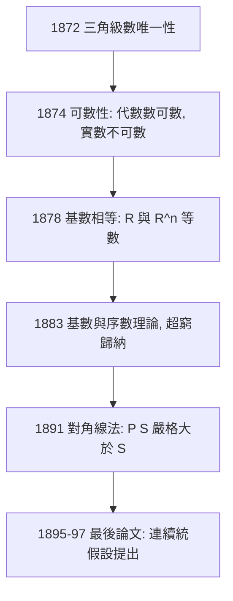

# 2.1 CANTOR的對角線與超窮數1874

## 本章導言

1874 年 11 月，Crelle 雜誌刊出一篇五頁的短文〈論實代數數集合的一個性質〉，作者 Georg Cantor。文中包含兩個結果：(1) 代數數可與自然數一一對應（可數）；(2) 實數不可與自然數一一對應。第一個結果革命性中等，第二個結果革命性徹底：**無窮有大小之分**。本節追蹤這一發現的來路——它不是哲學玄想，而是 Fourier 分析的一道技術習題的副產品——以及 Cantor 為證明它而發明的、後來成為整個邏輯學核心技術的**對角線法**。

### 從三角級數到集合論

Cantor 的原路是 Halle 大學的 Heine 教授指派的問題：**三角級數表示的唯一性**。若

$$
f(x) = a_0 + \sum_{n=1}^\infty (a_n \cos n\pi x + b_n \sin n\pi x)
$$

恆為零，係數是否全零？Cantor 1870 證明：全零。1871 推廣到「除有限個點外為零」。1872 推到「除某點集 $P$ 外為零」，其中 $P$ 必須是**可由導集構造生成**的集合（取極限點集 $P'$ 有限次）。為了處理「無窮多次導集」，他引入序型記號 $P^{(\infty)}$ ——**序數的種子**。

但這條路有個前提：這些例外點集「不會太多」。Cantor 1874 的論文正是為了證明某些集合「不會太多」（可數）、實數「太多」（不可數）而寫的。**分析學的精確化逼出了集合論**——這是「技術驅動理論」的教科書案例。

### 1874 論文的證明：不是對角線的不可數性

注意：1874 年的論文**沒有**用對角線法。其論證（針對閉區間 $[a,b]$ ）是區間套式：設實數可列為 $w_1, w_2, \dots$ 。任取子區間 $I_1 \subset [a,b]$ 不含 $w_1$ ；再取子子區間 $I_2 \subset I_1$ 不含 $w_1, w_2$ ；依此類推。閉區間套 $\overline{I_1} \supset \overline{I_2} \supset \cdots$ 有公共點 $w$ （完備性！）， $w$ 不等於任何 $w_n$ ——矛盾。

此證明用到的全是 1.2 節算術化的成果（區間套、完備性）。其哲學殺傷力在於：**「實數比自然數多」成為定理，而非哲學意見**。Kronecker 對此暴怒，稱 Cantor 為「青年腐化者」，阻止其發表。

### 對角線法：1891 的完美武器

1891 年 Cantor 在德國數學會首屆會議發表〈論一個集合論的基本問題〉，給出第二個、且是終極的證明——**對角線法**，並同時用來證明「集合之集合的基數嚴格遞增」。

**定理（Cantor 1891）**：設 $S$ 為任一集合，則不存在從 $S$ 到 $\mathcal{P}(S)$ 的滿射。

**證明**：設 $f: S \to \mathcal{P}(S)$ 為任一映射。定義

$$
D = \{x \in S : x \notin f(x)\}.
$$

$D \subseteq S$ ，故 $D \in \mathcal{P}(S)$ 。若 $D = f(d)$ ，問 $d \in D$ ？

- 若 $d \in D$ ，按定義 $d \notin f(d) = D$ ，矛盾。
- 若 $d \notin D$ ，按定義 $d \in f(d) = D$ ，矛盾。

故 $D \ne f(d)$ 對一切 $d$ 成立， $f$ 非滿射。 $\blacksquare$

以 $S = \mathbb{N}$ 特例化：設 $f: \mathbb{N} \to \mathcal{P}(\mathbb{N})$ ，第 $n$ 行是 $f(n)$ 的特徵序列；對角線處取反，即得漏網的子集。此構造的哲學含義：**「枚舉一切」的斷言，總可以透過「在第 $n$ 個處對付第 $n$ 個」被擊破**。它是一台反完備性機器。

### 超窮數的誕生：希臘禁令的解除

亞里士多德以來，主流立場是**潛無窮**（無窮只是「可以一直加下去」的過程，沒有「完成了的無窮」）。Cantor 的立場相反：無窮集是**完成的存在**（aktual-unendlich），且不只一個。1883 年《一般集合論基礎》中他系統建構：

- **序數** $\omega, \omega+1, \dots, \omega\cdot 2, \dots, \omega^2, \dots, \omega^\omega, \dots, \varepsilon_0, \dots$ ：計數「排隊方式」的無窮算術。
- **基數** $\aleph_0, 2^{\aleph_0}, 2^{2^{\aleph_0}}, \dots$ ：計數「多少」的無窮算術。

他為自己的異端辯護，搬出經院哲學的**絕對無限**（God 的無窮）與數學的**可傳遞無窮**之分：「前者拒斥一切確定，後者可被數學處理。」宗教與數學在他身上以奇特方式互相支撐——他深信超窮數是上帝思想的流露，並將連續統問題的解視為對神學的服務。

### 一個具體例子

**例題 2.1.1**：證明有理數集 $\mathbb{Q}$ 可數（Cantor 1878 的配對法），並明確寫出對應。

**解**：正有理數寫成既約分數 $p/q$ 。按 $p+q$ 的大小分層：

$$
\frac11;\quad \frac12, \frac21;\quad \frac13, \frac23, \frac31, \frac32;\quad \cdots
$$

（每層 $p+q = n$ 內按 $p$ 排序，跳過非既約者如 $\frac22$ 。）逐層串接得序列

$$
1, \tfrac12, 2, \tfrac13, 3, \tfrac23, \tfrac32, \tfrac13, \dots
$$

這個序列**窮盡所有正有理數且每個恰出現一次**，故 $\mathbb{Q}^+ \preceq \mathbb{N}$ ；顯然 $\mathbb{N} \subseteq \mathbb{Q}^+$ ，故 $\mathbb{N} \preceq \mathbb{Q}^+$ 。由 Schröder–Bernstein 定理（Cantor 1895/ Dedekind 版）， $\mathbb{Q}^+ \sim \mathbb{N}$ ，加上負有理數與零， $\mathbb{Q}$ 可數。 $\blacksquare$

**對照例題 2.1.2**：證明 $(0,1)$ 不可數（對角線法的實數版）。設 $(0,1)$ 可列為 $x_1, x_2, \dots$ ，寫出十進展開（避開以 $999\ldots$ 結尾的歧義），令 $d$ 的第 $n$ 位數字為 $x_n$ 的第 $n$ 位數字加一取模十。 $d \in (0,1)$ ，但 $d \ne x_n$ 對每個 $n$ （第 $n$ 位不同）。矛盾。

兩例的張力正是 Cantor 1878 的謎題：** $\mathbb{Q}$ 可數、 $\mathbb{R}$ 不可數，那 $\mathbb{R}$ 的「不可數程度」恰是 $\aleph_1$ ，還是更大？**——連續統假設（2.2 節）。

### 康托爾與神學界、數學界的雙重戰線

Cantor 的敵人不只在數學界。超窮數的「完成了的無窮」被某些神學家視為對上帝絕對無限的僭越。Cantor 與梵蒂岡的多明我會神學家 Gutberlet 長期通信辯護：**只有上帝的無窮是絕對的（inconsistens multitudinous，即後世的「真類」），數學的無窮是可傳遞的、安全的**。這場辯護意外地精確：「所有序數的全體」若視為集合會自爆（Burali-Forti 悖論，3.1 節）——Cantor 1899 年致 Dedekind 的信中已預見此點，比 Russell 早兩年。

### 歷史啟示

- **理論常由習題逼出**：集合論誕生自 Fourier 級數，正如複數誕生自三次方程——數學新對象從不是哲學首肯後才登場。
- **對角線法是「自我指涉」的生產性利用**：它使「枚舉一切」的失敗成為定理；同一招式將在 Gödel 不完備性（6.1 節）與停機問題（7.3 節）中再現。
- **無窮的分層迫使「集合」本身需要公理**：樸素的「任意性質定義集合」即將自爆（第 3 章）。

## 與其他章節及領域的關聯

- **1.2 節**：Cantor 的出發點是算術化運動中的三角級數問題。
- **2.2 節**：連續統假設與無窮階層的進一步展開。
- **3.1 節**：對角線法的自我指涉結構即羅素悖論的結構。
- **4.3 節**：序數、基數、累積層級的系統化。
- **6.1–6.2 節**：Gödel 不完備性是對角線法的算術化。
- **7.3 節**：停機問題是對角線法的計算化——程式的「可列舉性」與實數不可數遙相呼應。
- **計算機科學**： $|\mathcal{P}(\mathbb{N})| > \aleph_0$ 的直接推論是**不可計算函數的存在**：可計算函數只有可數多個，「多數」函數不可計算——計算的邊界由對角線法劃定。

## 練習

1. 證明代數數（整係數多項式的實根）可數：先證多項式可數，再證每個多項式只有有限多根。
2. 用 Schröder–Bernstein 定理證明 $(0,1) \sim \mathbb{R}$ （提示： $x \mapsto \tan(\pi x - \pi/2)$ 及嵌套夾逼）。
3. 寫出對角線構造在 $\mathbb{N}^\mathbb{N}$ （自然數列之集）上的版本，證明它不可數。
4. 證明：實數的任何可數子集都不能包含某閉區間（1874 論文的直接推論）。
5. 思考題：Cantor 的區間套證明依賴完備性，對角線證明不依賴。哪個證明「更深」？若改在雙曲幾何或有理數上問同樣問題，兩個證明的命運如何？

## 進階研讀：三個深化場景

**場景一：Cantor–Dedekind 通信（1872–1899）**。Dedekind 是 Cantor 最早的盟友，幫他修正「 $\mathbb{R} \sim \mathbb{R}^2$ 」的證明（1877，Cantor 自己驚呼「我看到了，但我不相信」）。1899 年信中 Cantor 首次區分集合與「絕對無限的全體」，成為 ZFC 真類概念的源頭。

**場景二：對角線法的資訊論解讀**。對角線構造實質是：若每個 $f(n)$ 可由有限描述索引，則構造一個在位置 $n$ 與 $f(n)$ 不同的對象。此模式即「**任何有限描述系統都有漏網之魚**」，在 Kolmogorov 複雜性中：可描述實數只有可數多，故存在不可壓縮的（Algorithmically random）實數——資訊理論中的對角線。

**場景三：康托爾的抑鬱症與數學爭論**。1884 年起 Cantor 多次陷入重度抑鬱，其時恰逢 Kronecker 的攻擊最烈。1913–1918 晚年病中仍持續數學通信。Poincaré 1908 年稱集合論為「某種病」，Hilbert 卻回應：「**無人能把我們從 Cantor 創造的天堂中驅逐出去**」——這句話成為二十世紀數學基礎研究的開場白（3.3 節）。

### 名詞速查表

- **可數**：與 $\mathbb{N}$ 之子集一一對應；**可數無窮**：與 $\mathbb{N}$ 對應。
- **對角線法**：以 $D = \{x : x \notin f(x)\}$ 擊破滿射假設的構造。
- ** $\aleph_0$ **：自然數的基數；** $2^{\aleph_0}$ **：連續統的基數。
- **導集 $P'$ **： $P$ 的極限點集，序數理論的搖籃。
- **潛／實無窮**：亞里士多德 vs Cantor 的無窮本體論。
- **絕對無限**：不可為集合的全體（真類），Cantor 神學護教的概念。

### 年表速查

- 1870–72：Cantor 三角級數唯一性定理。
- 1874：實數不可數（區間套證明）。
- 1877： $\mathbb{R} \sim \mathbb{R}^n$ 。
- 1878： $\mathbb{Q}$ 可數，配對法。
- 1883：《一般集合論基礎》，超窮數公開。
- 1891：對角線法。
- 1895–97：兩篇〈貢獻〉，連續統假設提出。
- 1899：致 Dedekind 信，預見 Burali-Forti 型悖論。
- 1918：Cantor 於哈勒精神病院去世。

### 深化問答三則

**問：對角線法與 1874 的區間套法本質差異為何？**
答：區間套法依賴實數的**拓撲完備性**，對角線法只用**集合成員關係**的純邏輯。前者把不可數性歸因於分析結構，後者顯示它是**純集合論事實**——這使對角線法能推廣到任意集合（Cantor 定理 $|S| < |\mathcal{P}(S)|$ ），威力天差地別。

**問：「完成了的無窮」在實用上有何必要性？**
答：沒有實無窮，就沒有「實數全體是集合」，微積分的極限理論退回 Cauchy 的曖昧；沒有超窮序數，就不能為遞迴定義排「步數」（超窮歸納），ZFC 的良序原則失效。**基礎的哲學直接決定數學可談什麼**——此例極端清晰。

**問：連續統假設為何對 Cantor 如此重要？**
答：它是超窮數理論「自洽且完備」的檢驗：若 $2^{\aleph_0}$ 不是 $\aleph_1$ ，序數與基數的對應就有斷層，整個階層圖像殘缺。Cantor 臨終未能解之；我們今日知道它既不可證也不可反證（8.2–8.3 節）——他的問題比他的一生更有生命力。

（本節完）
